# Java Interview Questions and Examples

A chapter-wise study guide built from the 17 distinct supplied PDFs, including the 31-section Java - OOPs Merged 3.pdf and the two Stream API exercise sets. Repeated questions are consolidated into topic-based answers. Examples and explanations have been rewritten for readability, with corrections to misleading statements in the source material.

**Scope:** Core Java fundamentals through advanced scenarios, JVM memory, collections, Java 8 functional programming, concurrency, design patterns, modern language features, and all 42 numbered exercises across the two Stream API PDFs. Your follow-up questions add race-condition/deadlock scenarios, a detailed locking comparison, and native-executable deployment on AWS.

**Java baseline:** Most examples use Java 8 syntax. Examples using Java 9, 11, 16, 17, or 21 features are labeled. The version chapter describes those releases specifically. Code blocks are independent examples or snippets, so reuse names freely when trying them separately.

## Contents

1. [Java, JDK, JRE, and JVM](#chapter-01)
2. [Types, wrappers, equality, and argument passing](#chapter-02)
3. [Classes, constructors, packages, and access](#chapter-03)
4. [Object-oriented programming](#chapter-04)
5. [Overloading, overriding, and dispatch](#chapter-05)
6. [Static, final, this, and super](#chapter-06)
7. [Strings and immutability](#chapter-07)
8. [Exceptions and resource management](#chapter-08)
9. [Generics, enums, and nested classes](#chapter-09)
10. [Collections and iteration](#chapter-10)
11. [Maps, hashing, equality, and caches](#chapter-11)
12. [Sorting and priority queues](#chapter-12)
13. [Lambdas and functional interfaces](#chapter-13)
14. [Streams, collectors, Optional, and date/time](#chapter-14)
15. [Threads, synchronization, and the memory model](#chapter-15)
16. [Thread communication and concurrency utilities](#chapter-16)
17. [Executors, futures, and cancellation](#chapter-17)
18. [JVM memory, garbage collection, and diagnostics](#chapter-18)
19. [Serialization and copying](#chapter-19)
20. [Reflection, annotations, class loaders, and modules](#chapter-20)
21. [Design patterns and SOLID](#chapter-21)
22. [Java versions, records, and sealed classes](#chapter-22)
23. [Advanced interview scenarios](#chapter-23)
24. [Stream coding exercises, Level I](#chapter-24)
25. [Stream coding exercises, Level II](#chapter-25)
26. [Your concurrency questions with scenarios and diagrams](#chapter-26)
27. [Java locking mechanisms, advantages, and tradeoffs](#chapter-27)
28. [Deploying a JAR with a native executable on AWS](#chapter-28)
29. [Variables, numeric representation, arrays, and operators](#chapter-29)
30. [Methods, constructors, initialization, and control flow](#chapter-30)
31. [OOP design, relationships, and real-world modeling](#chapter-31)
32. [Class forms, nested types, enums, POJOs, and immutability](#chapter-32)
33. [Generics, variance, bounds, raw types, and erasure](#chapter-33)
34. [Interface evolution and functional contracts](#chapter-34)
35. [Reflection and annotations in frameworks](#chapter-35)
36. [Collection APIs, views, queues, deques, and iteration](#chapter-36)
37. [Map, set, navigation, ordering, and key contracts](#chapter-37)
38. [Stream execution, collectors, and parallel correctness](#chapter-38)
39. [Process memory, garbage collection, and thread lifecycle](#chapter-39)
40. [Atomic variables, CAS, ABA, and publication](#chapter-40)
41. [Thread-pool sizing, factories, rejection, and fork/join](#chapter-41)
42. [Futures, async composition, scheduling, and scoped thread state](#chapter-42)
43. [Shallow copy, deep copy, aliasing, and defensive snapshots](#chapter-43)
44. [JDK circles, inheritance forms, and all four OOP pillars](#chapter-44)
45. [Static initialization, access scenarios, and constructor reasoning](#chapter-45)
46. [String equality laboratory and text API tables](#chapter-46)
47. [Exception hierarchy and complete handling scenarios](#chapter-47)
48. [Collection hierarchy and method-by-method reference](#chapter-48)
49. [Stream method catalog, intermediate and terminal operations](#chapter-49)
50. [Thread methods and virtual-thread version guide](#chapter-50)
51. [More lambda interview questions and execution puzzles](#chapter-51)
52. [In-depth memory walkthrough from the PDF](#chapter-52)
53. [PDF technical-figure atlas with interview questions](#chapter-53)
54. [Java 17 syntax and interview questions in your requested sequence](#chapter-54)
55. [Lombok: ten feature groups, generated code, and interview traps](#chapter-55)
56. [Java 21 sequenced collections and the new hierarchy](#chapter-56)
57. [Java 17 sealed classes and controlled inheritance](#chapter-57)
58. [Java 14 switch expressions, yield, and scope](#chapter-58)
59. [Java 16 pattern matching for instanceof](#chapter-59)
60. [Java 21 pattern matching for switch](#chapter-60)
61. [Java 16 records: headers, constructors, nesting, and Lombok comparison](#chapter-61)
62. [Java 15 text blocks, whitespace, escapes, and output puzzles](#chapter-62)
63. [Optional from Java 8 to 11: every method and practical composition](#chapter-63)
64. [Traditional file I/O: streams, decorators, encodings, and resources](#chapter-64)
65. [NIO Part 1: channels, direct memory, zero-copy, and mapping](#chapter-65)
66. [NIO Part 2: ByteBuffer, typed views, and state transitions](#chapter-66)
67. [NIO Part 3: FileChannel use cases and complete code](#chapter-67)
68. [Source coverage and technical references](#chapter-68)

**Requested revision path:** [JDK circles and inheritance](#chapter-44), [static/access/constructors](#chapter-45), [String equality](#chapter-46), [exceptions](#chapter-47), [collection tables](#chapter-48), [stream tables](#chapter-49), [thread tables and virtual threads](#chapter-50), [lambda questions](#chapter-51), [memory walkthrough](#chapter-52), [PDF figures](#chapter-53), and [your 17-topic syntax sequence](#chapter-54).

**New PDF/video revision:** [Lombok](#chapter-55), [sequenced collections](#chapter-56), [sealed types](#chapter-57), [Java 14 switch](#chapter-58), [instanceof patterns](#chapter-59), [Java 21 pattern switch](#chapter-60), [records](#chapter-61), [text blocks](#chapter-62), [Optional](#chapter-63), [traditional I/O](#chapter-64), [NIO memory model](#chapter-65), [buffers](#chapter-66), and [FileChannel examples](#chapter-67). These sections use the nine newly supplied PDFs and your video chapter outlines. Video transcripts were unavailable. Original examples and primary API references supply the detailed explanations.

## How to use the examples

For a snippet containing statements, put those statements inside `main`. Put supporting methods and nested types inside the enclosing class, outside `main`.

```java
import java.util.*;
import java.util.concurrent.*;
import java.util.concurrent.atomic.*;
import java.util.concurrent.locks.*;
import java.util.function.*;
import java.util.stream.*;
import java.time.*;
import java.io.*;

public class Main {
    public static void main(String[] args) throws Exception {
        // Paste statement snippets here.
    }
    // Paste helper methods and nested types here.
}
```

Save as `Main.java`, then run `javac Main.java` followed by `java Main`. Package declarations, top-level public classes, and module declarations have their own file placement rules, explained where used. Diagrams use Mermaid and render in GitHub or another Mermaid-enabled Markdown viewer. The nested-circle SVG and original PDF figures are in the accompanying assets folder. Extract the complete ZIP and keep README.md beside assets so its image links work. Code comments show expected results. Unspecified collection order and concurrent output are identified explicitly.

<a id="chapter-01"></a>
## Chapter 01 - Java, JDK, JRE, and JVM

Java execution combines class loading, runtime memory, and execution services.

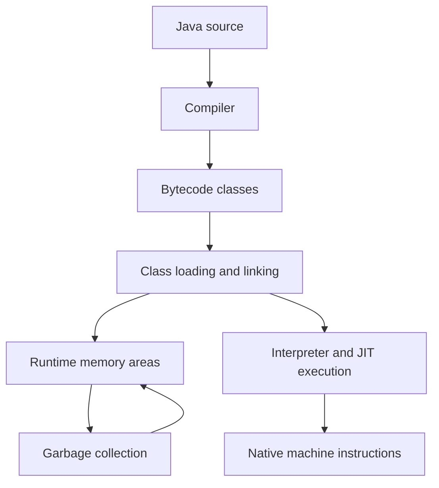

### Q1. What is Java, and what are its main features?

Java is a statically typed language with classes, interfaces, exceptions, generics, concurrency support, and automatic memory management. Java source usually compiles to bytecode, which a compatible JVM executes. Its standard libraries and runtime support applications on many operating systems.

Java includes primitive types such as `int` and `boolean`, so interviewers often describe it as not purely object-oriented. Primitive operations can avoid the allocation and indirection associated with wrapper objects.

### Q2. How do JDK, JRE, and JVM differ?

| Term | Purpose | Examples |
| --- | --- | --- |
| JVM | Executes bytecode and manages runtime execution | Class loading, JIT compilation, GC |
| JRE | Runtime concept including JVM and runtime libraries | Components required to run an application |
| JDK | Development kit including runtime capabilities and tools | `javac`, `java`, `jar`, `jcmd` |

Modern JDK distributions need not contain a separate `jre/` directory. An application can ship a runtime image built with `jlink`, so the user need not install a separate system JRE. Conventional JVM bytecode execution still needs a compatible runtime.

```bash
javac Main.java
java Main
jar --create --file app.jar --main-class Main Main.class
java -jar app.jar
```

The `jar --create` long-option syntax requires Java 9+. A real package must include all necessary application classes and its dependency strategy.

### Q3. What are the major JVM components?

The class-loading subsystem finds and defines classes. Runtime data areas hold stacks, heap objects, class information, and execution state. The execution engine interprets bytecode and may compile frequently executed code to machine code. The runtime also supplies GC and native interoperation.

### Q4. What does `public static void main(String[] args)` mean?

For the conventional Java 8-21 entry point, `public` makes the method accessible, `static` allows invocation without an instance, `void` means no return value, and `String[] args` contains command-line arguments. `String... args` is also valid.

```java
public class Main {
    public static void main(String[] args) {
        System.out.println(args.length);
    }
    public static void main(int value) { // An ordinary overload.
        System.out.println(value);
    }
}
```

`java Main hello` prints `1`. The launcher selects its supported entry-point signature. It does not select `main(int)`. A subclass can hide a static `main`, while runtime overriding applies to instance methods. Java 21 has preview alternatives to the conventional entry point, outside this guide's examples.

### Q5. Is Java always platform-independent?

Bytecode portability requires compatible runtime versions and dependencies. JNI libraries, executable files, OS paths, and operating-system APIs can create platform requirements. Bytecode produced for a newer Java release normally cannot run on an older JVM. Use `javac --release` when targeting an earlier supported release.

[Back to contents](#contents)

<a id="chapter-02"></a>
## Chapter 02 - Types, wrappers, equality, and argument passing

### Q1. How do primitive and reference types differ?

Primitives store values such as numbers and booleans. Reference variables hold references to objects or `null`. Java has eight primitive types: `byte`, `short`, `int`, `long`, `float`, `double`, `char`, and `boolean`.

Fields receive default values, including `0`, `false`, and `null`. Local variables must be definitely assigned before use. A primitive variable cannot hold `null`.

```java
int count = 10;
Integer optionalCount = null;
String name = "Shivam";
```

Java references provide controlled object access. Java source has no general pointer arithmetic or address-of operator.

### Q2. What are wrapper classes, autoboxing, and unboxing?

Wrappers represent primitive values as objects, which allows their use in generic collections and nullable APIs. Examples include `Integer`, `Long`, `Double`, and `Boolean`.

```java
Integer boxed = 10;                   // Autoboxing.
int value = boxed;                    // Unboxing.
int parsed = Integer.parseInt("42"); // Returns int.
Integer object = Integer.valueOf("42"); // Returns Integer.
List<Integer> values = Arrays.asList(1, 2, 3);
```

Built-in primitive wrapper classes are immutable. Unboxing `null` throws `NullPointerException`. Use primitive types where their value and null semantics fit.

### Q3. What is the difference between `==` and `equals()`?

For primitive operands, `==` compares values after applicable conversions. For two reference operands, `==` checks identity. `equals()` follows the class's equality implementation. `Object.equals()` itself uses identity, while `String.equals()` compares text.

```java
String first = new String("java");
String second = new String("java");
System.out.println(first == second);      // false
System.out.println(first.equals(second)); // true
System.out.println(Objects.equals(null, second)); // false

Integer x = 1000;
Integer y = 1000;
System.out.println(x.equals(y)); // true
// x == y depends on identity and caching. Use equals for wrapper values.
```

Small boxed integers can share cached objects, which makes identity comparisons appear to work for some values. Do not base numeric wrapper equality on that behavior.

### Q4. Is Java pass-by-value or pass-by-reference?

Java always passes arguments by value. For an object argument, the copied value is its reference. The method can modify a shared mutable object, while assigning the parameter to another object only changes the local reference.

```java
static class Box {
    int value = 10;
}
static void changePrimitive(int value) {
    value = 11;
}
static Integer increment(Integer value) {
    return value + 1;
}
static void mutate(Box box) {
    box.value++;
}
static void replace(Box box) {
    box = new Box();
    box.value = 99;
}
```

```java
int number = 10;
changePrimitive(number);
System.out.println(number); // 10

Integer wrapped = 10;
wrapped = increment(wrapped);
System.out.println(wrapped); // 11

Box box = new Box();
mutate(box);
replace(box);
System.out.println(box.value); // 11
```

### Q5. What happens when a method increments an `Integer` parameter?

`value++` unboxes, adds one, and boxes the result. It assigns the result to the local parameter. The caller sees an update only if it receives and assigns a returned value, or if a shared mutable holder is changed.

[Back to contents](#contents)

<a id="chapter-03"></a>
## Chapter 03 - Classes, constructors, packages, and access

### Q1. What is the relationship between a class and an object?

A class defines state and behavior. An object is an instance. An empty class is valid and still inherits applicable `Object` behavior.

```java
static class Student {
    private final String name;
    Student(String name) {
        this.name = Objects.requireNonNull(name);
    }
    String name() {
        return name;
    }
}
// Inside main:
Student student = new Student("Shivam");
System.out.println(student.name()); // Shivam
```

Objects can be created with `new`, factory methods, reflection, copying facilities, or deserialization. The exact construction behavior differs. A factory can return an existing instance, and cloning does not invoke ordinary constructors.

### Q2. What are constructors? Can they be overloaded or private?

Constructors initialize instances and have the class name with no return type. Overloads provide different parameter lists. Private constructors control construction, as in factories and singletons. Constructors are not inherited or overridden.

```java
static class User {
    private final String name;
    User() {
        this("Guest");
    }
    User(String name) {
        this.name = name;
    }
}
```

In the Java 8-21 baseline, an explicit `this(...)` or `super(...)` constructor invocation is the first statement. If no constructor is declared, the compiler supplies a default constructor, subject to superclass-constructor accessibility.

### Q3. What do the access modifiers mean?

| Access | Same class | Same package | Subclass in another package | Unrelated other package |
| --- | --- | --- | --- | --- |
| `private` | Yes | No | No | No |
| Package-private | Yes | Yes | No | No |
| `protected` | Yes | Yes | Yes, with subclass access restrictions | No |
| `public` | Yes | Yes | Yes | Yes |

For `protected` instance members across packages, access must satisfy Java's subclass and receiver restrictions. Module exports can impose additional constraints. Top-level classes support `public` or package-private access. Member classes can also be private or protected.

### Q4. Why use encapsulation instead of public mutable fields?

Methods can enforce invariants and let representation change without changing callers. Getters and setters are useful when they represent valid operations. A setter for every field can still expose invalid state transitions.

```java
static class Account {
    private long balance;
    void deposit(long amount) {
        if (amount <= 0) {
            throw new IllegalArgumentException("Amount must be positive");
        }
        balance = Math.addExact(balance, amount);
    }
    long balance() {
        return balance;
    }
}
```

### Q5. What do packages and imports do?

Packages organize types and define package access boundaries. Imports resolve source-level names. Importing a class does not itself force runtime class loading. Static imports permit short names for static members.

```java
java.util.Date legacyDate = new java.util.Date();
java.sql.Date sqlDate = java.sql.Date.valueOf("2025-01-01");
```

Use qualified names when simple names conflict. To expose behavior from a package-private implementation, provide an accessible public interface or facade. A subpackage is a different package for access control.

[Back to contents](#contents)

<a id="chapter-04"></a>
## Chapter 04 - Object-oriented programming

### Q1. What are the four common OOP principles?

| Principle | Meaning | Java example |
| --- | --- | --- |
| Encapsulation | Control access to state and preserve invariants | Private balance with `deposit` |
| Abstraction | Expose a useful contract | `List`, `PaymentMethod` |
| Inheritance | Derive a subtype from a parent | `Dog extends Animal` |
| Polymorphism | Use different implementations through one type | Call `pay` through an interface |

```java
interface PaymentMethod {
    void pay(long amount);
}
static class CardPayment implements PaymentMethod {
    @Override
    public void pay(long amount) {
        System.out.println("Card payment " + amount);
    }
}
static class Checkout {
    private final PaymentMethod payment;
    Checkout(PaymentMethod payment) {
        this.payment = payment;
    }
    void complete(long amount) {
        payment.pay(amount);
    }
}
```

`new Checkout(new CardPayment()).complete(500)` uses composition, abstraction, and runtime polymorphism.

### Q2. How do interface and abstract class differ?

| Feature | Interface | Abstract class |
| --- | --- | --- |
| Main use | A contract across implementations | Shared state and behavior in a hierarchy |
| Instance fields | None | Allowed |
| Constructors | None | Allowed |
| Implemented methods | Default/static since Java 8, private helpers since Java 9 | Allowed |
| Inheritance | Class can implement several interfaces | Class extends one superclass |
| Fields | Implicitly public static final | Normal field rules |

An abstract class cannot be instantiated directly. A concrete subclass must implement inherited abstract methods. A class that declares an abstract method must itself be abstract.

### Q3. Why does Java allow only one direct superclass?

Single class inheritance simplifies inherited state and implementation conflicts. A class can implement multiple interfaces. A class cannot extend itself or participate in a cyclic inheritance chain.

### Q4. How do default-method conflicts get resolved?

An applicable concrete superclass method takes precedence over an interface default. A more specific interface default takes precedence over a less specific one. Unrelated competing defaults require an explicit override.

```java
interface Left {
    default String label() { return "left"; }
}
interface Right {
    default String label() { return "right"; }
}
static class Choice implements Left, Right {
    @Override
    public String label() {
        return Left.super.label();
    }
}
```

Default methods support interface evolution, but new defaults can introduce conflicts. Interface static methods are called on the interface, such as `Comparator.comparing(...)`, and do not participate in instance overriding.

### Q5. How do association, aggregation, and composition differ?

Association is a general relationship. Aggregation models parts with independent lifetimes, such as players on a team. Composition models stronger ownership, such as line items owned by an order. Java references do not enforce these lifetime semantics automatically.

Inheritance describes an **is-a** relationship. Composition describes a **has-a** relationship and allows behavior to be supplied through fields, as in `Checkout` above.

[Back to contents](#contents)

<a id="chapter-05"></a>
## Chapter 05 - Overloading, overriding, and dispatch

### Q1. How do overloading and overriding differ?

| Property | Overloading | Overriding |
| --- | --- | --- |
| Signature | Same name, different parameter lists | Same instance method signature or compatible subsignature |
| Selection | Compile time | Runtime implementation dispatch |
| Return type alone sufficient? | No | Must be compatible, including covariant reference returns |
| Static methods | Can be overloaded | Can be hidden |

Overriding cannot narrow access or broaden checked exceptions beyond the overridden contract. Private methods are not inherited for overriding. Final methods cannot be overridden. `@Override` asks the compiler to verify the relationship.

### Q2. How does Java choose an overloaded method?

Selection uses compile-time argument types and applicable-method rules, with phases for strict invocation, boxing/unboxing, and varargs. The most specific applicable overload wins. Some calls are ambiguous, such as `method(null)` when unrelated reference overloads apply.

```java
static void print(Object value) { System.out.println("Object"); }
static void print(String value) { System.out.println("String"); }

// Inside main:
Object value = "hello";
print(value);     // Object
print("hello"); // String
```

### Q3. What happens when overloading and overriding are combined?

First determine the signature at compile time. Then dispatch an instance method to the runtime implementation of that signature.

```java
static class Parent {
    void show(Object value) { System.out.println("Parent Object"); }
}
static class Child extends Parent {
    @Override
    void show(Object value) { System.out.println("Child Object"); }
    void show(String value) { System.out.println("Child String"); }
}
// Inside main:
Parent reference = new Child();
reference.show("hello"); // Child Object
```

`Parent` exposes `show(Object)`. Runtime dispatch selects the child's override of that method.

[Back to contents](#contents)

<a id="chapter-06"></a>
## Chapter 06 - Static, final, this, and super

### Q1. What does `static` mean?

Static members belong to a class identity, which includes its defining class loader. Instance members belong to objects. A static method can access instance members through an explicit object reference.

```java
static class Counter {
    static int created;
    int value;
    Counter() { created++; }
    static int valueOf(Counter counter) {
        return counter.value;
    }
}
```

An instance synchronized method locks its receiver. A static synchronized method locks the declaring class's `Class` object. These are separate locks.

### Q2. When does a static initializer run?

A static initializer runs during class initialization, before the first relevant active use. Loading a class and initializing it are separate operations. Initializers can print when another entry point or test causes initialization, even if that class has no `main`.

If initialization fails with an ordinary exception, callers generally receive `ExceptionInInitializerError`. A thrown `Error` can propagate directly. Later attempts to use the erroneous class can produce `NoClassDefFoundError`. Checked exceptions must be handled within a static initializer, and an initializer must be able to complete normally at compile time.

### Q3. What does `final` mean for variables, methods, and classes?

A final variable can be assigned once. A final method cannot be overridden. A final class cannot be extended. A final reference can point to a mutable object.

```java
final List<String> names = new ArrayList<>();
names.add("Shivam"); // Allowed.
// names = new ArrayList<>(); // Compile-time error.
```

Final fields have special initialization-safety guarantees when objects are constructed correctly. Making a reference final does not synchronize changes to the object it points to. Use `final` to express design intent, and measure performance independently.

### Q4. How are `this` and `super` used?

`this` denotes the current receiver. `super` selects accessible superclass members or invokes its constructor. They require an instance context and cannot be assigned new values. Ordinary classes implicitly extend `Object` when no superclass is declared.

```java
static class Parent {
    String label() { return "parent"; }
}
static class Child extends Parent {
    private final String name;
    Child(String name) { this.name = name; }
    @Override
    String label() { return super.label() + ": " + this.name; }
}
```

[Back to contents](#contents)

<a id="chapter-07"></a>
## Chapter 07 - Strings and immutability

### Q1. What is the string pool?

String literals and constant string expressions are interned. `intern()` obtains a canonical reference for an equal string. Creating a string at runtime does not automatically intern every new instance.

```java
String first = "java";
String second = "ja" + "va";
String third = new String("java");
System.out.println(first == second);         // true
System.out.println(first == third);          // false
System.out.println(first == third.intern()); // true
```

Explicitly interning large amounts of unique external text can add overhead and retention pressure. In HotSpot, the pool's strings reside in the heap. String representation is implementation-specific. Java 8 HotSpot commonly uses `char[]`, while compact strings in Java 9+ HotSpot commonly use a `byte[]` plus an encoding marker.

### Q2. How do String, StringBuilder, and StringBuffer differ?

| Type | Mutable? | Synchronization | Typical use |
| --- | --- | --- | --- |
| `String` | No | Immutable values can be shared | Text values and keys |
| `StringBuilder` | Yes | No built-in synchronization | Local repeated text building |
| `StringBuffer` | Yes | Individual methods synchronized | Legacy shared mutable text |

```java
StringBuilder result = new StringBuilder();
for (int i = 1; i <= 3; i++) {
    result.append(i);
}
System.out.println(result); // 123
System.out.println(String.join(", ", "Java", "SQL")); // Java, SQL
```

Multiple `StringBuffer` calls do not automatically form one atomic operation. Shared log construction usually works better with separate local builders and a suitable logging system.

### Q3. How do you design an immutable class?

Keep state private, initialize it fully, prevent uncontrolled subclass mutation, expose no mutators, and copy mutable inputs and outputs. Final fields alone are insufficient if they refer to mutable state.

```java
static final class Profile {
    private final List<String> roles;
    Profile(List<String> roles) {
        this.roles = Collections.unmodifiableList(new ArrayList<>(roles));
    }
    List<String> roles() {
        return roles;
    }
}
```

This copies the container. Mutable elements would require their own treatment. Immutable objects simplify sharing, equality, caching, and use as map keys.

[Back to contents](#contents)

<a id="chapter-08"></a>
## Chapter 08 - Exceptions and resource management

An exception changes the control-flow path, while finally normally participates in both successful and exceptional completion.

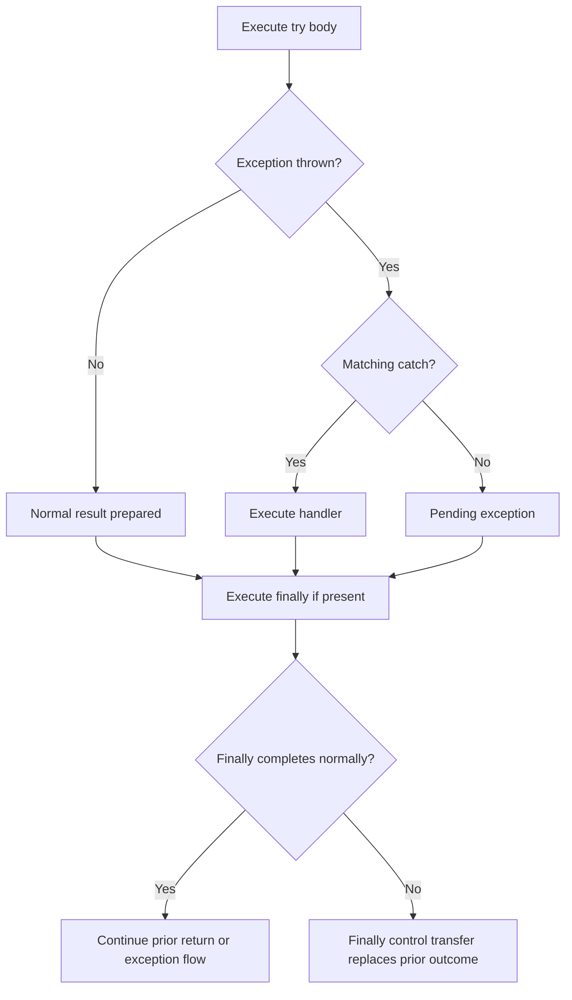

This diagram assumes execution reaches stack unwinding. Process termination and non-terminating code are covered in Q3.

### Q1. How do Throwable, Exception, and Error differ?

`Throwable` is the base type for thrown conditions. `Exception` includes checked exceptions and `RuntimeException`. `Error` represents serious runtime or linkage conditions. Runtime exceptions, errors, and their subclasses are unchecked. Other throwable types are checked.

```java
static String readFirstLine(String path) throws IOException {
    try (BufferedReader reader = new BufferedReader(new FileReader(path))) {
        return reader.readLine();
    }
}
```

A checked exception forces a catch or declaration. Use one when explicit caller handling fits the API. Use an unchecked exception for invalid arguments, violated invariants, or other cases where forced declarations are inappropriate.

### Q2. What do try, catch, finally, throw, and throws do?

`try` encloses an operation, `catch` handles a matching condition, and `finally` runs during normal completion or stack unwinding. `throw` throws an object, while `throws` declares checked exceptions that can escape a method.

A `try` can have catches, a finally block, or a resource specification as required by its syntax. A single `try` has at most one `finally`. Nested tries can each have one.

```java
try {
    int value = Integer.parseInt("bad");
    System.out.println(value);
} catch (NumberFormatException exception) {
    System.out.println("Invalid number");
} finally {
    System.out.println("Finished");
}
```

### Q3. Does finally run after return?

Normally yes. The return expression is evaluated first, then `finally` runs. A return or throw in `finally` can replace the original result or failure, so avoid those control transfers in cleanup.

```java
static int calculate() {
    int value = 10;
    try {
        return value;
    } finally {
        value = 20;
    }
}
// calculate() returns 10.
```

Finally execution can be prevented by process termination, `Runtime.halt`, a JVM crash, or control that never exits the try. `System.exit` normally terminates without unwinding these blocks.

### Q4. Why use try-with-resources?

It closes `AutoCloseable` resources in reverse declaration order. If the body and closing both throw, the body failure stays primary and close failures are suppressed. Use `getSuppressed()` to inspect them.

```java
try (InputStream input = new FileInputStream("input.txt")) {
    System.out.println(input.read());
} catch (IOException exception) {
    System.out.println(exception.getMessage());
}
```

A multi-catch uses `catch (IOException | SQLException exception)` when both checked types can arise from the try. Alternatives cannot have a subtype relationship.

### Q5. How do final, finally, and finalize differ?

`final` constrains assignment or inheritance. `finally` is control flow for cleanup. `finalize()` is a legacy object finalization hook with unpredictable execution and deprecated-for-removal status from Java 18. Use explicit ownership and try-with-resources for resource cleanup.

### Q6. When are custom exceptions useful?

Use a named exception when callers need a meaningful domain failure and its associated context. Preserve causes when translating lower-level failures.

```java
static class OrderRejectedException extends RuntimeException {
    OrderRejectedException(String message, Throwable cause) {
        super(message, cause);
    }
}
```

Catching `Throwable` also catches `Error` and can hide serious failures. Catch specific exceptions you can handle. Exception creation and stack traces cost work, so avoid exceptions as ordinary loop control.

[Back to contents](#contents)

<a id="chapter-09"></a>
## Chapter 09 - Generics, enums, and nested classes

### Q1. Why use generics? What is type erasure?

Generics give compile-time type checking and reusable algorithms. Java generally erases type parameters to bounds or `Object`, adding casts and bridge methods where required. Consequently, `List<String>` and `List<Integer>` use the same runtime list class.

```java
static <T> T first(List<T> values) {
    if (values.isEmpty()) {
        throw new IllegalArgumentException("List is empty");
    }
    return values.get(0);
}
List<String> names = new ArrayList<>(); // Diamond operator infers String.
```

Generic type inference derives type arguments from the surrounding call and target context. Generic type parameters cannot be primitives. `new T()` and `instanceof List<String>` are unavailable in ordinary generic code because `T` and the concrete type argument are not reified that way.

### Q2. Why is `new List<String>[10]` illegal?

Arrays are reified and check their component type at runtime. Generic type arguments are erased, so that creation cannot maintain the expected runtime checks. Prefer `List<List<String>>`. Some reifiable array types, such as `List<?>[]`, are allowed.

### Q3. What does PECS mean?

Use `? extends T` when reading values as `T`, and `? super T` when writing values of type `T`. It means producer extends, consumer super.

```java
static void copyNumbers(List<? extends Number> source,
                        List<? super Number> destination) {
    for (Number number : source) {
        destination.add(number);
    }
}
```

### Q4. What are enums, and can they extend a class?

Enums define named instances of one type. They can have fields, constructors, methods, and interface implementations. They implicitly extend `Enum<E>` and cannot extend another class.

```java
enum Status {
    PENDING, SUCCESS, FAILED
}
for (Status status : Status.values()) {
    System.out.println(status.name());
}
```

The declaration `Enum<E extends Enum<E>>` expresses a self-referential bound that helps keep enum operations type-specific. `Enum<?>` denotes an enum value with an unknown concrete enum type. `EnumSet` and `EnumMap` are useful specialized collections.

### Q5. How do member, static nested, local, and anonymous classes differ?

A non-static member inner class has an enclosing-instance relationship. A static nested class has no implicit enclosing instance. A local class is declared within a block. An anonymous class is declared and instantiated together, often for a one-off implementation.

```java
Runnable task = new Runnable() {
    @Override
    public void run() {
        System.out.println("Running");
    }
};
```

Java 16 relaxed restrictions so inner classes may declare static members. On Java 8, inner-class static declarations are restricted to constant variables. A long-lived inner object can retain its enclosing instance.

### Q6. What is a marker interface?

A marker interface declares a type-level capability without methods. `Serializable` and `Cloneable` are examples with special platform behavior. A custom marker matters only if application code or a framework checks for it. An annotation can be a better fit for metadata that does not need a type relationship.

[Back to contents](#contents)

<a id="chapter-10"></a>
## Chapter 10 - Collections and iteration

### Q1. What are the main collection interfaces?

`Collection` is the common interface for groups of elements. Its major subinterfaces include `List`, `Set`, and `Queue`. `Deque` supports operations at both ends. `Map` represents key-value associations and is a separate hierarchy.

Common collection operations include `size`, `isEmpty`, `contains`, `iterator`, and optional mutations such as `add`, `remove`, and `clear`. Some implementations reject mutation with `UnsupportedOperationException`.

| Type | Order and duplicates | Main use |
| --- | --- | --- |
| `ArrayList` | Index order, duplicates allowed | General lists and indexed access |
| `LinkedList` | Index order, duplicates allowed | A list/deque with node-based storage |
| `ArrayDeque` | Deque order | Stack and queue operations |
| `HashSet` | No guaranteed encounter order | Unique values and membership |
| `LinkedHashSet` | Insertion order | Unique values with stable iteration |
| `TreeSet` | Sorted order | Unique sorted values and range queries |
| `PriorityQueue` | Head follows priority | Repeatedly retrieve the smallest/highest-priority item |

### Q2. How do ArrayList and LinkedList compare?

`ArrayList` uses a resizable backing array. Indexed reads are O(1), appending is amortized O(1), and middle insertion/removal usually shifts O(n) elements. `LinkedList` uses doubly linked nodes. Index lookup is O(n). End operations or insertion/removal at a known iterator position can be O(1).

Finding a middle position in a linked list is still O(n). Its per-node allocation and poor locality can matter. `ArrayDeque` is often a suitable queue implementation.

```java
List<String> names = new ArrayList<>(100); // Capacity, initial size is still 0.
Deque<String> queue = new ArrayDeque<>();
queue.addLast("first");
queue.addLast("second");
System.out.println(queue.removeFirst()); // first
```

Choose initial capacity from a realistic estimate. Too small can cause repeated growth; too large retains unused storage.

### Q3. How do Iterator and ListIterator differ?

`Iterator` traverses forward and can support removal. `ListIterator` traverses in both directions and can support adding or replacing list elements.

```java
List<Integer> numbers = new ArrayList<>(Arrays.asList(1, 2, 3, 4));
Iterator<Integer> iterator = numbers.iterator();
while (iterator.hasNext()) {
    if (iterator.next() % 2 == 0) {
        iterator.remove();
    }
}
System.out.println(numbers); // [1, 3]
```

### Q4. What causes ConcurrentModificationException?

A fail-fast iterator can detect structural modifications made outside its permitted protocol. This can happen in a single thread. Detection is best effort and provides no synchronization guarantee.

Use `Iterator.remove`, `removeIf`, or build a separate result for single-threaded filtering. For shared data, choose a synchronization or concurrent-collection strategy appropriate to the whole operation.

```java
List<Integer> values = new ArrayList<>(Arrays.asList(1, 2, 3, 4));
values.removeIf(value -> value % 2 == 0);
System.out.println(values); // [1, 3]
```

### Q5. How do synchronized and concurrent collections differ?

`Collections.synchronizedList` and `synchronizedMap` synchronize individual operations on a common monitor. Iteration and multi-step operations still need synchronization on that same wrapper. Concurrent collections use concurrency-specific designs.

```java
List<String> shared = Collections.synchronizedList(new ArrayList<>());
synchronized (shared) {
    for (String value : shared) {
        System.out.println(value);
    }
}
```

`CopyOnWriteArrayList` iterators see a snapshot backed by an existing array. Mutations copy the array, so this suits read-heavy, infrequently updated lists. `ConcurrentHashMap` iterators are weakly consistent and can reflect some concurrent changes.

### Q6. What collection features did Java 8 add?

Notable additions include `stream`, `parallelStream`, `removeIf`, `forEach`, `List.sort`, `replaceAll`, and map operations such as `computeIfAbsent` and `merge`. These methods have interface-specific contracts. A default method on an arbitrary map does not imply atomic concurrency behavior.

[Back to contents](#contents)

<a id="chapter-11"></a>
## Chapter 11 - Maps, hashing, equality, and caches

Different keys can reach the same bucket. Candidate entries still need identity/equality checks.

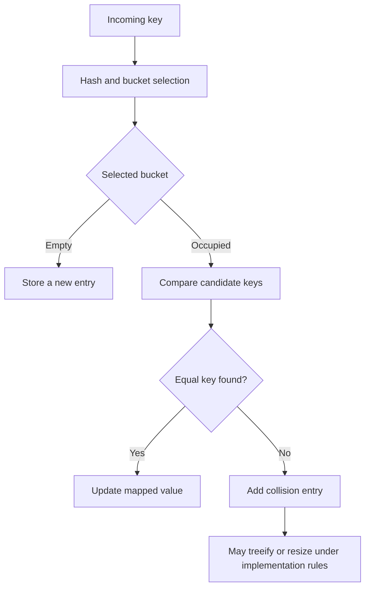

### Q1. How does HashMap work?

A `HashMap` uses an array of buckets. It derives a bucket from the key's hash, then compares candidate keys using identity or equality. Collisions place multiple entries in a bucket. Resizing redistributes entries as capacity changes.

In the usual OpenJDK Java 8+ implementation, crowded bins can become balanced trees. Common thresholds are 8 for treeification and a minimum table capacity of 64. A small table generally resizes first. These are implementation details, while the API contract describes behavior callers can rely on.

### Q2. What is the equals/hashCode contract?

Equal objects must have equal hash codes. Unequal objects may share a hash code. Equality should be reflexive, symmetric, transitive, consistent, and false for `null`. Keep equality-related state stable while an object is a key.

```java
static final class UserId {
    private final long value;
    UserId(long value) { this.value = value; }
    @Override
    public boolean equals(Object other) {
        if (this == other) return true;
        if (!(other instanceof UserId)) return false;
        return value == ((UserId) other).value;
    }
    @Override
    public int hashCode() {
        return Long.hashCode(value);
    }
}
// Inside main:
Map<UserId, String> users = new HashMap<>();
users.put(new UserId(7), "Shivam");
System.out.println(users.get(new UserId(7))); // Shivam
```

Overriding equality without a compatible hash can make logical lookups fail. Mutable keys can become unreachable by normal lookup after their hash-relevant fields change. Objects, including `Class<?>` objects, are valid keys when their equality semantics fit the problem.

### Q3. How do the main maps differ?

| Map | Key comparison | Order | Concurrency |
| --- | --- | --- | --- |
| `HashMap` | `equals` and hash | Unspecified | External coordination required |
| `LinkedHashMap` | `equals` and hash | Insertion or access order | External coordination required |
| `TreeMap` | Natural order or comparator | Sorted | External coordination required |
| `IdentityHashMap` | Reference identity | Unspecified | External coordination required |
| `Hashtable` | `equals` and hash | Unspecified | Synchronized legacy operations |
| `ConcurrentHashMap` | `equals` and hash | Unspecified | Concurrent operations and atomic map updates |

`HashMap` permits one null key and null values. `ConcurrentHashMap` and `Hashtable` reject null keys and values. A `TreeMap` with natural ordering rejects null keys; a comparator can explicitly support them.

### Q4. What are the operation costs?

| Structure | Lookup | Insert | Remove |
| --- | --- | --- | --- |
| HashMap / HashSet | Expected O(1) | Expected amortized O(1) | Expected O(1) |
| TreeMap / TreeSet | O(log n) | O(log n) | O(log n) |
| LinkedHashMap | Expected O(1) | Expected amortized O(1) | Expected O(1) |

A resize is O(n), so one hash-map insertion can be expensive. A get or remove does not itself rehash the whole map. Collision-heavy inputs can degrade lookup. Tree bins improve many collision cases, but avoid claiming unconditional O(log n) for every arbitrary key type and collision pattern.

`HashSet` uses a backing map and the same equality principles. `TreeSet` and `TreeMap` use comparison to determine element/key identity, so a comparator returning zero groups values as equivalent even if `equals` says otherwise.

### Q5. How does ConcurrentHashMap work in Java 8+?

The Java 8+ design uses a table with CAS-based updates and localized synchronization for contended bins, plus mechanisms for resizing and counting. Reads generally avoid locking. The older segmented design describes Java 7 and earlier implementations.

Thread safety of map methods does not make every combination of methods atomic. Use `merge`, `compute`, or `putIfAbsent` for suitable per-key updates.

```java
ConcurrentHashMap<String, Integer> counts = new ConcurrentHashMap<>();
counts.merge("java", 1, Integer::sum);
counts.merge("java", 1, Integer::sum);
System.out.println(counts.get("java")); // 2
```

The map does not automatically make mutable values thread-safe. Use appropriate value types and coordinate invariants spanning multiple keys.

### Q6. How can you implement an LRU cache?

Use an access-ordered `LinkedHashMap`. Successful access moves an entry toward the most recently used end. Evict the eldest entry after exceeding capacity.

```java
static class LruCache<K, V> extends LinkedHashMap<K, V> {
    private final int capacity;
    LruCache(int capacity) {
        super(16, 0.75f, true);
        if (capacity <= 0) {
            throw new IllegalArgumentException("Capacity must be positive");
        }
        this.capacity = capacity;
    }
    @Override
    protected boolean removeEldestEntry(Map.Entry<K, V> eldest) {
        return size() > capacity;
    }
}
// Inside main:
Map<Integer, String> cache = new LruCache<>(2);
cache.put(1, "A");
cache.put(2, "B");
cache.get(1);
cache.put(3, "C");
System.out.println(cache.keySet()); // [1, 3]
```

This educational implementation is single-threaded. Access-order reads also mutate order. For shared access, coordinate the full API, or use a suitable concurrent bounded cache. A plain `LinkedList` implementation can require O(n) to locate an item. O(1) LRU typically combines a key-to-node map with a doubly linked list.

### Q7. How can a HashMap be shared without ConcurrentHashMap?

Use `Collections.synchronizedMap`, guard every access with the same lock, or publish immutable snapshots through a safe publication mechanism. Lock complete check-then-act operations as one unit. Multiple readers and infrequent writes may justify a read/write lock after measurement.

[Back to contents](#contents)

<a id="chapter-12"></a>
## Chapter 12 - Sorting and priority queues

### Q1. How do Comparable and Comparator differ?

`Comparable<T>.compareTo` defines a type's natural ordering. `Comparator<T>` defines an external ordering. A comparator can combine keys, reverse order, and define null placement.

```java
List<String> names = new ArrayList<>(Arrays.asList("Bob", "Alex", "Amy"));
names.sort(Comparator.comparingInt(String::length)
                     .thenComparing(Comparator.naturalOrder()));
System.out.println(names); // [Amy, Bob, Alex]
```

Use comparison methods rather than subtraction, which can overflow. `Integer.compare(a, b)` is safer than `a - b`.

### Q2. How do Arrays.sort, Collections.sort, and Stream.sorted differ?

`Arrays.sort` mutates the array. `Collections.sort` and `List.sort` mutate a list. `Stream.sorted` produces a sorted stream and leaves the source's order unchanged.

OpenJDK primitive-array sorting commonly uses dual-pivot quicksort strategies, with special handling for some types and sizes. Object-array sorting commonly uses stable TimSort. `Collections.sort` delegates to `List.sort` in Java 8+, and implementations can differ. Stability and ordering contracts matter more than assuming one internal algorithm forever.

```java
List<Integer> source = Arrays.asList(3, 1, 2);
List<Integer> sorted = source.stream().sorted().collect(Collectors.toList());
System.out.println(source); // [3, 1, 2]
System.out.println(sorted); // [1, 2, 3]
```

### Q3. How do you sort custom objects or nulls?

Custom objects need an applicable natural ordering or explicit comparator. Natural ordering normally fails for null elements. Supply a null-aware comparator when nulls are meaningful.

```java
List<String> values = new ArrayList<>(Arrays.asList("B", null, "A"));
values.sort(Comparator.nullsLast(Comparator.naturalOrder()));
System.out.println(values); // [A, B, null]
```

### Q4. How does TreeSet order objects?

It uses natural ordering or a supplied comparator. Comparison result zero means an equivalent set element. Choose an ordering consistent with equality when set semantics require it.

```java
Set<String> sorted = new TreeSet<>(String.CASE_INSENSITIVE_ORDER);
sorted.add("Java");
sorted.add("JAVA");
System.out.println(sorted.size()); // 1
```

`LinkedHashSet` offers expected constant-time membership and insertion order. `TreeSet` provides sorted traversal and navigation in O(log n) operations.

### Q5. When should you use PriorityQueue?

Use it to retrieve the next item by priority, such as the next scheduled task or smallest candidate. A queue's head follows its comparator, but its iterator is not sorted.

```java
PriorityQueue<Integer> priorities = new PriorityQueue<>();
priorities.addAll(Arrays.asList(30, 10, 20));
while (!priorities.isEmpty()) {
    System.out.println(priorities.poll()); // 10, then 20, then 30.
}
```

`peek` is O(1), while insertion and head removal are O(log n). It rejects null and requires external coordination when shared. Use `PriorityBlockingQueue` where its unbounded concurrent semantics fit.

[Back to contents](#contents)

<a id="chapter-13"></a>
## Chapter 13 - Lambdas and functional interfaces

### Q1. What is a functional interface?

It has one abstract function contract after inheritance and method-equivalence rules are applied. Public `Object` method signatures do not count toward that contract. Default and static methods are allowed. `@FunctionalInterface` enables compiler validation.

```java
@FunctionalInterface
interface Calculator {
    int apply(int left, int right);
    default String description() { return "Calculator"; }
}
Calculator add = (left, right) -> left + right;
System.out.println(add.apply(2, 3)); // 5
```

A functional interface can extend other interfaces as long as the resulting abstract contract remains functional.

### Q2. What predefined functional interfaces should you know?

| Interface | Main method | Meaning | Example |
| --- | --- | --- | --- |
| `Predicate<T>` | `boolean test(T)` | Check a condition | `n -> n > 0` |
| `Function<T,R>` | `R apply(T)` | Transform a value | `String::length` |
| `Consumer<T>` | `void accept(T)` | Consume a value | `System.out::println` |
| `Supplier<T>` | `T get()` | Produce a value | `ArrayList::new` |
| `UnaryOperator<T>` | `T apply(T)` | Same-type transformation | `s -> s.trim()` |
| `BinaryOperator<T>` | `T apply(T,T)` | Combine two values | `Integer::sum` |
| `Runnable` | `void run()` | Execute an action | `() -> doWork()` |
| `Callable<V>` | `V call()` | Compute a result, possibly throwing | `() -> 42` |

Primitive variants such as `IntPredicate` and `ToIntFunction` avoid some boxing.

### Q3. How do lambdas differ from anonymous classes?

A lambda implements a functional interface. Its `this` and `super` have their lexical meanings from the enclosing context. An anonymous class introduces its own instance, so `this` refers to that instance. An anonymous class can implement a broader interface or extend a class.

Captured local variables must be final or effectively final. The referenced object may still be mutable, and mutating it concurrently needs coordination.

```java
int minimum = 18;
Predicate<Integer> adult = age -> age >= minimum;
System.out.println(adult.test(20)); // true
// minimum++; // Would make the capture invalid.
```

### Q4. What are method references?

They are concise references to existing behavior that matches a functional interface.

```java
Function<String, Integer> parse = Integer::parseInt; // Static method.
Function<String, String> trim = String::trim;       // Instance on argument.
Consumer<String> print = System.out::println;       // Bound instance.
Supplier<List<String>> create = ArrayList::new;    // Constructor.
```

### Q5. Can a lambda throw an exception or use synchronized?

A lambda may throw checked exceptions only when the target function contract allows them. A `Callable` can throw checked exceptions. A `Function` cannot declare a general checked exception, so handle it or translate it meaningfully. A lambda can contain a synchronized block, but synchronization follows normal shared-lock rules.

Lambdas change syntax for expressing tasks. They do not themselves create threads or make code thread-safe.

[Back to contents](#contents)

<a id="chapter-14"></a>
## Chapter 14 - Streams, collectors, Optional, and date/time

### Q1. What is a stream pipeline?

A stream is a single-use computation over elements. A pipeline has a source, zero or more intermediate operations, and a terminal operation. Intermediate operations are lazy. Terminal operations trigger processing, although implementations may optimize away work that cannot affect a result.

```java
List<String> result = Arrays.asList("java", "sql", "spring").stream()
        .filter(word -> word.length() > 3)
        .map(String::toUpperCase)
        .sorted()
        .collect(Collectors.toList());
System.out.println(result); // [JAVA, SPRING]
```

Streams do not store elements as collections do. A consumed stream cannot be reused. Close streams backed by resources, such as `Files.lines`, with try-with-resources.

### Q2. How do filter, map, and flatMap differ?

`filter` keeps matching elements. `map` transforms each element. `flatMap` transforms each element into a stream and flattens those streams.

```java
List<List<Integer>> nested = Arrays.asList(Arrays.asList(1, 2), Arrays.asList(3));
List<Integer> flat = nested.stream()
        .flatMap(List::stream)
        .collect(Collectors.toList());
System.out.println(flat); // [1, 2, 3]
```

### Q3. What is the difference between peek and map?

`map` produces transformed values. `peek` observes values passing through a pipeline and is mainly useful for debugging. Its action may run for only the consumed elements or be elided by optimizations. Business correctness should not depend on `peek` side effects.

### Q4. What do the main intermediate and terminal operations do?

| Operation | Kind | Purpose |
| --- | --- | --- |
| `filter`, `map`, `flatMap` | Intermediate | Select and transform |
| `distinct`, `sorted` | Stateful intermediate | Deduplicate and order |
| `limit`, `skip` | Intermediate | Bound or skip elements |
| `collect`, `reduce` | Terminal | Build a result or combine values |
| `count`, `sum`, `max` | Terminal | Aggregate |
| `findFirst`, `findAny` | Short-circuiting terminal | Find an element |
| `anyMatch`, `allMatch`, `noneMatch` | Short-circuiting terminal | Check predicates |
| `forEach`, `forEachOrdered` | Terminal | Perform actions |

`findFirst` respects encounter order where one exists. `findAny` may return any suitable element, especially under parallel execution. `forEachOrdered` preserves encounter order for an ordered stream. On an empty stream, `allMatch` and `noneMatch` return true, and `anyMatch` returns false.

### Q5. How do reduce and collect differ?

Use `reduce` for associative value combinations, such as summing. Use `collect` for mutable result containers, such as lists and maps. In parallel reduction, identities, accumulators, and combiners must satisfy their contracts.

```java
int sum = Arrays.asList(1, 2, 3).stream().reduce(0, Integer::sum);
Map<Integer, List<String>> byLength = Arrays.asList("a", "bb", "cc").stream()
        .collect(Collectors.groupingBy(String::length));
```

`count` returns a `long` count. Primitive stream `sum` returns the corresponding numeric sum. Ordinary `int` arithmetic can overflow, so choose a suitable range or overflow checking.

### Q6. How do you collect a list into a map when keys repeat?

Without a merge function, `Collectors.toMap` throws on duplicate keys. Define an explicit merge rule or group values into lists.

```java
Map<Integer, String> byLength = Arrays.asList("one", "two", "four").stream()
        .collect(Collectors.toMap(String::length, Function.identity(),
                                  (first, later) -> first));
System.out.println(byLength.get(3)); // one
```

`Collectors.toList()` does not guarantee a concrete list type or mutability. Request `toCollection(ArrayList::new)` when a mutable `ArrayList` is required. Java 16+ `Stream.toList()` returns an unmodifiable list.

### Q7. Are parallel streams always faster? How many threads run them?

Parallel pipelines split work and combine results. They commonly use the common `ForkJoinPool` and can involve the caller thread. The count is not fixed per pipeline. It depends on pool configuration, CPU availability, splitting, workload, and implementation.

Prefer independent, substantial CPU work with a cheaply splittable source. Small tasks, blocking I/O, shared mutation, and order-sensitive operations can add overhead or contention. Benchmark realistic data. A loop can be clearer for early exits, complex state, or measured hot paths.

```java
long total = LongStream.rangeClosed(1, 1_000)
        .parallel()
        .sum();
System.out.println(total); // 500500
```

### Q8. How do iterate, generate, and Stream.of differ?

`Stream.of` wraps specified values. `iterate` derives successive values from a seed. `generate` repeatedly calls a supplier. Bound infinite sources before operations that must finish.

```java
List<Integer> even = Stream.iterate(0, number -> number + 2)
        .limit(4)
        .collect(Collectors.toList());
System.out.println(even); // [0, 2, 4, 6]
```

### Q9. Why use Optional? How do of and ofNullable differ?

`Optional` expresses an absent result without returning null from the method. `of(null)` throws. `ofNullable(null)` returns empty. `get()` throws on empty; use operations that define the intended absent behavior.

```java
String name = Optional.ofNullable((String) null)
        .map(String::trim)
        .filter(value -> !value.isEmpty())
        .orElse("Guest");
System.out.println(name); // Guest
```

`orElse` evaluates its argument eagerly. `orElseGet` calls its supplier only when empty. Optional is generally most useful as a return type. For a parameter, decide whether an overload or direct argument communicates the API more simply. An Optional variable should itself be non-null.

### Q10. What did the Java 8 date/time API improve?

`java.time` gives immutable types with explicit date, time, instant, duration, and zone semantics. `LocalDateTime` has no zone and does not identify a unique global instant.

```java
LocalDate date = LocalDate.of(2025, 1, 1);
LocalDate next = date.plusDays(1);
Instant instant = Instant.parse("2025-01-01T00:00:00Z");
ZonedDateTime india = instant.atZone(ZoneId.of("Asia/Kolkata"));
System.out.println(next);  // 2025-01-02
System.out.println(india); // 2025-01-01T05:30+05:30[Asia/Kolkata]
```

[Back to contents](#contents)

<a id="chapter-15"></a>
## Chapter 15 - Threads, synchronization, and the memory model

### Q1. What is a thread, and how do you start one?

A thread is an execution path within a process. Threads share process resources and heap objects, while each has its own execution stack. A `Runnable` describes work and a `Thread` executes it.

```java
Thread worker = new Thread(() -> System.out.println("Working"));
worker.start();
worker.join();
```

Calling `run()` directly is a normal method call in the calling thread. A `Thread` instance can be started only once. A second `start()` throws `IllegalThreadStateException`. Prefer task submission to executors when managing many tasks.

### Q2. How do extending Thread and implementing Runnable compare?

Implementing `Runnable` separates the task from its execution mechanism and allows the class to extend another class. Extending `Thread` couples work to a particular thread abstraction. Neither approach automatically makes access to shared data safe.

### Q3. What are the Thread.State values?

| State | Meaning |
| --- | --- |
| `NEW` | Constructed, not started |
| `RUNNABLE` | Running or eligible to run according to the JVM/OS |
| `BLOCKED` | Waiting to acquire an intrinsic monitor |
| `WAITING` | Indefinite waiting, such as `wait()` or `join()` |
| `TIMED_WAITING` | Timed waiting, such as `sleep()` |
| `TERMINATED` | Execution completed |

There is no separate `RUNNING` value in `Thread.State`. A thread blocked on some I/O may still appear as `RUNNABLE`, depending on the operation and JVM.

### Q4. Can multithreading help on a one-core CPU?

Yes, when one task waits for I/O, another can use the CPU. Independent CPU-bound work cannot execute simultaneously on that single core, and scheduling adds overhead. Benefits can include responsiveness and overlapping waiting time.

### Q5. What does synchronized guarantee?

It provides mutual exclusion on the same monitor and memory visibility through monitor unlock/lock relationships. It is reentrant, so the current owner can reacquire the same monitor. The monitor is released when the block exits, including exceptional exit.

```java
static class SafeCounter {
    private int value;
    synchronized void increment() { value++; }
    synchronized int get() { return value; }
}
```

All operations participating in the same invariant must follow the same locking protocol.

### Q6. Which object is locked by a synchronized method or block?

| Code | Monitor |
| --- | --- |
| `synchronized void update()` | Current object, `this` |
| `static synchronized void update()` | Declaring class's `Class` object |
| `synchronized (lock) { ... }` | The specific `lock` object |

Two objects have distinct instance monitors. A static monitor and an instance monitor do not coordinate unless the code deliberately uses the same object. A private final lock avoids exposing the monitor to arbitrary callers.

```java
static class Ledger {
    private final Object lock = new Object();
    private long total;
    void add(long value) {
        synchronized (lock) {
            total += value;
        }
    }
}
```

`Thread.holdsLock(lock)` checks whether the current thread owns the specified intrinsic monitor. It does not query arbitrary `ReentrantLock` ownership.

### Q7. What does volatile guarantee? Is count++ atomic?

`volatile` establishes visibility and ordering for reads/writes of that field. A write happens-before subsequent reads of the same volatile field. `count++` is a compound read-modify-write operation, so volatile alone does not make it atomic.

```java
static class Worker implements Runnable {
    private volatile boolean running = true;
    void stop() { running = false; }
    @Override
    public void run() {
        while (running && !Thread.currentThread().isInterrupted()) {
            // Perform a bounded unit of work.
        }
    }
}
AtomicInteger count = new AtomicInteger();
count.incrementAndGet(); // Atomic update.
```

A busy loop is shown only to illustrate visibility. Real workers should usually block on work or use an appropriate scheduling mechanism.

### Q8. What is the Java Memory Model?

The JMM specifies which reads can observe which writes and the ordering guarantees among actions. It defines happens-before relationships, including monitor release/acquisition, volatile write/read, thread start, and successful join.

Visibility means observing writes with the required guarantees. Atomicity means an operation is indivisible for the relevant concurrency contract. Ordering constrains observable effects. A thread-safe single operation does not automatically preserve a multi-field invariant.

### Q9. How do synchronized and ReentrantLock compare?

Both provide reentrant mutual exclusion and visibility guarantees. `ReentrantLock` adds timed acquisition, interruptible acquisition, an optional fairness policy, and multiple conditions. It must be unlocked explicitly.

```java
ReentrantLock lock = new ReentrantLock();
lock.lock();
try {
    System.out.println("Critical section");
} finally {
    lock.unlock();
}
```

Fairness can reduce some starvation scenarios at a throughput cost. It does not control all operating-system scheduling decisions.

[Back to contents](#contents)

<a id="chapter-16"></a>
## Chapter 16 - Thread communication and concurrency utilities

### Q1. How do wait, notify, and notifyAll work?

The caller must own the target object's monitor. `wait()` releases that monitor and suspends until a wake-up, interruption, or timeout. After waking, the thread must reacquire the monitor. `notify()` selects one waiter and `notifyAll()` wakes all waiters. Notification itself does not release the monitor.

Always test the condition in a `while` loop because wake-ups may be spurious and another thread may change the condition before the waiter reacquires the monitor.

### Q2. Implement a bounded producer-consumer buffer using wait and notifyAll.

```java
static class BoundedBuffer<T> {
    private final Deque<T> queue = new ArrayDeque<>();
    private final int capacity;
    BoundedBuffer(int capacity) {
        if (capacity <= 0) {
            throw new IllegalArgumentException("Capacity must be positive");
        }
        this.capacity = capacity;
    }
    synchronized void put(T value) throws InterruptedException {
        Objects.requireNonNull(value);
        while (queue.size() == capacity) {
            wait();
        }
        queue.addLast(value);
        notifyAll();
    }
    synchronized T take() throws InterruptedException {
        while (queue.isEmpty()) {
            wait();
        }
        T value = queue.removeFirst();
        notifyAll();
        return value;
    }
}
```

```java
BoundedBuffer<Integer> buffer = new BoundedBuffer<>(2);
Thread producer = new Thread(() -> {
    try {
        for (int value = 1; value <= 3; value++) {
            buffer.put(value);
        }
    } catch (InterruptedException exception) {
        Thread.currentThread().interrupt();
    }
});
Thread consumer = new Thread(() -> {
    try {
        for (int index = 0; index < 3; index++) {
            System.out.println(buffer.take());
        }
    } catch (InterruptedException exception) {
        Thread.currentThread().interrupt();
    }
});
producer.start();
consumer.start();
producer.join();
consumer.join();
// Prints 1, 2, 3 in that order with one consumer.
```

The demonstration has a known finite item count. Production pipelines also need a completion/cancellation protocol so consumers can finish if producers fail. `ArrayBlockingQueue.put/take` supplies this buffering behavior without manually implementing monitor coordination.

### Q3. How do sleep, wait, and join differ?

`sleep` pauses the current thread without releasing held monitors. `wait` coordinates on a monitor and releases that monitor while waiting. `join` waits for another thread to terminate. Sleeping is not a substitute for establishing happens-before relationships.

### Q4. What causes deadlock and starvation?

Deadlock occurs when progress depends on resources that cannot become available because of a dependency cycle. Prevent lock-order cycles, reduce nested locks, and consider timed acquisition. Starvation occurs when a task repeatedly fails to obtain needed execution or resources.

A single thread can self-deadlock on a non-reentrant mechanism, such as trying to acquire its own single-permit semaphore again. Intrinsic monitors and `ReentrantLock` are reentrant. A single-worker executor can also deadlock if its task waits for another task queued to the same executor.

### Q5. How do CountDownLatch, CyclicBarrier, and Semaphore differ?

| Utility | Purpose | Example |
| --- | --- | --- |
| `CountDownLatch` | Wait until a count reaches zero, one-shot | Wait for three initializations |
| `CyclicBarrier` | Let participants rendezvous repeatedly | Parallel work in repeated phases |
| `Semaphore` | Restrict concurrent permits | Bound simultaneous resource use |
| `Phaser` | Coordinate changing participants/phases | Dynamic staged processing |

```java
CountDownLatch done = new CountDownLatch(1);
Thread worker = new Thread(() -> {
    try {
        System.out.println("Initialized");
    } finally {
        done.countDown();
    }
});
worker.start();
done.await();
System.out.println("Continue");
```

A barrier can become broken if a participant fails or times out. Coordinate failure and timeouts rather than assuming every participant always arrives.

### Q6. What is ThreadLocal, and how can it leak?

A `ThreadLocal` provides a per-thread value, useful for scoped request metadata. Pool threads live beyond a request, so stale values can leak data or retain memory unless removed.

```java
ThreadLocal<String> requestId = new ThreadLocal<>();
try {
    requestId.set("request-123");
    System.out.println(requestId.get());
} finally {
    requestId.remove();
}
```

ThreadLocal state does not automatically follow a task to another thread. Pass context explicitly or use a suitable framework mechanism for asynchronous work.

[Back to contents](#contents)

<a id="chapter-17"></a>
## Chapter 17 - Executors, futures, and cancellation

ThreadPoolExecutor makes admission decisions using worker limits, queue capacity, and its current run state.

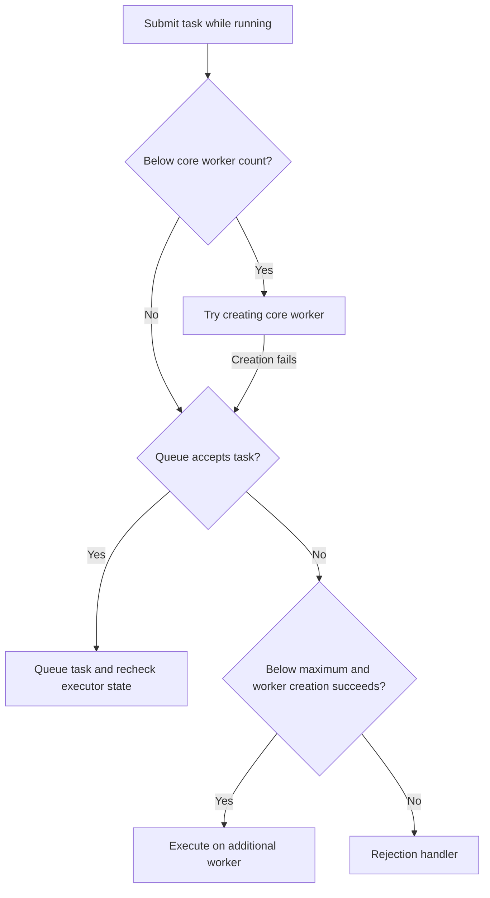

Shutdown races and worker-creation failure are handled by the executor's full acceptance protocol. The diagram highlights its normal policy.

### Q1. Why use ExecutorService? How do Runnable and Callable differ?

An executor separates task submission from execution and provides lifecycle control. `Runnable.run` returns no value and declares no checked exceptions. `Callable.call` returns a value and may throw a checked exception.

```java
ExecutorService executor = Executors.newFixedThreadPool(2);
try {
    Future<Integer> result = executor.submit(() -> 40 + 2);
    System.out.println(result.get()); // 42
} finally {
    executor.shutdown();
}
```

`get()` can block. It throws `ExecutionException` for task failure and `InterruptedException` if the waiting caller is interrupted. A timed `get` can throw `TimeoutException`, and cancellation can cause `CancellationException`.

### Q2. How do execute and submit differ?

`execute(Runnable)` returns nothing. `submit` accepts a Runnable or Callable and returns a Future. With a usual `ThreadPoolExecutor`, uncaught failure from a directly executed Runnable can reach the thread's uncaught-exception handler. Submitted task failures are normally captured in the Future, so inspect the Future or install deliberate error reporting.

### Q3. How does ThreadPoolExecutor accept a task?

The normal policy is:

1. If fewer than `corePoolSize` workers exist, try to start one for the task.
2. Otherwise, try to enqueue the task, subject to run-state checks.
3. If enqueuing fails, try to start a worker up to `maximumPoolSize`.
4. If execution cannot be accepted, invoke the rejection handler.

```java
ThreadPoolExecutor executor = new ThreadPoolExecutor(
        2, 4, 30, TimeUnit.SECONDS,
        new ArrayBlockingQueue<Runnable>(100),
        new ThreadPoolExecutor.AbortPolicy());
try {
    executor.execute(() -> System.out.println("Task"));
} finally {
    executor.shutdown();
}
```

A fixed pool created by `Executors.newFixedThreadPool` uses an unbounded queue. This can accumulate work when arrivals exceed capacity. Queue capacity, task timeouts, pool size, and overload policy should be designed together.

### Q4. What happens when a pool is overloaded?

`AbortPolicy` throws `RejectedExecutionException`. `CallerRunsPolicy` executes in the submitting thread while the executor is running, which can slow producers. Discard policies drop work and require a deliberate loss contract. Blind immediate retries can amplify overload.

Use a suitable rejection handler when the caller needs a clear failure, fallback, or controlled retry. A handler must also account for executor shutdown.

### Q5. How does ThreadPoolExecutor track worker lifecycle?

Its implementation tracks run state and worker count, and workers fetch queued tasks as they finish. Excess idle workers can time out according to keep-alive rules. Core timeout is configurable. Workers that fail abruptly may be replaced when the pool state and policy allow it.

Common run states are `RUNNING`, `SHUTDOWN`, `STOP`, `TIDYING`, and `TERMINATED`. `getActiveCount()` is an estimate and must not be used as a correctness signal.

### Q6. How do shutdown, shutdownNow, and interruption differ?

`shutdown` rejects new work and lets accepted work proceed. `shutdownNow` tries to interrupt active tasks and returns queued tasks that did not start. It cannot forcibly guarantee task termination. `awaitTermination` waits for termination within a timeout.

`Future.cancel(true)` requests interruption for appropriate running tasks. Interruption is cooperative, so tasks must respond to it and close resources. A timeout from `get(timeout, unit)` does not automatically cancel the task.

```java
static void work() {
    try {
        while (!Thread.currentThread().isInterrupted()) {
            Thread.sleep(100);
        }
    } catch (InterruptedException exception) {
        Thread.currentThread().interrupt();
    }
}
```

`isInterrupted()` observes a status. `Thread.interrupted()` observes and clears the current thread's status. When catching `InterruptedException`, either propagate it or restore the status and exit appropriately.

### Q7. How can CompletableFuture combine independent tasks?

```java
ExecutorService executor = Executors.newFixedThreadPool(2);
try {
    CompletableFuture<Integer> first = CompletableFuture.supplyAsync(() -> 10, executor);
    CompletableFuture<Integer> second = CompletableFuture.supplyAsync(() -> 20, executor);
    CompletableFuture<Integer> combined = first.thenCombine(second, Integer::sum);
    System.out.println(combined.get()); // 30
} finally {
    executor.shutdown();
}
```

Choose the executor deliberately for blocking work. `CompletableFuture` cancellation does not generally interrupt the underlying computation as `FutureTask` cancellation can. Define failure handling for the whole workflow.

[Back to contents](#contents)

<a id="chapter-18"></a>
## Chapter 18 - JVM memory, garbage collection, and diagnostics

The Java heap is one part of process memory. Per-thread stacks and native allocations also contribute to a process's total footprint.

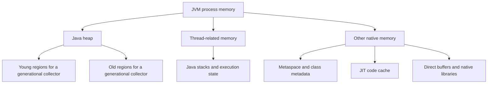

Region layout and generation organization depend on the selected collector. The method area is a JVM specification concept, while Metaspace describes HotSpot implementation storage.

### Q1. What are the JVM runtime memory areas?

| Area | Main purpose |
| --- | --- |
| Heap | Objects and arrays in the conceptual JVM model |
| Java stack | Per-thread frames, local variables, operands, and calls |
| Method area | Class-related structures defined by the JVM specification |
| Metaspace | HotSpot native-memory implementation for much class metadata |
| PC register | Per-thread execution position |
| Native stacks and other native memory | Native calls, buffers, thread overhead, runtime structures |

The method-area specification and HotSpot Metaspace are related concepts with different abstraction levels. A process uses more memory than just its Java heap.

### Q2. Is stack access always faster than heap access?

Avoid an unconditional claim. Allocation and access depend on generated machine code, escape analysis, locality, and synchronization. HotSpot can allocate short-lived objects efficiently using thread-local allocation buffers and eliminate some allocations entirely. A local reference can point to a heap object.

### Q3. How does GC determine which objects can be reclaimed?

Tracing collectors start from GC roots, such as relevant live thread references and static reachability, and find reachable objects. Objects unreachable from roots can be reclaimed even if they refer to each other. `System.gc()` is a request and may be ignored or handled differently by configuration.

### Q4. What are young generation, old generation, and Metaspace?

In a generational collector, new objects commonly start in young regions and surviving objects may be promoted. Old regions hold longer-lived objects. Specific allocation/promotion behavior depends on the collector. Metaspace stores class metadata outside the Java heap in HotSpot and replaced PermGen in Java 8.

Metaspace can still exhaust available native memory or a configured limit. Large numbers of classes or retained class loaders can drive growth.

### Q5. Which garbage collectors should an interview candidate know?

| Collector | Main emphasis | Version context |
| --- | --- | --- |
| Serial | Simple serial collection | Useful for suitable small workloads |
| Parallel | Throughput | Common Java 8 server-class default |
| G1 | Region-based collection with pause-time goals | Default on server-class HotSpot configurations from Java 9 |
| ZGC | Low pause times | Experimental in 11, production in 15; generational mode added in 21 |
| Shenandoah | Concurrent low-pause collection | Availability depends on JDK distribution |
| Epsilon | Allocation without reclamation | Added in Java 11 for controlled specialized uses |
| CMS | Historical concurrent collector | Removed in Java 14 |

Collector selection depends on latency, throughput, heap size, and the deployed JDK. This table is scoped to relevant Java 8-21 history. Check the actual runtime and flags when answering a version-specific question.

### Q6. What are strong, soft, weak, and phantom references?

Strong reachability keeps objects alive. Soft references may be cleared under memory pressure, with timing controlled by the collector. Weak references do not keep weakly reachable objects alive. Phantom references with a `ReferenceQueue` support post-reachability notifications, and `get()` returns null.

```java
Object value = new Object();
java.lang.ref.WeakReference<Object> reference =
        new java.lang.ref.WeakReference<>(value);
System.out.println(reference.get() == value); // true while value is strongly reachable.
```

A bounded cache gives a more explicit retention policy than relying on soft references. `WeakHashMap` has weak keys, and values must not strongly retain those keys through another path if collection is expected.

### Q7. How can memory leaks occur with GC?

A leak occurs when objects remain reachable beyond their useful lifetime. Common causes include unbounded caches/queues, static collections, forgotten listeners, ThreadLocal values in pooled threads, and retained class loaders. GC cannot infer that a reachable object is no longer useful.

### Q8. How do you investigate OutOfMemoryError or a leak?

First identify the memory category from the message and metrics. Java heap, Metaspace, direct buffers, native threads, and process/container limits have different causes. Compare allocation and retained heap over time. Inspect a heap dump's dominators and paths to GC roots. Verify the repair under representative load.

```bash
jcmd <pid> GC.heap_info
jcmd <pid> GC.heap_dump /tmp/heap.hprof
jcmd <pid> Thread.print
jcmd <pid> JFR.start name=investigation settings=profile duration=60s filename=/tmp/app.jfr
```

Commands require a compatible JDK, permissions, and a target process. Heap dumps can pause the process and require substantial disk space. Java 9+ supports unified logging such as `-Xlog:gc*`. `-Xms` sets initial heap sizing, and `-Xmx` sets the maximum. Native memory remains additional.

### Q9. What does JIT optimize, and what are its costs?

JIT compilation can inline calls, specialize hot paths, eliminate redundant checks, and remove some allocations. Costs include warm-up, compilation CPU, code-cache memory, and deoptimization when assumptions change. Startup-sensitive workloads may benefit from other deployment approaches after compatibility and performance evaluation.

Use JMH for focused microbenchmarks and workload measurements for application-level outcomes. Final methods do not guarantee a performance improvement, and non-final methods can also be inlined.

### Q10. Can classes be unloaded?

Class unloading is runtime-controlled and depends on class-loader reachability and JVM rules. Retaining a loader, class, instance, or associated context can prevent unloading. Application code has no general method to force a particular class to unload. Repeated plugin reloads require careful cleanup of threads, listeners, and context class-loader references.

[Back to contents](#contents)

<a id="chapter-19"></a>
## Chapter 19 - Serialization and copying

### Q1. What is Java serialization, and what does Serializable do?

Java object serialization writes an object graph to a byte stream. `Serializable` is a marker interface. Default serialization processes non-static, non-transient fields and tracks references so graph sharing and cycles can be preserved.

```java
static class Session implements Serializable {
    private static final long serialVersionUID = 1L;
    private final String user;
    private transient String token;
    Session(String user, String token) {
        this.user = user;
        this.token = token;
    }
}
```

### Q2. What happens to transient, static, and non-serializable fields?

Transient fields are omitted by default and generally restore to default values unless customized. Static fields belong to class state and are excluded from default instance serialization. A reachable non-serializable value normally causes `NotSerializableException` unless excluded or handled through customization/replacement.

Transient is an omission rule, not encryption. Sensitive data could still be included through another reachable field or custom serialization logic.

### Q3. What is serialVersionUID?

It is the compatibility identifier used for serializable classes. A mismatch can cause `InvalidClassException`. Matching identifiers alone do not make every schema change safe, so evaluate compatible evolution separately.

### Q4. How do Serializable and Externalizable differ?

Serializable provides default graph serialization plus optional private `writeObject`/`readObject` hooks. Those hooks are recognized by the protocol rather than being overrides of `Object` methods. `Externalizable` requires explicit `writeExternal` and `readExternal` implementations and a public no-argument constructor.

### Q5. How do shallow and deep copies differ?

A shallow copy copies field values, including references to the same nested objects. A deep copy duplicates the mutable parts of a graph that should become independent. Immutable components can safely be shared.

```java
static class Address {
    String city;
    Address(String city) { this.city = city; }
}
static class Person {
    final Address address;
    Person(Address address) { this.address = address; }
    Person deepCopy() {
        return new Person(new Address(address.city));
    }
}
// Inside main:
Person original = new Person(new Address("Patna"));
Person shallow = new Person(original.address);
Person deep = original.deepCopy();
original.address.city = "Bengaluru";
System.out.println(shallow.address.city); // Bengaluru
System.out.println(deep.address.city);    // Patna
```

### Q6. What does Cloneable do?

It permits `Object.clone()` to perform its standard field copy without `CloneNotSupportedException`. It does not declare a `clone` method, expose the protected method publicly, or automatically deep-copy referenced objects. Copy constructors and explicit copy methods often communicate ownership more clearly. Deep copying general cyclic graphs requires identity tracking to preserve cycles and sharing.

### Q7. How do you handle serialization security?

Deserializing untrusted Java object streams can execute dangerous behavior. Prefer explicit data formats and validation at trust boundaries. Where legacy serialization is required, use restrictive `ObjectInputFilter` policies, graph-size limits, and invariant validation. Filters require configuration and are not a blanket default protection.

[Back to contents](#contents)

<a id="chapter-20"></a>
## Chapter 20 - Reflection, annotations, class loaders, and modules

### Q1. What is reflection used for?

Reflection examines classes, constructors, fields, and methods at runtime. Frameworks use it for dependency injection, mapping, testing, and adapters. Access depends on language access rules, module boundaries, and runtime restrictions.

```java
static class Greeting {
    public Greeting() {}
    public String hello(String name) { return "Hello " + name; }
}
// Inside main, which may declare throws Exception:
Class<Greeting> type = Greeting.class;
Greeting instance = type.getDeclaredConstructor().newInstance();
java.lang.reflect.Method method = type.getMethod("hello", String.class);
System.out.println(method.invoke(instance, "Shivam")); // Hello Shivam
```

Invocation failures can be wrapped in `InvocationTargetException`. Keep reflective lookup and failure handling explicit.

### Q2. Can reflection change final fields?

The answer depends on field kind, Java version, access policy, and module boundaries. Some historical reflective writes to ordinary instance final fields were possible, while static finals and record component fields have stronger restrictions. Compilers/JITs may assume final values are stable. Design objects so correctness never depends on reflective final-field mutation.

### Q3. What do @Retention and @Target mean?

Retention specifies whether an annotation is retained in source only, the class file, or at runtime. Target specifies legal declaration or type-use locations. Runtime reflection requires `RetentionPolicy.RUNTIME`.

```java
@java.lang.annotation.Retention(java.lang.annotation.RetentionPolicy.RUNTIME)
@java.lang.annotation.Target(java.lang.annotation.ElementType.CONSTRUCTOR)
@interface Inject {}
```

### Q4. How might a simple reflection-based DI container work?

Choose a constructor explicitly, resolve each parameter type from registered bindings, recursively construct dependencies, and invoke the constructor. Track the construction path to detect cycles and define scopes and disposal. This minimal example injects an already registered dependency.

```java
interface Repository {}
static class MemoryRepository implements Repository {}
static class Service {
    private final Repository repository;
    @Inject
    public Service(Repository repository) { this.repository = repository; }
}
Map<Class<?>, Object> bindings = new HashMap<>();
bindings.put(Repository.class, new MemoryRepository());
Service service = Service.class.getConstructor(Repository.class)
        .newInstance(bindings.get(Repository.class));
```

Constructor injection also works directly with `new Service(repository)` and keeps required dependencies explicit.

### Q5. How do class loading and initialization work?

Loading creates a class definition. Linking includes verification, preparation, and resolution as required. Initialization executes static initializers. Java 9+ commonly has bootstrap, platform, and application loaders. Class identity includes the binary name and defining loader.

`Class.forName(name)` normally initializes the class. `Class.forName(name, false, loader)` requests loading without initialization. `loader.loadClass(name)` normally loads without initializing. Their exact APIs and loader choices matter.

### Q6. How do ClassNotFoundException and NoClassDefFoundError differ?

`ClassNotFoundException` is a checked exception from explicit lookup APIs such as `Class.forName` when the requested class cannot be found. `NoClassDefFoundError` is a linkage error when a required class definition cannot be obtained or a class previously failed initialization. Inspect the complete cause chain, runtime classpath/module path, and earlier initialization failures.

### Q7. What can go wrong with circular static initialization?

Within one thread, a class can observe another class's fields before initialization completes, including default values. Across threads, mutually dependent initialization can block indefinitely. Avoid circular initialization and move complex startup into an explicit sequence.

### Q8. How do you load plugins safely?

Use a defined interface with `ServiceLoader` or a controlled class-loading mechanism. Manage loader lifetime and close `URLClassLoader` instances when appropriate. A class loader separates namespaces but does not by itself isolate malicious code.

```java
interface PaymentPlugin { void execute(); }
// Providers need the appropriate service registration or module declaration.
ServiceLoader<PaymentPlugin> plugins = ServiceLoader.load(PaymentPlugin.class);
for (PaymentPlugin plugin : plugins) {
    plugin.execute();
}
```

For untrusted plugins, use a separately restricted process/container with limited OS permissions and resource access. The Security Manager was deprecated in Java 17 and permanently disabled in Java 24. Do not base a new plugin isolation design on it.

### Q9. What are dynamic proxies and hidden classes?

JDK dynamic proxies implement interfaces and delegate calls to an `InvocationHandler`. They can add logging, authorization checks, or other interception. Handle `Object` methods and unwrap reflective target failures carefully in real handlers.

```java
interface GreetingApi { String greet(String name); }
GreetingApi proxy = (GreetingApi) java.lang.reflect.Proxy.newProxyInstance(
        GreetingApi.class.getClassLoader(),
        new Class<?>[] { GreetingApi.class },
        (object, method, arguments) -> {
            if (method.getName().equals("greet")) {
                return "Hello " + arguments[0];
            }
            if (method.getName().equals("toString")) return "GreetingProxy";
            if (method.getName().equals("hashCode")) return System.identityHashCode(object);
            if (method.getName().equals("equals")) return object == arguments[0];
            throw new UnsupportedOperationException(method.getName());
        });
System.out.println(proxy.greet("Shivam")); // Hello Shivam
```

Hidden classes, introduced in Java 15, are runtime-defined implementation classes that cannot be discovered through normal name-based class loading. A framework retaining their `Class` or lookup references can still interact with them. Their lifecycle is useful for runtime generation.

### Q10. What is the Java module system?

JPMS, introduced in Java 9, declares module dependencies and exported/open packages. It adds encapsulation and reliable configuration. It does not automatically fix bad dependencies or reduce every application's heap footprint.

```java
// module-info.java, Java 9+
module example.app {
    requires java.sql;
    exports example.api;
}
```

`exports` permits ordinary access to a package's public API. `opens` permits deep reflection subject to its declaration. Use `jdeps` to inspect dependencies, address split packages, migrate incrementally, and test reflective frameworks. `jlink` creates a runtime image from a resolved module graph and can reduce packaged runtime size.

[Back to contents](#contents)

<a id="chapter-21"></a>
## Chapter 21 - Design patterns and SOLID

### Q1. What is a design pattern, and how do you choose one?

A pattern describes a recurring design problem and a reusable structure for solving it. Choose a pattern because its ownership, extension, or collaboration model fits the requirement. Evaluate the resulting complexity and performance through actual use.

| Pattern | Purpose | Example |
| --- | --- | --- |
| Singleton | One controlled instance per relevant class-loader scope | Shared immutable configuration |
| Factory | Encapsulate creation or implementation selection | Select a parser implementation |
| Builder | Assemble a complex object with readable options | HTTP request configuration |
| Strategy | Supply an interchangeable algorithm | Payment method |
| State | Change behavior according to internal state | Order lifecycle |
| Observer | Notify registered listeners | Application events |

### Q2. How do you implement a thread-safe singleton?

An enum singleton uses JVM initialization and has special serialization and construction rules.

```java
enum AppConfig {
    INSTANCE;
    String environment() { return "production"; }
}
System.out.println(AppConfig.INSTANCE.environment()); // production
```

A lazy initialization holder also uses class initialization.

```java
static final class Configuration {
    private Configuration() {}
    private static class Holder {
        private static final Configuration INSTANCE = new Configuration();
    }
    static Configuration getInstance() {
        return Holder.INSTANCE;
    }
}
```

These approaches need no explicit synchronized accessor. The JVM still coordinates initialization. Ordinary lazy singletons can fail under concurrency, reflection, serialization, or cloning unless designed carefully. Double-checked locking requires a volatile instance. Singleton scope does not span multiple JVM processes.

### Q3. Should database connections be managed with one singleton Connection?

Use a connection pool, commonly exposed through a `DataSource`. Acquire a connection per unit of work and close it to return it to the pool. A single shared JDBC connection can create contention and mix transaction state. A shared pool manager is a different responsibility from sharing one connection.

### Q4. Why use Builder instead of many constructors?

A builder can name optional properties, validate combinations, and build one immutable result. Factory methods choose or hide construction. A factory may itself return or use a builder.

```java
static final class Request {
    private final String path;
    private final int timeoutMillis;
    private Request(Builder builder) {
        path = Objects.requireNonNull(builder.path);
        timeoutMillis = builder.timeoutMillis;
    }
    static class Builder {
        private final String path;
        private int timeoutMillis = 1_000;
        Builder(String path) { this.path = path; }
        Builder timeoutMillis(int value) {
            if (value <= 0) throw new IllegalArgumentException("Timeout must be positive");
            timeoutMillis = value;
            return this;
        }
        Request build() { return new Request(this); }
    }
}
Request request = new Request.Builder("/orders").timeoutMillis(500).build();
```

### Q5. How do Strategy and State differ?

Strategy represents a selectable algorithm, often chosen by a caller. State represents behavior associated with an object's lifecycle state and its allowed transitions. Both can use interfaces and delegation. The distinction comes from the domain responsibility.

```java
@FunctionalInterface
interface Discount {
    long apply(long price);
}
Discount tenPercent = price -> price - price / 10;
System.out.println(tenPercent.apply(1_000)); // 900
```

### Q6. How does Observer work?

A publisher maintains subscribers and emits events to them. Define ordering, failure handling, synchronous versus asynchronous delivery, and subscription lifetime.

```java
static class EventBus {
    private final List<Consumer<String>> listeners = new CopyOnWriteArrayList<>();
    void subscribe(Consumer<String> listener) { listeners.add(listener); }
    void unsubscribe(Consumer<String> listener) { listeners.remove(listener); }
    void publish(String event) {
        for (Consumer<String> listener : listeners) {
            listener.accept(event);
        }
    }
}
```

Here delivery is synchronous and a throwing listener stops that publish call. Choose a different error policy explicitly if independent delivery is required. Unregister listeners when their owners finish.

### Q7. What are SOLID principles?

| Principle | Meaning | Example |
| --- | --- | --- |
| Single responsibility | Keep a coherent reason for change | Invoice calculation separate from email delivery |
| Open/closed | Add behavior through suitable extension points | Supply a new payment implementation |
| Liskov substitution | Subtypes honor the parent's behavioral contract | An implementation preserves promised operations |
| Interface segregation | Clients depend on focused contracts | Separate printing from scanning |
| Dependency inversion | High-level policy depends on abstractions | Checkout receives a `PaymentMethod` |

The payment example in Chapter 04 demonstrates open/closed and dependency inversion. Principles guide design choices and need context, rather than requiring an interface for every class.

[Back to contents](#contents)

<a id="chapter-22"></a>
## Chapter 22 - Java versions, records, and sealed classes

### Q1. Which features belong to which releases?

| Release | Interview-relevant additions and status |
| --- | --- |
| Java 8 | Lambdas, functional interfaces, streams, default/static interface methods, Optional, java.time |
| Java 9 | Modules, JShell, private interface methods, collection factories, Stream takeWhile/dropWhile |
| Java 10 | Local variable type inference with `var` |
| Java 11 | Standard HTTP client, String strip/isBlank/repeat, lambda parameter `var`, single-file source launching |
| Java 14 | Switch expressions became final |
| Java 15 | Text blocks became final, hidden classes introduced |
| Java 16 | Records and instanceof pattern matching became final, Stream.toList |
| Java 17 | Sealed classes became final; switch pattern matching was preview |
| Java 21 | Virtual threads, record patterns, switch pattern matching, sequenced collections became final |

Java 17 supported records and instanceof patterns because they had become final in Java 16. Avoid attributing every feature available in a release to that release. The Foreign Function and Memory API was incubating in Java 17, preview in Java 21, and final in Java 22.

### Q2. What is a record?

A record is a concise data carrier with components. Java supplies component fields, a canonical constructor, accessors, and value-based implementations of `equals`, `hashCode`, and `toString` based on its components. A record class is implicitly final and extends `java.lang.Record`.

```java
// Java 16+. Put this nested record inside Main, outside main.
record Employee(int id, String name) {
    Employee {
        if (id <= 0) throw new IllegalArgumentException("ID must be positive");
        Objects.requireNonNull(name);
    }
}
// Inside main:
Employee employee = new Employee(1, "Shivam");
System.out.println(employee.name()); // Shivam
System.out.println(employee.equals(new Employee(1, "Shivam"))); // true
System.out.println(employee); // Employee[id=1, name=Shivam]
```

Records can implement interfaces and define methods, static fields, and additional constructors that delegate appropriately. They cannot declare extra instance fields outside their components.

### Q3. Are records deeply immutable?

Component references are final, but referenced objects may be mutable. Make defensive copies when the model requires ownership isolation.

```java
// Java 16+
record Team(List<String> members) {
    Team {
        members = List.copyOf(members);
    }
}
```

The list is copied and unmodifiable, while mutable elements would still require their own handling. Arrays in records also retain their ordinary reference-based `equals` semantics unless the record customizes equality.

### Q4. What is a sealed class or interface?

It restricts direct subtypes. A permitted subtype must continue the hierarchy as final, sealed, or non-sealed, subject to the relevant type rules. Direct subtypes must satisfy module/package restrictions.

```java
// Java 17+. Types can be nested in Main.
sealed interface Result permits Success, Failure {}
record Success(String value) implements Result {}
record Failure(String message) implements Result {}
```

Records are implicitly final, so they fit closed alternatives. Sealed hierarchies make a finite set of domain cases explicit.

### Q5. What does pattern matching simplify?

```java
// Java 16+
Object value = "Java";
if (value instanceof String text) {
    System.out.println(text.length()); // 4
}
```

Java 21 pattern matching for switch supports matching types and record patterns with exhaustiveness checks where applicable. Preview features require the matching compiler/runtime flags and should be identified as preview for their exact release.

### Q6. What are virtual threads?

Virtual threads, final in Java 21, are lightweight threads managed by the runtime. They suit large numbers of tasks that spend time waiting, especially suitable blocking I/O. CPU-bound work remains limited by CPU capacity, and shared-resource limits still need control.

```java
// Java 21+
try (ExecutorService executor = Executors.newVirtualThreadPerTaskExecutor()) {
    Future<String> response = executor.submit(() -> "done");
    System.out.println(response.get()); // done
}
```

Do not pool virtual threads just to limit access to a scarce external resource. Bound that resource with an appropriate semaphore, connection pool, or other concurrency control. Java 21 has pinning considerations that vary with later runtime versions.

[Back to contents](#contents)

<a id="chapter-23"></a>
## Chapter 23 - Advanced interview scenarios

### Q1. A financial application updates shared state frequently. What would you do?

Define the invariant first. One counter may use an atomic type. Related balances need a single consistent operation, such as a shared lock or a transactional boundary. Immutable snapshots can simplify reads. Partitioning work by account or instrument can reduce contention.

Measure p95/p99 latency, contention, allocation, and queueing under realistic load. Use a suitable numeric representation for the domain, such as validated minor units or `BigDecimal` with explicit rounding. A volatile field alone cannot preserve a multi-field transaction.

### Q2. A user clicks a button and nothing happens. How do you investigate?

Reproduce with a correlation/request ID. Confirm that the event handler runs, input is valid, and execution reaches the asynchronous/network boundary. Inspect client logs, thread state, HTTP status, server traces, and dependent service latency. Look for swallowed exceptions, exhausted pools, deadlocks, and work blocking the UI/event thread. Verify the visible success/failure state after the repair.

For an interview experience question, explain your actual observations and actions. Replace hypothetical measurements with evidence from your own work.

### Q3. How would you reduce allocation and GC pressure?

Profile allocation sites first. Remove unnecessary temporary objects, avoid repeated parsing, use primitive arrays where appropriate, pre-size known collections, and bound caches and queues. Stream processing and batching can reduce materialized intermediate data. Object pools for ordinary short-lived objects can add retention and synchronization costs, so use them only when evidence supports the tradeoff.

### Q4. How would you scale a Java service?

Find the limiting resource through load tests and telemetry. Optimize database calls, indexes, network calls, serialization, and connection use as applicable. Bound concurrency and queueing. Make stateless request handling horizontally scalable when the design allows it. Keep shared state and retries consistent, and verify behavior during partial failures.

### Q5. What is the difference between REST and RESTful services?

The terms are commonly used interchangeably. REST is an architectural style with constraints including a uniform interface, stateless interactions, caching, client/server separation, and layering. An endpoint using JSON over HTTP does not establish that all REST constraints are followed. Discuss concrete resource and protocol behavior rather than inventing two distinct service categories.

### Q6. What is DDoS, and how would you reduce its impact?

A distributed denial-of-service attack overwhelms a service using traffic from multiple sources. Controls operate at several levels, including upstream traffic filtering, managed network protection, rate limits, authentication, bounded request sizes, timeouts, and overload handling. Application thread pools alone cannot stop network saturation.

### Q7. Can Java serve HTTP without Spring?

Yes. The JDK's lightweight HTTP server can demonstrate a simple endpoint. In a named Java 9+ module, declare `requires jdk.httpserver;`.

```java
// Standalone Main.java. Run and request http://localhost:8080/health.
import com.sun.net.httpserver.HttpServer;
import java.net.InetSocketAddress;
import java.nio.charset.StandardCharsets;
import java.util.concurrent.ExecutorService;
import java.util.concurrent.Executors;

public class Main {
    public static void main(String[] args) throws Exception {
        ExecutorService executor = Executors.newFixedThreadPool(2);
        HttpServer server = HttpServer.create(new InetSocketAddress(8080), 0);
        server.createContext("/health", exchange -> {
            byte[] body = "OK".getBytes(StandardCharsets.UTF_8);
            exchange.getResponseHeaders().set("Content-Type", "text/plain; charset=utf-8");
            exchange.sendResponseHeaders(200, body.length);
            try (java.io.OutputStream output = exchange.getResponseBody()) {
                output.write(body);
            } finally {
                exchange.close();
            }
        });
        server.setExecutor(executor);
        Runtime.getRuntime().addShutdownHook(new Thread(() -> {
            server.stop(1);
            executor.shutdown();
        }));
        server.start();
    }
}
```

This is a minimal endpoint example. A production service needs its required routing, transport, authentication, lifecycle, observability, and capacity design.

### Q8. Which coding standards should you describe in an interview?

Use meaningful names, focused methods, consistent formatting, clear ownership, validated inputs, deliberate exception handling, and explicit concurrency contracts. Review changes, run relevant tests, and add operational telemetry where it supports diagnosis. Explain conventions your team actually used.

### Q9. How do you answer optimization experience questions?

Describe the original symptom, measured bottleneck, change, and verified result. For example, you might explain a query/index change or removal of repeated remote calls if you actually performed it. Include latency distributions, throughput, error rates, and resource cost where you have measurements.

### Q10. Is "L1/L2 garbage collection" a JVM cache-leak solution?

L1/L2 typically describes cache tiers in that context. JVM collectors have their own heap organization and collection phases. Fix cache leaks through explicit size bounds, eviction, expiry, invalidation, and lifecycle cleanup. Changing GC cannot release an entry that remains strongly reachable in an application cache.

[Back to contents](#contents)

<a id="chapter-24"></a>
## Chapter 24 - Stream coding exercises, Level I

These 20 exercises correspond to the 20 numbered questions in the supplied Level I Stream PDF. Each block supplies its own input and can be pasted into `main` with the common imports above. Unless stated otherwise, inputs are non-null and contain non-null elements.

### I-01. Filter even numbers

Keep each element whose remainder on division by two is zero. O(n) traversal.

```java
List<Integer> numbers = Arrays.asList(1, 2, 3, 4, 5, 6);
List<Integer> result = numbers.stream()
        .filter(number -> number % 2 == 0)
        .collect(Collectors.toList());
System.out.println(result); // [2, 4, 6]
```

### I-02. Find the maximum

`max` returns an Optional so an empty input has a defined representation.

```java
List<Integer> numbers = Arrays.asList(1, 2, 3, 4, 5, 6);
Optional<Integer> maximum = numbers.stream().max(Integer::compare);
System.out.println(maximum.orElseThrow(() -> new IllegalArgumentException("Empty input"))); // 6
```

For empty input, this chosen `orElseThrow` policy throws `IllegalArgumentException`.

### I-03. Sum the elements

Use a primitive long stream to avoid int-range overflow for the int inputs in a List.

```java
List<Integer> numbers = Arrays.asList(1, 2, 3, 4, 5, 6);
long sum = numbers.stream().mapToLong(Integer::longValue).sum();
System.out.println(sum); // 21
```

### I-04. Convert names to uppercase

`Locale.ROOT` makes this case conversion independent of the machine's default locale.

```java
List<String> names = Arrays.asList("Alice", "Bob", "Charlie");
List<String> result = names.stream()
        .map(name -> name.toUpperCase(Locale.ROOT))
        .collect(Collectors.toList());
System.out.println(result); // [ALICE, BOB, CHARLIE]
```

### I-05. Sort a list in ascending order

`sorted` orders the result without mutating the input list. General comparison sorting costs O(n log n).

```java
List<Integer> numbers = Arrays.asList(3, 1, 2);
List<Integer> sorted = numbers.stream().sorted().collect(Collectors.toList());
System.out.println(sorted); // [1, 2, 3]
```

### I-06. Count elements greater than five

Filter first, then count the matching elements. The return type of `count` is long.

```java
List<Integer> numbers = Arrays.asList(1, 2, 3, 4, 5, 6);
long count = numbers.stream().filter(number -> number > 5).count();
System.out.println(count); // 1
```

### I-07. Get distinct elements

For an ordered stream, `distinct` preserves the encounter order of retained elements and follows equality semantics.

```java
List<Integer> numbers = Arrays.asList(3, 1, 3, 2, 1);
List<Integer> unique = numbers.stream().distinct().collect(Collectors.toList());
System.out.println(unique); // [3, 1, 2]
```

### I-08. Reduce elements to a sum

Zero is the identity for addition. Converting each int to long avoids int addition overflow in this example.

```java
List<Integer> numbers = Arrays.asList(1, 2, 3, 4, 5, 6);
long sum = numbers.stream().map(Integer::longValue).reduce(0L, Long::sum);
System.out.println(sum); // 21
```

An empty input produces `0L`.

### I-09. Find any element

The contract permits any element. An empty input produces `Optional.empty()`.

```java
List<Integer> numbers = Arrays.asList(10, 20, 30);
Optional<Integer> result = numbers.stream().findAny();
System.out.println(result.isPresent()); // true
// result contains one of 10, 20, or 30.
```

### I-10. Extract first names

Trim the full name, discard blank inputs, and take the first whitespace-separated component.

```java
List<String> fullNames = Arrays.asList("Alice Johnson", "  Bob Harris  ", "Charlie Lou");
List<String> firstNames = fullNames.stream()
        .map(String::trim)
        .filter(name -> !name.isEmpty())
        .map(name -> name.split("\\s+", 2)[0])
        .collect(Collectors.toList());
System.out.println(firstNames); // [Alice, Bob, Charlie]
```

### I-11. Check whether all numbers are positive

`allMatch` stops as soon as it finds a non-matching value. Empty input gives true.

```java
List<Integer> numbers = Arrays.asList(1, 2, 3);
boolean result = numbers.stream().allMatch(number -> number > 0);
System.out.println(result); // true
```

### I-12. Check whether no number is negative

`noneMatch` returns false when a negative value is found. Empty input gives true.

```java
List<Integer> numbers = Arrays.asList(0, 2, 3);
boolean result = numbers.stream().noneMatch(number -> number < 0);
System.out.println(result); // true
```

### I-13. Find the first element

This returns the first element in the list's encounter order.

```java
List<Integer> numbers = Arrays.asList(10, 20, 30);
Optional<Integer> first = numbers.stream().findFirst();
System.out.println(first.orElse(-1)); // 10
```

The fallback `-1` is an example policy. Keep Optional when a sentinel could also be a valid value.

### I-14. Flatten nested lists

Each nested list becomes a stream, and `flatMap` joins their elements. Complexity is O(total elements).

```java
List<List<Integer>> nested = Arrays.asList(
        Arrays.asList(1, 2), Arrays.asList(3, 4, 5));
List<Integer> flat = nested.stream().flatMap(List::stream).collect(Collectors.toList());
System.out.println(flat); // [1, 2, 3, 4, 5]
```

### I-15. Group users by age

For a self-contained example, each map entry represents a user name and age. A TreeMap makes the printed age order predictable. In an application model, use the equivalent getter such as `User::getAge`.

```java
List<Map.Entry<String, Integer>> users = Arrays.asList(
        new AbstractMap.SimpleImmutableEntry<>("Alice", 20),
        new AbstractMap.SimpleImmutableEntry<>("Bob", 21),
        new AbstractMap.SimpleImmutableEntry<>("Cara", 20));
Map<Integer, List<String>> grouped = users.stream().collect(Collectors.groupingBy(
        Map.Entry::getValue,
        TreeMap::new,
        Collectors.mapping(Map.Entry::getKey, Collectors.toList())));
System.out.println(grouped); // {20=[Alice, Cara], 21=[Bob]}
```

### I-16. Observe elements using peek

This demonstrates observing elements consumed by a collecting pipeline. Use `peek` for diagnostics and keep required work out of it.

```java
List<Integer> numbers = Arrays.asList(1, 2, 3);
List<Integer> result = numbers.stream()
        .peek(number -> System.out.println("Seen " + number))
        .collect(Collectors.toList());
System.out.println(result);
// Seen 1
// Seen 2
// Seen 3
// [1, 2, 3]
```

### I-17. Limit to the first three elements

An input with fewer than three elements returns all its elements.

```java
List<Integer> numbers = Arrays.asList(1, 2, 3, 4, 5);
List<Integer> result = numbers.stream().limit(3).collect(Collectors.toList());
System.out.println(result); // [1, 2, 3]
```

### I-18. Skip the first two elements

If the input has at most two elements, the result is empty.

```java
List<Integer> numbers = Arrays.asList(1, 2, 3, 4, 5);
List<Integer> result = numbers.stream().skip(2).collect(Collectors.toList());
System.out.println(result); // [3, 4, 5]
```

### I-19. Convert a list to a set

Use LinkedHashSet when the printed encounter order matters. `Collectors.toSet()` leaves the set type and order unspecified.

```java
List<Integer> numbers = Arrays.asList(3, 1, 3, 2);
Set<Integer> result = numbers.stream()
        .collect(Collectors.toCollection(LinkedHashSet::new));
System.out.println(result); // [3, 1, 2]
```

### I-20. Obtain summary statistics

Summary statistics include count, sum, minimum, maximum, and average in one traversal.

```java
List<Integer> numbers = Arrays.asList(1, 2, 3, 4, 5, 6);
IntSummaryStatistics stats = numbers.stream().mapToInt(Integer::intValue).summaryStatistics();
System.out.println(stats.getCount());   // 6
System.out.println(stats.getSum());     // 21
System.out.println(stats.getMin());     // 1
System.out.println(stats.getMax());     // 6
System.out.println(stats.getAverage()); // 3.5
```

For empty input, count/sum/average are zero, while min/max use extreme sentinel values. Check count before interpreting them as actual observations.

[Back to contents](#contents)

<a id="chapter-25"></a>
## Chapter 25 - Stream coding exercises, Level II

These 22 exercises correspond to the Level II PDF. Overlapping exercises are kept so each source question remains easy to locate. Each block supplies its own data.

### II-01. Find even numbers, or partition into even and odd

```java
List<Integer> numbers = Arrays.asList(10, 15, 8, 49, 25, 98, 32);
List<Integer> even = numbers.stream()
        .filter(number -> number % 2 == 0).collect(Collectors.toList());
Map<Boolean, List<Integer>> partitions = numbers.stream()
        .collect(Collectors.partitioningBy(number -> number % 2 == 0));
System.out.println(even);                  // [10, 8, 98, 32]
System.out.println(partitions.get(false)); // [15, 49, 25]
```

`partitioningBy` makes two boolean groups. Use it when both groups are needed.

### II-02. Find numbers starting with the digit one

Define whether the sign counts. This example treats the decimal magnitude as the digit sequence, so `-12` qualifies. Widening to long before absolute value handles `Integer.MIN_VALUE` correctly.

```java
List<Integer> numbers = Arrays.asList(10, 15, 8, -12, 25, 98, 32);
List<Integer> result = numbers.stream()
        .filter(number -> Long.toString(Math.abs((long) number)).startsWith("1"))
        .collect(Collectors.toList());
System.out.println(result); // [10, 15, -12]
```

If the question means the literal signed text must start with `1`, use `number.toString().startsWith("1")` instead.

### II-03. Find duplicate values

Count first and return keys occurring more than once. This prints each duplicate once, in first-occurrence order, and avoids a shared mutable set inside the stream predicate.

```java
List<Integer> numbers = Arrays.asList(10, 15, 8, 49, 25, 98, 98, 32, 15);
Map<Integer, Long> counts = numbers.stream().collect(Collectors.groupingBy(
        Function.identity(), LinkedHashMap::new, Collectors.counting()));
List<Integer> duplicates = counts.entrySet().stream()
        .filter(entry -> entry.getValue() > 1)
        .map(Map.Entry::getKey)
        .collect(Collectors.toList());
System.out.println(duplicates); // [15, 98]
```

Expected O(n) time and O(k) counting storage, where k is the number of distinct values. `distinct()` gives unique values from the whole input and answers a different operation from selecting repeated values.

### II-04. Find the first element

```java
List<Integer> numbers = Arrays.asList(10, 15, 8);
Optional<Integer> first = numbers.stream().findFirst();
System.out.println(first.orElse(-1)); // 10
```

An empty list gives an empty Optional before the example fallback is applied.

### II-05. Count all elements

```java
List<Integer> numbers = Arrays.asList(10, 15, 8, 49, 25, 98, 98, 32, 15);
long count = numbers.stream().count();
System.out.println(count); // 9
```

For a Collection with no filtering, `size()` is the direct operation. This exercise practices the stream equivalent.

### II-06. Find the maximum list element

```java
List<Integer> numbers = Arrays.asList(10, 15, 8, 49, 25, 98, 32);
Optional<Integer> maximum = numbers.stream().max(Integer::compare);
System.out.println(maximum.orElseThrow(() -> new IllegalArgumentException("Empty input"))); // 98
```

This explicitly rejects empty input instead of calling an unchecked `Optional.get()`.

### II-07. Find the first non-repeated character

Define case sensitivity and character units. This example counts case-sensitive Unicode code points, preserving first-occurrence order. Spaces are included if present.

```java
String input = "swiss";
Map<Integer, Long> counts = input.codePoints().boxed().collect(Collectors.groupingBy(
        Function.identity(), LinkedHashMap::new, Collectors.counting()));
Optional<Integer> codePoint = counts.entrySet().stream()
        .filter(entry -> entry.getValue() == 1)
        .map(Map.Entry::getKey)
        .findFirst();
String result = codePoint.map(value -> new String(Character.toChars(value))).orElse("<none>");
System.out.println(result); // w
```

A code point can still be part of a larger user-perceived grapheme. Normalize with an explicitly chosen policy when the requirement calls for case-insensitive or normalized text.

### II-08. Find the first repeated character

Here "first repeated" means the earliest character in original order whose total count exceeds one, matching the grouping-style interpretation in the PDF.

```java
String input = "abccba";
Map<Integer, Long> counts = input.codePoints().boxed().collect(Collectors.groupingBy(
        Function.identity(), LinkedHashMap::new, Collectors.counting()));
Optional<Integer> codePoint = counts.entrySet().stream()
        .filter(entry -> entry.getValue() > 1)
        .map(Map.Entry::getKey)
        .findFirst();
System.out.println(codePoint.map(value -> new String(Character.toChars(value))).orElse("<none>")); // a
```

If the interviewer means the first repeat encountered while scanning, the same input yields `c`. A sequential loop with a seen set expresses that interpretation clearly. The two interpretations are intentionally distinguished here.

### II-09. Sort ascending

```java
List<Integer> numbers = Arrays.asList(10, 15, 8, 49, 25);
List<Integer> sorted = numbers.stream().sorted().collect(Collectors.toList());
System.out.println(sorted); // [8, 10, 15, 25, 49]
```

### II-10. Sort descending

```java
List<Integer> numbers = Arrays.asList(10, 15, 8, 49, 25);
List<Integer> sorted = numbers.stream()
        .sorted(Comparator.reverseOrder()).collect(Collectors.toList());
System.out.println(sorted); // [49, 25, 15, 10, 8]
```

Both sorting exercises generally cost O(n log n) comparisons.

### II-11. Check whether an integer array contains any duplicate

The distinct count differs from the length exactly when a duplicate exists. Empty input returns false.

```java
int[] numbers = {1, 2, 3, 1};
boolean duplicate = Arrays.stream(numbers).distinct().count() != numbers.length;
System.out.println(duplicate); // true
```

This traverses the whole stream. A sequential loop with a HashSet can stop at the first repeated value. Avoid assuming a shared HashSet predicate remains safe after switching to a parallel stream.

### II-12. Get the current date and time

Use a zone explicitly when the user or business has a specific location. This captures one instant so the displayed values are consistent with each other.

```java
ZonedDateTime now = ZonedDateTime.now(ZoneId.of("Asia/Kolkata"));
System.out.println(now.toLocalDate());
System.out.println(now.toLocalTime());
System.out.println(now.toLocalDateTime());
System.out.println(now.getZone()); // Asia/Kolkata
```

The first three outputs depend on the execution time. Use an injected `Clock` for deterministic tests.

### II-13. Concatenate two streams

For ordered inputs, the result contains the first stream followed by the second.

```java
List<String> first = Arrays.asList("Java", "8");
List<String> second = Arrays.asList("explained", "through", "programs");
String result = Stream.concat(first.stream(), second.stream())
        .collect(Collectors.joining(" "));
System.out.println(result); // Java 8 explained through programs
```

### II-14. Cube the values and keep cubes greater than fifty

The example accepts arbitrary int values and checks long multiplication overflow. For the supplied small values it yields the expected cubes.

```java
List<Integer> numbers = Arrays.asList(4, 5, 6, 7, 1, 2, 3);
List<Long> cubes = numbers.stream()
        .map(number -> {
            long value = number.longValue();
            return Math.multiplyExact(Math.multiplyExact(value, value), value);
        })
        .filter(cube -> cube > 50)
        .collect(Collectors.toList());
System.out.println(cubes); // [64, 125, 216, 343]
```

`ArithmeticException` reports long-range overflow. If all possible int cubes must be supported exactly, use `BigInteger`.

### II-15. Sort an array and turn it into a stream

```java
int[] numbers = {99, 55, 203, 99, 4, 91};
Arrays.sort(numbers);
List<Integer> result = Arrays.stream(numbers).boxed().collect(Collectors.toList());
System.out.println(result); // [4, 55, 91, 99, 99, 203]
```

`Arrays.sort` mutates the array. `Arrays.parallelSort` is also available in Java 8, with performance depending on size and workload. `Arrays.stream(int[])` returns an IntStream, so `boxed()` converts its elements for a `List<Integer>`.

### II-16. Convert strings to uppercase with map

```java
List<String> names = Arrays.asList("aa", "bb", "cc", "dd");
List<String> result = names.stream()
        .map(name -> name.toUpperCase(Locale.ROOT))
        .collect(Collectors.toList());
System.out.println(result); // [AA, BB, CC, DD]
```

For a custom object, map the appropriate property or construct a new result object. Avoid mutating shared source objects in a parallel pipeline.

### II-17. Convert objects into an ordered map with duplicate keys

This follows the PDF's descending tag-ID ordering and keeps the first value after sorting. Therefore a duplicate tag retains its highest ID. Map entries provide a compact self-contained stand-in for a `Note` model with tag-name and tag-ID getters.

```java
List<Map.Entry<String, Long>> notes = Arrays.asList(
        new AbstractMap.SimpleImmutableEntry<>("note1", 11L),
        new AbstractMap.SimpleImmutableEntry<>("note2", 22L),
        new AbstractMap.SimpleImmutableEntry<>("note3", 33L),
        new AbstractMap.SimpleImmutableEntry<>("note4", 44L),
        new AbstractMap.SimpleImmutableEntry<>("note5", 55L),
        new AbstractMap.SimpleImmutableEntry<>("note4", 66L));
Map<String, Long> result = notes.stream()
        .sorted(Comparator.comparingLong((Map.Entry<String, Long> note) -> note.getValue())
                          .reversed())
        .collect(Collectors.toMap(
                Map.Entry::getKey, Map.Entry::getValue,
                (first, later) -> first, LinkedHashMap::new));
System.out.println(result);
// {note4=66, note5=55, note3=33, note2=22, note1=11}
```

Sorting costs O(n log n). `LinkedHashMap` preserves sorted encounter order after deduplication. If the requirement is sorted keys, supply `TreeMap::new` and define the duplicate merge rule independently.

### II-18. Count occurrences of each word

```java
List<String> words = Arrays.asList("AA", "BB", "AA", "CC");
Map<String, Long> counts = words.stream().collect(Collectors.groupingBy(
        Function.identity(), LinkedHashMap::new, Collectors.counting()));
System.out.println(counts); // {AA=2, BB=1, CC=1}
```

This counts list elements as supplied, with case-sensitive equality. Tokenize or normalize first if the input is a sentence or requires case folding.

### II-19. Return duplicate words with their counts

Count once, then filter counts. Repeated `Collections.frequency` calls inside a filter can lead to O(n squared) work.

```java
List<String> words = Arrays.asList("AA", "BB", "AA", "CC");
Map<String, Long> counts = words.stream().collect(Collectors.groupingBy(
        Function.identity(), LinkedHashMap::new, Collectors.counting()));
Map<String, Long> duplicates = counts.entrySet().stream()
        .filter(entry -> entry.getValue() > 1)
        .collect(Collectors.toMap(Map.Entry::getKey, Map.Entry::getValue,
                                  (first, later) -> first, LinkedHashMap::new));
System.out.println(duplicates); // {AA=2}
```

### II-20. Safely iterate a nullable list and ignore null elements

Optional handles the null list reference. The stream filter handles null elements. A non-null empty list naturally produces no output.

```java
List<String> names = Arrays.asList("Java", null, "Streams");
Optional.ofNullable(names)
        .orElseGet(Collections::emptyList)
        .stream()
        .filter(Objects::nonNull)
        .forEach(System.out::println);
// Java
// Streams
```

For notes, replace the final printing with `.map(Note::getTagName).forEach(System.out::println)`, using your actual model. The method reference itself must be the mapper expression.

### II-21. Find the maximum element of an array

Primitive stream `max` produces an OptionalInt, allowing an explicit empty-input policy.

```java
int[] numbers = {12, 19, 20, 88, 0, 9};
OptionalInt maximum = Arrays.stream(numbers).max();
System.out.println(maximum.orElseThrow(() -> new IllegalArgumentException("Empty input"))); // 88
```

### II-22. Count each character in a string

This example counts Unicode code points, includes spaces, and keeps first-occurrence order. It is case-sensitive. Code points are converted to strings for readable map keys.

```java
String input = "Java Java";
Map<String, Long> counts = input.codePoints()
        .mapToObj(codePoint -> new String(Character.toChars(codePoint)))
        .collect(Collectors.groupingBy(
                Function.identity(), LinkedHashMap::new, Collectors.counting()));
System.out.println(counts); // {J=2, a=4, v=2,  =1}
```

Expected O(n) counting time with O(k) distinct-key storage. If the requirement uses UTF-16 code units, `chars()` supplies those instead. User-perceived graphemes may contain several code points.

[Back to contents](#contents)

<a id="chapter-26"></a>
## Chapter 26 - Your concurrency questions with scenarios and diagrams

These questions extend Chapters 15-17 with complete runnable examples. Save each `public class` example using its class name, such as `RaceConditionExample.java`. The examples use platform threads and Java 8-compatible APIs unless a later version is stated.

### Q1. What are the benefits of multithreading on a one-core CPU?

A single CPU core executes one thread's instructions at a time. When a thread waits for a file, network response, timer, or lock, another ready thread can use that core. This overlap improves responsiveness and can improve throughput for waiting-heavy workloads.

A phone can accept a button tap while a background task waits for the network. A backend service can process another request while one request waits for a database response. CPU-intensive calculations still share the single core and incur switching overhead.

| Workload on one core | Likely effect of more threads | Reason |
| --- | --- | --- |
| Network requests that spend time waiting | More overlap and potentially higher throughput | CPU can work while I/O is pending |
| UI thread plus background file access | Better responsiveness | UI events can be scheduled while the file task waits |
| Two large numeric calculations | No additional CPU capacity | Both calculations share the same core |
| Many runnable tasks with heavy locking | Can reduce throughput | Context switches, contention, and queueing |

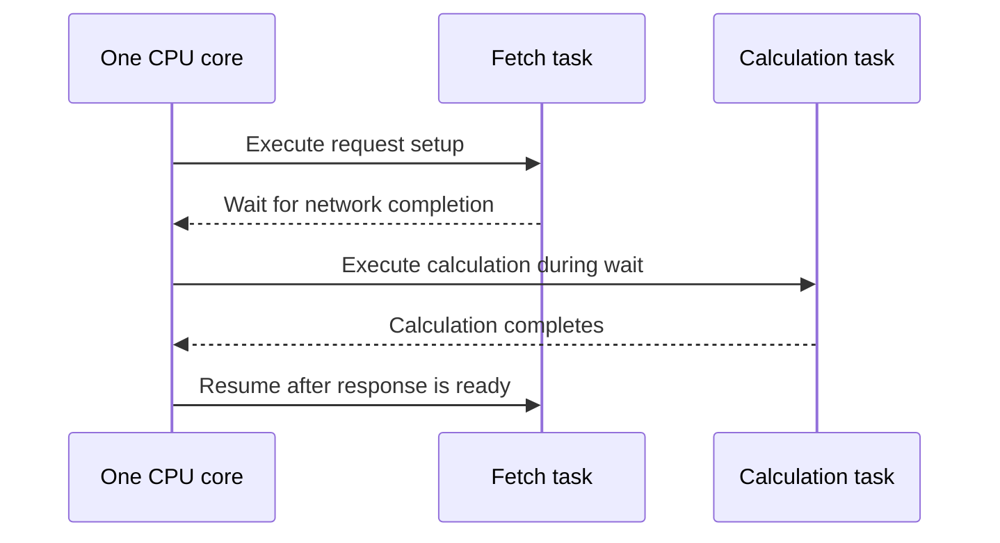

The next example simulates waiting with `sleep`. It illustrates overlap and does not force the machine to use a single core or benchmark network performance.

```java
import java.util.concurrent.CountDownLatch;

public class SingleCoreExample {
    public static void main(String[] args) throws InterruptedException {
        CountDownLatch waitingStarted = new CountDownLatch(1);
        Thread fetch = new Thread(() -> {
            System.out.println("Fetch task starts waiting");
            waitingStarted.countDown();
            try {
                Thread.sleep(200); // Simulated I/O wait.
                System.out.println("Fetch task resumes");
            } catch (InterruptedException exception) {
                Thread.currentThread().interrupt();
            }
        });
        Thread calculate = new Thread(() -> {
            try {
                waitingStarted.await();
                long sum = 0;
                for (int number = 1; number <= 100_000; number++) {
                    sum += number;
                }
                System.out.println("Calculation result " + sum);
            } catch (InterruptedException exception) {
                Thread.currentThread().interrupt();
            }
        });
        fetch.start();
        calculate.start();
        fetch.join();
        calculate.join();
    }
}
```

The sum is `5000050000`. The fetch-start message appears before the other messages. The order of the calculation result and fetch-resume message depends on scheduling. `sleep` releases CPU time while retaining any monitors the sleeping thread already holds.

### Q2. What is synchronized on a method versus synchronized on a class?

The important distinction is the identity of the lock object. An instance synchronized method uses its receiver's monitor. A static synchronized method uses the declaring class's `Class` object. An explicit synchronized block can select either of those monitors or a dedicated private lock.

| Form | Actual monitor | What coordinates? | Real-world example |
| --- | --- | --- | --- |
| `synchronized void reserve()` | `this` | Calls using the same receiver | Update one in-memory inventory object |
| `static synchronized void update()` | `Inventory.class` | Calls using that declaring class's monitor | Update one static registry |
| `synchronized (Inventory.class)` | `Inventory.class` | Static synchronized methods and blocks using that same class object | Coordinate several operations over shared class state |
| `synchronized (privateLock)` | The referenced private object | Code using that exact private lock | Protect a component's internal state |

Two instances can run instance synchronized methods simultaneously. A static synchronized method and an instance synchronized method can also run simultaneously because they use different monitors. Two methods using the same instance monitor exclude one another even if their method names differ.

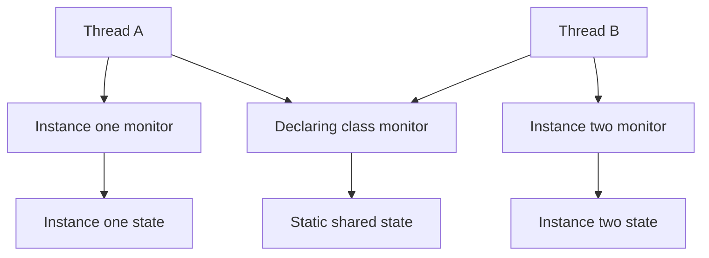

In the runnable example, the two objects maintain independent instance totals. Both global update styles use the same class monitor.

```java
public class MonitorScopeExample {
    static class Counter {
        private int instanceTotal;
        private static int globalTotal;

        synchronized void incrementInstance() {
            instanceTotal++;
        }
        synchronized int instanceTotal() {
            return instanceTotal;
        }
        static synchronized void incrementGlobal() {
            globalTotal++;
        }
        static void incrementGlobalWithBlock() {
            synchronized (Counter.class) {
                globalTotal++;
            }
        }
        static synchronized int globalTotal() {
            return globalTotal;
        }
    }

    public static void main(String[] args) throws InterruptedException {
        Counter first = new Counter();
        Counter second = new Counter();
        Thread a = new Thread(() -> {
            for (int index = 0; index < 1_000; index++) {
                first.incrementInstance();
                Counter.incrementGlobal();
            }
        });
        Thread b = new Thread(() -> {
            for (int index = 0; index < 1_000; index++) {
                second.incrementInstance();
                Counter.incrementGlobalWithBlock();
            }
        });
        a.start();
        b.start();
        a.join();
        b.join();
        System.out.println(first.instanceTotal());  // 1000
        System.out.println(second.instanceTotal()); // 1000
        System.out.println(Counter.globalTotal());  // 2000
    }
}
```

A class monitor applies to a particular loaded class identity. Multiple application processes have separate monitors and require coordination at a shared data/resource boundary when updating shared external state.

### Q3. What is a race condition? Is it the same as a race-around condition?

In Java concurrency, this question usually refers to a **race condition**. Correctness depends on the ordering of competing operations. A data race is the narrower memory-model issue of conflicting shared accesses without the required ordering. The term **race-around condition** is also used in digital electronics for some level-triggered JK flip-flop behavior. Here the examples address Java race conditions.

Suppose two requests each increase a counter initialized to zero. `count++` involves reading the value, calculating a result, and writing it. Both requests can read zero and each write one, losing an update.

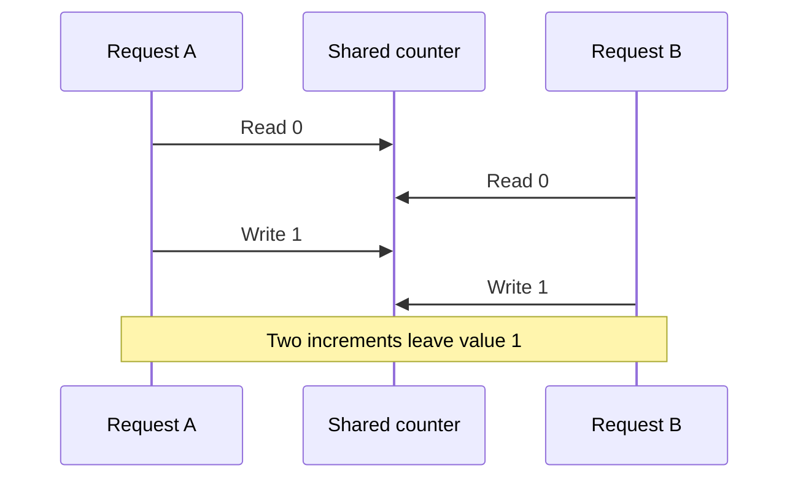

This example deliberately coordinates the bad interleaving with a barrier. Even a volatile counter loses an update because the complete operation is not atomic.

```java
import java.util.concurrent.BrokenBarrierException;
import java.util.concurrent.CyclicBarrier;
import java.util.concurrent.atomic.AtomicInteger;

public class RaceConditionExample {
    private static volatile int count;

    private static void unsafeIncrement(CyclicBarrier bothHaveRead) {
        int snapshot = count;
        try {
            bothHaveRead.await();
        } catch (InterruptedException exception) {
            Thread.currentThread().interrupt();
            return;
        } catch (BrokenBarrierException exception) {
            throw new IllegalStateException(exception);
        }
        count = snapshot + 1;
    }

    public static void main(String[] args) throws InterruptedException {
        CyclicBarrier bothHaveRead = new CyclicBarrier(2);
        Thread first = new Thread(() -> unsafeIncrement(bothHaveRead));
        Thread second = new Thread(() -> unsafeIncrement(bothHaveRead));
        first.start();
        second.start();
        first.join();
        second.join();
        System.out.println("Unsafe result " + count); // Unsafe result 1

        AtomicInteger safeCount = new AtomicInteger();
        Thread third = new Thread(() -> safeCount.incrementAndGet());
        Thread fourth = new Thread(() -> safeCount.incrementAndGet());
        third.start();
        fourth.start();
        third.join();
        fourth.join();
        System.out.println("Atomic result " + safeCount.get()); // Atomic result 2
    }
}
```

For a single counter, an atomic update fits. For a check-and-update invariant such as reserving the last seat, make the complete operation atomic using one lock, a correct CAS protocol, or the shared database's conditional update/transaction mechanism.

### Q4. Give a real-world race-condition scenario.

A concert has one seat left. Two requests read `remaining == 1`, both accept payment, and each sets remaining to zero. A synchronized getter followed by a synchronized setter does not make the pair atomic. The reservation check and decrement must occur within the same protected operation.

```java
static class SeatInventory {
    private int remaining = 1;
    synchronized boolean reserve() {
        if (remaining == 0) {
            return false;
        }
        remaining--;
        return true;
    }
}
```

This protects one shared inventory object in one JVM. A database-backed reservation shared across service instances needs an atomic database operation or appropriate transaction/isolation strategy.

### Q5. What is deadlock? Show the scenario with a diagram.

Thread A holds the inventory lock and waits for the payment lock. Thread B holds the payment lock and waits for the inventory lock. Each depends on the other releasing a resource first, so neither can proceed.

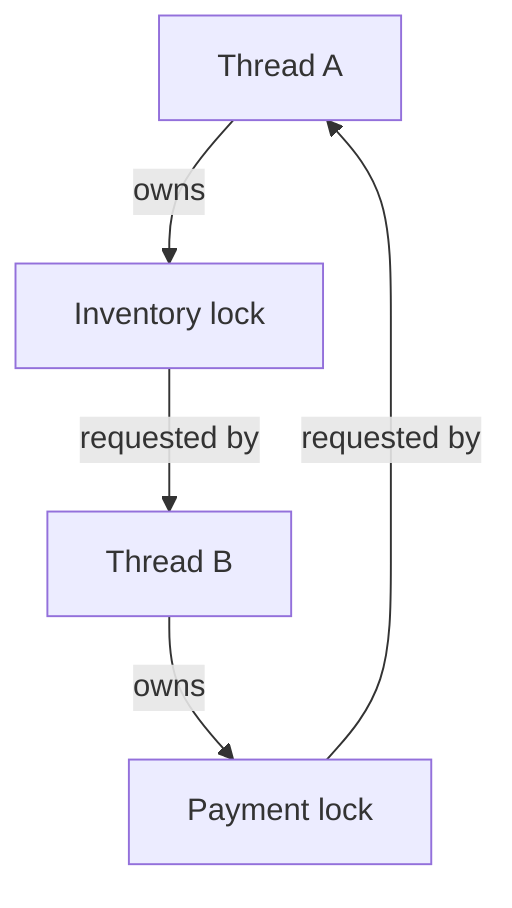

The four classical conditions are mutual exclusion, hold-and-wait, no preemption, and circular wait. Consistent lock ordering breaks the circular-wait condition. Timed acquisition can let a caller abandon an attempt, provided it releases locks already held and handles failure correctly.

### Q6. Give a runnable, detectable deadlock example.

Run this standalone example in its own Java process. It intentionally creates two permanently blocked daemon threads, detects the cycle, and lets the demonstration process exit. Application thread dumps provide the production investigation path.

```java
import java.lang.management.ManagementFactory;
import java.lang.management.ThreadMXBean;
import java.util.concurrent.CountDownLatch;
import java.util.concurrent.TimeUnit;

public class DeadlockExample {
    private static final Object inventory = new Object();
    private static final Object payment = new Object();
    private static final CountDownLatch firstLocksHeld = new CountDownLatch(2);

    private static void acquireInOrder(Object first, Object second) {
        synchronized (first) {
            firstLocksHeld.countDown();
            try {
                firstLocksHeld.await();
            } catch (InterruptedException exception) {
                Thread.currentThread().interrupt();
                return;
            }
            synchronized (second) {
                System.out.println("Both locks acquired");
            }
        }
    }

    public static void main(String[] args) throws InterruptedException {
        Thread first = new Thread(() -> acquireInOrder(inventory, payment), "inventory-first");
        Thread second = new Thread(() -> acquireInOrder(payment, inventory), "payment-first");
        first.setDaemon(true);
        second.setDaemon(true);
        first.start();
        second.start();
        ThreadMXBean threads = ManagementFactory.getThreadMXBean();
        long deadline = System.nanoTime() + TimeUnit.SECONDS.toNanos(5);
        while (System.nanoTime() < deadline) {
            long[] deadlocked = threads.findDeadlockedThreads();
            if (deadlocked != null) {
                System.out.println("Deadlocked threads " + deadlocked.length); // 2
                return;
            }
            Thread.sleep(10);
        }
        throw new IllegalStateException("Deadlock was not detected within the demo timeout");
    }
}
```

Interrupting a thread waiting to enter an intrinsic synchronized block does not cancel monitor acquisition. The example uses daemon threads for process termination, while production code should avoid creating the cycle. `findDeadlockedThreads` diagnoses platform-thread monitor/ownable-synchronizer cycles within its supported scope. It does not detect every application-level dependency deadlock.

### Q7. How do you fix the account-transfer deadlock scenario?

Acquire account locks in one global order, regardless of transfer direction. Protect the debit and credit together. Validate arithmetic before changing either balance so a failure leaves both balances consistent.

```java
public class OrderedTransferExample {
    static final class Account {
        final long id;
        long balance;
        Account(long id, long balance) {
            if (balance < 0) throw new IllegalArgumentException("Negative balance");
            this.id = id;
            this.balance = balance;
        }
    }

    static void transfer(Account from, Account to, long amount) {
        if (amount <= 0) throw new IllegalArgumentException("Amount must be positive");
        if (from == to) return;
        if (from.id == to.id) throw new IllegalArgumentException("Account IDs must be unique");
        Account first = from.id < to.id ? from : to;
        Account second = from.id < to.id ? to : from;
        synchronized (first) {
            synchronized (second) {
                if (from.balance < amount) {
                    throw new IllegalStateException("Insufficient balance");
                }
                long updatedDestination = Math.addExact(to.balance, amount);
                from.balance -= amount;
                to.balance = updatedDestination;
            }
        }
    }

    public static void main(String[] args) throws InterruptedException {
        Account first = new Account(1, 1_000);
        Account second = new Account(2, 1_000);
        Thread a = new Thread(() -> transfer(first, second, 100));
        Thread b = new Thread(() -> transfer(second, first, 50));
        a.start();
        b.start();
        a.join();
        b.join();
        System.out.println(first.balance);  // 950
        System.out.println(second.balance); // 1050
    }
}
```

The ID ordering is stable, and all code accessing these balances must follow the same locking protocol. A real multi-process payment system also needs durable transactions and its required failure/retry semantics.

### Q8. What is thread communication in Java?

Communication has two parts. Threads need a safe way to publish data and a way to wait for the condition that makes progress possible. Monitors provide shared-state coordination with `wait/notifyAll`. Explicit locks provide `Condition`. Queues and futures supply higher-level protocols.

| Requirement | Typical API | Example |
| --- | --- | --- |
| Wait for protected state to change | `wait` / `notifyAll` | Single shared bounded buffer |
| Wait on separate predicates under one explicit lock | `Condition` | Not-empty and not-full queues |
| Pass work items | `BlockingQueue` | Producers feed worker threads |
| Wait for task completion or a result | `Future`, `CompletableFuture` | Combine remote-call results |
| Wait for several tasks to finish | `CountDownLatch` | Start serving after initialization |
| Coordinate repeated phases | `CyclicBarrier`, `Phaser` | Staged parallel processing |

The complete `wait/notifyAll` implementation is in [Chapter 16](#chapter-16). Its state transitions explain why the condition is tested in a loop.

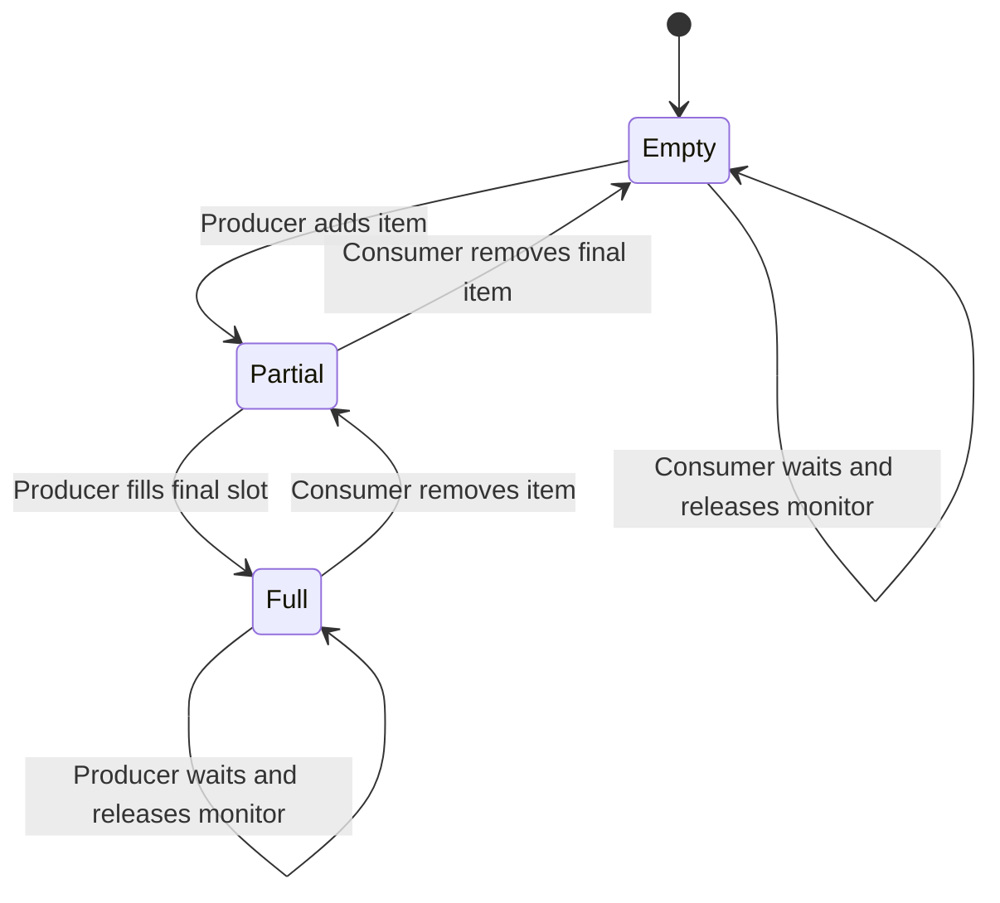

### Q9. Show communication using Lock and Condition.

This slot holds one non-null string. A producer waits for `notFull`, while a consumer waits for `notEmpty`. `await` releases the associated lock while waiting and reacquires it before returning. `signal` makes a waiter eligible to resume after lock reacquisition.

```java
import java.util.Objects;
import java.util.concurrent.locks.Condition;
import java.util.concurrent.locks.ReentrantLock;

public class ConditionExample {
    static final class Slot {
        private final ReentrantLock lock = new ReentrantLock();
        private final Condition notEmpty = lock.newCondition();
        private final Condition notFull = lock.newCondition();
        private String item;

        void put(String value) throws InterruptedException {
            Objects.requireNonNull(value);
            lock.lockInterruptibly();
            try {
                while (item != null) {
                    notFull.await();
                }
                item = value;
                notEmpty.signal();
            } finally {
                lock.unlock();
            }
        }
        String take() throws InterruptedException {
            lock.lockInterruptibly();
            try {
                while (item == null) {
                    notEmpty.await();
                }
                String result = item;
                item = null;
                notFull.signal();
                return result;
            } finally {
                lock.unlock();
            }
        }
    }

    public static void main(String[] args) throws InterruptedException {
        Slot slot = new Slot();
        Thread consumer = new Thread(() -> {
            try {
                System.out.println(slot.take());
            } catch (InterruptedException exception) {
                Thread.currentThread().interrupt();
            }
        });
        Thread producer = new Thread(() -> {
            try {
                slot.put("order-123");
            } catch (InterruptedException exception) {
                Thread.currentThread().interrupt();
            }
        });
        consumer.start();
        producer.start();
        producer.join();
        consumer.join();
        // Prints order-123.
    }
}
```

The single-slot contract allows one producer or consumer to be signaled for each transition. This demonstration exchanges one item. Longer-lived pipelines need an explicit close/failure protocol. `ArrayBlockingQueue` is a ready-made alternative for a bounded queue.

### Q10. How do race condition, deadlock, livelock, and starvation differ?

| Problem | What happens? | Scenario | Typical response |
| --- | --- | --- | --- |
| Race condition | A bad ordering causes an incorrect result | Two buyers reserve the last seat | Make the full invariant atomic |
| Deadlock | Tasks wait on a dependency cycle | Transfers acquire accounts in opposite orders | Global lock order, reduced nesting, or timed acquisition with cleanup |
| Livelock | Tasks keep reacting but fail to complete | Two workers repeatedly release and retry in sync | Bounded retries, backoff, randomized delay where appropriate |
| Starvation | A task repeatedly misses resources or execution | A waiting writer is continually overtaken | Review workload, scheduling, fairness, and queueing |

### Q11. Can a thread-safe collection still participate in a race condition?

Yes. A thread-safe `get` followed by a thread-safe `put` leaves a gap between them. Use an atomic map operation for a single-key invariant, or protect the larger operation consistently.

```java
java.util.concurrent.ConcurrentHashMap<String, Integer> reservations =
        new java.util.concurrent.ConcurrentHashMap<>();
reservations.merge("show-123", 1, Integer::sum);
```

This makes the per-key increment atomic. It does not by itself coordinate seat capacity, billing, or a transaction spanning multiple keys.

[Back to contents](#contents)

<a id="chapter-27"></a>
## Chapter 27 - Java locking mechanisms, advantages, and tradeoffs

### Q1. What kinds of locking and coordination should I know?

Start with the scope of the state and the invariant to protect. A monitor or `ReentrantLock` controls exclusive access. A read/write lock allows concurrent readers. `StampedLock` adds validated optimistic reads. A semaphore limits concurrent admissions. Atomic types support particular indivisible operations without an explicit mutual-exclusion block.

| Mechanism | Access model | Ownership / reentrancy | Main advantage | Main limitation | Real-world scenario |
| --- | --- | --- | --- | --- | --- |
| Intrinsic monitor with `synchronized` | One owner | Thread-owned, reentrant | Automatic release on block exit | No timed/interruptible monitor acquisition API | Protect one inventory object's state |
| `ReentrantLock` | One owner | Thread-owned, reentrant | Timed or interruptible acquisition, Conditions, optional fairness | Explicit unlock in finally | Reservation with a bounded lock wait |
| `ReentrantReadWriteLock` | Many readers or one writer | Per-thread holds, reentrant | Concurrent protected reads | Additional coordination cost, no direct read-to-write upgrade | Shared configuration with substantial read work |
| `StampedLock` | Read, write, optimistic read | Stamps, no thread ownership, non-reentrant | Short validated reads can avoid a read-lock acquisition | Validation/retry complexity and no fairness guarantee | Small consistent quote or coordinate snapshot |
| `Semaphore` | At most the available permits admitted | No thread ownership, no reentrant accounting | Limit concurrent access to a scarce resource | Every successful acquire needs one matching release | At most five simultaneous vendor calls |
| Atomic types / CAS | A specific atomic state transition | No lock ownership | Efficient counters and conditional single-state updates | Compound invariants require a deliberate protocol | Remaining-seat counter with a CAS loop |
| `FileLock` | Operating-system file-region locking | Held on behalf of the JVM | Coordinate cooperating processes over a file | OS/filesystem-specific semantics | Two local batch processes updating one shared file |

These cover the principal mechanisms relevant to the supplied questions. Database locks and distributed locks introduce a different scope and failure model, addressed in Q11.

### Q2. How do I choose a mechanism?

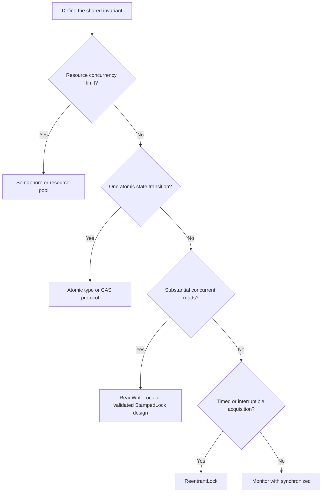

The read-heavy branch requires measurement. A tiny read can be cheaper with a simple lock or an immutable safely published snapshot. Consider contention, read duration, writes, and ownership before choosing additional complexity.

### Q3. What is a monitor lock, and what are its advantages and disadvantages?

Every Java object can serve as an intrinsic monitor. Entering `synchronized (lock)` acquires it. Exiting releases it even when the body throws. A thread can reenter a monitor it already owns. An object also has a wait set used by its `wait` and notification methods.

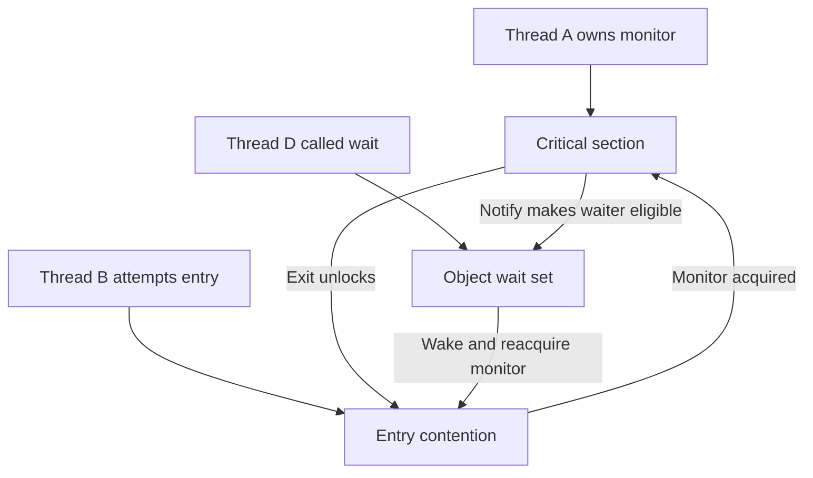

The entry-contention node is conceptual. Intrinsic monitors do not promise a public FIFO acquisition policy. A notified waiter competes for acquisition and cannot resume its protected body until it obtains the monitor.

**Advantages** include compact syntax, automatic release, reentrancy, and established visibility guarantees. **Disadvantages** include potentially indefinite entry wait, no fairness setting, one object wait set, and the risk of accidentally exposing a public monitor to unrelated code.

Real-world example, an in-memory stock object with a private lock:

```java
public class MonitorLockExample {
    static final class Inventory {
        private final Object monitor = new Object();
        private int remaining = 1;

        boolean reserve() {
            synchronized (monitor) {
                if (remaining == 0) return false;
                remaining--;
                return true;
            }
        }
    }

    public static void main(String[] args) throws InterruptedException {
        Inventory inventory = new Inventory();
        java.util.concurrent.atomic.AtomicInteger successes =
                new java.util.concurrent.atomic.AtomicInteger();
        Runnable buyer = () -> {
            if (inventory.reserve()) successes.incrementAndGet();
        };
        Thread first = new Thread(buyer);
        Thread second = new Thread(buyer);
        first.start();
        second.start();
        first.join();
        second.join();
        System.out.println("Reservations " + successes.get()); // Reservations 1
    }
}
```

### Q4. What is ReentrantLock? What does reentrant mean?

The owning thread can acquire the same lock again. The hold count increases, and each successful acquisition needs a matching unlock. Other threads remain excluded until the owner's hold count returns to zero.

| Step | Thread A hold count | Thread B |
| --- | --- | --- |
| A enters `deposit` | 1 | Cannot enter protected code |
| A calls a helper that acquires the same lock | 2 | Still waiting |
| Helper unlocks | 1 | Still waiting |
| Outer method unlocks | 0 | Eligible to acquire |

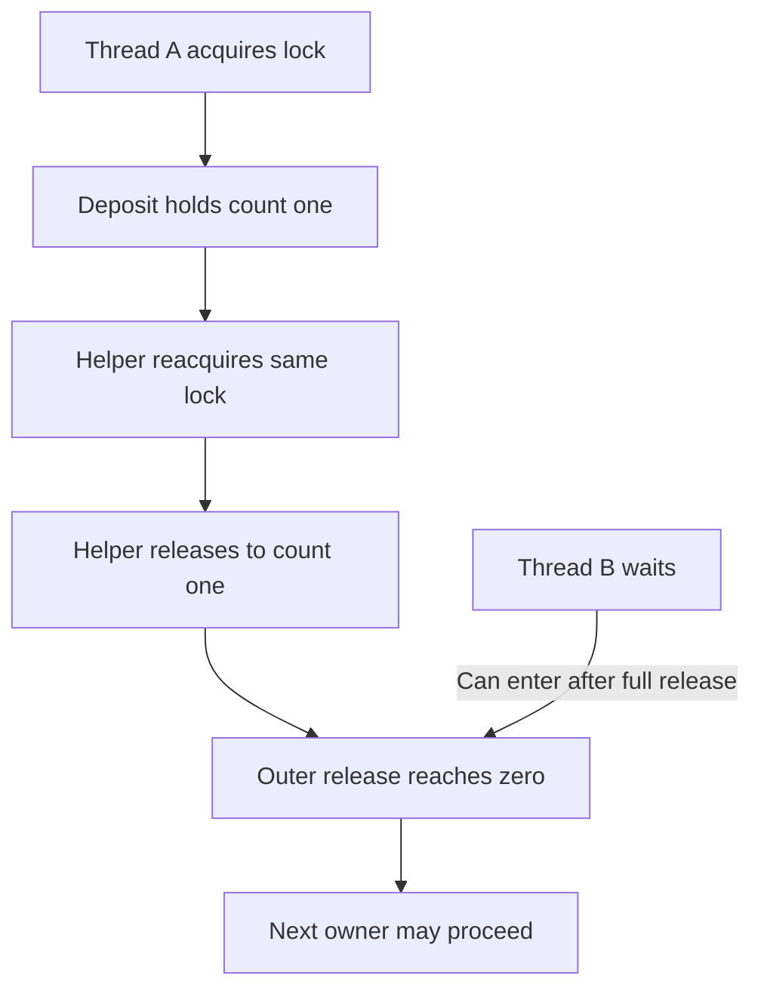

```java
import java.util.concurrent.locks.ReentrantLock;

public class ReentrantLockExample {
    static final class Counter {
        private final ReentrantLock lock = new ReentrantLock();
        private int value;

        void increment() {
            lock.lock();
            try {
                incrementInside();
            } finally {
                lock.unlock();
            }
        }
        private void incrementInside() {
            lock.lock(); // Same thread reenters the same lock.
            try {
                value++;
            } finally {
                lock.unlock();
            }
        }
        int value() {
            lock.lock();
            try {
                return value;
            } finally {
                lock.unlock();
            }
        }
    }

    public static void main(String[] args) throws InterruptedException {
        Counter counter = new Counter();
        Runnable job = () -> {
            for (int index = 0; index < 1_000; index++) counter.increment();
        };
        Thread first = new Thread(job);
        Thread second = new Thread(job);
        first.start();
        second.start();
        first.join();
        second.join();
        System.out.println(counter.value()); // 2000
    }
}
```

The nested acquisition is deliberate to demonstrate reentrancy. Normal code can often keep locking at a simpler boundary.

**Advantages** include `tryLock`, timed waits, `lockInterruptibly`, separate Conditions, and optional fairness. **Disadvantages** include manual release, more lifecycle decisions, and contention overhead. Reentrancy does not prevent a cycle involving multiple different locks.

### Q5. How do tryLock, timed locking, fairness, and interruptible locking differ?

| Method or option | Behavior | Example use |
| --- | --- | --- |
| `lock()` | Wait until acquired | A short mandatory critical section |
| `tryLock()` | Acquire immediately or return false | Skip an optional cache refresh |
| `tryLock(timeout, unit)` | Wait up to a timeout and support interruption | Limit a request's lock wait |
| `lockInterruptibly()` | Wait for acquisition while allowing cancellation | Cancel background work before it enters |
| `new ReentrantLock(true)` | Fair acquisition policy under its contract | Reduce overtaking under contention |

Untimed `tryLock()` can barge even on a fair ReentrantLock. Fairness may reduce throughput and does not guarantee operating-system scheduling fairness.

This method skips the refresh if it cannot acquire the lock within the chosen budget. Put it inside an enclosing class with the standard imports.

```java
static boolean refreshWithBudget(ReentrantLock lock, Runnable refresh)
        throws InterruptedException {
    if (!lock.tryLock(100, TimeUnit.MILLISECONDS)) {
        return false;
    }
    try {
        refresh.run();
        return true;
    } finally {
        lock.unlock();
    }
}
```

The timeout governs acquisition, not the duration of `refresh.run()`. Run the callback only when it follows the component's locking and execution contract.

### Q6. What is ReadWriteLock? How does it help a read-heavy application?

`ReentrantReadWriteLock` supplies a shared read lock and an exclusive write lock. Several readers can hold the read lock together. A writer must obtain exclusive access, and normal readers cannot enter while another thread holds the write lock.

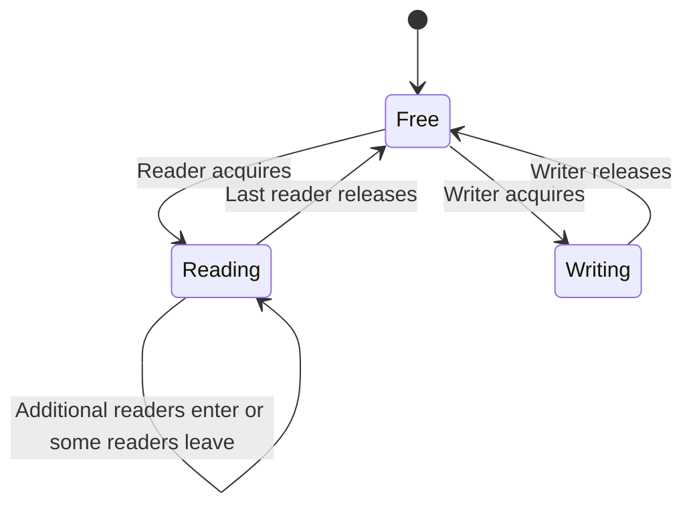

A writer waiting during the Reading state proceeds only after the relevant acquisitions become eligible under the lock's scheduling policy. This simplified diagram shows cross-thread exclusion and omits same-thread reentrant/downgrade holds.

Real-world example, a product-price catalog:

```java
import java.util.HashMap;
import java.util.Map;
import java.util.concurrent.locks.ReentrantReadWriteLock;

public class ReadWriteLockExample {
    static final class Catalog {
        private final ReentrantReadWriteLock lock = new ReentrantReadWriteLock();
        private final Map<String, Long> prices = new HashMap<>();

        Long price(String product) {
            lock.readLock().lock();
            try {
                return prices.get(product);
            } finally {
                lock.readLock().unlock();
            }
        }
        void update(String product, long price) {
            if (price < 0) throw new IllegalArgumentException("Negative price");
            lock.writeLock().lock();
            try {
                prices.put(product, price);
            } finally {
                lock.writeLock().unlock();
            }
        }
    }

    public static void main(String[] args) throws InterruptedException {
        Catalog catalog = new Catalog();
        catalog.update("book", 500);
        Thread first = new Thread(() -> System.out.println(catalog.price("book")));
        Thread second = new Thread(() -> System.out.println(catalog.price("book")));
        first.start();
        second.start();
        first.join();
        second.join();
        // Prints 500 twice. Reader scheduling is unspecified.
    }
}
```

**Advantages** include concurrent read access and a natural contract for protecting a mutable read-mostly structure. **Disadvantages** include lock-accounting costs, contention during writes, and possible starvation under a nonfair contended policy. Protect every access with the matching protocol, and do not leak mutable internal values for callers to change outside it.

### Q7. Can I upgrade a read lock to a write lock? Can I downgrade?

`ReentrantReadWriteLock` does not support obtaining its write lock while retaining a read hold that prevents exclusive acquisition. Release the read lock, acquire the write lock, and recheck the condition because the state may have changed in between.

A writer may acquire a read lock before releasing the write lock to downgrade while preserving protected access. Each hold must be released appropriately. Its write lock supports Conditions, while the read lock does not.

For a cache refresh, check validity under the read lock. If stale, release it, acquire the write lock, recheck validity, then refresh if still needed. This prevents two stale observations from blindly triggering duplicate refreshes.

### Q8. What is StampedLock? What is an optimistic read?

`StampedLock`, introduced in Java 8, supports write locking, read locking, and optimistic reading. Locking operations return a long stamp used for release or conversion. An optimistic read records a version, copies the relevant fields into local variables, validates, and falls back to a proper read lock when validation fails.

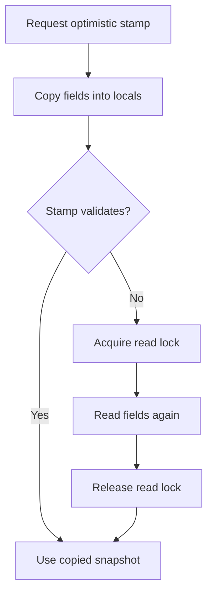

An optimistic stamp does not block a writer. Perform only operations safe on a temporarily inconsistent observation before validation. The example copies primitive fields and returns them only after successful validation or a locked reread.

```java
import java.util.Arrays;
import java.util.concurrent.locks.StampedLock;

public class StampedLockExample {
    static final class Quote {
        private final StampedLock lock = new StampedLock();
        private long bid;
        private long ask;

        void update(long bid, long ask) {
            if (bid < 0 || bid > ask) throw new IllegalArgumentException("Invalid quote");
            long stamp = lock.writeLock();
            try {
                this.bid = bid;
                this.ask = ask;
            } finally {
                lock.unlockWrite(stamp);
            }
        }
        long[] snapshot() {
            long stamp = lock.tryOptimisticRead();
            long observedBid = bid;
            long observedAsk = ask;
            if (!lock.validate(stamp)) {
                stamp = lock.readLock();
                try {
                    observedBid = bid;
                    observedAsk = ask;
                } finally {
                    lock.unlockRead(stamp);
                }
            }
            return new long[] { observedBid, observedAsk };
        }
    }

    public static void main(String[] args) {
        Quote quote = new Quote();
        quote.update(100, 102);
        System.out.println(Arrays.toString(quote.snapshot())); // [100, 102]
    }
}
```

**Advantages** include potentially cheaper short read snapshots when writes are uncommon, shared read mode, and conditional stamp conversion. **Disadvantages** include non-reentrancy, retry/fallback complexity, no Condition API, and no consistent fairness policy. Avoid callbacks that might reacquire the same StampedLock.

`tryConvertToWriteLock(stamp)` can succeed for an eligible read/optimistic state or return zero. A conversion protocol must retain and release the correct valid stamp and recheck state after any unlock/reacquire gap. Unlike reentrant locks, StampedLock does not track thread ownership, so a valid capability can be passed between threads under a deliberately designed protocol.

### Q9. What is a Semaphore? How does it differ from a lock?

A semaphore maintains permits. With two permits, up to two tasks can be admitted at a time when callers acquire and release correctly. A binary semaphore starts with one permit and can provide exclusion, but has no thread-ownership or reentrant-hold rules.

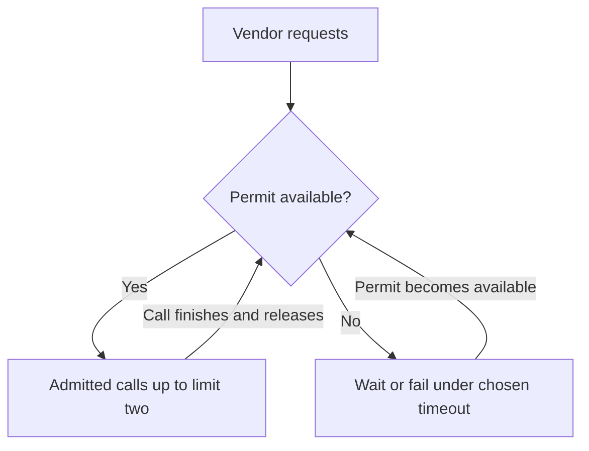

A semaphore counts admissions. It does not automatically select a free connection or make the admitted tasks' shared objects thread-safe. A connection pool additionally manages concrete resource ownership and cleanup.

```java
import java.util.ArrayList;
import java.util.List;
import java.util.concurrent.*;
import java.util.concurrent.atomic.AtomicInteger;

public class SemaphoreExample {
    private static final Semaphore slots = new Semaphore(2, true);
    private static final AtomicInteger active = new AtomicInteger();
    private static final AtomicInteger maximum = new AtomicInteger();

    private static void callVendor() throws InterruptedException {
        slots.acquire();
        try {
            int running = active.incrementAndGet();
            maximum.accumulateAndGet(running, Math::max);
            Thread.sleep(20); // Simulated external call.
        } finally {
            active.decrementAndGet();
            slots.release();
        }
    }

    public static void main(String[] args) throws Exception {
        ExecutorService executor = Executors.newFixedThreadPool(6);
        try {
            List<Future<Void>> results = new ArrayList<>();
            for (int index = 0; index < 6; index++) {
                results.add(executor.submit(() -> {
                    callVendor();
                    return null;
                }));
            }
            for (Future<Void> result : results) result.get();
            System.out.println("Within limit " + (maximum.get() <= 2)); // true
            System.out.println("Available permits " + slots.availablePermits()); // 2
        } finally {
            executor.shutdownNow();
        }
    }
}
```

**Advantages** include a direct concurrency limit, interruptible/timed acquisition, and optional fairness. **Disadvantages** include permit leaks when release is omitted, accidental over-release that increases the count, and no automatic ownership checking. Untimed `tryAcquire()` can barge even with a fair semaphore.

The example releases only after successful acquisition. If `acquire()` throws before success, it never enters the try/finally body, so it does not manufacture a permit.

### Q10. Where do CAS, atomic types, and spin locks fit?

CAS means compare-and-set. It changes a value only if the observed state still matches an expected value. A failed comparison can cause a retry. `AtomicInteger` and `AtomicReference` expose suitable atomic operations; `LongAdder` is useful for high-contention statistics with a different observation contract.

```java
import java.util.concurrent.atomic.AtomicInteger;

public class CasReservationExample {
    private static final AtomicInteger remaining = new AtomicInteger(1);

    private static boolean reserve() {
        while (true) {
            int observed = remaining.get();
            if (observed == 0) return false;
            if (remaining.compareAndSet(observed, observed - 1)) return true;
        }
    }

    public static void main(String[] args) throws InterruptedException {
        AtomicInteger successes = new AtomicInteger();
        Runnable buyer = () -> {
            if (reserve()) successes.incrementAndGet();
        };
        Thread first = new Thread(buyer);
        Thread second = new Thread(buyer);
        first.start();
        second.start();
        first.join();
        second.join();
        System.out.println("Reservations " + successes.get()); // Reservations 1
    }
}
```

**Advantages** include a small atomic transition and no explicit unlock. **Disadvantages** include retry contention, limited scope for compound state, and possible ABA issues in some reference-based algorithms. An algorithm's progress guarantees depend on its complete implementation and runtime primitives.

A spin lock repeatedly checks/acquires instead of parking. It can waste a whole core while the owner is descheduled, especially on a single-core machine. JVM locks may use adaptive internal techniques. Choose standard JDK constructs instead of implementing an application spin lock casually.

### Q11. What about file locks, database locks, and distributed locks?

| Scope | Mechanism | What it coordinates | Example |
| --- | --- | --- | --- |
| Threads sharing one JVM object | Monitor / explicit lock | In-process state under one protocol | Local inventory object |
| Cooperating processes accessing a file | `FileChannel.lock` / `tryLock` | File regions subject to platform semantics | Local batch file writer |
| Transactions using shared database state | Database locking/isolation or conditional writes | Database records and transactional invariants | Reserve a seat across several API servers |
| Several service instances | A shared coordination protocol | Ownership/leases across processes | Elect a refresh worker |

A JVM lock on one EC2 instance does not coordinate another instance's Java process. Distributed leases must account for expiry, process pauses, stale owners, and the shared resource's enforcement model. For shared durable business state, use that storage system's consistency and transaction primitives when they fit.

`FileLock` coordinates cooperating processes and is held on behalf of the JVM. It does not provide the usual monitor-style thread protection within one JVM, and overlapping requests in one JVM can throw `OverlappingFileLockException`. Its effectiveness and shared-lock behavior depend on the filesystem and platform.

```java
// A standalone local file-region locking demonstration.
import java.nio.channels.FileChannel;
import java.nio.channels.FileLock;
import java.nio.file.Files;
import java.nio.file.Path;
import java.nio.file.StandardOpenOption;

public class FileLockExample {
    public static void main(String[] args) throws Exception {
        Path file = Files.createTempFile("java-lock-demo-", ".tmp");
        try {
            try (FileChannel channel = FileChannel.open(file,
                    StandardOpenOption.READ, StandardOpenOption.WRITE);
                 FileLock lock = channel.lock()) {
                System.out.println("Lock valid " + lock.isValid()); // Lock valid true
            }
        } finally {
            Files.deleteIfExists(file);
        }
    }
}
```

### Q12. Are optimistic/pessimistic locking and fair/unfair locking separate classes?

These describe properties or strategies. Pessimistic coordination obtains exclusion before accessing protected state. Optimistic coordination observes state and validates or conditionally commits. StampedLock optimistic reads and version-checked database updates are examples at different scopes.

Fairness describes how contenders are admitted. Reentrancy describes whether an owner can reacquire its lock. Shared/exclusive describes how many compatible holders can coexist. These dimensions explain why several mechanisms can share some properties while serving different purposes.

### Q13. Which mistakes should I watch for in interview code?

| Mistake | Consequence | Correct pattern |
| --- | --- | --- |
| Different lock objects guard the same state | Concurrent conflicting access remains possible | Define one consistent access protocol |
| Lock only the getter or setter | Check-and-update race remains | Protect the entire invariant |
| Call `wait` without owning its monitor | `IllegalMonitorStateException` | Enter the matching synchronized block |
| Use `if` around `await` or `wait` | Proceed after an invalid wake-up condition | Recheck in a while loop |
| Omit unlock in an exception path | Permanent exclusion | Release in finally |
| Release a semaphore after failed acquire | Permit count grows incorrectly | Enter the release scope after successful acquire |
| Upgrade a read hold without releasing it | Self-blocking write acquisition | Release, acquire write, then recheck |
| Reenter StampedLock | Possible self-deadlock | Avoid reentrant call paths |
| Perform slow external work while holding a state lock | High contention and blocked progress | Narrow the protected invariant and design publication carefully |
| Use a per-JVM lock for cross-instance state | Conflicting distributed updates | Coordinate at the shared resource boundary |

[Back to contents](#contents)

<a id="chapter-28"></a>
## Chapter 28 - Deploying a JAR with a native executable on AWS

### Q1. What do you first clarify when someone says "driver file"?

Identify how Java uses the dependency and which operating system and CPU architecture it supports. The filename alone does not tell you its runtime integration contract.

| Dependency | How Java uses it | What must be deployed |
| --- | --- | --- |
| JDBC driver packaged as `.jar` | Classpath/module/framework dependency loading | Driver JAR or the application's packaged dependency set |
| Java class with `main` | Java launcher entry point | Class and all required Java dependencies |
| Native executable such as `driver.exe` | Separate process through `ProcessBuilder` | Executable, DLLs, config/data, supported OS and architecture |
| Native shared library such as `.dll` or `.so` | JNI/JNA or library-specific API | Matching native library and compatible Java binding/runtime |
| Vendor installer | Installation before application startup | Installed service/binaries, prerequisites, and licensing configuration |
| Kernel/device driver | Operating-system installation and device integration | A suitable host/device setup under the vendor's requirements |

This chapter's main scenario assumes a **user-space command-line program** that the JAR starts as a child process. A kernel driver, GUI-only tool, installer, or long-lived daemon requires its own installation/lifecycle design.

### Q2. Can I put a Windows executable inside a JAR and run it on Linux?

The executable's machine-code format, operating-system APIs, and native dependencies must match the environment. Packaging it alongside or inside a JAR does not change those requirements. A standard Windows PE executable needs a compatible Windows environment; a vendor-supplied Linux build can run in a matching Linux environment.

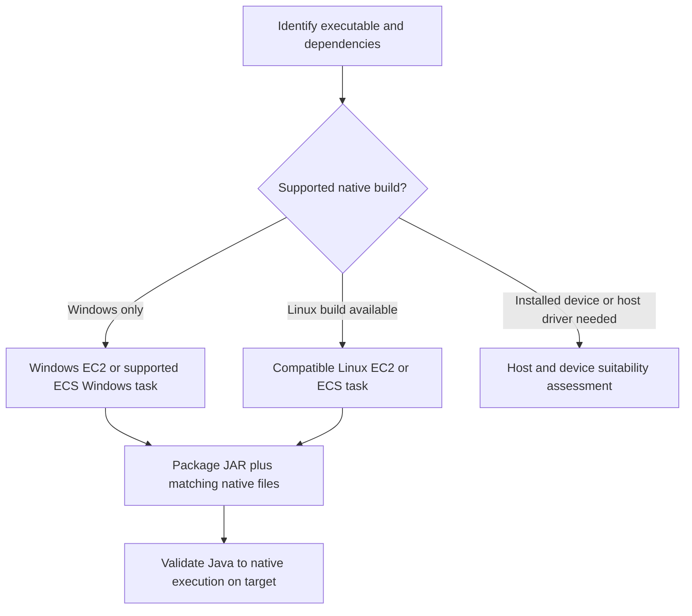

A native program is normally executed from a filesystem path. If it is packaged as a JAR resource, extract it and its required files to an appropriate application directory before starting it. Version the native payload together with the JAR and handle executable permissions on Linux.

### Q3. How would you deploy a Windows-only executable and a JAR to EC2?

A practical answer is to deploy them together on a compatible Windows EC2 instance and make the dependency explicit in the release package.

1. Confirm supported Windows Server version, x86/x64 architecture, Java version, required DLL/runtime packages, and headless command-line behavior.
2. Build a versioned release containing `app.jar`, the native program, its accompanying files, and the expected directory/configuration layout. Include integrity/version metadata that your release process can check.
3. Provision or update the Windows instance with a matching Java runtime and vendor prerequisites. Use a reproducible image or installation automation so replacement instances behave consistently.
4. Retrieve the matching release using the instance's deployment mechanism and AWS identity. Systems Manager Run Command can automate installation and bootstrap commands on configured managed nodes.
5. Configure a trusted executable path, working directory, writable output/log location, and the native tool's input/output contract. Run a smoke test under the same account that will run the application.
6. Start the application through a Windows-service-capable launcher or service wrapper with the required startup and recovery behavior. Expose health status and collect application/native-process failures in the chosen monitoring setup.
7. Deploy the JAR and native dependency as one release unit. Keep the prior compatible release available so rollback restores both together.

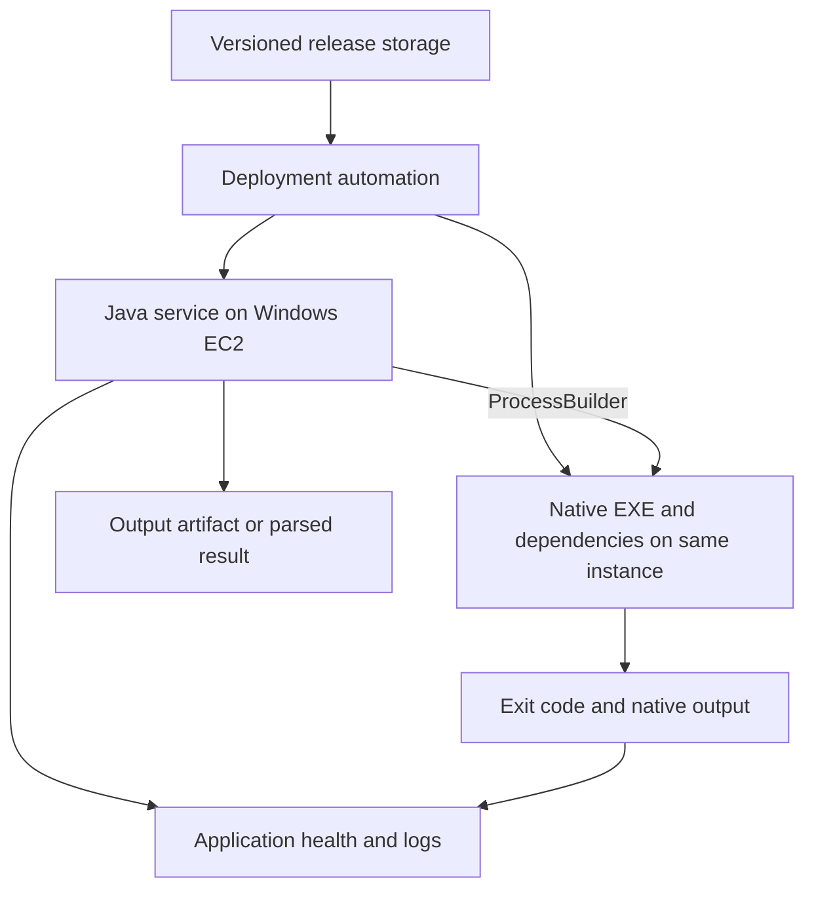

For example, use `C:/apps/report-service/app.jar`, `C:/apps/report-service/vendor/report.exe`, and an application-specific output/log directory. The paths are illustrative. A vendor executable can require a particular working directory or a specific user profile, so test those assumptions directly.

[Reference for automated instance commands](https://docs.aws.amazon.com/systems-manager/latest/userguide/run-command.html)

### Q4. Can I use ECS or Fargate with a Windows executable?

Amazon ECS supports Windows containers on compatible EC2 capacity and supported Fargate Windows configurations. Match the Windows container image, runtime platform, region, CPU architecture, and native dependencies. Current AWS documentation lists Windows Server 2019/2022 Core and Full variants for Fargate and requires x86_64 for Windows tasks. Check the platform-specific feature limits for the chosen deployment.

A Windows container image can include both the JAR and the native executable. This Dockerfile assumes the build context already contains a compatible **Windows** Java runtime in `runtime/`, `app.jar`, and the vendor files in `vendor/`.

```dockerfile
FROM mcr.microsoft.com/windows/servercore:ltsc2022
WORKDIR C:/app
COPY runtime/ C:/runtime/
COPY app.jar C:/app/app.jar
COPY vendor/ C:/app/vendor/
ENV VENDOR_EXECUTABLE="C:/app/vendor/driver.exe"
ENTRYPOINT ["C:/runtime/bin/java.exe", "-jar", "C:/app/app.jar"]
```

The example base image and native files must satisfy the vendor's runtime requirements. Configure the JAR to read `VENDOR_EXECUTABLE` and invoke that path. The following is a task-definition fragment for the matching Fargate runtime platform, rather than a complete ECS service definition.

```json
{
  "runtimePlatform": {
    "cpuArchitecture": "X86_64",
    "operatingSystemFamily": "WINDOWS_SERVER_2022_CORE"
  }
}
```

A complete task/service also needs the matching image, supported resources, role permissions, networking, ports where relevant, and log/lifecycle configuration. Put a long-lived native service in an explicitly managed lifecycle, such as a separate worker or supervised process, rather than assuming its lifetime matches a short command invocation.

[References for Windows Fargate support and constraints](https://docs.aws.amazon.com/AmazonECS/latest/developerguide/windows-considerations.html) · [Operating systems and architectures](https://docs.aws.amazon.com/AmazonECS/latest/developerguide/fargate-tasks-services.html) · [Regional support](https://docs.aws.amazon.com/AmazonECS/latest/developerguide/AWS_Fargate-Regions.html)

### Q5. What if the vendor supplies a Linux build? What about Lambda?

A Linux native binary can be packaged with the JAR in a compatible Linux deployment. Match CPU architecture and required shared libraries, provide execute permission, and test the program with the actual base image and runtime account.

Lambda execution environments use Linux. A native dependency must match the environment and architecture, and the application must satisfy Lambda's invocation and resource model. A normal server JAR or Windows EXE does not become a compatible Lambda handler merely by being uploaded. A Java Lambda handler can call a suitable Linux helper process when the dependency and execution constraints fit.

[Reference for Lambda runtimes and native architecture requirements](https://docs.aws.amazon.com/lambda/latest/dg/lambda-runtimes.html)

### Q6. How does the JAR invoke the executable?

Use `ProcessBuilder` with a configured absolute executable path and separate argument strings. Set the working directory explicitly when the native program resolves relative files. Handle stdin, stdout, stderr, timeouts, exit codes, interruption, and child cleanup.

This Java 8-compatible example redirects stdout and stderr to a file so an unread output pipe cannot block the child. The input stream is closed to signal that the tool receives no stdin. Each invocation creates its own log file.

```java
import java.io.IOException;
import java.nio.file.Files;
import java.nio.file.Path;
import java.nio.file.Paths;
import java.util.ArrayList;
import java.util.Arrays;
import java.util.List;
import java.util.concurrent.TimeUnit;

public class NativeToolExample {
    static int runTool(Path executable, List<String> arguments, Path log,
                       long timeoutMillis) throws IOException, InterruptedException {
        if (timeoutMillis <= 0) {
            throw new IllegalArgumentException("Timeout must be positive");
        }
        Path absoluteExecutable = executable.toAbsolutePath().normalize();
        if (!Files.isRegularFile(absoluteExecutable)) {
            throw new IOException("Executable file not found " + absoluteExecutable);
        }
        List<String> command = new ArrayList<>();
        command.add(absoluteExecutable.toString());
        command.addAll(arguments);
        Process process = new ProcessBuilder(command)
                .directory(absoluteExecutable.getParent().toFile())
                .redirectErrorStream(true)
                .redirectOutput(log.toAbsolutePath().toFile())
                .start();
        try {
            process.getOutputStream().close();
            if (!process.waitFor(timeoutMillis, TimeUnit.MILLISECONDS)) {
                process.destroy();
                if (!process.waitFor(2, TimeUnit.SECONDS)) {
                    process.destroyForcibly();
                    if (!process.waitFor(2, TimeUnit.SECONDS)) {
                        throw new IOException("Native process did not terminate. Log " + log);
                    }
                }
                throw new IOException("Native process timed out. Log " + log);
            }
            int exitCode = process.exitValue();
            if (exitCode != 0) {
                throw new IOException("Native process failed with exit " + exitCode + ". Log " + log);
            }
            return exitCode;
        } catch (InterruptedException exception) {
            process.destroyForcibly();
            Thread.currentThread().interrupt();
            throw exception;
        } finally {
            if (process.isAlive()) process.destroyForcibly();
        }
    }

    public static void main(String[] args) throws Exception {
        if (args.length == 0) {
            throw new IllegalArgumentException("Provide an executable path, then its arguments");
        }
        Path log = Files.createTempFile("native-tool-", ".log");
        List<String> arguments = Arrays.asList(args).subList(1, args.length);
        int exitCode = runTool(Paths.get(args[0]), arguments, log, 30_000);
        System.out.println("Exit code " + exitCode);
        System.out.println("Log file " + log);
    }
}
```

Example invocation on a compatible Windows machine, after compiling:

```powershell
java NativeToolExample "C:/apps/report-service/vendor/report.exe" "--input" "C:/data/input.json"
```

The actual arguments and success exit-code convention must match the vendor program. This example treats zero as success. If the tool writes its structured result to stdout, collect that output according to its protocol instead of treating the merged log file as a structured response. Keep log retention and growth bounded in production.

`ProcessBuilder` starts a child process directly from the argument list, with OS-specific quoting rules. Configure the executable from a trusted application setting and validate permitted inputs according to the program's contract. A native program that launches descendants needs an appropriate process-tree lifecycle policy through its supervisor or platform. The example cleanup targets the direct child.

[Reference for ProcessBuilder I/O and process attributes](https://docs.oracle.com/en/java/javase/21/docs/api/java.base/java/lang/ProcessBuilder.html)

### Q7. Is the executable loaded using the classpath?

The classpath locates Java classes/resources. A native executable is launched through an operating-system process API. A JNI library is loaded through the Java/native integration mechanism, such as `System.load` with an absolute library path, rather than by executing the DLL itself.

For a plain Java app with dependency JARs, the classpath separator differs by OS.

```powershell
# Windows, assuming this main class and lib directory exist.
java -cp "app.jar;lib/*" com.example.Main
```

```bash
# Linux, assuming this main class and lib directory exist.
java -cp "app.jar:lib/*" com.example.Main
```

A framework-packaged executable JAR may manage its dependencies differently. Use its supported launcher and package the native payload separately or extract it deliberately.

### Q8. What if the JAR runs on Linux but the vendor executable is Windows-only?

A Windows worker service can own the native execution and expose a defined request/result interface. The Linux Java service calls that worker through an authenticated application protocol or queue. Define job IDs, timeouts, output storage, and duplicate-handling behavior for retries.

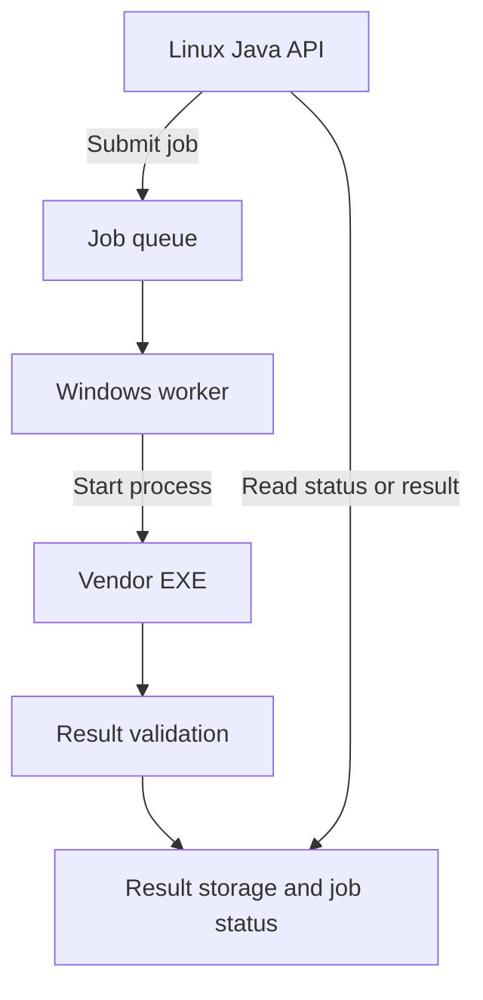

This separates operating-system dependencies at a service boundary and adds network/distributed-job responsibilities. Co-locating the JAR and executable on Windows can be simpler when the complete application supports that environment.

### Q9. What is a concise interview answer for this AWS deployment question?

> I would first identify whether the driver is a Java dependency, a native library, or a separate executable, then confirm its OS and architecture requirements. For a Windows-only command-line executable, I would deploy the JAR and its matching native files together on Windows EC2 or a supported ECS Windows environment. I would invoke it through ProcessBuilder with a configured path and explicit working directory, handle output, exit codes and timeouts, and manage the service lifecycle and monitoring. I would version and roll back the JAR and native dependency together. If the rest of the application needs Linux, I would evaluate a vendor Linux build or a separate Windows worker service.

### Q10. Which parts of this example require target-environment validation?

The Java subprocess helper is independent of AWS provisioning and can be tested locally with a compatible executable. The actual vendor EXE, DLLs, licensing, Windows base image, service account, filesystem permissions, and AWS task/instance configuration must be verified with the real deployment package. Dockerfile and task JSON blocks illustrate packaging decisions and are not a claim of a deployed AWS system.

[Back to contents](#contents)

<a id="chapter-29"></a>
## Chapter 29 - Variables, numeric representation, arrays, and operators

Source sections 02, 03, and 16 expand the foundations in Chapters 01-02. This chapter uses Java 8-compatible examples.

### Q1. What do statically typed and strongly typed mean in Java?

A variable has a compile-time type that constrains legal assignments and operations. Java checks many type errors before execution and enforces relevant checks at runtime, such as array store checks and casts. Local `var`, introduced in Java 10, asks the compiler to infer a static type from the initializer.

A backend request DTO can therefore require a numeric quantity and reject a direct assignment of arbitrary text at compilation. Parsing external text is a separate operation that can fail at runtime.

### Q2. Which Java editions appear in the PDF?

Java SE supplies the core language platform and standard libraries. Java EE was the enterprise specification family whose continuation is Jakarta EE. Java ME means Micro Edition and targets constrained environments. A Java backend can use Java SE plus frameworks without implementing every enterprise specification.

### Q3. What are the primitive sizes, ranges, and default field values?

| Type | Value representation | Range or notable property | Default field value |
| --- | --- | --- | --- |
| `byte` | 8-bit signed integer | -128 to 127 | 0 |
| `short` | 16-bit signed integer | -32768 to 32767 | 0 |
| `int` | 32-bit signed integer | -2^31 through 2^31 - 1 | 0 |
| `long` | 64-bit signed integer | -2^63 through 2^63 - 1 | 0L |
| `char` | Unsigned 16-bit UTF-16 code unit | 0 through 65535 | `\u0000` |
| `float` | IEEE 754 binary32 | 1 sign, 8 exponent, 23 stored fraction bits | 0.0f |
| `double` | IEEE 754 binary64 | 1 sign, 11 exponent, 52 stored fraction bits | 0.0d |
| `boolean` | Logical true/false | Language does not fix its storage footprint to one bit | false |

Local variables require definite assignment. Arrays initialize their components to the corresponding defaults. A primitive field can live inside a heap object or array, while a primitive local can be represented in a frame or optimized machine state.

### Q4. How do variable kinds and naming rules differ?

Instance fields belong to an object. Static fields belong to a class identity. Parameters receive argument values for one invocation. Local variables have a block scope and definite-assignment rules.

Identifiers are case-sensitive and can contain permitted Unicode identifier characters. They cannot be reserved keywords or start with a digit. A single `_` is a keyword from Java 9. Conventional names use `camelCase` for variables/methods, `PascalCase` for types, and uppercase underscore names for constants.

### Q5. How do widening, narrowing, and numeric promotion work?

Widening permits conversions such as int to long. Some widening conversions, including int to float, can lose numeric precision. Narrowing requires an explicit cast in many contexts and may discard bits. Arithmetic on byte, short, and char normally promotes operands to int before computing.

```java
public class NumericConversionExample {
    public static void main(String[] args) {
        byte first = 1;
        byte second = 127;
        int promoted = first + second;
        System.out.println(promoted);          // 128
        System.out.println((byte) promoted);   // -128
        System.out.println((byte) 255);        // -1
        int large = 16_777_217;
        float rounded = large;
        System.out.println((int) rounded);     // 16777216
        long exactSum = (long) Integer.MAX_VALUE + 1;
        System.out.println(exactSum);          // 2147483648
    }
}
```

Promotion follows type rules and occurs before the operation. It does not automatically choose a wider result type just because the runtime value overflows.

### Q6. Why does `shortValue += 1` compile when `shortValue = shortValue + 1` may fail?

Compound assignment includes a conversion back to the left-hand type, and evaluates the left-hand expression once. A plain addition produces an int for short operands. An explicit cast is required to assign that nonconstant int expression back to short. The implicit narrowing in compound assignment can still overflow.

```java
short value = 32767;
value += 1;
System.out.println(value); // -32768
```

For counters or totals that must reject overflow, use a suitable larger type or checked arithmetic such as `Math.addExact` with a deliberate conversion policy.

### Q7. How do float and double represent a number?

For normal binary32 values, the value is `(-1)^sign * (1 + fraction) * 2^(exponent - 127)`. Binary64 uses an exponent bias of 1023. Subnormal values and special exponent encodings have different interpretations.

The exactly representable value `4.125` is binary `100.001`, or `1.00001 * 2^2`. Its binary32 sign is 0, stored exponent is 129, and stored fraction has the bit corresponding to 1/32 set. `Float.floatToIntBits(4.125f)` yields hexadecimal `40840000`.

| IEEE 754 concept | Meaning | Backend implication |
| --- | --- | --- |
| Normal finite value | Sign, biased exponent, leading significant bit, fraction | Most ordinary calculations |
| Subnormal | Very small value with reduced precision | Underflow behavior needs consideration |
| Infinity | Overflow or some floating-point divisions | Validate values at an API boundary |
| NaN | Undefined/unrepresentable numeric result | NaN is unequal to itself with `==` |
| Signed zero | Positive and negative zero | Can affect division and formatting |

### Q8. Why do decimal values sometimes produce surprising results?

Many decimal fractions repeat in binary, so binary floating-point stores a rounded approximation. `BigDecimal` supports decimal arithmetic with explicit scale and rounding. `BigInteger` supports arbitrary-size integers.

```java
import java.math.BigDecimal;

public class DecimalExample {
    public static void main(String[] args) {
        System.out.println(0.1 + 0.2); // 0.30000000000000004
        System.out.println((double) 0.7f); // 0.699999988079071
        BigDecimal total = new BigDecimal("0.1").add(new BigDecimal("0.2"));
        System.out.println(total); // 0.3
        System.out.println(Float.toHexString(4.125f)); // 0x1.08p2
        System.out.println(Integer.toHexString(Float.floatToIntBits(4.125f))); // 40840000
    }
}
```

A billing example should define currency scale and rounding. Constructing `BigDecimal` directly from a double carries that binary value's approximation into the decimal representation.

### Q9. What is the difference between a constant and a final variable?

A constant variable, in the language-specification sense, is a final primitive or String variable initialized with a constant expression. A final value initialized by an arbitrary method call is not a compile-time constant. Compile-time constant values may be inlined into dependent bytecode, which matters when separately compiled libraries change them.

`static final List<String>` is a final reference, while the list can still be mutable. Immutability and copying are treated in [Chapter 43](#chapter-43).

### Q10. Are arrays objects? How do one-dimensional and jagged arrays differ?

Arrays are objects with a fixed length and runtime component type. A multidimensional Java array is an array of arrays, and rows can have different lengths or be null. Java source does not promise a physically contiguous rectangular block for a 2D array.

```java
public class ArrayShapeExample {
    public static void main(String[] args) {
        int[][] rows = { {1, 2}, {3} };
        System.out.println(rows.length);    // 2
        System.out.println(rows[0].length); // 2
        System.out.println(rows[1].length); // 1
        int[] defaults = new int[2];
        System.out.println(defaults[0]);    // 0
        Object[] strings = new String[1];
        try {
            strings[0] = Integer.valueOf(7);
        } catch (ArrayStoreException expected) {
            System.out.println("Runtime array type check");
        }
    }
}
```

Array indices run from zero through length minus one. An invalid index throws `ArrayIndexOutOfBoundsException`.

### Q11. How do arithmetic and relational operators behave?

Integer division truncates toward zero. Integer remainder follows the dividend's sign. Integer division by zero throws `ArithmeticException`. Floating-point division can produce infinities or NaN instead. Relational operators compare values and return a boolean.

```java
System.out.println(5 / 2);       // 2
System.out.println(-5 % 2);      // -1
System.out.println(5 / 2.0);     // 2.5
System.out.println(1.0 / 0.0);   // Infinity
System.out.println(0.0 / 0.0);   // NaN
```

An average computed from int values needs an intentional floating-point or decimal conversion before division when a fractional result is required.

### Q12. How do logical, unary, and assignment operators differ?

`&&` and `||` short-circuit. With boolean operands, `&` and `|` evaluate both sides. Prefix increment changes the variable before the expression yields a value, while postfix increment yields the old value. `!` negates a boolean, and unary minus negates a number within its representation rules.

```java
String name = null;
System.out.println(name != null && !name.isEmpty()); // false, safe short-circuit
int number = 5;
System.out.println(number++); // 5
System.out.println(++number); // 7
```

Use explicit statements when several increments in one expression would obscure evaluation order. Assignment operators update variables and do not provide thread synchronization.

### Q13. How do bitwise operators and shifts work?

`&`, `|`, and `^` combine bits. `~` complements the bits of a promoted integral value. `>>` sign-extends, and `>>>` fills with zeros. Shifts on int use the low five bits of the shift distance, while long shifts use the low six bits.

```java
public class BitOperationsExample {
    public static void main(String[] args) {
        int read = 1;
        int write = 2;
        int permissions = read | write;
        System.out.println((permissions & write) != 0); // true
        System.out.println(permissions ^ write);       // 1, toggles write bit
        System.out.println(~4);                        // -5
        System.out.println(-8 >> 1);                   // -4
        System.out.println(-8 >>> 1);                  // 2147483644
        System.out.println(1 << 32);                   // 1, distance masked to zero
    }
}
```

Bit masks are useful for compact permission flags or protocol fields. Choose a representation that also supports readability and validation.

### Q14. What do ternary and instanceof do?

The ternary operator selects one of two expressions based on a boolean condition. Its type rules can perform numeric promotion or boxing, so examine the resulting type when mixing operands. `instanceof` tests a compatible runtime type and returns false for null. A successful check can support a safe cast.

```java
Object input = "Java";
if (input instanceof String) {
    System.out.println(((String) input).length()); // 4
}
System.out.println(null instanceof String); // false
int maximum = 4 > 5 ? 4 : 5;
System.out.println(maximum); // 5
```

### Q15. How do precedence, associativity, and evaluation order differ?

Precedence determines grouping between different operators. Associativity determines grouping for operators at the same level. Operand evaluation order is a separate rule, and Java evaluates operands left-to-right subject to short-circuit behavior.

| Higher to lower grouping, simplified | Examples |
| --- | --- |
| Access, calls, postfix | `a[i]`, `object.method()`, `x++` |
| Unary and casts | `!x`, `~x`, `(long) x` |
| Multiplication then addition | `* / %`, then `+ -` |
| Shifts then comparisons | `<< >> >>>`, then `< <= > >= instanceof` |
| Equality then bitwise | `== !=`, then `&`, `^`, `|` |
| Logical then conditional | `&&`, `||`, `?:` |
| Assignment | `=`, `+=`, and related operators |

`2 + 3 * 4` evaluates to 14. Parentheses make a business calculation's intended grouping explicit.

### Q16. What are Java source-file naming and comment rules?

With ordinary file-based javac compilation, a public top-level type belongs in a correspondingly named source file. Several package-private top-level types can share a compilation unit. Nested public types are separate from this top-level file-organization rule. Multiple classes may define entry points, and the launcher selects the class you name.

A conventional main method can belong to a package-private top-level class. A public containing class is not a universal requirement for launching it. Single-line comments use //, block comments use /* ... */, and Javadoc comments use /** ... */ for documentation tooling.

```java
public class FileLayoutExample {
    /**
     * Adds two values with overflow checking.
     * @param first the first value
     * @param second the second value
     * @return the exact sum
     */
    static int add(int first, int second) {
        return Math.addExact(first, second);
    }
    public static void main(String[] args) {
        System.out.println(add(1, 2)); // 3
    }
}
```

Save this example as FileLayoutExample.java. The source-file organization is a compilation/discovery convention, rather than a way for the JVM to guess among every main method in the application.

[Back to contents](#contents)

<a id="chapter-30"></a>
## Chapter 30 - Methods, constructors, initialization, and control flow

Source sections 04, 05, and 17 extend the method and constructor questions in Chapters 03, 05, and 06.

### Q1. What belongs in a method declaration and method signature?

A declaration can include annotations, modifiers, type parameters, a return type, a name, parameters, a throws clause, and a body or permitted semicolon form. A method signature uses its name and parameter-type information under the language's generic rules. Return type and throws clause alone cannot distinguish overloads.

For example, `public int total(int quantity, int price)` declares a public instance method returning int. A parameter is the variable in that declaration; an argument is an expression supplied at a call.

### Q2. When does a method make sense as static, final, or abstract?

A static method is useful when its operation belongs to the type and needs no receiver, such as a factory or stateless conversion. A final instance method fixes an implementation within a class hierarchy. An abstract method states a required implementation for an abstract class or interface contract.

System-defined library methods and user-defined methods obey the same language invocation rules. An abstract method has no implementation body, while an ordinary method that does nothing still has a body.

### Q3. What are varargs rules and their overload pitfalls?

A varargs parameter is represented by an array and must be the last parameter. Only one is allowed. Callers can supply zero or more values, or an array. An explicit null array is possible and must be handled according to the API contract.

```java
public class VarargsExample {
    static int sum(String label, int... values) {
        int total = 0;
        for (int value : values) total = Math.addExact(total, value);
        return total;
    }
    static String choose(long value) { return "widening"; }
    static String choose(Integer value) { return "boxing"; }
    public static void main(String[] args) {
        System.out.println(sum("empty"));           // 0
        System.out.println(sum("prices", 10, 20));  // 30
        System.out.println(sum("prices", new int[] {10, 20})); // 30
        System.out.println(choose(7));               // widening
    }
}
```

Fixed-arity applicability and conversion phases precede variable-arity selection. Overloads such as `sum(int...)` and `sum(int, int...)` can make calls ambiguous. Keep public overload sets easy to predict.

### Q4. How do default, no-argument, parameterized, and copy constructors differ?

A compiler-provided default constructor appears only when the class declares no constructor. A developer-written no-argument constructor is explicit. A parameterized constructor accepts initialization arguments. A copy constructor is an ordinary constructor that follows an application-defined copy policy.

A JavaBean convention often expects a public no-argument constructor and properties. That convention does not apply to every plain Java object.

### Q5. Why do constructors have no return type and reject static/final/abstract/synchronized?

A constructor participates in instance initialization under a dedicated language mechanism. Adding a return type declares a method with a similar name. Constructors are not inherited or overridden, cannot be abstract, cannot be static class operations, and do not allow the synchronized modifier.

A constructor may contain a synchronized block when it needs to coordinate with existing shared state. Avoid letting the partially initialized `this` escape to callbacks, static fields, or other threads.

### Q6. How do this and super constructor chains work?

A constructor can delegate to another constructor in the same class or invoke a superclass constructor. For the Java 8-21 examples here, an explicit constructor invocation is first. The chain eventually reaches a superclass constructor. An implicit `super()` requires an accessible no-argument superclass constructor.

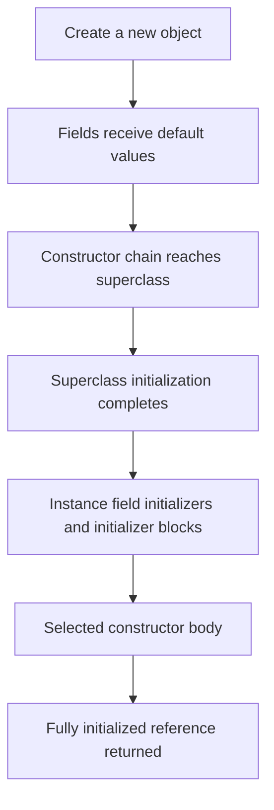

Class initialization, including static initialization, happens separately when required before relevant instance creation. Constructor delegation must not form a cycle.

### Q7. What is the initialization order across a superclass and subclass?

For each class being initialized, static field initializers and static blocks run in source order after required superclass initialization. During object construction, superclass construction precedes that subclass's instance initializers and constructor body.

```java
public class InitializationOrderExample {
    static class Parent {
        static { System.out.println("Parent static"); }
        { System.out.println("Parent instance"); }
        Parent() { System.out.println("Parent constructor"); }
    }
    static class Child extends Parent {
        static { System.out.println("Child static"); }
        { System.out.println("Child instance"); }
        Child() { System.out.println("Child constructor"); }
    }
    public static void main(String[] args) {
        new Child();
    }
}
```

Expected order is Parent static, Child static, Parent instance, Parent constructor, Child instance, Child constructor. A second new Child skips already completed static initialization.

### Q8. Why is calling an overridable method from a constructor risky?

Dynamic dispatch can enter a subclass override before that subclass's fields have received their explicit initialization. The override may see default values. Keep construction dependent on non-overridable helpers or fully initialized inputs.

A payment processor constructor that calls an overridable `connect()` could enter code relying on credentials that the subclass has not set yet. Establish the full object state before invoking such lifecycle behavior.

### Q9. How do if, else-if, and nested conditions differ?

An if branch checks one boolean. An if/else chooses between alternatives. An else-if chain selects the first matching branch in order. Nested conditions express dependent checks, such as first validating authentication and then checking a specific permission.

```java
int quantity = 3;
String shipping;
if (quantity <= 0) {
    shipping = "invalid";
} else if (quantity >= 5) {
    shipping = "bulk";
} else {
    shipping = "standard";
}
System.out.println(shipping); // standard
```

Order business rules deliberately so an earlier broad condition does not hide a later specific one.

### Q10. How do traditional switch statements and fall-through work?

Colon-style cases can continue into following cases until a break, return, throw, or end is reached. A default label is optional for many traditional statements and need not appear last. Case labels must follow the applicable constant/type rules and cannot duplicate values.

```java
public class SwitchStatementExample {
    public static void main(String[] args) {
        int quarter;
        String month = "March";
        switch (month) {
            case "January":
            case "February":
            case "March":
                quarter = 1;
                break;
            default:
                quarter = 0;
        }
        System.out.println(quarter); // 1
    }
}
```

For traditional Java 8 switch, supported selectors include byte/short/char/int, corresponding wrappers, String, and enums. Null reference selectors throw. Java 21 expands switch through final pattern-matching features, including explicit null handling where supported.

### Q11. How do switch expressions, arrow cases, and yield work?

Switch expressions became final in Java 14. They produce a value and must be exhaustive under their rules. Arrow rules avoid ordinary fall-through. A block can use yield to supply its result. A return in a surrounding method has different control-flow semantics.

```java
// Java 14+
public class SwitchExpressionExample {
    public static void main(String[] args) {
        int quantity = 3;
        String category = switch (quantity) {
            case 0 -> "empty";
            case 1 -> "single";
            default -> {
                String label = "multiple";
                yield label;
            }
        };
        System.out.println(category); // multiple
    }
}
```

### Q12. How do for, while, do-while, and enhanced for differ?

A for loop groups initialization, condition, and update. A while loop checks its condition before each iteration. A do-while executes its body at least once. Enhanced for traverses an array or Iterable and assigns each encountered value to a loop variable.

Changing an enhanced-for variable that holds an int does not write back into the array. Mutating the object referenced by an element can change that shared object. Structural collection modification still follows its iteration contract.

### Q13. How do break, continue, and labels work?

Break exits the applicable loop or switch. Continue skips to the next iteration of its target loop. Labels can target an enclosing statement, but cannot jump into a method or arbitrary code location.

```java
public class LoopControlExample {
    public static void main(String[] args) {
        int sum = 0;
        for (int number = 1; number <= 5; number++) {
            if (number == 3) continue;
            sum += number;
        }
        System.out.println(sum); // 12
        int foundRow = -1;
        int[][] matrix = { {1, 2}, {3, 4} };
        search:
        for (int row = 0; row < matrix.length; row++) {
            for (int value : matrix[row]) {
                if (value == 3) {
                    foundRow = row;
                    break search;
                }
            }
        }
        System.out.println(foundRow); // 1
    }
}
```

### Q14. When can access control, overload resolution, and exceptions interact?

The compiler first needs a legal accessible method and an applicable signature. It checks declared checked exceptions for that chosen contract. Runtime dispatch then selects an overriding instance implementation. An override may narrow checked exceptions, but a call through a broader interface still follows that interface's compile-time throws contract.

For a storage interface declaring `throws IOException`, a specific in-memory implementation may throw none. A variable typed as the interface still requires the caller to handle or declare the checked exception.

[Back to contents](#contents)

<a id="chapter-31"></a>
## Chapter 31 - OOP design, relationships, and real-world modeling

Source sections 01, 07, 09, and 10 develop the four pillars through application scenarios. The underlying definitions and dispatch rules remain in Chapters 03-07.

### Q1. How would you explain all four pillars through one checkout example?

A checkout depends on a payment contract, which is abstraction. Different payment implementations supply runtime polymorphism. Each account or payment implementation controls its own state, which is encapsulation. An appropriate base implementation can share a stable invariant through inheritance when the subtype contract fits.

```mermaid
classDiagram
    class Checkout {
        -Payment payment
        +complete(long amount)
    }
    class Payment {
        <<interface>>
        +pay(long amount)
    }
    class CardPayment {
        +pay(long amount)
    }
    class WalletPayment {
        -long balance
        +pay(long amount)
    }
    Payment <|.. CardPayment
    Payment <|.. WalletPayment
    Checkout --> Payment : uses
```

### Q2. Show a runnable payment example with encapsulation and polymorphism.

```java
public class PaymentPolymorphismExample {
    interface Payment {
        void pay(long amount);
    }
    static final class WalletPayment implements Payment {
        private long balance;
        WalletPayment(long balance) {
            if (balance < 0) throw new IllegalArgumentException("Negative balance");
            this.balance = balance;
        }
        @Override
        public void pay(long amount) {
            if (amount <= 0 || amount > balance) {
                throw new IllegalArgumentException("Invalid amount");
            }
            balance -= amount;
            System.out.println("Wallet paid " + amount);
        }
        long balance() { return balance; }
    }
    static final class CardPayment implements Payment {
        @Override
        public void pay(long amount) {
            if (amount <= 0) throw new IllegalArgumentException("Invalid amount");
            System.out.println("Card paid " + amount);
        }
    }
    static final class Checkout {
        private final Payment payment;
        Checkout(Payment payment) { this.payment = java.util.Objects.requireNonNull(payment); }
        void complete(long amount) { payment.pay(amount); }
    }
    public static void main(String[] args) {
        WalletPayment wallet = new WalletPayment(1_000);
        new Checkout(wallet).complete(300);             // Wallet paid 300
        new Checkout(new CardPayment()).complete(200); // Card paid 200
        System.out.println(wallet.balance());           // 700
    }
}
```

The code demonstrates dispatch and state validation. Production billing additionally requires durable accounting, external-provider behavior, and retry/idempotency rules.

### Q3. How do abstraction and encapsulation solve different problems?

Abstraction defines the operations a client can rely on. Encapsulation controls representation and legal state changes. A repository interface abstracts storage operations, while a concrete cache encapsulates its map and invalidation policy.

Private fields contribute to encapsulation, but public setters for every field can still expose invalid states. An operation such as `reserveSeat()` can preserve an invariant more effectively than separate `getRemaining()` and `setRemaining()` calls.

### Q4. What are single, multilevel, hierarchical, and multiple inheritance?

Single inheritance has one direct superclass. Multilevel inheritance forms a chain. Hierarchical inheritance has several subclasses of one parent. A Java class has one direct superclass and can implement multiple interfaces. Interfaces may themselves extend multiple interfaces.

```mermaid
classDiagram
    class Asset
    class Vehicle
    class Car
    class Bike
    Asset <|-- Vehicle
    Vehicle <|-- Car
    Vehicle <|-- Bike
```

The chain Asset to Vehicle to Car demonstrates multilevel inheritance. Car and Bike demonstrate hierarchical inheritance. The relationship must preserve meaningful subtype behavior.

### Q5. When does an is-a relationship become misleading?

A class should honor the operations and invariants of its advertised parent contract. Modeling a read-only collection as a mutable subtype that unexpectedly rejects required modifications can surprise callers when the base contract promises mutation. Define contracts that accurately express supported operations and documented optional behavior.

Inheritance shares implementation and commitments. A payment processor that simply needs logging can own a logger through composition without claiming to be a logger.

### Q6. How do association, aggregation, and composition apply to a school?

A teacher assigned to a school is associated with it. Students enrolled at a school can exist independently, which models aggregation. Rooms or schedule entries owned exclusively by a school model composition if the domain gives them that ownership.

```mermaid
classDiagram
    class School
    class Student
    class Room
    class Teacher
    School o-- Student : enrolls
    School *-- Room : owns
    School --> Teacher : assigns
```

These are domain ownership relationships. Java GC still follows reachability. Losing a School reference does not immediately destroy Room objects if another reference keeps them reachable.

### Q7. Can composition be one-to-one, one-to-many, or many-to-many?

Multiplicity describes how many related objects can participate. An order can own many line items. A user can have one profile. Students can attend many courses, and courses can contain many students. Many-to-many associations often need an enrollment object that stores relationship-specific information such as date and status.

Strong exclusive composition and shared many-to-many ownership need careful modeling because ownership and multiplicity answer different questions.

### Q8. Does every real-world entity need its own class?

Create a type when it expresses a useful concept, invariant, ownership boundary, or behavior. A `Money` value can carry amount and currency validation. A simple temporary loop index does not need a domain object. Procedural programs also support modularity and code reuse; OOP specifically organizes collaboration through objects and their contracts.

### Q9. What is coupling, and how does dependency injection help?

Coupling is how strongly components depend on each other's details. Constructor injection makes dependencies explicit and allows implementations to vary under a stable contract. It does not require a framework.

```java
interface MessageSender { void send(String message); }
static final class NotificationService {
    private final MessageSender sender;
    NotificationService(MessageSender sender) { this.sender = sender; }
    void notifyUser(String message) { sender.send(message); }
}
// Inside main:
NotificationService service = new NotificationService(System.out::println);
service.notifyUser("Order shipped"); // Order shipped
```

### Q10. What is the difference between overriding an operation and changing its contract?

An override supplies subtype-specific behavior while honoring the parent's promises. Tightening required inputs, surprising callers with broader checked failures, or invalidating documented postconditions can break substitutability. The compiler enforces signature/access/checked-exception rules, while many behavioral obligations need design review and tests.

### Q11. Are getters enough to keep an object read-only?

A getter that returns a mutable internal collection or array can expose direct modification. Return an appropriate defensive copy or immutable view according to the intended ownership. An unmodifiable view can still reflect underlying mutations, while an independent copy has its own container.

An audit report that must preserve approved data should own a stable snapshot. Chapter 43 demonstrates container copies, deep copies, and immutable publication in detail.

### Q12. How can a state machine make an OOP model safer?

Represent valid transitions explicitly instead of allowing arbitrary status setters. For an order, require CREATED before payment, PAID before shipping, and a defined cancellation policy.

```mermaid
stateDiagram-v2
    [*] --> Created
    Created --> Paid: Payment accepted
    Created --> Cancelled: Cancel before payment
    Paid --> Shipped: Fulfillment completes
    Paid --> Refunded: Refund accepted
    Shipped --> Delivered: Delivery confirmed
```

Methods such as `markPaid()` validate the current state and perform one legal transition. Concurrent or distributed transitions additionally need atomic storage/update rules.

[Back to contents](#contents)

<a id="chapter-32"></a>
## Chapter 32 - Class forms, nested types, enums, POJOs, and immutability

Source sections 07 and 09 expand class forms and enum behavior. Earlier introductory answers remain in Chapter 09.

### Q1. How do concrete, abstract, final, and immutable classes differ?

A concrete class can be instantiated when its constructors are accessible and other rules permit it. An abstract class supports incomplete implementations. A final class prevents subclasses. An immutable class preserves its observable value after construction through a deliberate design of fields, copying, and methods.

A final class can be mutable. An abstract class can contain constructors, state, and implemented methods, even when it has no abstract methods.

### Q2. How do static nested and member inner classes differ in construction?

A static nested class has no implicit enclosing instance. A member inner class needs an enclosing object and can access that instance's members, subject to normal rules.

```java
public class NestedClassExample {
    private final String name;
    NestedClassExample(String name) { this.name = name; }
    static final class Formatter {
        String format(String value) { return "[" + value + "]"; }
    }
    final class Session {
        String owner() { return name; }
    }
    public static void main(String[] args) {
        Formatter formatter = new Formatter();
        NestedClassExample outer = new NestedClassExample("Shivam");
        Session session = outer.new Session();
        System.out.println(formatter.format(session.owner())); // [Shivam]
    }
}
```

A nested implementation can keep a helper close to its owner. A long-lived member inner object can also keep its enclosing instance reachable.

### Q3. What can local and anonymous classes capture?

They can capture effectively final local variables. A local class's visibility is limited to its enclosing block, so it cannot use a member access modifier such as public or private. An anonymous class has no explicitly declared constructor but can use an instance initializer and the selected superclass constructor arguments.

A callback that captures an outer service or a large request can retain it as long as the callback remains reachable. Keep lifecycle and captured state deliberate.

### Q4. Can an inner class extend another inner class?

Yes, provided the constructor supplies the enclosing instance required by the superclass. A subclass constructor can use a qualified super invocation such as `owner.super()` for a non-static inner superclass. A static nested superclass needs no enclosing instance.

```java
public class InnerInheritanceExample {
    static class Outer {
        class Base {
            String label() { return "base"; }
        }
    }
    static class Child extends Outer.Base {
        Child(Outer owner) { owner.super(); }
    }
    public static void main(String[] args) {
        System.out.println(new Child(new Outer()).label()); // base
    }
}
```

This is legal but introduces a specific ownership relationship. Prefer a simpler type structure when that relationship is unnecessary.

### Q5. What is a POJO? Does it require setters or prohibit annotations?

POJO means Plain Old Java Object. It is a descriptive term rather than a strict language category. It does not universally require a public no-argument constructor, prohibit interfaces, or forbid annotations. Those restrictions usually belong to a specific convention or framework.

A JavaBean is a more specific convention involving properties and common construction/accessor expectations. A record is a language-defined type with component-based data-carrier behavior.

### Q6. What methods are available on enum values?

`values()` returns the constants in declaration order. `valueOf(String)` finds an exact declared name or throws `IllegalArgumentException`. `name()` returns that name. `ordinal()` is the zero-based declaration position, while `toString()` can be overridden.

Persist an explicit stable code when external storage needs a durable identifier. Inserting/reordering enum constants changes ordinal values. Enum identity comparisons with `==` are appropriate, and comparing a nullable enum reference with `==` is null-safe.

### Q7. How do enum fields, constructors, and constant-specific implementations work?

```java
public class EnumBehaviorExample {
    interface FeeRule { long fee(long amount); }
    enum PaymentKind implements FeeRule {
        CARD("card") {
            public long fee(long amount) { return amount / 100; }
        },
        WALLET("wallet") {
            public long fee(long amount) { return 0; }
        };
        private final String code;
        PaymentKind(String code) { this.code = code; }
        String code() { return code; }
        public abstract long fee(long amount);
    }
    public static void main(String[] args) {
        PaymentKind kind = PaymentKind.valueOf("CARD");
        System.out.println(kind.code());   // card
        System.out.println(kind.fee(500)); // 5
        System.out.println(PaymentKind.WALLET.fee(500)); // 0
    }
}
```

Each constant implements the abstract operation. Enum constructors are private in effect and cannot be public or protected. Enum constants with bodies can have constant-specific runtime subclasses.

### Q8. Why use enums instead of several unrelated int or String constants?

An enum restricts a parameter to a named domain type and groups valid choices with behavior. A method taking `PaymentKind` cannot accidentally receive an arbitrary integer code. External strings still require parsing/validation and a compatibility policy for unknown future values.

Enums represent a closed set within that deployed program version. Plugins or server-defined dynamic catalogs can need a different extensibility model.

### Q9. Can an immutable object contain a list or date?

Yes, if it controls ownership and prevents observable mutation. Copy mutable constructor inputs, protect mutable outputs, and consider nested elements. `java.time` values and String are immutable and can usually be shared. Legacy `java.util.Date` is mutable and needs a copy when independent state is required.

```java
static final class Deadline {
    private final java.util.Date value;
    Deadline(java.util.Date value) {
        this.value = new java.util.Date(value.getTime());
    }
    java.util.Date value() {
        return new java.util.Date(value.getTime());
    }
}
```

For a new date/time model, choose an appropriate immutable java.time type. Chapter 43 explains the depth and consistency requirements for larger object graphs.

### Q10. How do singleton initialization choices compare?

| Approach | Initialization | Key requirement |
| --- | --- | --- |
| Eager static final instance | During class initialization | Construction cost is acceptable at that point |
| Initialization holder | On holder initialization | Static initialization supplies safe publication |
| Enum singleton | Enum initialization | API fits enum semantics |
| Synchronized lazy accessor | On first call | All creation follows the accessor protocol |
| Double-checked locking | On first call | Volatile instance and correct checks/publication |

A private constructor alone does not make a lazy singleton thread-safe. A singleton's mutable methods still need their own concurrency design. The existing implementations are in Chapter 21.

### Q11. Can abstract classes and interfaces have static nested types?

Yes. Nested interfaces are implicitly static. A type declared inside an interface is public and static under the relevant rules. A class can give its own nested interface a more restrictive member access level. Implementing an outer interface does not automatically implement a nested interface's independent contract.

### Q12. What access exists between an outer class and its nested classes?

Java permits the enclosing/nested class family to access private members under its language rules. This helps implement tightly related helpers. It does not change the rules for unrelated callers or the enclosing-instance requirement of a member inner class.

[Back to contents](#contents)

<a id="chapter-33"></a>
## Chapter 33 - Generics, variance, bounds, raw types, and erasure

Source section 08 expands Chapter 09. Use these questions to explain type safety and the compiler's limits through repository and collection examples.

### Q1. How does a generic class improve an Object-based holder?

A generic holder preserves the intended type at compile time. An Object-based holder accepts unrelated values and often needs casts when reading. A `Repository<Order>` communicates that its contract handles orders and lets the compiler reject unrelated inputs.

```java
public class GenericHolderExample {
    static class Holder<T> {
        private final T value;
        Holder(T value) { this.value = value; }
        T value() { return value; }
    }
    static final class StringHolder extends Holder<String> {
        StringHolder(String value) { super(value); }
    }
    static final class NamedHolder<T> extends Holder<T> {
        private final String name;
        NamedHolder(String name, T value) { super(value); this.name = name; }
        String name() { return name; }
    }
    public static void main(String[] args) {
        Holder<Integer> quantity = new Holder<>(3);
        System.out.println(quantity.value() + 1); // 4
        System.out.println(new StringHolder("order").value()); // order
        NamedHolder<Long> total = new NamedHolder<>("total", 500L);
        System.out.println(total.name() + "=" + total.value()); // total=500
    }
}
```

The subclass can fix a type argument or preserve its own type parameter. Generic constructors and fields still follow ordinary ownership and mutability rules.

### Q2. How do multiple type parameters and generic methods differ?

A class such as `Pair<K,V>` preserves separate key and value types. A generic method declares its type parameters before its return type and can belong to a nongeneric class. Its type parameter scope is that declaration.

```java
static <T> T identity(T value) {
    return value;
}
```

A generic class's static method cannot directly use the class's instance-level type parameter. It can declare its own method type parameter instead.

### Q3. What is invariance, and why is List<Integer> not a List<Number>?

If a List<Integer> could be assigned directly to List<Number>, a caller could insert a Double and violate the original list's contract. Generic types are generally invariant. Arrays are covariant and use runtime array-store checks, so they behave differently.

```mermaid
flowchart TD
    I[Integer is a Number] --> R[Subtype relationship of element types]
    L[List of Integer] --> W[List of unknown subtype of Number]
    N[List of Number] --> W
    W --> C[Read elements as Number]
    W --> A[Arbitrary Number insertion is disallowed]
```

An extends wildcard grants read-oriented flexibility without giving the caller permission to insert an arbitrary Number into an unknown narrower list.

### Q4. What do upper-bounded, lower-bounded, and unbounded wildcards allow?

| Form | Safe read type | Safe non-null writes | Example |
| --- | --- | --- | --- |
| `List<? extends Number>` | Number | No arbitrary Number value | Sum several numeric-list types |
| `List<? super Integer>` | Object | Integer values | Collect integer results |
| `List<?>` | Object | No arbitrary value | Inspect a list of unknown element type |

Null can be supplied under ordinary reference-type rules, though the collection may reject null at runtime. Removing or clearing elements is still possible when the implementation supports it. Wildcard read restrictions do not make a collection immutable.

### Q5. Show PECS in a reusable copy utility.

```java
import java.util.*;

public class GenericCopyExample {
    static <T> void copy(List<? extends T> source, List<? super T> destination) {
        for (T value : source) destination.add(value);
    }
    public static void main(String[] args) {
        List<Integer> source = Arrays.asList(1, 2);
        List<Number> destination = new ArrayList<>();
        copy(source, destination);
        destination.add(2.5);
        System.out.println(destination); // [1, 2, 2.5]
    }
}
```

This copies element references into the destination. It is a collection transfer operation, and mutable elements remain shared unless separately copied.

### Q6. When should I name a type parameter instead of using a wildcard?

A named parameter can express relationships among arguments and the return value. Two independent wildcards describe two potentially different unknown types. Use `<T> T choose(T first, T second)` when callers and inference should relate inputs to an output type. Use a wildcard when an implementation only needs an unknown value within a bound.

Multiple wildcards are legal in a signature. Java can infer a shared supertype for a named type parameter, so a generic parameter does not always force arguments to have identical concrete runtime classes.

### Q7. How do upper bounds and intersection bounds work?

`<T extends Number>` permits Number and its subtypes. A type parameter can have several upper bounds, such as `<T extends Number & Comparable<T>>`. If one bound is a class, it must appear first. Remaining bounds are interfaces, and at most one class bound is allowed.

```java
static <T extends Number & Comparable<T>> T larger(T first, T second) {
    return first.compareTo(second) >= 0 ? first : second;
}
// larger(10, 20) returns 20.
```

A type parameter uses `extends` for class and interface bounds. Lower bounds use wildcard syntax such as `? super Integer`.

### Q8. What is a raw type, and how does heap pollution happen?

A raw use such as `List` loses generic type checks. Heap pollution means a variable of a parameterized type refers to an object incompatible with its supposed parameterization. Raw assignments, unchecked casts, and unsafe generic varargs can create it.

```java
import java.util.*;

public class HeapPollutionExample {
    @SuppressWarnings({"rawtypes", "unchecked"})
    public static void main(String[] args) {
        List raw = new ArrayList<Integer>(); // Deliberately unsafe demonstration.
        raw.add("wrong element type");
        List<Integer> integers = raw;
        try {
            Integer value = integers.get(0);
            System.out.println(value);
        } catch (ClassCastException expected) {
            System.out.println("Heap pollution detected on read");
        }
    }
}
```

Suppression hides the compiler warning and provides no runtime repair. Keep raw types at narrowly controlled legacy integration boundaries.

### Q9. What does erasure replace type parameters with?

A type parameter erases to its leftmost bound, or Object when unbounded. The compiler can insert casts and bridge methods to preserve source-level contracts after erasure. Generic signature metadata can remain in class files for reflection, even though individual List instances do not retain reified element-type parameters.

`Holder<T>.value()` may therefore have an erased Object return descriptor, while source code using Holder<String> sees String and can receive an inserted cast.

### Q10. What is a bridge method?

Suppose a base method erases to Object but a concrete implementation returns or accepts a more specific type. The compiler can generate a synthetic bridge to connect the erased invocation signature to the concrete implementation. Reflection may reveal both methods, with `isBridge()` identifying the bridge.

A serializer or injection tool inspecting methods should consider synthetic/bridge methods instead of assuming every reflected method was explicitly written in source.

### Q11. Why do generic arrays and overloads have restrictions?

Creating `new T[10]` is unavailable when T is not reified, and parameterized array creation such as `new List<String>[10]` is rejected. Prefer lists or provide an explicit array factory/class token when needed.

Methods `process(List<String>)` and `process(List<Integer>)` erase to the same parameter type and cannot coexist as ordinary overloads. Change their names or use a meaningful distinct parameter structure.

### Q12. Can I test, construct, or cast using a type parameter at runtime?

Ordinary code cannot use `new T()` or `instanceof T`. A `Class<T>` token can support checked casts or reflective construction when T is reifiable and the required constructor is available. A factory `Supplier<T>` often expresses creation more directly and avoids reflective exception handling.

```java
static <T> T create(java.util.function.Supplier<T> factory) {
    return factory.get();
}
// create(java.util.ArrayList<String>::new) produces a new list.
```

### Q13. How do wildcard capture and helper methods relate?

The compiler gives an unknown wildcard a temporary captured type. A generic helper can operate consistently on that captured type when an operation needs a named relationship. For example, a helper can swap two elements within the same unknown list without claiming a specific element type to its caller.

### Q14. What should an API designer decide before introducing generics?

Choose the type relationship, supported variance, mutation/ownership behavior, null policy, and runtime validation boundary. Type parameters can prevent mixing an OrderId and UserId at compile time, while deserialized network data still needs validation. Generics do not provide thread safety or deep immutability by themselves.

[Back to contents](#contents)

<a id="chapter-34"></a>
## Chapter 34 - Interface evolution and functional contracts

Source sections 10-12 expand Chapters 04 and 13.

### Q1. What can an interface extend, implement, and contain?

An interface can extend other interfaces. A class can implement several interfaces. Interfaces may declare abstract methods, constants, nested types, Java 8 default/static methods, and Java 9 private helper methods. They do not have ordinary instance fields or constructors.

Top-level interfaces are public or package-private. Nested interfaces follow their enclosing declaration's member rules. A concrete implementing class must satisfy inherited abstract method contracts, whether through its own methods or a compatible inherited implementation.

### Q2. How do interface constants differ from object state?

An interface field is implicitly public static final. Its reference may still point to a mutable object. Publicly exposing a mutable list from an interface exposes shared global state. Prefer explicit immutable values or a component with clear state ownership.

An abstract class may carry instance state and constructor-enforced invariants, making it useful for a real common implementation. Interfaces are useful for capabilities shared across unrelated implementations.

### Q3. Can a child interface inherit, override, or re-abstract a default method?

Yes. It can inherit the default unchanged, provide a more specific default, or declare the method abstract again. Re-abstraction requires an implementation in a concrete class, or a suitable lambda when the resulting contract is functional.

```java
public class DefaultEvolutionExample {
    interface Parent {
        default String name() { return "parent"; }
    }
    interface Inherited extends Parent {}
    interface Refined extends Parent {
        @Override
        default String name() { return "refined"; }
    }
    @FunctionalInterface
    interface Required extends Parent {
        @Override
        String name();
    }
    public static void main(String[] args) {
        Inherited first = new Inherited() {};
        Refined second = new Refined() {};
        Required third = () -> "provided";
        System.out.println(first.name());  // parent
        System.out.println(second.name()); // refined
        System.out.println(third.name());  // provided
    }
}
```

### Q4. Does adding a default method always preserve compatibility without conflicts?

Default methods can evolve an interface without forcing every implementation to add a method immediately. However, adding a method can interact with competing defaults, method signatures, and existing class members. Check both source and binary compatibility for the actual hierarchy.

The conflict resolution rules and explicit `Left.super.method()` selection are in Chapter 04. A concrete superclass method generally takes precedence over an interface default where the inheritance rules apply.

### Q5. Why are interface static and private methods useful?

Static interface methods group operations with their contract and are called through that interface. Private interface methods share implementation among defaults or static helpers while staying inside the interface. Private instance helpers need an instance context, while static helpers can be used from static methods.

```java
// Java 9+
public class PrivateInterfaceHelperExample {
    interface Report {
        default String title(String name) { return normalize(name); }
        default String footer(String name) { return "End " + normalize(name); }
        private String normalize(String value) { return value.trim(); }
        static String category() { return categoryValue(); }
        private static String categoryValue() { return "AUDIT"; }
    }
    public static void main(String[] args) {
        Report report = new Report() {};
        System.out.println(report.title("  Summary  ")); // Summary
        System.out.println(report.footer("  Summary  ")); // End Summary
        System.out.println(Report.category()); // AUDIT
    }
}
```

### Q6. Can a functional interface extend another functional interface?

Yes, when one abstract function contract remains after inheritance. Two inherited abstract declarations can describe the same compatible operation. Adding an unrelated abstract operation makes the resulting type nonfunctional.

```java
public class FunctionalInheritanceExample {
    interface Left { void run(); }
    interface Right { void run(); }
    @FunctionalInterface
    interface Task extends Left, Right {}
    public static void main(String[] args) {
        Task task = () -> System.out.println("one function contract");
        task.run();
    }
}
```

Whether an inherited interface is labeled functional is less important than the actual abstract-method contract remaining after the language rules are applied.

### Q7. Why do Object method signatures not necessarily add SAM operations?

Abstract declarations matching public Object methods, such as `equals(Object)`, do not count toward the functional contract. A default implementation override-equivalent to an Object instance method is restricted by interface rules. An interface with only Object-equivalent abstract methods still needs an actual functional operation to be a functional interface.

### Q8. How do named implementations, anonymous classes, and lambdas compare?

A named class supports reuse and a descriptive type. An anonymous class gives a local class-based implementation and its own this. A lambda supplies one function contract and uses lexical this. Choose based on scope, state, and readability instead of reducing every choice to line count.

A request-specific validation rule can be a Predicate lambda. A reusable processor with several operations and lifecycle state can justify a named class.

### Q9. How do Predicate, Function, Consumer, and Supplier compose?

Predicates combine through and/or/negate with the documented short-circuit behavior. Functions support andThen and compose. Consumers support andThen for sequential actions. Suppliers produce a value on each invocation according to their implementation and may return the same instance or a new one.

```java
import java.util.function.*;

public class FunctionCompositionExample {
    public static void main(String[] args) {
        Function<String, String> trim = String::trim;
        Function<String, Integer> length = String::length;
        System.out.println(trim.andThen(length).apply("  Java  ")); // 4
        System.out.println(length.compose(trim).apply("  Java  ")); // 4
        Predicate<Integer> positiveEven = ((Predicate<Integer>) number -> number > 0)
                .and(number -> number % 2 == 0);
        System.out.println(positiveEven.test(4));  // true
        System.out.println(positiveEven.test(-2)); // false
        Supplier<StringBuilder> factory = StringBuilder::new;
        System.out.println(factory.get() == factory.get()); // false
    }
}
```

For a composed Consumer, a failure in the first action prevents ordinary execution of the second. Keep failure semantics explicit for events or audit writes.

### Q10. Why use primitive functional interfaces?

`IntPredicate`, `IntConsumer`, `IntSupplier`, `IntFunction<R>`, and `ToIntFunction<T>` describe primitive-aware operations. They can avoid boxing at some pipeline boundaries. They do not guarantee faster application performance, so measure meaningful hotspots.

A ToIntFunction<Order> can extract a quantity from an Order, feeding mapToInt without a Stream<Integer> intermediate.

### Q11. Can lambdas capture mutable state safely?

An effectively final local reference can point to a mutable object. This allows the code to compile, but concurrent mutation still requires a safe protocol. A lambda incrementing an ArrayList's size through add is not thread-safe just because the list variable is final.

Keep stream transformations stateless where possible. Use local immutable results, collectors with appropriate contracts, or deliberate synchronization for shared state.

### Q12. How should checked exceptions be modeled in callback APIs?

A callback can throw checked exceptions only when its target interface permits them. A custom `CheckedSupplier<T>` can declare a checked failure. Alternatively, the caller can catch and translate a failure with meaningful context. Avoid dropping failures inside lambdas or turning every error into a null result.

[Back to contents](#contents)

<a id="chapter-35"></a>
## Chapter 35 - Reflection and annotations in frameworks

Source sections 13-14 expand Chapter 20. The examples use Java 8-compatible reflection except where a newer API is explicitly mentioned.

### Q1. How do class literals, getClass, and forName differ?

`Type.class` denotes that type's Class object without needing an instance. `object.getClass()` returns the object's runtime class and requires a non-null receiver. `Class.forName(name)` resolves by name and normally initializes the class. Its loader/initialize overload gives explicit control.

Primitive and array types also have Class objects. Class identity includes its defining loader, so two loaders can define distinct classes with the same binary name.

### Q2. How do getMethods and getDeclaredMethods differ?

`getMethods` returns applicable public methods, including inherited ones. `getDeclaredMethods` returns methods declared by that class, including nonpublic ones, but excludes inherited methods. Both can include compiler-generated members where applicable, and returned order is unspecified.

`getMethod(name, parameterTypes)` looks for a public method under its search rules. `getDeclaredMethod` selects a declaration in that specific type. Reflective lookup uses parameter classes and does not perform normal source overload selection from arbitrary argument values.

### Q3. How do getFields, getDeclaredFields, and constructors differ?

Public-field lookup includes inherited public fields. Declared-field lookup includes private declarations in that class. Constructor lookup has public and declared variants, and constructors are not inherited. A framework must deliberately choose its visibility, parameter binding, and access policy.

### Q4. Show reflective method invocation and field inspection.

```java
import java.lang.reflect.*;

public class ReflectionInspectionExample {
    public static final class Invoice {
        public String reference = "INV-1";
        private int quantity = 2;
        public Invoice() {}
        public int total(int unitPrice) { return Math.multiplyExact(quantity, unitPrice); }
    }
    public static void main(String[] args) throws Exception {
        Class<Invoice> type = Invoice.class;
        Invoice invoice = type.getDeclaredConstructor().newInstance();
        Method method = type.getMethod("total", int.class);
        System.out.println(method.invoke(invoice, 50)); // 100
        System.out.println(type.getField("reference").get(invoice)); // INV-1
        Field quantity = type.getDeclaredField("quantity");
        quantity.setAccessible(true);
        quantity.setInt(invoice, 3);
        System.out.println(method.invoke(invoice, 50)); // 150
        System.out.println(Modifier.isPublic(type.getModifiers())); // true
    }
}
```

The field modification is a controlled reflection demonstration. Access suppression can be denied by module/runtime restrictions. An API should use explicit domain operations for its normal state changes.

### Q5. What failures can reflective code encounter?

Lookup can fail with NoSuchMethodException, NoSuchFieldException, or ClassNotFoundException. Access can fail with IllegalAccessException or module-related restrictions. A method body failure is commonly wrapped in InvocationTargetException, whose cause carries the original exception. Construction can fail for abstract classes, missing constructors, invalid arguments, and target-code failures.

Cache stable metadata where measurement justifies it. Avoid repeated broad reflective scans on every request when the bindings are known at startup.

### Q6. What is an annotation, and does it execute behavior by itself?

An annotation carries structured metadata. A compiler, processor, framework, or runtime reader can interpret it. Defining @Audited alone does not emit an audit record unless some consumer implements that behavior.

This distinction explains how a web framework uses route annotations or a test framework discovers test methods.

### Q7. What do the common predefined annotations do?

| Annotation | Main effect |
| --- | --- |
| `@Override` | Compiler verifies an overriding/implementing declaration |
| `@Deprecated` | Marks an API as deprecated for tooling and consumers |
| `@SuppressWarnings` | Suppresses selected compiler warnings in its scope |
| `@FunctionalInterface` | Compiler verifies a functional interface contract |
| `@SafeVarargs` | Asserts that an eligible varargs implementation handles its generic varargs safely |

Suppression does not add runtime checks. SafeVarargs does not make an unsafe body safe. Its eligibility includes constructors and static/final methods, with private instance methods allowed from Java 9.

### Q8. How do Retention and Target work?

RetentionPolicy.SOURCE discards annotations after source processing, CLASS retains them in class files, and RUNTIME makes them available through runtime reflection. CLASS is the default retention. Target controls legal locations such as TYPE, METHOD, FIELD, PARAMETER, CONSTRUCTOR, TYPE_USE, and TYPE_PARAMETER.

```mermaid
flowchart TD
    A[Annotation declaration] --> T[Target restricts legal usage sites]
    A --> R{Retention policy}
    R -->|SOURCE| S[Compiler or processor reads source metadata]
    R -->|CLASS| C[Metadata retained in class file]
    R -->|RUNTIME| M[Metadata retained for reflection]
    M --> F[Framework interprets behavior]
```

### Q9. What do Documented, Inherited, and Repeatable mean?

Documented asks documentation tooling to include the annotation in the public API documentation. Inherited affects class annotation lookup through superclass inheritance. It does not automatically copy annotations from implemented interfaces or overridden methods. Repeatable permits multiple occurrences using a container annotation with compatible retention/target rules.

### Q10. Show custom annotation elements, defaults, repeatability, and inheritance.

```java
import java.lang.annotation.*;

public class AnnotationMetadataExample {
    @Retention(RetentionPolicy.RUNTIME)
    @Target(ElementType.TYPE)
    @Repeatable(Roles.class)
    @interface Role {
        String value();
    }
    @Retention(RetentionPolicy.RUNTIME)
    @Target(ElementType.TYPE)
    @interface Roles {
        Role[] value();
    }
    @Inherited
    @Retention(RetentionPolicy.RUNTIME)
    @Target(ElementType.TYPE)
    @interface Audited {
        String category() default "general";
    }
    @Audited(category = "orders")
    static class Parent {}
    @Role("reader")
    @Role("writer")
    static class Service extends Parent {}

    public static void main(String[] args) {
        for (Role role : Service.class.getAnnotationsByType(Role.class)) {
            System.out.println(role.value()); // reader, then writer
        }
        System.out.println(Service.class.getAnnotation(Audited.class).category()); // orders
        System.out.println(Service.class.getDeclaredAnnotation(Audited.class) == null); // true
    }
}
```

An annotation element has no parameters or ordinary method body. Element types are restricted to supported primitives, String, Class, enum, annotation types, and one-dimensional arrays of supported element types. Null is not a legal annotation element value or default.

### Q11. What is a safe generic-varargs example?

A safe implementation reads the incoming lists and copies their elements without writing an incompatible value into the varargs array or exposing it.

```java
import java.util.*;

public class SafeVarargsExample {
    @SafeVarargs
    static <T> List<T> concatenate(List<? extends T>... inputs) {
        List<T> result = new ArrayList<>();
        for (List<? extends T> input : inputs) result.addAll(input);
        return result;
    }
    public static void main(String[] args) {
        System.out.println(concatenate(Arrays.asList(1, 2), Arrays.asList(3))); // [1, 2, 3]
    }
}
```

The compiler warning comes from non-reifiable generic array interactions. Review the method body and array escape behavior before applying the annotation.

### Q12. How do annotation processing and runtime reflection differ?

Annotation processing runs during compilation and can inspect declarations or generate source/resources. Runtime reflection inspects loaded types during execution. SOURCE-retained annotations can support code generation, while a runtime framework needs RUNTIME retention to inspect an annotation through normal reflection.

A compile-time generated mapper can avoid some runtime discovery work. A dynamic plugin system may require runtime discovery. The appropriate choice depends on how much configuration is known before execution.

### Q13. Can reflection invalidate encapsulation or singleton assumptions?

Reflective access can expose implementation details where access rules allow it. Modules and field-kind restrictions limit some operations, and final-field writes have additional caveats. Keep framework access deliberate and documented. A private constructor is an ordinary language access boundary, while enum construction/serialization has special runtime treatment.

### Q14. What should a framework's metadata cache consider?

Choose stable keys that include the relevant class identity. Avoid retaining plugin class loaders indefinitely through static maps. Consider bridge methods, inherited annotations, repeatable containers, overloaded methods, and access restrictions. Discovery and invocation failures should identify the type/member that caused the problem.

[Back to contents](#contents)

<a id="chapter-36"></a>
## Chapter 36 - Collection APIs, views, queues, deques, and iteration

Source sections 18-20 expand Chapters 10 and 12.

### Q1. How do Iterable, Collection, and Collections relate?

Iterable provides an iterator for enhanced-for traversal and a default forEach operation. Collection adds group operations such as size, add, remove, contains, and bulk changes. Collections is a utility class with static algorithms and wrappers. Map belongs to a separate hierarchy.

```mermaid
classDiagram
    class Iterable
    class Collection
    class List
    class Set
    class Queue
    class Deque
    Iterable <|-- Collection
    Collection <|-- List
    Collection <|-- Set
    Collection <|-- Queue
    Queue <|-- Deque
```

The diagram shows interfaces. Implementations have their own complexity, mutation, null, and concurrency contracts.

### Q2. How do Collection operations work together?

| Operation group | Main methods | Typical use |
| --- | --- | --- |
| Inspect | size, isEmpty, contains, containsAll | Validate required membership |
| Add | add, addAll | Append work or combine groups |
| Remove | remove, removeAll, retainAll, clear, removeIf | Reconcile selections |
| Traverse | iterator, forEach, stream, parallelStream | Visit or transform values |
| Convert | toArray | Supply an array to another API |

Mutations are optional operations and can throw UnsupportedOperationException. contains/remove behavior follows the implementation's equality or ordering contract. An empty collection and a null collection reference are different API states.

### Q3. What is the difference between Queue add/offer, remove/poll, and element/peek?

| Intent | Exception-oriented operation | Special-result operation |
| --- | --- | --- |
| Insert | add | offer returns false when capacity prevents insertion |
| Remove head | remove throws when empty | poll returns null when empty |
| Inspect head | element throws when empty | peek returns null when empty |

A queue can also reject an element for null/type/capacity contract reasons. A priority queue orders its head by comparator, while a FIFO queue follows encounter order. Many queue implementations disallow null so null can represent absence.

### Q4. How do bounded BlockingQueue methods add waiting semantics?

put waits for available capacity and take waits for an element, both with interruption support. Timed offer and poll limit waiting. ArrayBlockingQueue is bounded, LinkedBlockingQueue can be configured with a bound, and PriorityBlockingQueue is logically unbounded and does not provide a producer capacity bound by itself.

For a notification pipeline, a bounded queue can apply backpressure. Define what happens when the producer cannot enqueue within its deadline and how the consumer shuts down.

### Q5. How do Deque queue and stack operations map to its two ends?

| Behavior | Insert | Remove | Inspect |
| --- | --- | --- | --- |
| FIFO queue | offerLast / addLast | pollFirst / removeFirst | peekFirst / getFirst |
| LIFO stack | push / addFirst | pop / removeFirst | peek / peekFirst |
| Other end | offerFirst / addFirst | pollLast / removeLast | peekLast / getLast |

```java
import java.util.*;

public class DequeOperationsExample {
    public static void main(String[] args) {
        Deque<String> tasks = new ArrayDeque<>();
        tasks.offerLast("first");
        tasks.offerLast("second");
        System.out.println(tasks.pollFirst()); // first
        tasks.push("urgent");
        System.out.println(tasks.pop());       // urgent
        System.out.println(tasks.peekFirst()); // second
        System.out.println(tasks.pollLast());  // second
        System.out.println(tasks.pollFirst()); // null
    }
}
```

ArrayDeque is a general-purpose stack/queue choice for local use and rejects null. Its end operations are amortized O(1), while searching and occurrence removal can take O(n).

### Q6. Which queue/deque implementations support concurrency?

| Need | Candidate | Important property |
| --- | --- | --- |
| Bounded blocking FIFO | ArrayBlockingQueue | Explicit capacity and blocking operations |
| Linked blocking FIFO | LinkedBlockingQueue | Choose a bound when memory must be controlled |
| Concurrent nonblocking FIFO | ConcurrentLinkedQueue | No built-in blocking wait or capacity bound |
| Blocking priority order | PriorityBlockingQueue | Priority head, logically unbounded |
| Concurrent deque | ConcurrentLinkedDeque | Nonblocking operations at both ends |
| Blocking deque | LinkedBlockingDeque | Optional bound and blocking end operations |

Thread safety of the container does not make arbitrary processing of its elements thread-safe. A priority queue also needs a stable priority key while an element remains enqueued.

### Q7. Why can List remove behave unexpectedly with Integer?

`remove(int)` removes by index. `remove(Object)` removes a matching element. An int literal selects the index overload, while `Integer.valueOf(value)` can select value removal.

```java
import java.util.*;

public class ListRemovalExample {
    public static void main(String[] args) {
        List<Integer> values = new ArrayList<>(Arrays.asList(1, 2, 3));
        values.remove(1);
        System.out.println(values); // [1, 3]
        values.remove(Integer.valueOf(1));
        System.out.println(values); // [3]
    }
}
```

Be explicit in a data-cleanup routine that removes ID values, especially when small IDs also happen to be legal list indices.

### Q8. How do get, set, add(index), indexOf, subList, and ListIterator work?

get reads an indexed element. set replaces one and returns the old value. add(index, value) inserts and shifts subsequent list positions. indexOf and lastIndexOf find equal elements. subList returns a range view under its contract.

ListIterator additionally traverses backward and supports legal add/set/remove operations tied to iterator position. Its state rules matter, such as requiring a valid last-returned element for set/remove.

```java
import java.util.*;

public class ListIteratorExample {
    public static void main(String[] args) {
        List<Integer> values = new ArrayList<>(Arrays.asList(1, 2, 3));
        ListIterator<Integer> iterator = values.listIterator();
        iterator.next();
        iterator.set(10);
        iterator.add(11);
        System.out.println(iterator.next());     // 2
        System.out.println(iterator.previous()); // 2
        System.out.println(values);              // [10, 11, 2, 3]
    }
}
```

### Q9. How do fixed-size lists, unmodifiable views, and copies differ?

| Construction | Own container? | Structural mutation | Effect of later source mutation |
| --- | --- | --- | --- |
| Arrays.asList(array) | Backed by that array | Add/remove unsupported, set supported | Element replacement is reflected through backing array |
| Collections.unmodifiableList(list) | Wrapper view | Through wrapper rejected | Underlying list changes remain visible |
| new ArrayList<>(list) | New container | Supported | Source structure changes are independent |
| List.of(...) | Unmodifiable list, Java 9+ | Rejected | Values supplied at construction, null rejected |
| List.copyOf(list) | Unmodifiable result, Java 10+ | Rejected | Source structure changes do not update result, null rejected |

Container independence does not imply independent nested elements. An unmodifiable factory can reuse a suitable existing immutable container, so do not rely on distinct object identity.

### Q10. What can go wrong with subList views?

A subList shares its backing list. Nonstructural element replacement is reflected in the backing list. Structural modification of the backing list outside the view's permitted path can invalidate the view's behavior and cause ConcurrentModificationException.

```java
import java.util.*;

public class CollectionViewExample {
    public static void main(String[] args) {
        List<String> source = new ArrayList<>(Arrays.asList("A", "B", "C"));
        List<String> range = source.subList(0, 2);
        List<String> snapshot = new ArrayList<>(range);
        range.set(0, "X");
        System.out.println(source);   // [X, B, C]
        System.out.println(snapshot); // [A, B]
    }
}
```

If a result must be independent of later list structure changes, copy the relevant range according to its element ownership policy.

### Q11. How do ArrayList, LinkedList, Vector, and Stack differ?

ArrayList favors indexed reads and compact array-backed storage. LinkedList provides node-based List/Deque operations but locating an arbitrary index is O(n). Vector has synchronized legacy methods. Stack extends Vector and provides legacy LIFO methods.

Individual synchronized calls on Vector or Stack do not make `if (!stack.empty()) stack.pop()` one atomic operation. A local ArrayDeque or an appropriate concurrent deque can express the required stack behavior with a clearer contract.

### Q12. How do primitive-array and object sorting differ?

Arrays.sort(int[]) sorts primitive values. Object sorting needs a natural ordering or comparator and has stability guarantees under its API. Collections.sort or List.sort mutates a list, while stream sorting produces a new computation/result.

The comparator contract requires consistency of sign and transitivity. A comparator based on `a - b` can overflow and violate ordering. Use comparison helpers and combined keys.

### Q13. What is a max-priority queue, and how do duplicate priorities behave?

Supply a reversed comparator to retrieve the greatest value first. Equal-priority items have no guaranteed FIFO ordering unless the comparator includes an explicit tie-breaker, such as a sequence number.

```java
import java.util.*;

public class PriorityOrderingExample {
    public static void main(String[] args) {
        PriorityQueue<Integer> queue = new PriorityQueue<>(Comparator.reverseOrder());
        queue.addAll(Arrays.asList(10, 30, 20));
        while (!queue.isEmpty()) System.out.println(queue.poll()); // 30, 20, 10
    }
}
```

A scheduler's time-based waiting contract is separate from a PriorityQueue's head ordering. DelayQueue or ScheduledExecutorService may fit delayed execution requirements better.

### Q14. How do Collections utility algorithms and wrappers help?

Collections supplies sort, reverse, shuffle, binarySearch, min/max, frequency, disjoint, synchronized wrappers, and unmodifiable wrappers. binarySearch requires matching sorted-order assumptions. Mutating algorithms require a modifiable target, and wrapper semantics must be respected during iteration and compound operations.

### Q15. How does a binary-heap priority queue maintain its head?

A binary heap keeps a parent ordered before its children under the comparator. Insertion can sift an element upward. Removing the head replaces it with a later element and restores heap order by sifting downward. The heap property does not globally sort every storage position.

```mermaid
flowchart TD
    A[10] --> B[20]
    A --> C[30]
    B --> D[40]
    B --> E[50]
    C --> F[60]
    C --> G[70]
```

This is one valid min-heap. The smallest element is at the root, while iteration over its backing structure need not produce sorted order. A max-heap uses the reverse comparator relationship.

### Q16. What operation costs should I know for list, deque, and legacy stack choices?

| Structure | Indexed lookup | End append/push | Remove head | Search by value |
| --- | --- | --- | --- | --- |
| ArrayList | O(1) | Amortized O(1) | O(n) shifting | O(n) |
| LinkedList | O(n) | O(1) | O(1) | O(n) |
| ArrayDeque | No List index API | Amortized O(1) at either end | Amortized O(1) | O(n) |
| Vector | O(1) | Typically amortized O(1) under ordinary growth settings | O(n) shifting | O(n) |
| Stack using Vector storage | Inherited O(1) indexed access | Typically amortized O(1) push | pop at top is O(1) | O(n) |

Growth policy, locking, cache locality, and allocation affect actual costs. A configured Vector capacity increment can change amortized growth behavior. For a LinkedList, inserting at a known iterator position is different from first searching for an arbitrary index.

[Back to contents](#contents)

<a id="chapter-37"></a>
## Chapter 37 - Map, set, navigation, ordering, and key contracts

Source sections 21-22 expand Chapter 11.

### Q1. What are the main Map operations and views?

put associates a value with a key and returns the prior value. get can return null for absence or a mapped null when supported. containsKey distinguishes those cases. keySet, values, and entrySet usually provide backed views whose supported mutations affect the map.

`Map.Entry` represents a key/value association and may support setValue depending on the entry source. Entry objects returned by different APIs have different mutability and snapshot contracts.

### Q2. How do default map update methods differ?

| Method | Main intent | Null/result caveat |
| --- | --- | --- |
| getOrDefault | Read with absence fallback | An existing mapped null can remain null |
| putIfAbsent | Associate when absent under its contract | Existing null handling depends on contract |
| computeIfAbsent | Calculate a missing value | A null result does not establish a mapping |
| computeIfPresent | Recalculate an eligible existing value | Null result can remove mapping |
| compute | Recalculate with old-value context | Null result removes or leaves absent |
| merge | Combine with a supplied non-null value | Null remapping result removes mapping |
| replace / replaceAll | Update existing associations | Mutation support and concurrency contracts apply |

Atomicity depends on the concrete concurrent-map implementation. Keep mapping functions short and follow restrictions on recursively modifying the same map.

### Q3. Show map views and an atomic concurrent counting operation.

```java
import java.util.*;
import java.util.concurrent.ConcurrentHashMap;

public class MapOperationsExample {
    public static void main(String[] args) {
        Map<String, Integer> quantities = new LinkedHashMap<>();
        quantities.put("book", 2);
        quantities.put("pen", 3);
        quantities.keySet().remove("pen");
        quantities.computeIfAbsent("pencil", key -> 1);
        System.out.println(quantities); // {book=2, pencil=1}
        ConcurrentHashMap<String, Integer> counts = new ConcurrentHashMap<>();
        counts.merge("login", 1, Integer::sum);
        counts.merge("login", 1, Integer::sum);
        System.out.println(counts.get("login")); // 2
    }
}
```

### Q4. What do capacity, load factor, threshold, and rehashing mean?

Capacity is the bucket-table size in the implementation. The load factor influences the resize threshold as entries grow. A resize changes the table and redistributes bucket placement. It costs work and can increase temporary allocation pressure.

A realistic expected-size estimate can reduce repeated growth. Avoid assuming that constructing HashMap immediately allocates a table of exactly the requested size. OpenJDK's allocation and rounding rules are implementation details. The equality/hash and collision behavior is in Chapter 11.

### Q5. What happens if a key's hashCode or comparator changes after insertion?

A changed hash-relevant field can make a hash-map entry difficult to retrieve under its new hash. A changed sort-relevant field can violate a TreeMap/TreeSet's ordering assumptions. Use stable keys, immutable value objects, or remove and reinsert under a consistent protocol when a legitimate key change is required.

A user's mutable display name is often a poor primary map key if identity is really a stable user ID.

### Q6. How do insertion-order and access-order LinkedHashMap differ?

Insertion order reflects entry introduction under the map's contract. Access order moves relevant accessed entries toward the recent end and is useful for LRU behavior. Reads such as get can structurally change access order, which matters for synchronization and iteration.

The complete LRU example is in Chapter 11. Eviction, expiration, invalidation, and concurrency are separate cache policies.

### Q7. What do SortedMap and NavigableMap add?

SortedMap adds comparator-aware key ordering and range views. NavigableMap adds floor, ceiling, lower, higher, first/last entries, polling, descending views, and range endpoints with inclusive/exclusive controls.

```java
import java.util.*;

public class NavigableMapExample {
    public static void main(String[] args) {
        NavigableMap<Integer, String> slots = new TreeMap<>();
        slots.put(10, "A");
        slots.put(20, "B");
        slots.put(30, "C");
        System.out.println(slots.floorEntry(25));   // 20=B
        System.out.println(slots.ceilingEntry(25)); // 30=C
        System.out.println(slots.lowerKey(20));     // 10
        System.out.println(slots.higherKey(20));    // 30
        System.out.println(slots.subMap(10, true, 30, false)); // {10=A, 20=B}
        System.out.println(slots.descendingKeySet()); // [30, 20, 10]
    }
}
```

For an appointment system, floorEntry can find the latest start at or before a requested time. A range view is normally live and can enforce its key bounds on insertions.

### Q8. How do HashSet, LinkedHashSet, TreeSet, and concurrent sets differ?

HashSet supports expected constant-time membership without order guarantees. LinkedHashSet preserves insertion order. TreeSet supports sorted navigation. ConcurrentHashMap.newKeySet provides a concurrent hash-backed set, while ConcurrentSkipListSet supports concurrent sorted access. CopyOnWriteArraySet suits relatively small, read-heavy, rarely changed membership sets.

Choose equality, ordering, mutation cost, null support, and iteration consistency together. A synchronized wrapper still requires the appropriate external synchronization for its iteration protocol.

### Q9. Show union, intersection, and difference using set operations.

```java
import java.util.*;

public class SetAlgebraExample {
    public static void main(String[] args) {
        Set<Integer> first = new LinkedHashSet<>(Arrays.asList(1, 2, 3));
        Set<Integer> second = new LinkedHashSet<>(Arrays.asList(3, 4));
        Set<Integer> union = new LinkedHashSet<>(first);
        union.addAll(second);
        Set<Integer> intersection = new LinkedHashSet<>(first);
        intersection.retainAll(second);
        Set<Integer> difference = new LinkedHashSet<>(first);
        difference.removeAll(second);
        System.out.println(union);        // [1, 2, 3, 4]
        System.out.println(intersection); // [3]
        System.out.println(difference);   // [1, 2]
    }
}
```

This is useful for comparing existing permissions with newly selected permissions. The inputs remain unchanged because each result starts from a new container.

### Q10. What happens when comparator equality and equals disagree?

A TreeSet treats comparison result zero as an equivalent element. A TreeMap uses that result for key equivalence. Two objects that compare as zero can therefore occupy one logical set/key position even when equals returns false. Use an ordering consistent with equality when the Map/Set contract expected by callers requires it.

A comparator sorting users only by age merges all equal-age users in a TreeSet. Add a stable ID tie-breaker if those users should remain distinct.

### Q11. When are IdentityHashMap, WeakHashMap, and EnumMap useful?

IdentityHashMap compares keys by reference identity and is useful for tracking already-copied graph objects. WeakHashMap allows weakly reachable keys to be reclaimed, but a value that strongly retains its key can prevent that outcome. EnumMap uses enum keys from one declared enum type and preserves enum declaration order.

None of these choices automatically provides the same concurrency semantics as ConcurrentHashMap. Pick the map because its identity/retention/key-domain behavior matches the model.

### Q12. How do navigable sets support range queries?

NavigableSet provides floor, ceiling, lower, higher, descending iteration, polling of endpoints, and bounded range views. TreeSet is a common local implementation. For sorted concurrent membership, consider ConcurrentSkipListSet and its contract.

```java
java.util.NavigableSet<Integer> values = new java.util.TreeSet<>(java.util.Arrays.asList(10, 20, 30));
System.out.println(values.floor(25)); // 20
System.out.println(values.ceiling(25)); // 30
```

### Q13. Which remaining Map operations complete the basic API picture?

size and isEmpty inspect the association count. containsValue searches for an equal value under the implementation's contract and can require a full scan. putAll transfers associations, clear removes all mappings, and remove(key) removes one mapping. Conditional remove(key, value) and replace variants can support guarded changes, with concrete atomicity supplied by the chosen implementation.

Map.forEach visits key/value pairs, while entrySet allows entry-oriented traversal. A map's values view can contain duplicates even though its keys are unique. A view's mutation support and iteration consistency should be checked for the actual implementation.

[Back to contents](#contents)

<a id="chapter-38"></a>
## Chapter 38 - Stream execution, collectors, and parallel correctness

Source section 23 expands Chapter 14 and the 42 coding exercises.

### Q1. What are the source, intermediate, and terminal stages responsible for?

The source exposes elements. Intermediate stages describe transformations or selection. A terminal operation initiates evaluation and produces a result or action. A stream does not necessarily materialize one complete intermediate collection per stage.

```mermaid
flowchart TD
    S[Next source element] --> F{Matches filter?}
    F -->|No| S
    F -->|Yes| M[Transform element]
    M --> L{Terminal needs more?}
    L -->|Yes| S
    L -->|No| R[Return result]
```

This diagram illustrates a sequential short-circuiting pipeline. Stateful operations such as sorted can need buffered data before a downstream result is available.

### Q2. How can a stream be created?

Collections expose stream and parallelStream. Arrays.stream supplies array-specific sources. Stream.of wraps values, Stream.builder assembles a source, iterate derives successive values, and generate invokes a Supplier. Primitive stream range methods represent numeric intervals.

```java
import java.util.*;
import java.util.stream.*;

public class StreamSourcesExample {
    public static void main(String[] args) {
        Stream.Builder<String> builder = Stream.builder();
        builder.add("Java").add("Streams");
        System.out.println(builder.build().collect(Collectors.joining(" "))); // Java Streams
        int[] numbers = {1, 2, 3};
        System.out.println(Arrays.stream(numbers).sum()); // 6
        System.out.println(Stream.of(numbers).count());  // 1, one int[] element
        System.out.println(IntStream.range(1, 4).sum());  // 6, end exclusive
        System.out.println(Stream.iterate(1, n -> n + 1).limit(3).count()); // 3
        System.out.println(Stream.generate(() -> "x").limit(2).collect(Collectors.joining())); // xx
    }
}
```

### Q3. How do laziness, operation order, and short-circuiting affect work?

A terminal may need only part of the source. Filtering before an expensive mapping can reduce transformations when the filter does not need the mapped value. `sorted().limit(3)` generally considers the source ordering task before choosing three elements, while `limit(3).sorted()` sorts only the selected prefix and answers a different question.

A sorted operation on an unbounded stream cannot ordinarily complete. Bound the source or choose a terminating algorithm. Correctness comes before rearranging stages for performance.

### Q4. Which intermediate operations preserve or change cardinality?

map normally produces one result per input. filter can remove values. flatMap can produce zero, one, or many values per input. distinct removes equality duplicates. skip and limit select a range. sorted changes order without removing elements. peek observes encountered values subject to evaluation and optimization rules.

mapToInt/mapToLong/mapToDouble produce primitive streams. boxed converts a primitive stream to its wrapper stream. Use flatMap for nested orders-to-line-items transformations when the terminal operates over line items.

### Q5. How do toArray and collect differ?

A typed array factory such as String[]::new gives the desired reference-array result. collect can build mutable containers, groupings, or other aggregate results through a Collector. Primitive streams have their corresponding primitive-array terminals.

```java
import java.util.*;
import java.util.stream.*;

public class StreamArrayAndReductionExample {
    public static void main(String[] args) {
        String[] names = Stream.of("alice", "bob").map(name -> name.toUpperCase(Locale.ROOT)).toArray(String[]::new);
        System.out.println(Arrays.toString(names)); // [ALICE, BOB]
        Optional<Integer> emptySum = Stream.<Integer>empty().reduce(Integer::sum);
        System.out.println(emptySum.isPresent()); // false
        int identitySum = Stream.<Integer>empty().reduce(0, Integer::sum);
        System.out.println(identitySum); // 0
    }
}
```

### Q6. What must a parallel reduction satisfy?

The operation must follow the associativity and identity/combiner contracts. Floating-point addition can show rounding differences across grouping. A mutable list accumulated through an inappropriate reduce can violate independence between partial results. Use collect for mutable result containers.

An identity of 10 is not a valid identity for ordinary sum: combining it with x yields 10+x, not x. In parallel execution, an invalid identity can be introduced into multiple partial reductions.

### Q7. How do groupingBy, partitioningBy, mapping, and downstream collectors fit together?

Grouping creates keys from a classifier. Partitioning splits into true/false groups. A downstream collector summarizes each group, such as counting, summingLong, mapping, or collecting into a list.

```java
import java.util.*;
import java.util.stream.*;

public class DownstreamCollectorExample {
    public static void main(String[] args) {
        List<String> words = Arrays.asList("java", "sql", "code");
        Map<Integer, Long> counts = words.stream().collect(Collectors.groupingBy(
                String::length, TreeMap::new, Collectors.counting()));
        System.out.println(counts); // {3=1, 4=2}
        Map<Boolean, List<String>> groups = words.stream()
                .collect(Collectors.partitioningBy(word -> word.length() > 3));
        System.out.println(groups.get(true)); // [java, code]
    }
}
```

For parallel grouping, a concurrent collector can change accumulation behavior and ordering guarantees. Keep the required result contract explicit.

### Q8. How should null values be handled in a stream?

Define whether null is invalid, absent, or meaningful before creating the pipeline. A mapping method reference can throw on a null receiver. Some terminals such as findFirst/findAny cannot represent a selected null in Optional. Collectors may have their own null restrictions, including grouping classifiers and map values.

Use Objects::nonNull when discarding null is the intended policy. A validation failure can be preferable when null indicates corrupted input.

### Q9. Can I reuse a stream or rely on peek for required work?

A stream is single-use after a terminal. Create another stream from the source or use a Supplier<Stream<T>> when repeatable reconstruction fits. A resource-backed stream also needs proper closing.

Evaluation can omit stages or traversal that cannot affect a terminal's result, such as some sized count pipelines. Required persistence, billing, or audit actions should follow an explicit processing protocol instead of relying on peek.

### Q10. How do encounter order and parallel actions interact?

An ordered source can impose ordering on suitable operations and results. Parallel forEach does not promise encounter-order output. forEachOrdered preserves encounter order, potentially restricting useful parallelism. findAny permits any selected element, while findFirst follows encounter order where defined.

Chained CompletableFuture stages are a separate async dependency model, covered in Chapter 42.

### Q11. Why is a mutable external accumulator dangerous with parallelStream?

Multiple workers may modify the same object without a safe protocol. Even a synchronized accumulator can add contention and hide ordering assumptions. Use a suitable reduction/collector with isolated partial results and documented merge behavior.

Streams do not copy the elements of a source list. Mutating an Order object inside a pipeline changes that shared object. Deep copying is a separate decision.

### Q12. What is an interview approach to stream coding questions?

Clarify empty/null input, ordering, duplicate semantics, numeric range, and the required result type. State traversal and sorting costs. Choose a primitive stream when its numeric contract fits. Explain a loop alternative when early exit or explicit state makes the algorithm clearer.

All 42 exercises in Chapters 24-25 include concrete inputs and results. They cover filter/map/flatMap, sorting, grouping, counts, extrema, matching, distinct values, Optional, duplicate keys, and character-counting semantics.

### Q13. How do min, max, count, and matching terminals handle empty inputs?

min and max return optional results when there is no element. count returns zero. On an empty stream, anyMatch is false, while allMatch and noneMatch are true. A primitive stream provides OptionalInt, OptionalLong, or OptionalDouble for its extrema.

```java
import java.util.stream.IntStream;

public class EmptyStreamTerminalsExample {
    public static void main(String[] args) {
        System.out.println(IntStream.empty().min().isPresent()); // false
        System.out.println(IntStream.of(3, 1, 2).max().getAsInt()); // 3, known nonempty input
        System.out.println(IntStream.empty().count()); // 0
        System.out.println(IntStream.empty().anyMatch(value -> value > 0)); // false
        System.out.println(IntStream.empty().allMatch(value -> value > 0)); // true
        System.out.println(IntStream.empty().noneMatch(value -> value > 0)); // true
    }
}
```

An API asking whether every required check passed should define whether an empty set of checks is acceptable. The mathematical allMatch contract alone cannot decide that business requirement.

[Back to contents](#contents)

<a id="chapter-39"></a>
## Chapter 39 - Process memory, garbage collection, and thread lifecycle

Source sections 06, 24, and 25 expand Chapters 15-18 and 26.

### Q1. How do a process and a thread differ?

A process is an executing program with its operating-system resources and address space. Threads are execution paths sharing that process's resources. Threads have individual execution state and stacks, while they can reference shared heap objects.

Processes can communicate through explicit mechanisms such as sockets, shared memory, or files. Multitasking schedules multiple tasks/processes, while multithreading schedules threads within a process. Concurrency can exist on one core; simultaneous execution requires suitable hardware resources.

### Q2. Does -Xmx limit the JVM's entire process memory?

-Xmx limits the configured Java heap, rather than the complete process footprint. Native thread stacks, class metadata, code cache, direct buffers, GC structures, and other native allocations contribute additional memory. Container/host limits apply to the complete process according to that environment.

`java -Xms256m -Xmx2g Main` requests initial and maximum heap settings. It does not promise that the entire process remains below 2 GB. The deployment needs headroom for nonheap resources.

### Q3. How do bytecode, JIT machine code, program counters, and context switching fit together?

Bytecode is the JVM instruction format produced by normal Java compilation. The runtime can interpret it or compile hot paths into native instructions. A thread's execution state includes its call stack and instruction position. Scheduling saves/restores relevant state when switching execution.

The specification's conceptual PC register and an operating system's hardware register state are related abstraction layers, rather than a promise that every Java thread permanently owns physical CPU registers.

### Q4. What does mark-and-sweep actually mark?

A tracing collector typically marks reachable live objects from GC roots, then reclaims unreachable space according to its algorithm. Marking is not simply checking whether an object has any incoming references. Unreachable cycles can still be collected.

```mermaid
flowchart TD
    R[GC roots] --> A[Reachable order]
    A --> B[Reachable line items]
    X[Unreachable object X] --> Y[Unreachable object Y]
    Y --> X
    R --> M[Mark reachable graph]
    M --> C[Reclaim unreachable objects under collector policy]
```

The diagram separates a reachable graph from a cycle with no path from roots. Object allocation layout and collection phases remain collector-specific.

### Q5. How do sweeping, copying, and compaction differ?

Sweeping reclaims unreachable regions/blocks. Copying moves live objects to another area. Compaction relocates surviving objects to reduce fragmentation and updates relevant references through the collector's mechanisms.

A conventional generational layout can have Eden, survivor areas, and old-generation storage. Young survivors can age and be promoted. The exact layout, thresholds, and handling of large objects vary by collector and configuration. Old generation means longer-lived/promoted allocation context, not a guarantee that every object there is large.

### Q6. Do G1 and concurrent collectors stop application threads?

Concurrent collectors perform substantial work alongside application threads but can still have stop-the-world phases. G1 has pause-time goals and evacuation/collection behavior rather than a guarantee of zero pauses. Different collectors trade throughput, latency, footprint, and CPU overhead.

Minor, major, mixed, and full-GC terminology can vary by collector and tooling. Inspect the actual GC event and collector instead of inferring a complete algorithm from the word major. Chapter 18 supplies the historical collector/version table.

### Q7. Are all static values stored in Metaspace?

Metaspace stores HotSpot class metadata. Static fields and their referenced objects are part of a broader runtime representation, and referenced ordinary objects reside in the heap in the conceptual model. Do not treat Metaspace as a universal storage location for every static value or constant.

A static list can retain heap objects for as long as its class/loader remains reachable. This is why an unbounded static cache can contribute to a heap leak even though class metadata itself is outside the Java heap.

### Q8. Which Object methods should I explain in an interview?

| Method family | Meaning |
| --- | --- |
| getClass | Obtain runtime type metadata |
| equals / hashCode | Define equality and hash-based collection behavior |
| toString | Provide a diagnostic text representation |
| clone | Protected copying mechanism with shallow default field copying |
| wait / notify / notifyAll | Coordinate through an object's monitor/wait set |
| finalize | Legacy finalization hook, deprecated for removal in relevant modern releases |

The normal cleanup mechanism is explicit ownership and AutoCloseable where appropriate. Copy behavior is expanded in Chapter 43.

### Q9. What is the exact difference between start, run, sleep, and join?

start schedules a new thread's execution once. Calling run directly executes a method in the caller. sleep pauses the current thread for a duration subject to scheduling. join waits for another thread's termination and establishes the corresponding visibility guarantee when it completes successfully.

A timed join returning does not prove termination; check isAlive when that distinction matters. Use proper completion signals instead of sleeping and assuming another task must have finished.

### Q10. Is RUNNING a separate Java Thread.State?

Thread.State contains NEW, RUNNABLE, BLOCKED, WAITING, TIMED_WAITING, and TERMINATED. RUNNABLE includes the runtime's running/ready abstraction. BLOCKED specifically represents intrinsic monitor entry contention; other waiting mechanisms have their own state reporting.

```mermaid
stateDiagram-v2
    [*] --> NEW
    NEW --> RUNNABLE: start
    RUNNABLE --> BLOCKED: Monitor unavailable
    BLOCKED --> RUNNABLE: Monitor acquired
    RUNNABLE --> WAITING: Untimed wait or join
    WAITING --> RUNNABLE: Completion or notification and required reacquisition
    RUNNABLE --> TIMED_WAITING: Sleep or timed waiting
    TIMED_WAITING --> RUNNABLE: Timeout or completion
    RUNNABLE --> TERMINATED: Task finishes
```

The diagram simplifies implementation details. A notified monitor waiter can pass through monitor contention before continuing, and native I/O state reporting depends on the operation/runtime.

### Q11. How do thread priorities work?

Platform-thread priorities use the Thread API's range from MIN_PRIORITY through MAX_PRIORITY, with NORM_PRIORITY as the ordinary middle value. They are scheduling inputs and do not establish execution order, fairness, or a happens-before relationship. OS behavior can differ.

A high-priority background task can still contend with other work. Correctness must use synchronization and dependencies instead of priority assumptions.

### Q12. What is a daemon thread, and does daemon mean asynchronous?

Daemon status determines whether a platform thread keeps the JVM alive. JVM shutdown can begin when only daemon threads remain. Asynchronous execution describes a caller/workflow relationship, so a daemon flag does not define async behavior.

Set platform-thread daemon status before start. Do not rely on a daemon thread completing a required write or cleanup during shutdown. Virtual threads are daemon threads under their Java 21 contract.

### Q13. Why are stop, suspend, and resume unsuitable for application cancellation?

These legacy APIs can violate invariants or leave progress blocked. Historical stop behavior could release monitors while shared state was inconsistent. Suspending an owner while it holds a needed monitor can strand other threads. Modern runtime behavior and API availability vary, and these are not a sound cancellation protocol.

Use cooperative interruption, explicit state transitions, and resource-specific cancellation. The runnable interruption and producer-consumer examples are in Chapters 16-17 and 26.

### Q14. How can a background task finish before the main thread exits?

Use join or a task/future completion protocol, and define failure/timeout behavior. A CountDownLatch can signal a specific lifecycle stage. Executor shutdown plus awaitTermination coordinates the executor's lifecycle, while Future.get observes one task's result/failure.

```java
public class JoinVisibilityExample {
    static final class Result { int value; }
    public static void main(String[] args) throws InterruptedException {
        Result result = new Result();
        Thread worker = new Thread(() -> result.value = 42);
        worker.start();
        worker.join();
        System.out.println(result.value); // 42 after successful join
    }
}
```

### Q15. What challenges make concurrent programs difficult to test?

Interleavings vary with scheduling, load, CPU count, compilation, and timing. A bug can disappear when logging changes execution. Use controlled barriers/latches to reproduce a specific ordering, bounded test timeouts, representative stress tests, and thread/heap diagnostics where appropriate.

The deterministic lost-update and isolated deadlock examples in Chapter 26 deliberately coordinate the problematic order rather than hoping a race appears during one run.

### Q16. What are Eden, S0/S1, survivor age, and promotion?

In a conventional copying generational design, new ordinary allocations commonly begin in Eden. A young collection copies appropriate reachable survivors into a survivor area or promotes them. Two survivor spaces can alternate roles between collection cycles. Surviving age and space/collector policies influence promotion.

```mermaid
flowchart TD
    A[New allocation in Eden] --> C{Reachable at collection?}
    C -->|No| U[Space becomes reclaimable]
    C -->|Yes| P{Promotion policy applies?}
    P -->|Yes| O[Old generation]
    P -->|No| S[Survivor to-space]
    S --> N[Later cycle uses opposite survivor role]
    N --> C
```

S0/S1 is a useful teaching layout for collectors that use that structure. G1 uses region-based organization, and other collectors differ. No universal rule says every object promotes after exactly three collections or that every allocation must first pass through Eden.

[Back to contents](#contents)

<a id="chapter-40"></a>
## Chapter 40 - Atomic variables, CAS, ABA, and publication

Source section 27 expands Chapters 15 and 27.

### Q1. What does compare-and-set check?

A CAS operation compares the current value with an expected value and conditionally replaces it with an update as one atomic operation under its API contract. A failed CAS leaves the value unchanged. AtomicReference compares reference identity for its CAS expectation.

```mermaid
flowchart TD
    R[Read current state] --> C[Compute proposed update]
    C --> A{CAS succeeds?}
    A -->|Yes| D[Operation completes]
    A -->|No| R
```

A retrying algorithm must re-evaluate all conditions that depend on the observed state. Chapter 27 includes a complete one-seat reservation CAS loop.

### Q2. Which atomic classes serve common use cases?

| Class | Typical purpose |
| --- | --- |
| AtomicInteger / AtomicLong | Numeric counters and conditional numeric state |
| AtomicBoolean | One-bit state transitions |
| AtomicReference | Atomically publish or replace one reference |
| AtomicIntegerArray / AtomicLongArray / AtomicReferenceArray | Atomic operations on individual array elements |
| AtomicStampedReference | Reference plus stamp checked together |
| AtomicMarkableReference | Reference plus boolean mark |
| LongAdder / DoubleAdder | High-contention statistics with aggregate observation semantics |

Atomicity applies to the specified operation or element, rather than automatically spanning several fields or array positions.

### Q3. How do getAndIncrement and incrementAndGet differ?

getAndIncrement returns the previous value, while incrementAndGet returns the updated value. Similar paired operations exist for other transformations.

```java
import java.util.concurrent.atomic.AtomicInteger;

public class AtomicCounterOperationsExample {
    public static void main(String[] args) {
        AtomicInteger counter = new AtomicInteger(10);
        System.out.println(counter.getAndIncrement()); // 10
        System.out.println(counter.incrementAndGet()); // 12
        System.out.println(counter.addAndGet(3));       // 15
        System.out.println(counter.compareAndSet(15, 20)); // true
        System.out.println(counter.get());             // 20
    }
}
```

### Q4. Why must atomic update functions avoid externally visible side effects?

Functions supplied to retry-based update methods can be reapplied after contention. An update lambda that sends a message or charges a customer could perform the side effect more than once. Keep it a pure state calculation and coordinate external effects through a separate reliable protocol.

Atomicity of a CAS on memory does not provide an external provider transaction.

### Q5. What is the ABA problem?

A thread observes reference A, another operation changes it to B, and a later operation restores A. A CAS expecting A can succeed even though the history changed in a way the algorithm needed to detect. ABA matters for algorithms whose correctness depends on that intervening history.

```mermaid
sequenceDiagram
    participant Reader as Thread one
    participant State as Shared reference and stamp
    participant Writer as Thread two
    Reader->>State: Observe A with stamp zero
    Writer->>State: Change to B with stamp one
    Writer->>State: Restore A with stamp two
    Reader->>State: CAS expecting A and stamp zero
    State-->>Reader: Reject because stamp is now two
```

A version/stamp can distinguish these states when all updates follow the version protocol. Finite stamp wraparound and the complete algorithm still need consideration.

### Q6. Show a deterministic AtomicStampedReference example.

```java
import java.util.concurrent.atomic.AtomicStampedReference;

public class AbaStampedExample {
    public static void main(String[] args) {
        String first = new String("A");
        String second = new String("B");
        AtomicStampedReference<String> state = new AtomicStampedReference<>(first, 0);
        int[] stamp = new int[1];
        String observed = state.get(stamp);
        int observedStamp = stamp[0];
        System.out.println(state.compareAndSet(first, second, 0, 1)); // true
        System.out.println(state.compareAndSet(second, first, 1, 2)); // true
        System.out.println(state.compareAndSet(observed, second, observedStamp, 3)); // false
    }
}
```

This orders the ABA changes sequentially to isolate the contract. The same historical observation can arise across threads in a real algorithm.

### Q7. How can AtomicReference publish an immutable state snapshot?

Construct a complete immutable value and replace its reference atomically. Readers retrieve a coherent published value under that atomic operation's memory semantics. A read-modify-write update based on the old snapshot needs a CAS/update protocol to avoid overwriting a concurrent change.

```java
import java.util.concurrent.atomic.AtomicReference;

public class AtomicSnapshotExample {
    static final class Config {
        final int retries;
        final long timeoutMillis;
        Config(int retries, long timeoutMillis) {
            if (retries < 0 || timeoutMillis <= 0) throw new IllegalArgumentException();
            this.retries = retries;
            this.timeoutMillis = timeoutMillis;
        }
    }
    public static void main(String[] args) {
        AtomicReference<Config> current = new AtomicReference<>(new Config(1, 500));
        current.set(new Config(2, 1_000));
        Config snapshot = current.get();
        System.out.println(snapshot.retries + "," + snapshot.timeoutMillis); // 2,1000
    }
}
```

If Config contained mutable nested objects, the atomic reference would not automatically make them immutable or thread-safe.

### Q8. What do volatile and happens-before actually guarantee?

A write to a volatile field happens-before subsequent reads of that same field under the JMM. This is a visibility/ordering contract. It does not require source-level reasoning about bypassing CPU caches or direct physical RAM access.

A reader that observes a properly published volatile flag can also observe earlier writes ordered before the publishing write. Repeated compound updates and multi-field invariants still need an appropriate atomic/locking design.

### Q9. How do atomic, thread-safe, lock-free, and wait-free differ?

Atomic describes an indivisible operation under its contract. Thread safety concerns valid concurrent use of a component. Lock-free progress means system-wide progress despite stalled competitors under the algorithm's model. Wait-free progress provides a bound on each participant's own steps under its model.

A CAS retry loop can starve an individual caller. A method using atomics can still block elsewhere or violate a larger invariant. Inspect the entire algorithm before assigning a progress guarantee.

### Q10. When is LongAdder useful, and what is its read caveat?

LongAdder spreads updates across internal cells to reduce contention for suitable statistics. Its sum is not a single atomic snapshot relative to all concurrent updates, so it is useful for metrics where that contract fits. Use a different mechanism when a precise conditional sequence number or reservation limit is required.

### Q11. How do atomic variables and concurrent collections fit together?

ConcurrentHashMap can atomically create a per-key counter and the counter can handle subsequent numeric updates. Neither protects a transaction spanning several keys automatically.

```java
java.util.concurrent.ConcurrentHashMap<String, java.util.concurrent.atomic.LongAdder> counts =
        new java.util.concurrent.ConcurrentHashMap<>();
counts.computeIfAbsent("requests", key -> new java.util.concurrent.atomic.LongAdder()).increment();
System.out.println(counts.get("requests").sum()); // 1 after this sequential update
```

Review retention and removal behavior when counters or keys have a limited lifecycle.

### Q12. When should a lock be preferred over several atomics?

A lock can express a multi-field invariant clearly, including validation and all related updates. Several independent atomic fields do not automatically provide one atomic combined state transition. An immutable aggregate in AtomicReference can be another option when its copy/update cost and retry behavior fit.

For a transfer, debit and credit must belong to one coherent operation. Chapter 26 demonstrates a lock-ordered in-memory example and explains the distributed-storage boundary.

[Back to contents](#contents)

<a id="chapter-41"></a>
## Chapter 41 - Thread-pool sizing, factories, rejection, and fork/join

Source sections 28 and 30 expand Chapter 17.

### Q1. What responsibilities do Executor, ExecutorService, and ThreadPoolExecutor add?

Executor accepts Runnable execution requests. ExecutorService adds submission results, bulk task APIs, and lifecycle operations. ThreadPoolExecutor is a configurable worker-pool implementation with core/maximum counts, a work queue, idle timeout, ThreadFactory, and rejection handling.

The task is the submitted unit of work. A worker thread can execute many tasks over its lifetime. Submitting a task does not necessarily create a new thread.

### Q2. How do corePoolSize, maximumPoolSize, keepAliveTime, and queue capacity interact?

The normal admission policy starts workers up to the core size, then queues, then tries growth beyond core size when queueing fails. Maximum limits that growth. Keep-alive controls eligible idle worker retirement, and allowCoreThreadTimeOut can include core threads when configured with a positive timeout.

Queue capacity and task duration therefore affect both latency and effective pool expansion. The original admission diagram is in Chapter 17.

### Q3. How do ArrayBlockingQueue, LinkedBlockingQueue, and SynchronousQueue differ in a pool?

| Queue | Storage behavior | Pool consequence |
| --- | --- | --- |
| ArrayBlockingQueue | Explicit fixed capacity | Saturation can trigger growth beyond core and then rejection |
| LinkedBlockingQueue | Linked capacity, potentially very large if unbounded default used | Large queues can retain work and keep pool near core size |
| SynchronousQueue | Direct handoff with no stored capacity | Submission needs a receiving worker or another execution decision |

Queueing absorbs bursts only within its capacity and delay budget. It does not create processing capacity. Include queued-task retained objects in memory analysis.

### Q4. Show a deterministic saturated-pool example.

With two core workers, four maximum workers, and two queue slots, six blocked tasks can be accepted under the normal policy. The seventh is rejected until capacity becomes available.

```java
import java.util.concurrent.*;

public class PoolSaturationExample {
    public static void main(String[] args) throws InterruptedException {
        CountDownLatch release = new CountDownLatch(1);
        ThreadPoolExecutor pool = new ThreadPoolExecutor(2, 4, 10, TimeUnit.SECONDS,
                new ArrayBlockingQueue<Runnable>(2), new ThreadPoolExecutor.AbortPolicy());
        Runnable task = () -> {
            try {
                release.await();
            } catch (InterruptedException exception) {
                Thread.currentThread().interrupt();
            }
        };
        try {
            for (int index = 0; index < 6; index++) pool.execute(task);
            System.out.println("Workers " + pool.getPoolSize()); // Workers 4
            System.out.println("Queued " + pool.getQueue().size()); // Queued 2
            try {
                pool.execute(task);
            } catch (RejectedExecutionException expected) {
                System.out.println("Seventh task rejected");
            }
        } finally {
            release.countDown();
            pool.shutdown();
            if (!pool.awaitTermination(2, TimeUnit.SECONDS)) pool.shutdownNow();
        }
    }
}
```

The latch intentionally holds work to make saturation predictable. Real service metrics vary over time, so pool-size/active-count observations alone are not correctness signals.

### Q5. What can a ThreadFactory customize?

It creates worker Thread objects and can set names, daemon status, priority, uncaught-exception handlers, and supported thread context. Names improve diagnostics. A factory must return appropriate fresh thread objects and respect the executor's contract.

```java
import java.util.concurrent.*;
import java.util.concurrent.atomic.AtomicInteger;

public class NamedThreadFactoryExample {
    public static void main(String[] args) throws Exception {
        AtomicInteger sequence = new AtomicInteger();
        ThreadFactory defaults = Executors.defaultThreadFactory();
        ThreadFactory factory = task -> {
            Thread thread = defaults.newThread(task);
            thread.setName("report-worker-" + sequence.incrementAndGet());
            return thread;
        };
        ExecutorService executor = Executors.newFixedThreadPool(2, factory);
        try {
            Future<String> name = executor.submit(() -> Thread.currentThread().getName());
            System.out.println(name.get().startsWith("report-worker-")); // true
        } finally {
            executor.shutdown();
        }
    }
}
```

Submitted failures may be captured in a Future, so an uncaught-exception handler alone is not complete task-failure reporting.

### Q6. How do the standard rejection policies differ?

| Policy | Normal behavior when invoked | Design implication |
| --- | --- | --- |
| AbortPolicy | Throws RejectedExecutionException | Caller receives a visible admission failure |
| CallerRunsPolicy | Runs in submitter while executor is running | Can slow producers and move work onto request/event threads |
| DiscardPolicy | Silently drops rejected work | Requires an explicit acceptable-loss contract |
| DiscardOldestPolicy | Removes a queued task and retries under its rules | Can lose earlier accepted work; queue ordering matters |

A custom handler that merely logs and returns can leave a submitted Future without a completion result. Decide how rejected/discarded work is reported or canceled. Use bounded retry/backoff only when the workflow permits it and load recovery is plausible.

### Q7. How do fixed, cached, single-thread, and work-stealing factories compare?

| Factory | Typical configuration | Useful workload | Main caution |
| --- | --- | --- | --- |
| newFixedThreadPool(n) | Fixed worker count, unbounded work queue | Bounded desired execution concurrency | Queue retention/latency can grow |
| newCachedThreadPool() | Zero core, very large max, direct handoff, idle timeout | Suitable bursts of short tasks | Unbounded growth under heavy blocking load |
| newSingleThreadExecutor() | One worker, unbounded queue, sequential execution | Ordered asynchronous processing | Backlog and dependent-task deadlock risk |
| newWorkStealingPool(...) | ForkJoinPool-based work stealing | Independently splittable tasks | Ordering, blocking, and shared-pool assumptions |

A single worker can execute asynchronously relative to its caller. It simply executes its accepted tasks one at a time. Factory defaults do not replace workload-specific capacity design.

### Q8. How would you size a platform-thread pool?

Measure CPU service time, waiting time, arrival rate, latency goals, task memory, queue retention, and downstream limits. A common starting heuristic for some waiting workloads is `threads ≈ cores * target utilization * (1 + wait time / compute time)`.

For 64 effective cores, utilization 1, 50 ms wait, and 100 ms compute, the arithmetic gives 96. This is a starting estimate under assumptions, rather than a safe universal maximum. Memory, connection capacity, burst behavior, and lock contention can make it unsuitable.

For CPU-heavy work, a concurrency near available CPU capacity is often a reasonable starting point. Validate with representative load tests and tail-latency/error measurements.

### Q9. What memory should pool sizing include?

Account for native worker stacks, in-flight request objects, queued tasks and captured closures, result buffers, caches, direct buffers, and the rest of JVM/process overhead. A large queue of requests retaining 10 MB each can exhaust heap before every task starts.

A maximum worker count controls one resource dimension. Queue bounds, request-size limits, timeouts, and downstream concurrency controls must also fit the application's throughput and memory budget.

### Q10. How does fork/join work stealing differ from one central FIFO queue?

ForkJoinPool workers can maintain local task deques and execute recursively created work. Other workers can steal available tasks to balance load. External submissions have their own internal handling. Exact queue arrangement and worker creation are implementation details, and target parallelism is not a promise that all workers are created immediately.

```mermaid
flowchart TD
    S[External submissions] --> P[ForkJoinPool]
    P --> A[Worker A]
    P --> B[Worker B]
    A --> Q[Ready subtasks in A deque]
    A --> C[Compute current branch]
    B -->|Steal eligible work| Q
    B --> D[Compute stolen branch]
    C --> J[Join completed results]
    D --> J
```

### Q11. Show RecursiveTask and explain RecursiveAction.

RecursiveTask returns a result, while RecursiveAction performs a computation without a result. A suitable task splits independent work until a threshold, computes subresults, and combines them.

```java
import java.util.concurrent.*;

public class ForkJoinSumExample {
    static final class SumTask extends RecursiveTask<Long> {
        private final int[] values;
        private final int start;
        private final int end;
        SumTask(int[] values, int start, int end) {
            this.values = values;
            this.start = start;
            this.end = end;
        }
        @Override
        protected Long compute() {
            if (end - start <= 2) {
                long sum = 0;
                for (int index = start; index < end; index++) sum += values[index];
                return sum;
            }
            int middle = start + (end - start) / 2;
            SumTask left = new SumTask(values, start, middle);
            SumTask right = new SumTask(values, middle, end);
            left.fork();
            long rightResult = right.compute();
            return left.join() + rightResult;
        }
    }
    public static void main(String[] args) {
        int[] values = {1, 2, 3, 4, 5, 6, 7, 8};
        ForkJoinPool pool = new ForkJoinPool(2);
        try {
            System.out.println(pool.invoke(new SumTask(values, 0, values.length))); // 36
        } finally {
            pool.shutdown();
        }
    }
}
```

The tiny threshold demonstrates decomposition. A real threshold should make per-task work large enough to justify scheduling/allocation overhead.

### Q12. What can go wrong when blocking inside a shared pool?

Blocking on external I/O or on dependent tasks can occupy workers needed for other progress. A one-worker pool waiting for its own queued child is a clear dependency deadlock. Shared common-pool contention can affect unrelated components.

Separate workloads with different resource needs when appropriate. Evaluate ManagedBlocker for specialized fork/join integrations, a suitable blocking executor, or Java 21 virtual threads while still bounding scarce external resources.

### Q13. Are core workers created immediately, and when do idle workers retire?

ThreadPoolExecutor normally creates core workers on demand. prestartCoreThread or prestartAllCoreThreads can start them earlier. Workers above the core size are eligible for keep-alive retirement, and allowCoreThreadTimeOut can also make core workers eligible when configured correctly.

Increasing core size can start workers for waiting work under the implementation's policy, while reducing size does not forcibly interrupt every in-progress task. A worker count is a lifecycle state, not an assurance of one permanently running task per configured slot.

[Back to contents](#contents)

<a id="chapter-42"></a>
## Chapter 42 - Futures, async composition, scheduling, and scoped thread state

Source sections 29 and 31 expand Chapters 16-17 and 22.

### Q1. What do the three ExecutorService submit overloads return?

| Submission | Result on normal completion |
| --- | --- |
| submit(Runnable) | Future<?> whose get normally returns null |
| submit(Runnable, result) | Future<T> returning the supplied result value |
| submit(Callable<T>) | Future<T> returning the Callable's result |

Future represents task completion and its result/failure, rather than a Thread object. FutureTask implements RunnableFuture and can bridge a Runnable task wrapper and Future state.

### Q2. How do isDone, isCancelled, get, and cancel relate?

isDone is true for success, failure, or cancellation. isCancelled indicates cancellation under the Future contract. get waits and returns or throws for the observed completion. cancel attempts a state transition and may request interruption when permitted.

A get timeout only stops that wait; the underlying task may continue. Decide whether to cancel it, keep observing it, or record its eventual outcome.

### Q3. Show all submit result forms.

```java
import java.util.concurrent.*;

public class SubmitOverloadsExample {
    public static void main(String[] args) throws Exception {
        ExecutorService executor = Executors.newSingleThreadExecutor();
        try {
            Future<?> noResult = executor.submit((Runnable) () -> {});
            Future<String> suppliedResult = executor.submit(() -> {}, "accepted");
            Future<Integer> computedResult = executor.submit(() -> 42);
            System.out.println(noResult.get() == null); // true
            System.out.println(suppliedResult.get());   // accepted
            System.out.println(computedResult.get());   // 42
        } finally {
            executor.shutdown();
        }
    }
}
```

### Q4. How do thenApply and thenCompose differ?

thenApply transforms a value. If its function returns a CompletableFuture, the result is nested. thenCompose accepts a stage-producing function and flattens the dependent async result. This fits loading a user's ID and then asynchronously fetching that user's orders.

```mermaid
flowchart TD
    U[Load user ID] --> D[Dependent order fetch]
    D --> C[thenCompose flattens returned stage]
    C --> O[Order result]
    U --> A[thenApply returning a stage]
    A --> N[Nested future value]
```

### Q5. How does thenCombine differ from thenCompose?

thenCombine merges results from two stages. They can start independently, such as price and inventory lookups. thenCompose models a stage whose creation depends on an earlier result.

```java
import java.util.concurrent.*;

public class AsyncCompositionExample {
    public static void main(String[] args) throws Exception {
        ExecutorService executor = Executors.newFixedThreadPool(2);
        try {
            CompletableFuture<String> user = CompletableFuture.supplyAsync(() -> "user-7", executor);
            CompletableFuture<String> order = user.thenCompose(id ->
                    CompletableFuture.supplyAsync(() -> "order-for-" + id, executor));
            CompletableFuture<Integer> price = CompletableFuture.supplyAsync(() -> 100, executor);
            CompletableFuture<Integer> fee = CompletableFuture.supplyAsync(() -> 5, executor);
            CompletableFuture<Integer> total = price.thenCombine(fee, Integer::sum);
            System.out.println(order.get()); // order-for-user-7
            System.out.println(total.get()); // 105
        } finally {
            executor.shutdown();
        }
    }
}
```

### Q6. Do Async methods guarantee a newly created or different thread?

Async methods arrange execution through the specified executor or their documented default facility. An executor can reuse an existing worker. Non-async dependent actions may run in a completing thread or another eligible completion caller, and attachment after completion can affect the observed execution thread.

A chain of thenApplyAsync stages still preserves its dependency order. Independent sibling stages may run concurrently. Async changes execution arrangement, rather than deleting dependencies.

### Q7. How do thenAccept, thenRun, handle, exceptionally, and whenComplete differ?

thenAccept consumes a successful result and produces a Void stage. thenRun performs a successful continuation without consuming the value. handle can transform success or failure. exceptionally supplies a failure recovery value. whenComplete observes completion and normally preserves it, although an observer failure has its own propagation rules.

```java
import java.util.concurrent.*;

public class AsyncFailureExample {
    public static void main(String[] args) throws Exception {
        CompletableFuture<Integer> failure = new CompletableFuture<>();
        failure.completeExceptionally(new IllegalStateException("Unavailable"));
        CompletableFuture<Integer> recovered = failure.exceptionally(error -> 0);
        System.out.println(recovered.get()); // 0
        CompletableFuture<String> classified = failure.handle((value, error) ->
                error == null ? "success" : "failure");
        System.out.println(classified.get()); // failure
    }
}
```

Recovery values should make sense for the domain. Returning zero for a missing price could hide a failure in a real billing application.

### Q8. How do allOf and anyOf behave?

allOf produces a CompletableFuture<Void> representing collective completion; retrieve individual typed results separately after the appropriate successful completion. anyOf produces a CompletableFuture<Object> for one completed result and can complete exceptionally. Neither method automatically cancels every other task when one result/failure becomes available.

Choose a workflow-level cancellation, timeout, and partial-result policy. A completed future result does not by itself prove external work was rolled back or stopped.

### Q9. How do shutdown, shutdownNow, and awaitTermination affect queued work?

shutdown rejects new admission while allowing accepted work to proceed according to executor policy. shutdownNow attempts to interrupt workers and removes queued work for the caller to handle. Removed queued Runnable wrappers are not automatically a guarantee that every associated Future was completed/canceled for its original caller.

awaitTermination waits for termination and returns a boolean. It does not initiate shutdown. Handle interruption and the possibility that tasks ignore cancellation. Scheduled executors have additional delayed/periodic-task shutdown policies.

```mermaid
stateDiagram-v2
    [*] --> RUNNING
    RUNNING --> SHUTDOWN: shutdown
    RUNNING --> STOP: shutdownNow
    SHUTDOWN --> STOP: shutdownNow
    SHUTDOWN --> TIDYING: Accepted work drained and workers exit
    STOP --> TIDYING: Workers exit
    TIDYING --> TERMINATED: Termination completes
```

### Q10. How do one-shot, fixed-rate, and fixed-delay scheduling differ?

One-shot schedule runs a Runnable or Callable after its delay becomes eligible. Fixed rate targets a sequence based on the initial schedule and period. Fixed delay measures the next delay from completion of the previous execution.

| Example with a 3-second execution | Intended timing if scheduler is available |
| --- | --- |
| Fixed rate, period 5 seconds | Target starts at 0, 5, 10 seconds |
| Fixed delay, delay 5 seconds | Target starts around 0, 8, 16 seconds |
| Fixed rate, period 2 seconds | Later starts can be late because prior execution takes longer |

Successive executions of the same periodic registration do not overlap. Separate tasks can run concurrently on a suitable pool. Unhandled failure in an execution suppresses subsequent executions of that periodic task under its contract.

### Q11. Show a bounded scheduling demonstration.

```java
import java.util.concurrent.*;
import java.util.concurrent.atomic.AtomicInteger;

public class SchedulingExample {
    public static void main(String[] args) throws Exception {
        ScheduledExecutorService scheduler = Executors.newScheduledThreadPool(1);
        ScheduledFuture<?> repeating = null;
        try {
            ScheduledFuture<String> once = scheduler.schedule(() -> "ready", 10, TimeUnit.MILLISECONDS);
            System.out.println(once.get()); // ready
            CountDownLatch firstThree = new CountDownLatch(3);
            AtomicInteger ticks = new AtomicInteger();
            repeating = scheduler.scheduleWithFixedDelay(() -> {
                int tick = ticks.incrementAndGet();
                if (tick <= 3) {
                    System.out.println("tick " + tick);
                    firstThree.countDown();
                }
            }, 0, 10, TimeUnit.MILLISECONDS);
            if (!firstThree.await(2, TimeUnit.SECONDS)) {
                throw new IllegalStateException("Scheduled demonstration timed out");
            }
        } finally {
            if (repeating != null) repeating.cancel(false);
            scheduler.shutdownNow();
        }
        // Prints ready, tick 1, tick 2, tick 3 in that order.
    }
}
```

The count bounds the visible demonstration. Production recurring work needs an explicit failure, overlap, retention, and shutdown policy.

### Q12. Why can ThreadLocal state leak between requests in a pool?

The value belongs to the worker thread, which can outlive the request. Removing a ThreadLocal on the submitting thread does not clear the worker's value. Clean up in the same worker's task-finally scope, and explicitly propagate only the context that asynchronous work should inherit.

```java
import java.util.concurrent.*;

public class ThreadLocalCleanupExample {
    public static void main(String[] args) throws Exception {
        ThreadLocal<String> requestId = new ThreadLocal<>();
        ExecutorService executor = Executors.newSingleThreadExecutor();
        try {
            executor.submit(() -> {
                try {
                    requestId.set("request-1");
                    System.out.println(requestId.get()); // request-1
                } finally {
                    requestId.remove();
                }
            }).get();
            System.out.println(executor.submit(() -> requestId.get() == null).get()); // true
        } finally {
            executor.shutdown();
        }
    }
}
```

### Q13. How do virtual threads relate to platform threads and carriers?

Virtual threads, final in Java 21, are scheduled by the runtime on carrier platform threads. Suitable blocking can unmount a virtual thread so the carrier can run another. Unmounting is operation/runtime-dependent, and Java 21 has pinning cases. A parked virtual thread retains its logical execution state.

```mermaid
flowchart TD
    R[Runnable virtual threads] --> S[Runtime scheduler]
    S --> A[Carrier one]
    S --> B[Carrier two]
    A --> W[Suitable blocking wait can unmount task]
    W --> S
    S --> C[Resume eligible virtual thread on a carrier]
```

Virtual threads can increase throughput for waiting-heavy workloads. They do not add CPU cores or remove limits on database connections, native processes, memory, or external APIs. The Java 21 runnable example is in Chapter 22.

### Q14. What is a practical async-service interview scenario?

Fetch independent price and inventory results concurrently, then combine them. If a shipping lookup needs the selected warehouse, create that stage after inventory identifies the warehouse. Apply deadlines to the whole request and its resource operations, record failures with context, and decide how partial results are handled.

thenCombine and thenCompose express these dependencies. A dedicated executor, a virtual-thread design, or another execution model must still fit the resource and cancellation contracts.

### Q15. How can FutureTask run directly on a Thread?

FutureTask implements RunnableFuture, combining executable work with Future completion state. It can wrap a Callable and be passed directly to a Thread when an executor is unnecessary for the example.

```java
import java.util.concurrent.FutureTask;

public class FutureTaskExample {
    public static void main(String[] args) throws Exception {
        FutureTask<Integer> task = new FutureTask<>(() -> 7);
        Thread worker = new Thread(task);
        worker.start();
        System.out.println(task.get()); // 7
        worker.join();
    }
}
```

The Future represents the task's completion contract. The Thread represents its execution mechanism, so their lifecycles and cancellation behavior must be reasoned about separately.

[Back to contents](#contents)

<a id="chapter-43"></a>
## Chapter 43 - Shallow copy, deep copy, aliasing, and defensive snapshots

This chapter expands the copying introduction in Chapter 19 and connects the merged PDF's reference variables, collections, immutability, and object-relationship examples.

### Q1. What are aliasing, shallow copying, and deep copying?

Aliasing assigns another reference to the same object. A shallow copy creates a new outer object but copies its field values, including references to the same nested objects. A deep copy follows the chosen ownership graph and creates independent copies of mutable owned objects, while immutable values can often be shared.

| Operation | New outer object? | Nested mutable objects independent? | Typical purpose |
| --- | --- | --- | --- |
| `Cart alias = original` | No | No | Deliberately refer to one shared cart |
| A shallow outer-object copy | Yes | Usually no | Copy an outer record of shared/immutable values |
| `new ArrayList<>(items)` | New list container | Elements remain shared | Independent list structure |
| A policy-aware deep copy | Yes | For the objects the policy duplicates | Edit a draft without changing the original |
| Unmodifiable view | Wrapper may be new | Referenced data can remain shared | Restrict mutation through one access path |

Deep is defined by the model's ownership policy. Duplicating an application service, socket, database connection, or global registry is usually a different lifecycle operation.

### Q2. Why does ordinary assignment fail to create a snapshot?

Java copies the reference value during assignment. Both variables can still designate the same object. Mutating a nested field through either reference changes that shared object. Reassigning one variable to a different object only changes that variable.

For an audit workflow, `Draft draft = approvedReport` does not establish an independent editable draft. Define an explicit snapshot/copy model for the report content.

### Q3. What references are shared after a shallow copy?

In this cart model, a shallow copy shares the address and the item list. The list itself still contains references to the same mutable line items.

```mermaid
flowchart TD
    O[Original Cart] --> A[Shared Address]
    S[Shallow Cart copy] --> A
    O --> L[Shared item List]
    S --> L
    L --> I[Shared mutable LineItem]
```

A new outer object does not automatically cause recursive copying. String fields can still be shared safely because String is immutable.

### Q4. What changes after a policy-aware deep copy?

The new cart owns another address, another list, and new mutable line items. Its immutable strings can be shared. This provides the desired editing independence for those owned data objects.

```mermaid
flowchart TD
    O[Original Cart] --> A1[Original Address]
    O --> L1[Original item List]
    L1 --> I1[Original LineItem]
    D[Deep Cart copy] --> A2[Copied Address]
    D --> L2[Copied item List]
    L2 --> I2[Copied LineItem]
```

### Q5. Show aliasing, shallow copy, and deep copy in one runnable example.

```java
import java.util.*;

public class CartCopyExample {
    static final class Address {
        String city;
        Address(String city) { this.city = city; }
        Address(Address source) { this.city = source.city; }
    }
    static final class LineItem {
        final String product;
        int quantity;
        LineItem(String product, int quantity) {
            this.product = product;
            this.quantity = quantity;
        }
        LineItem(LineItem source) {
            this(source.product, source.quantity);
        }
    }
    static final class Cart {
        final String owner;
        final Address address;
        final List<LineItem> items;
        Cart(String owner, Address address, List<LineItem> items) {
            this.owner = owner;
            this.address = address;
            this.items = items;
        }
        Cart shallowCopy() {
            return new Cart(owner, address, items);
        }
        Cart deepCopy() {
            List<LineItem> copiedItems = new ArrayList<>();
            for (LineItem item : items) copiedItems.add(new LineItem(item));
            return new Cart(owner, new Address(address), copiedItems);
        }
    }
    public static void main(String[] args) {
        Cart original = new Cart("Shivam", new Address("Patna"),
                new ArrayList<>(Arrays.asList(new LineItem("Book", 1))));
        Cart alias = original;
        Cart shallow = original.shallowCopy();
        Cart deep = original.deepCopy();
        System.out.println(alias == original);          // true
        System.out.println(shallow == original);        // false
        System.out.println(shallow.items == original.items); // true
        System.out.println(deep.items == original.items);    // false
        System.out.println(deep.items.get(0) == original.items.get(0)); // false
        original.address.city = "Bengaluru";
        original.items.get(0).quantity = 9;
        original.items.add(new LineItem("Pen", 2));
        System.out.println(shallow.address.city); // Bengaluru
        System.out.println(deep.address.city);    // Patna
        System.out.println(shallow.items.get(0).quantity); // 9
        System.out.println(deep.items.get(0).quantity);    // 1
        System.out.println(shallow.items.size()); // 2
        System.out.println(deep.items.size());    // 1
    }
}
```

This model assumes non-null owned address/list/line-item values. The constructors/copy methods define that educational model rather than a general object copier. If a production model permits null or shared owned subgraphs, define and handle those cases explicitly.

### Q6. Is copying a primitive array deep enough?

A primitive array clone creates a new array containing copied primitive values. For that array's data, element changes become independent. An object-array clone creates a new outer array with the same element references. A 2D primitive array is an array of row-array references, so cloning only the outer array leaves rows shared.

```java
import java.util.*;
import java.util.stream.Collectors;

public class ArrayAndListCopyExample {
    static final class Value {
        int amount;
        Value(int amount) { this.amount = amount; }
    }
    public static void main(String[] args) {
        int[] source = {1, 2};
        int[] copy = source.clone();
        source[0] = 9;
        System.out.println(copy[0]); // 1

        int[][] matrix = { {1, 2}, null, {3} };
        int[][] shallow = matrix.clone();
        int[][] deep = Arrays.stream(matrix)
                .map(row -> row == null ? null : row.clone())
                .toArray(int[][]::new);
        matrix[0][0] = 99;
        System.out.println(shallow[0][0]); // 99
        System.out.println(deep[0][0]);    // 1
        System.out.println(deep[1] == null); // true

        List<Value> values = new ArrayList<>(Arrays.asList(new Value(1)));
        List<Value> containerCopy = new ArrayList<>(values);
        List<Value> elementCopies = values.stream()
                .map(value -> new Value(value.amount)).collect(Collectors.toList());
        values.get(0).amount = 7;
        System.out.println(containerCopy.get(0).amount); // 7
        System.out.println(elementCopies.get(0).amount); // 1
    }
}
```

The row-copy example handles null rows and jagged lengths. Object-valued rows or nested mutable elements would require the next level of policy-aware copying.

### Q7. Are Arrays.copyOf, System.arraycopy, and collection constructors deep copies?

They copy array elements or collection contents according to their API. Primitive elements are values. Reference elements are references. Therefore, copying an Employee[] using Arrays.copyOf still shares Employee objects unless those elements are copied separately.

System.arraycopy also performs applicable runtime array-type checks. Neither array copy API recursively duplicates an arbitrary object graph.

### Q8. How does Object.clone work, and what does Cloneable contribute?

Object.clone performs field-by-field shallow copying for ordinary Cloneable objects under its contract. It does not run their normal constructors or recursively clone referenced objects. Cloneable is a marker and does not declare a public clone method. A class can override the protected method with a public covariant return.

```java
public class CloneDepthExample {
    static final class Address {
        String city;
        Address(String city) { this.city = city; }
    }
    static final class Profile implements Cloneable {
        final String name;
        Address address;
        Profile(String name, Address address) {
            this.name = name;
            this.address = address;
        }
        @Override
        public Profile clone() {
            try {
                return (Profile) super.clone();
            } catch (CloneNotSupportedException impossible) {
                throw new AssertionError(impossible);
            }
        }
        Profile deepCopy() {
            Profile copy = clone();
            copy.address = new Address(address.city);
            return copy;
        }
    }
    public static void main(String[] args) {
        Profile original = new Profile("Shivam", new Address("Patna"));
        Profile shallow = original.clone();
        Profile deep = original.deepCopy();
        original.address.city = "Gaya";
        System.out.println(shallow.address.city); // Gaya
        System.out.println(deep.address.city);    // Patna
    }
}
```

The name is safely shared because String is immutable. The address is mutable, so the deepCopy implementation replaces its cloned reference with a copied address.

### Q9. Why can final mutable fields make clone-based copying awkward?

A shallow clone copies the reference of a final field. Ordinary Java code cannot then assign a different copied object into that final field. A copy constructor or factory can construct the new object with a fresh mutable dependency from the start and validate invariants normally.

```java
static final class Tags {
    private final java.util.List<String> values;
    Tags(java.util.List<String> source) {
        values = new java.util.ArrayList<>(source);
    }
    Tags(Tags source) {
        this(source.values);
    }
}
```

This example independently copies the list container and safely shares its immutable String elements.

### Q10. How can a deep copier handle cycles and shared children?

A naive recursive copier can recurse forever on a cycle and can duplicate one shared child multiple times. Track original objects by identity, create the destination before traversing children, and reuse the destination when that same original is encountered again.

```mermaid
flowchart TD
    R[Original root] --> C[Original shared child]
    C -->|Cycle| R
    R -->|Second reference to same child| C
    D[Copied root] --> E[Copied shared child]
    E -->|Preserved cycle| D
    D -->|Preserved second reference| E
    M[Identity map from original to copy] --> D
    M --> E
```

### Q11. Show a cycle-safe graph copy with IdentityHashMap.

```java
import java.util.*;

public class GraphDeepCopyExample {
    static final class Node {
        String name;
        final List<Node> children = new ArrayList<>();
        Node(String name) { this.name = name; }
    }
    static Node deepCopy(Node source, IdentityHashMap<Node, Node> seen) {
        if (source == null) return null;
        Node existing = seen.get(source);
        if (existing != null) return existing;
        Node copy = new Node(source.name);
        seen.put(source, copy);
        for (Node child : source.children) copy.children.add(deepCopy(child, seen));
        return copy;
    }
    public static void main(String[] args) {
        Node root = new Node("root");
        Node child = new Node("child");
        root.children.add(child);
        root.children.add(child);
        child.children.add(root);
        Node copy = deepCopy(root, new IdentityHashMap<>());
        System.out.println(copy == root); // false
        System.out.println(copy.children.get(0) == copy.children.get(1)); // true
        System.out.println(copy.children.get(0).children.get(0) == copy); // true
        copy.children.get(0).name = "edited child";
        System.out.println(child.name); // child
        System.out.println(deepCopy(null, new IdentityHashMap<>()) == null); // true
    }
}
```

Identity tracking preserves the graph's sharing relationships even if a Node later defines value equality. A whole-graph operation across multiple roots needs one shared identity map if cross-root alias relationships must be preserved. Very deep graphs can require an iterative traversal to avoid stack overflow.

### Q12. Can Java serialization be used to copy a graph?

A trusted in-memory serialization round trip can recreate the serializable graph while preserving ordinary graph sharing and cycles. All relevant nontransient values must satisfy serialization requirements. It adds encoding/decoding overhead and can invoke serialization hooks with their own semantics.

```java
import java.io.*;

public class SerializationCopyExample {
    static final class Details implements Serializable {
        private static final long serialVersionUID = 1L;
        String city;
        Details(String city) { this.city = city; }
    }
    static final class Snapshot implements Serializable {
        private static final long serialVersionUID = 1L;
        final Details details;
        transient String token;
        Snapshot(Details details, String token) {
            this.details = details;
            this.token = token;
        }
    }
    static Snapshot copy(Snapshot source) throws IOException, ClassNotFoundException {
        ByteArrayOutputStream bytes = new ByteArrayOutputStream();
        try (ObjectOutputStream output = new ObjectOutputStream(bytes)) {
            output.writeObject(source);
        }
        try (ObjectInputStream input = new ObjectInputStream(
                new ByteArrayInputStream(bytes.toByteArray()))) {
            return (Snapshot) input.readObject();
        }
    }
    public static void main(String[] args) throws Exception {
        Snapshot original = new Snapshot(new Details("Patna"), "secret-token");
        Snapshot duplicate = copy(original);
        original.details.city = "Bengaluru";
        System.out.println(duplicate.details.city); // Patna
        System.out.println(duplicate.details == original.details); // false
        System.out.println(duplicate.token == null); // true
    }
}
```

This example deserializes bytes it just generated from its own controlled objects. It does not establish a safe protocol for untrusted streams. readResolve and other custom hooks can canonicalize or replace objects, so a serialization round trip is not an unconditional independent-copy guarantee for every Serializable class.

### Q13. How do manual copies, clone, serialization, and mapper-based copying compare?

| Approach | Main advantage | Main limitation | Appropriate use |
| --- | --- | --- | --- |
| Copy constructor/factory | Explicit invariants and ownership policy | Must evolve with the model | Business snapshots and draft creation |
| clone plus custom repair | Can preserve the runtime object type through the clone mechanism | Shallow defaults, constructor bypass, final-field issues | A carefully designed existing Cloneable hierarchy |
| Serialization round trip | Handles ordinary serializable graph structure | Overhead, hooks, transient omissions, security requirements | Controlled legacy-compatible cases |
| Generated/explicit mapper | Clear field mapping and different target models | Depth and cycle handling depend on mapping design | Entity-to-DTO or snapshot projection |
| Shared immutable values | Avoids unnecessary duplicate mutable state | Requires real immutability and safe publication | Read-heavy configuration or value objects |

A bean-property copier's method name does not establish deep-copy semantics. Read the actual mapper contract and inspect nested values.

### Q14. Does deep copy mean equals returns true, or == returns false?

Equality and copying are separate contracts. A copied value object can be equal by content while having a different identity. Classes that inherit Object.equals use identity unless overridden. A semantic copy can also intentionally exclude transient state or change metadata, affecting equality.

Test the intended values and the intended reference relationships. A new outer object alone is insufficient evidence of a deep copy.

### Q15. How do immutable objects and records change the copying decision?

Immutable values can usually be shared safely. A record's component references are final, but mutable components can still be shared. Constructing another record with the same list component does not clone its elements. List.copyOf protects the resulting list's structural mutation, while mutable element ownership remains a separate decision.

For a record containing only String and primitive components, sharing the existing immutable record can be enough. A mutable report graph can need an explicit snapshot type instead.

### Q16. Can a deep copy taken during concurrent mutation be inconsistent?

Yes. Copying several fields or traversing a list can race with writers. Individually valid field reads do not guarantee one coherent version of the whole graph. Define a synchronization boundary, use an immutable published state, or adopt a suitable versioned snapshot protocol.

Every writer must follow the protocol used by the copier. Synchronizing only the copy method cannot protect against unrelated unsynchronized mutation of shared children.

### Q17. Does a base-class copy constructor preserve a subclass automatically?

Constructing `new Base(existingSubtype)` creates a Base object with the fields the constructor copies. It does not automatically retain subtype state or runtime type. A polymorphic copy contract, a dedicated snapshot DTO, or subtype-aware factory can model the intended result.

Similarly, an entity-to-DTO mapper can intentionally project only selected fields. That is a semantic transformation with an explicit contract.

### Q18. How expensive is copying, and how should I test it?

A graph traversal with identity tracking is typically O(V + E) for visited objects and references, plus the copied payload and bookkeeping space. Large arrays, byte buffers, and strings introduce their own payload costs. Repeated whole-graph copies can increase allocation and GC pressure.

Test primitive/value preservation, source-to-copy and copy-to-source mutation independence, container structure, shared-child preservation, cycles, nulls, subtype policy, and concurrency assumptions. For externally owned resources, test the chosen ownership policy rather than pretending an object-field copy duplicates the real resource.

### Q19. What real-world situations favor each copy policy?

| Scenario | Suitable policy to evaluate | Reason |
| --- | --- | --- |
| Two references intentionally update one cart | Shared reference | Shared identity is part of the workflow |
| Independent list selection of immutable product IDs | New container | Structure can change independently, IDs are immutable |
| Editable draft of a mutable invoice | Policy-aware deep copy or snapshot DTO | Draft edits must preserve the approved original |
| Undo state in an editor | Snapshot/persistent immutable model | Past states must remain stable |
| Cached immutable configuration | Safe shared immutable reference | Readers can share one coherent value |
| Copying a service containing a connection pool | Explicit lifecycle/configuration model | Resource ownership cannot be inferred from field copying |

### Q20. What is a concise interview answer for shallow versus deep copy?

> A shallow copy creates a new outer object and copies its field values, so nested mutable objects can remain shared. A deep copy duplicates the mutable owned graph according to a defined policy, while immutable values can be reused. For an editable cart, I would copy the address, the list, and each mutable line item. If the graph can contain cycles or shared children, I would track originals with an IdentityHashMap. I would also define how the copy is made consistently when other threads can mutate the source.

[Back to contents](#contents)

<a id="chapter-44"></a>
## Chapter 44 - JDK circles, inheritance forms, and all four OOP pillars

This expansion begins with your requested study order. Chapter 54 follows the 17-topic Java 17 syntax sequence you supplied. Tables in this expansion use Java 17 as their main API baseline, and newer additions carry version labels.

### Q1. How do JVM, JRE, and JDK fit inside one another?


The JDK supplies development tools and runtime capabilities. JRE describes the runtime concept, including the JVM and runtime libraries. JVM executes compatible bytecode and manages execution services. Modern modular JDKs need not contain a separate jre directory.

| Question | Answer |
| --- | --- |
| Which compiles source? | The JDK's javac tool |
| Which executes bytecode? | A compatible JVM with required runtime libraries |
| Which performs JIT compilation? | The execution runtime's JIT implementation |
| Must the user install a separate JRE? | An application can ship its compatible runtime image |
| Are the JVM binaries identical on every OS? | Runtime implementations target their OS/architecture |

### Q2. What is single inheritance, with a real-world example?

A child has one direct superclass. A registered parcel can reuse a parcel's tracking identity while adding registration behavior.

```mermaid
classDiagram
    class Parcel {
        +trackingId()
    }
    class RegisteredParcel {
        +receipt()
    }
    Parcel <|-- RegisteredParcel
```

```java
public class SingleInheritanceExample {
    static class Parcel {
        private final String id;
        Parcel(String id) { this.id = id; }
        String trackingId() { return id; }
    }
    static class RegisteredParcel extends Parcel {
        RegisteredParcel(String id) { super(id); }
        String receipt() { return "Registered " + trackingId(); }
    }
    public static void main(String[] args) {
        System.out.println(new RegisteredParcel("P-7").receipt()); // Registered P-7
    }
}
```

### Q3. What is multilevel inheritance?

A chain introduces progressively specialized subtypes. An asset can become a vehicle and then a delivery truck. Each level must preserve the applicable parent contract.

```mermaid
classDiagram
    class Asset
    class Vehicle
    class DeliveryTruck
    Asset <|-- Vehicle
    Vehicle <|-- DeliveryTruck
```

```java
public class MultilevelInheritanceExample {
    static class Asset { String id() { return "A-1"; } }
    static class Vehicle extends Asset { int wheels() { return 4; } }
    static class DeliveryTruck extends Vehicle { int capacityKg() { return 800; } }
    public static void main(String[] args) {
        DeliveryTruck truck = new DeliveryTruck();
        System.out.println(truck.id() + "," + truck.wheels() + "," + truck.capacityKg()); // A-1,4,800
    }
}
```

### Q4. What is hierarchical inheritance?

Several classes inherit a shared parent contract. Different employee roles can supply their own responsibilities.

```mermaid
classDiagram
    class Employee {
        <<abstract>>
        +work()
    }
    class Developer
    class Manager
    Employee <|-- Developer
    Employee <|-- Manager
```

```java
public class HierarchicalInheritanceExample {
    static abstract class Employee { abstract String work(); }
    static final class Developer extends Employee {
        String work() { return "Build feature"; }
    }
    static final class Manager extends Employee {
        String work() { return "Plan delivery"; }
    }
    public static void main(String[] args) {
        Employee[] team = { new Developer(), new Manager() };
        for (Employee employee : team) System.out.println(employee.work());
        // Build feature
        // Plan delivery
    }
}
```

### Q5. How does Java support multiple inheritance through interfaces?

A class can implement several capabilities. A multifunction office device can print and scan. Java permits one direct superclass and multiple implemented interfaces.

```mermaid
classDiagram
    class Printable {
        <<interface>>
        +print()
    }
    class Scannable {
        <<interface>>
        +scan()
    }
    class OfficeDevice
    Printable <|.. OfficeDevice
    Scannable <|.. OfficeDevice
```

```java
public class MultipleInterfaceExample {
    interface Printable { String print(); }
    interface Scannable { String scan(); }
    static final class OfficeDevice implements Printable, Scannable {
        public String print() { return "Printed"; }
        public String scan() { return "Scanned"; }
    }
    public static void main(String[] args) {
        OfficeDevice device = new OfficeDevice();
        System.out.println(device.print()); // Printed
        System.out.println(device.scan());  // Scanned
    }
}
```

### Q6. What is hybrid inheritance in Java?

Hybrid describes a combination of inheritance shapes. Java can combine a class hierarchy with multiple interface capabilities. A reviewed invoice can be a document and implement review/signing contracts.

```mermaid
classDiagram
    class Document
    class Invoice
    class ReviewedInvoice
    class Reviewable {
        <<interface>>
    }
    class Signable {
        <<interface>>
    }
    Document <|-- Invoice
    Invoice <|-- ReviewedInvoice
    Reviewable <|.. ReviewedInvoice
    Signable <|.. ReviewedInvoice
```

```java
public class HybridInheritanceExample {
    static class Document { String type() { return "Document"; } }
    static class Invoice extends Document { long amount() { return 500; } }
    interface Reviewable { String review(); }
    interface Signable { String sign(); }
    static final class ReviewedInvoice extends Invoice implements Reviewable, Signable {
        public String review() { return "Reviewed"; }
        public String sign() { return "Signed"; }
    }
    public static void main(String[] args) {
        ReviewedInvoice invoice = new ReviewedInvoice();
        System.out.println(invoice.type() + "," + invoice.amount()); // Document,500
        System.out.println(invoice.review() + "," + invoice.sign()); // Reviewed,Signed
    }
}
```

### Q7. How is a default-method diamond resolved?

When unrelated inherited defaults conflict, the implementing class must select or supply an implementation. More-specific interface rules and superclass precedence also apply.

```mermaid
classDiagram
    class Root {
        <<interface>>
    }
    class Left {
        <<interface>>
    }
    class Right {
        <<interface>>
    }
    class Choice
    Root <|-- Left
    Root <|-- Right
    Left <|.. Choice
    Right <|.. Choice
```

```java
public class DiamondResolutionExample {
    interface Root { default String label() { return "root"; } }
    interface Left extends Root { default String label() { return "left"; } }
    interface Right extends Root { default String label() { return "right"; } }
    static final class Choice implements Left, Right {
        public String label() { return Left.super.label(); }
    }
    public static void main(String[] args) {
        System.out.println(new Choice().label()); // left
    }
}
```

### Q8. Show all four pillars through one real-world Java model.

An alert service depends on a sender contract for abstraction. Sender implementations supply runtime polymorphism. A validating base sender supplies inherited validation. An account encapsulates its balance and exposes valid deposit operations.

```java
public class OopPillarsExample {
    interface Sender { void send(String message); }
    static abstract class ValidatingSender implements Sender {
        protected final String validate(String message) {
            if (message == null || message.trim().isEmpty()) {
                throw new IllegalArgumentException("Message required");
            }
            return message.trim();
        }
    }
    static final class EmailSender extends ValidatingSender {
        public void send(String message) { System.out.println("Email " + validate(message)); }
    }
    static final class SmsSender extends ValidatingSender {
        public void send(String message) { System.out.println("SMS " + validate(message)); }
    }
    static final class Account {
        private long balance;
        void deposit(long amount) {
            if (amount <= 0) throw new IllegalArgumentException("Amount must be positive");
            balance = Math.addExact(balance, amount);
        }
        long balance() { return balance; }
    }
    static void alert(Sender sender, String message) { sender.send(message); }
    public static void main(String[] args) {
        Account account = new Account();
        account.deposit(200);
        alert(new EmailSender(), "Deposit received"); // Email Deposit received
        alert(new SmsSender(), "Deposit received");   // SMS Deposit received
        System.out.println(account.balance());         // 200
    }
}
```

| Pillar | Exact location in the example | Why it matters |
| --- | --- | --- |
| Abstraction | Sender contract | Alert callers depend on a capability |
| Encapsulation | Private balance plus deposit validation | Invalid state changes are controlled |
| Inheritance | EmailSender/SmsSender extend ValidatingSender | Stable validation logic is reused |
| Polymorphism | alert accepts Sender | Runtime implementation determines delivery |

### Q9. Which questions test understanding beyond definitions?

| Interview question | Answer direction |
| --- | --- |
| Can a final class be mutable? | Yes; final controls subclassing |
| Can an abstract class have zero abstract methods? | Yes |
| Does composition force immediate GC of children? | GC follows reachability and runtime policy |
| Does implementing an interface copy its object state? | Interfaces do not provide ordinary instance fields |
| Are constructors inherited? | No; subclass construction invokes an accessible superclass constructor |
| Does overloading dispatch from runtime argument classes? | Overload selection uses compile-time rules |
| Can one method satisfy identical inherited interface signatures? | Yes when the contracts are compatible |

[Back to contents](#contents)

<a id="chapter-45"></a>
## Chapter 45 - Static initialization, access scenarios, and constructor reasoning

### Q1. Do static variables or static methods load first?

Separate loading, linking/preparation, initialization, and invocation. Class metadata includes methods. Preparation gives applicable static fields default storage values, with special constant-variable treatment. Initialization evaluates static field initializers and static blocks in textual order. A static method body executes when invoked.

There is no universal race between a method body loading and a variable initializer. Calling a static method normally triggers required initialization of its declaring class before the method executes.

```java
public class StaticOrderExample {
    static int first = initialize("field first", 10);
    static { System.out.println("static block"); }
    static int second = initialize("field second", 20);
    static int initialize(String label, int value) {
        System.out.println(label);
        return value;
    }
    static void show() { System.out.println(first + second); }
    public static void main(String[] args) {
        System.out.println("main");
        show();
    }
}
```

Expected output is field first, static block, field second, main, then 30. The initializer can call a method declared later in the source because declaration order does not control method availability.

### Q2. Can an initializer observe another static field's default value?

Yes, an allowed indirect access can observe a later field before its explicit initializer runs. A direct unqualified illegal forward reference is rejected by the compiler under its rules.

```java
public class StaticForwardReadExample {
    static int early = readLater();
    static int later = 7;
    static int readLater() { return later; }
    public static void main(String[] args) {
        System.out.println(early); // 0
        System.out.println(later); // 7
    }
}
```

Avoid circular or surprising initialization dependencies. A configuration service can initialize explicitly from validated startup inputs instead.

### Q3. Do constants, class literals, and inherited static access initialize a subclass?

A compile-time constant access can use an inlined value without initializing its declaring class. A class literal does not itself initialize the class. A reference to an inherited static field/method initializes the class that declares that member when initialization is otherwise required.

```java
public class StaticTriggerExample {
    static class Parent {
        static final int CONSTANT = 42;
        static int value = make();
        static int make() { System.out.println("Parent initialized"); return 7; }
    }
    static class Child extends Parent {
        static { System.out.println("Child initialized"); }
    }
    public static void main(String[] args) {
        System.out.println(Child.CONSTANT); // 42
        Class<?> type = Child.class;
        System.out.println(Child.value);    // Parent initialized, then 7
        System.out.println(type.getSimpleName()); // Child
        new Child();                       // Child initialized
    }
}
```

### Q4. How do static hiding and instance overriding differ?

```java
public class StaticHidingExample {
    static class Parent {
        static String kind() { return "parent static"; }
        String action() { return "parent instance"; }
    }
    static class Child extends Parent {
        static String kind() { return "child static"; }
        @Override String action() { return "child instance"; }
    }
    public static void main(String[] args) {
        Parent reference = new Child();
        System.out.println(reference.kind()); // parent static, compile-time type
        System.out.println(reference.action()); // child instance, runtime receiver
    }
}
```

Use the declaring class name for normal static access. A static access through a null variable can still succeed because it does not require a receiver dereference, but it obscures the contract and is a poor ordinary calling style.

### Q5. What is inherited, what is initialized, and what is accessible?

An object contains state established by superclass construction, including private superclass fields. Those private members are not inherited as directly accessible subclass members. Access rules determine whether source code may refer to a member at a particular location.

| Member access | Same class | Unrelated same-package class | Same-package subclass | Other-package subclass through its permitted receiver | Unrelated other-package class |
| --- | --- | --- | --- | --- | --- |
| public | Yes | Yes | Yes | Yes | Yes |
| protected | Yes | Yes | Yes | Yes, with receiver restrictions | No |
| package-private | Yes | Yes | Yes | No direct access | No |
| private | Yes | No | No direct access | No direct access | No |

Enclosing/nested classes have additional private-access permissions within their language-defined nest. Module exports/readability can add further public-access constraints.

### Q6. Which protected receivers work across packages?

Inside a subclass in another package, a protected instance member can be accessed through this or a receiver whose compile-time type satisfies the accessing-subclass restriction. A plain Base-typed variable does not satisfy that condition merely because its runtime object is a Child.

| Code inside other-package Child extends Base | Allowed? |
| --- | --- |
| `this.protectedValue` | Yes |
| `super.protectedValue` | Yes |
| `child.protectedValue`, child typed Child | Yes |
| `base.protectedValue`, base typed Base | No |
| `sibling.protectedValue`, sibling typed unrelated sibling subclass | No |
| `getPrivateValue()` exposed by Base as public | Yes, via the accessible method |

The following example uses two files in their indicated package directories. The commented accesses are intentionally invalid examples.

```java
// access/base/Base.java
package access.base;
public class Base {
    private final int privateValue;
    int packageValue = 2;
    protected int protectedValue = 3;
    public int publicValue = 4;
    protected Base(int value) { privateValue = value; }
    public int privateValue() { return privateValue; }
}
```

```java
// access/child/Child.java
package access.child;
import access.base.Base;
public class Child extends Base {
    public Child() { super(9); }
    int read(Child other) { return other.protectedValue; }
    // int invalid(Base other) { return other.protectedValue; }
    // int invalidPrivate() { return privateValue; }
    // int invalidPackage() { return packageValue; }
    public static void main(String[] args) {
        Child child = new Child();
        System.out.println(child.privateValue()); // 9, superclass state was initialized
        System.out.println(child.read(child));    // 3
    }
}
```

Compile both files with `javac -d out access/base/Base.java access/child/Child.java`, then run `java -cp out access.child.Child`.

### Q7. Why does a constructor have no return type?

A constructor is a dedicated initialization declaration. The new expression is responsible for producing the object reference after successful construction. Writing a return type creates a method that happens to share the class name, rather than declaring its constructor.

```java
public class ConstructorNameExample {
    ConstructorNameExample() { System.out.println("constructor"); }
    void ConstructorNameExample() { System.out.println("ordinary method"); }
    public static void main(String[] args) {
        ConstructorNameExample object = new ConstructorNameExample(); // constructor
        object.ConstructorNameExample(); // ordinary method
    }
}
```

A constructor can contain an appropriate bare return, but cannot return a value as an ordinary result.

### Q8. Why can a constructor not be final?

Final on an instance method prevents overriding. Constructors are not inherited or overridden, so Java does not allow the final modifier there. Making the class final is the separate way to prevent subclassing.

### Q9. Why can a constructor not be synchronized?

The language excludes that constructor modifier. The new object's normal initialization starts under the construction mechanism rather than an inherited synchronized method contract. If construction coordinates with existing shared state, it may use an explicit synchronized block on the correct existing lock.

Construction still needs safe publication. A constructor can leak this to another thread before completion, so the absence of a synchronized constructor modifier does not remove concurrency concerns.

### Q10. Why can a constructor not be abstract?

A constructor must participate in a concrete initialization chain when invoked. It is not an inherited operation for a subclass to override. An abstract class can have implemented constructors that its subclasses invoke, but the constructors themselves cannot be abstract.

### Q11. Why can a constructor not be static?

Static methods operate without a receiver. A constructor initializes a particular newly allocated instance and follows the constructor-chain rules. Use a static factory method when the public API should select an implementation, return a cached value, or name a creation strategy.

### Q12. Which constructor forms should I demonstrate?

| Form | Meaning | Use case |
| --- | --- | --- |
| Compiler-provided default | Added when no constructor is declared | Simple implicit construction |
| Explicit no-argument | Developer-written zero-parameter constructor | Framework/default initialization contract |
| Parameterized | Receives initialization inputs | Required validated fields |
| Overloaded | Multiple parameter lists | Convenient creation paths |
| Private | Restricts direct construction | Factory/singleton control |
| Copy constructor | Application-defined copying policy | Independent draft/snapshot |
| Varargs constructor | Last parameter is a varargs array | Convenient variable-size configuration |

this delegates within the class, and super invokes superclass construction. The complete initialization and copy examples are in Chapters 30 and 43.

[Back to contents](#contents)


<a id="chapter-46"></a>
## Chapter 46 - String equality laboratory and text API tables

### Q1. What does the string pool share?

Literals and constant string expressions are interned. Equal pooled values share a canonical String reference. A new String expression creates a distinct String object even when its text equals a literal. Runtime concatenation and pooling must be reasoned about using expression/initialization rules rather than assumptions about visible text.

```mermaid
flowchart TD
    A[Literal variable first] --> P[Canonical java String]
    B[Literal variable second] --> P
    C[Variable created with new String] --> H[Distinct String with equal text]
    H -->|intern obtains canonical reference| P
```

String is immutable. Reassigning a variable to another String changes the variable, rather than the existing String's character content.

### Q2. What are the outcomes of these equality expressions?

Use this shared setup. Each table row is independent of further mutations.

```java
String literal = "java";
String sameLiteral = "java";
String heap = new String("java");
String anotherHeap = new String("java");
String prefix = "ja";
final String constantPrefix = "ja";
String runtime = prefix + "va";
StringBuilder builder = new StringBuilder("java");
StringBuilder anotherBuilder = new StringBuilder("java");
StringBuffer buffer = new StringBuffer("java");
StringBuffer anotherBuffer = new StringBuffer("java");
```

| Expression | Result | Reason |
| --- | --- | --- |
| `literal == sameLiteral` | true | Same canonical literal |
| `literal == heap` | false | Explicit new object |
| `heap == anotherHeap` | false | Two new objects |
| `literal.equals(heap)` | true | String compares text |
| `heap.equals(anotherHeap)` | true | Equal text |
| `literal == "ja" + "va"` | true | Constant expression is interned |
| `literal == constantPrefix + "va"` | true | Constant variable participates in constant expression |
| `literal == runtime` | false | Nonconstant concatenation produces a separate result |
| `literal.equals(runtime)` | true | Equal character content |
| `literal == runtime.intern()` | true | Canonical reference obtained |
| `heap.intern() == anotherHeap.intern()` | true | Same canonical content |
| `literal.equals("JAVA")` | false | Case-sensitive |
| `literal.equalsIgnoreCase("JAVA")` | true | Case-insensitive String comparison |
| `literal.equals(null)` | false | String equality rejects null |
| `java.util.Objects.equals(null, null)` | true | Null-safe equality utility |
| `builder == anotherBuilder` | false | Distinct mutable objects |
| `builder.equals(anotherBuilder)` | false | Inherited identity equality |
| `builder.equals(builder)` | true | Same object |
| `builder.toString().equals(anotherBuilder.toString())` | true | Converts both to String values |
| `literal.equals(builder)` | false | String.equals requires a String operand |
| `literal.contentEquals(builder)` | true | Compares CharSequence content |
| `buffer.equals(anotherBuffer)` | false | StringBuffer inherits identity equality |
| `literal.contentEquals(buffer)` | true | Buffer content matches |
| `buffer.toString().equals(literal)` | true | String text comparison |
| `builder.equals(buffer)` | false | Different objects, identity contract |
| `builder.compareTo(anotherBuilder) == 0` | true | Lexicographic content ordering, Java 11+ |
| `buffer.compareTo(anotherBuffer) == 0` | true | Lexicographic content ordering, Java 11+ |
| `literal.hashCode() == heap.hashCode()` | true | Equal Strings have equal hashes |
| `"FB".hashCode() == "Ea".hashCode()` | true | A hash collision is possible |
| `"FB".equals("Ea")` | false | Equal hash does not imply equal text |
| `new String(new char[] {'j','a','v','a'}).equals(literal)` | true | Construction source does not change text equality |
| `new StringBuilder("abc").reverse().toString().equals("cba")` | true | Reverse mutates that builder |

### Q3. Can I run the equality cases together?

```java
public class StringEqualityLab {
    static void show(int number, boolean result) { System.out.println(number + " " + result); }
    public static void main(String[] args) {
        String literal = "java";
        String sameLiteral = "java";
        String heap = new String("java");
        String anotherHeap = new String("java");
        String prefix = "ja";
        final String constantPrefix = "ja";
        String runtime = prefix + "va";
        StringBuilder builder = new StringBuilder("java");
        StringBuilder anotherBuilder = new StringBuilder("java");
        StringBuffer buffer = new StringBuffer("java");
        StringBuffer anotherBuffer = new StringBuffer("java");
        show(1, literal == sameLiteral);
        show(2, literal == heap);
        show(3, heap == anotherHeap);
        show(4, literal.equals(heap));
        show(5, literal == "ja" + "va");
        show(6, literal == constantPrefix + "va");
        show(7, literal == runtime);
        show(8, literal == runtime.intern());
        show(9, builder.equals(anotherBuilder));
        show(10, literal.contentEquals(builder));
        show(11, buffer.equals(anotherBuffer));
        show(12, buffer.toString().equals(literal));
        show(13, builder.compareTo(anotherBuilder) == 0);
        show(14, "FB".hashCode() == "Ea".hashCode());
        show(15, "FB".equals("Ea"));
    }
}
```

Expected booleans for 1 through 15 are true, false, false, true, true, true, false, true, false, true, false, true, true, true, false. compareTo on these mutable text classes is available in the Java 17 baseline.

### Q4. Which String methods should I know, with examples?

Each example uses its own literal input, so it can be tried independently. Indexes are UTF-16 positions unless the API says otherwise.

| Method family | Function | Example and result |
| --- | --- | --- |
| length | UTF-16 length | `"java".length()` gives 4 |
| isEmpty / isBlank | Empty versus whitespace-only | `" ".isEmpty()` false, `" ".isBlank()` true |
| charAt | One UTF-16 code unit | `"java".charAt(1)` gives 'a' |
| codePointAt / codePointBefore | Read a Unicode code point at a boundary | `"A".codePointAt(0)` gives 65 |
| codePointCount / offsetByCodePoints | Count/navigate code points | `"abc".codePointCount(0,3)` gives 3 |
| equals / equalsIgnoreCase | Text equality | `"Java".equalsIgnoreCase("JAVA")` true |
| compareTo / compareToIgnoreCase | Lexicographic comparison | `"a".compareTo("b")` is negative |
| contentEquals | Compare CharSequence/Buffer content | `"x".contentEquals(new StringBuilder("x"))` true |
| startsWith / endsWith | Prefix/suffix tests | `"report.pdf".endsWith(".pdf")` true |
| contains | Sequence containment | `"java17".contains("17")` true |
| indexOf / lastIndexOf | Find character/substring, with start-position overloads | `"abca".lastIndexOf('a')` gives 3 |
| substring / subSequence | Select a half-open range | `"java".substring(1,3)` gives "av" |
| concat | Concatenate text | `"a".concat("b")` gives "ab" |
| replace | Literal character/sequence replacement | `"a.b".replace(".","-")` gives "a-b" |
| replaceFirst / replaceAll | Regex replacement | `"a1b2".replaceAll("[0-9]", "")` gives "ab" |
| matches | Entire-string regex match | `"123".matches("[0-9]+")` true |
| split | Regex splitting with optional result limit | `"a,b".split(",")` gives [a,b] |
| join | Join CharSequence values | `String.join("-", "a", "b")` gives "a-b" |
| toUpperCase / toLowerCase | Case conversion, optionally using a Locale | `"java".toUpperCase(java.util.Locale.ROOT)` gives "JAVA" |
| trim | Remove leading/trailing code points under its historical <= U+0020 rule | `" x ".trim()` gives "x" |
| strip / stripLeading / stripTrailing | Whitespace stripping using Character.isWhitespace | `" x ".strip()` gives "x" |
| repeat | Repeated text, Java 11+ | `"ab".repeat(2)` gives "abab" |
| lines | Stream of lines, Java 11+ | `"a\nb".lines().count()` gives 2 |
| indent | Adjust line indentation, Java 12+ | `"x".indent(2)` gives two spaces, x, newline |
| stripIndent | Remove incidental indentation, Java 15+ | Useful with consistently indented multiline input |
| translateEscapes | Interpret supported escape sequences, Java 15+ | `"a\\nb".translateEscapes()` contains a newline |
| formatted / static format | Format arguments | `"%s-%d".formatted("x",2)` gives "x-2" |
| transform | Apply a function to this String, Java 12+ | `"java".transform(String::length)` gives 4 |
| toCharArray / getChars | Copy UTF-16 characters | `"ab".toCharArray()` gives a new char array |
| getBytes | Encode to bytes with a chosen charset | `"a".getBytes(java.nio.charset.StandardCharsets.UTF_8)` gives one byte |
| chars / codePoints | IntStream of code units/code points | `"ab".codePoints().count()` gives 2 |
| valueOf / copyValueOf | Convert values or character arrays | `String.valueOf(12)` gives "12" |
| intern | Obtain canonical reference | `new String("x").intern() == "x"` true |
| toString | Return this String | `"x".toString()` is the same String |
| describeConstable / resolveConstantDesc | Runtime constant-description APIs, Java 12+ | `"x".describeConstable().isPresent()` true |

Case conversion may return the same reference when no transformation is required. Avoid using identity as a content test. For external text encoding/decoding, specify the intended charset explicitly.

### Q5. How do StringBuilder and StringBuffer methods compare?

Both expose similar mutable text operations. StringBuffer synchronizes its individual methods. A multi-call business operation still needs an appropriate common protocol if several threads share it.

| Method family | Purpose | Independent example |
| --- | --- | --- |
| append, with primitive/object/sequence/array overloads | Add at the end | `new StringBuilder("a").append(2)` produces a2 |
| appendCodePoint | Append one Unicode code point | Append 0x1F600 to produce the smiling character |
| insert, with indexed overloads | Insert before an index | `new StringBuilder("ac").insert(1,"b")` produces abc |
| delete / deleteCharAt | Remove range or character | `new StringBuilder("abc").delete(1,2)` produces ac |
| replace | Replace a half-open range | `new StringBuilder("abc").replace(1,2,"X")` produces aXc |
| reverse | Reverse according to its character/surrogate handling | `new StringBuilder("abc").reverse()` produces cba |
| length / setLength | Read/change logical length | Shrinking abc to length 2 produces ab |
| capacity / ensureCapacity / trimToSize | Inspect/reserve/trim internal storage | `builder.ensureCapacity(100)` requests enough capacity |
| charAt / setCharAt | Read/change one code unit | Set index 0 of abc to X to produce Xbc |
| codePointAt / codePointBefore / codePointCount / offsetByCodePoints | Unicode-aware inspection | Same index/UTF-16 considerations as CharSequence |
| getChars | Copy a range into a destination char array | `builder.getChars(0,2,target,0)` |
| substring / subSequence | Produce a selected sequence result | abc substring(1) gives bc |
| indexOf / lastIndexOf | Find a substring with optional start positions | abca indexOf("a",1) gives 3 |
| chars / codePoints | Expose an int stream over text | Consume under a valid mutation/concurrency protocol |
| compareTo | Content ordering, Java 11+ | Two equal-text builders compare as zero |
| toString | Produce immutable String text | Use String equality for value comparison |
| equals / hashCode, inherited | Object identity contract | Two equal-text builders remain unequal by equals |

setLength can extend a builder with null characters. Capacity is storage reservation and does not change visible length. A mutable text object used as an ordered-set key can invalidate ordering assumptions if its text changes.

### Q6. Show independent String, Builder, and Buffer transformations.

```java
public class MutableTextExample {
    public static void main(String[] args) {
        String original = "java";
        String updated = original.concat("17");
        System.out.println(original); // java
        System.out.println(updated);  // java17
        StringBuilder builder = new StringBuilder("abc");
        builder.insert(1, "X").deleteCharAt(2).append(7);
        System.out.println(builder); // aXc7
        builder.reverse();
        System.out.println(builder); // 7cXa
        StringBuffer buffer = new StringBuffer("log");
        buffer.append('-').append(1);
        System.out.println(buffer); // log-1
        String snapshot = builder.toString();
        builder.setCharAt(0, '9');
        System.out.println(snapshot); // 7cXa, prior immutable snapshot
    }
}
```

### Q7. Which String interview traps deserve explicit reasoning?

| Question | Answer |
| --- | --- |
| Does String.equals accept StringBuilder with the same text? | It returns false; contentEquals can compare CharSequence text |
| Are equal Strings required to have equal hashes? | Yes |
| Do equal hashes establish equal Strings? | No |
| Is new StringBuilder(existing).toString automatically pooled? | No automatic canonical-pooling guarantee |
| Can calling intern change an existing String's text? | No; it returns a canonical reference |
| Is StringBuffer immutable? | No |
| Does StringBuilder override equals for text? | No |
| Does a final StringBuilder reference prevent append? | No |
| Is a String comparison loop safe when a variable is null? | Use a defined null policy, Objects.equals, or a non-null literal receiver |
| Can concatenation inside a large loop be expensive? | Repeated copying can accumulate cost; evaluate a suitable builder and measure |
| Does length always equal the number of user-perceived characters? | UTF-16 length can differ from code-point and grapheme counts |
| Is String a safe immutable map key? | Its content/hash are stable; map concurrency still needs its own contract |

[Back to contents](#contents)

<a id="chapter-47"></a>
## Chapter 47 - Exception hierarchy and complete handling scenarios

### Q1. What is the top-level throwable hierarchy?

```mermaid
classDiagram
    class Object
    class Throwable
    class Error
    class Exception
    class RuntimeException
    Object <|-- Throwable
    Throwable <|-- Error
    Throwable <|-- Exception
    Exception <|-- RuntimeException
```

RuntimeException and Error families are unchecked. Other throwable types are checked under the language rules. Checked failures are still thrown during execution; their catch-or-declare obligation is enforced by compilation.

### Q2. Which checked exception branches should I recognize?

```mermaid
classDiagram
    class Exception
    class IOException
    class SQLException
    class ReflectiveOperationException
    class InterruptedException
    class CloneNotSupportedException
    class FileNotFoundException
    class EOFException
    Exception <|-- IOException
    Exception <|-- SQLException
    Exception <|-- ReflectiveOperationException
    Exception <|-- InterruptedException
    Exception <|-- CloneNotSupportedException
    IOException <|-- FileNotFoundException
    IOException <|-- EOFException
```

ReflectiveOperationException includes ClassNotFoundException, NoSuchMethodException, NoSuchFieldException, IllegalAccessException, InstantiationException, and InvocationTargetException. ParseException is another checked example. These examples describe major interview branches rather than asserting that every library Throwable subtype is pictured.

### Q3. How do common runtime failures relate?

```mermaid
classDiagram
    class RuntimeException
    class IllegalArgumentException
    class IndexOutOfBoundsException
    class NullPointerException
    class ArithmeticException
    class ClassCastException
    class NumberFormatException
    class ArrayIndexOutOfBoundsException
    class StringIndexOutOfBoundsException
    RuntimeException <|-- IllegalArgumentException
    RuntimeException <|-- IndexOutOfBoundsException
    RuntimeException <|-- NullPointerException
    RuntimeException <|-- ArithmeticException
    RuntimeException <|-- ClassCastException
    IllegalArgumentException <|-- NumberFormatException
    IndexOutOfBoundsException <|-- ArrayIndexOutOfBoundsException
    IndexOutOfBoundsException <|-- StringIndexOutOfBoundsException
```

Other relevant RuntimeException subtypes include IllegalStateException, UnsupportedOperationException, ConcurrentModificationException, ArrayStoreException, SecurityException, and NoSuchElementException. Runtime subtype names and contracts should drive specific handling.

### Q4. Which Error branches matter during diagnostics?

```mermaid
classDiagram
    class Error
    class VirtualMachineError
    class LinkageError
    class AssertionError
    class OutOfMemoryError
    class StackOverflowError
    class NoClassDefFoundError
    class ExceptionInInitializerError
    class UnsatisfiedLinkError
    Error <|-- VirtualMachineError
    Error <|-- LinkageError
    Error <|-- AssertionError
    VirtualMachineError <|-- OutOfMemoryError
    VirtualMachineError <|-- StackOverflowError
    LinkageError <|-- NoClassDefFoundError
    LinkageError <|-- ExceptionInInitializerError
    LinkageError <|-- UnsatisfiedLinkError
```

A missing class requested through Class.forName can produce a checked ClassNotFoundException. A linkage/initialization failure can produce NoClassDefFoundError. Diagnose using the full cause history, as covered in Chapter 20.

### Q5. How do throw, throws, catch, and propagation fit together?

throw raises a Throwable object. throws declares checked failures that may escape. catch handles a compatible type. When no handler applies in the current invocation, unwinding searches callers while running required cleanup.

```mermaid
flowchart TD
    M3[Failure thrown in method three] --> H3{Local compatible catch?}
    H3 -->|Yes| D[Handle or translate]
    H3 -->|No| M2[Unwind to calling method]
    M2 --> H2{Caller handles it?}
    H2 -->|Yes| D
    H2 -->|No| U[Continue unwinding to thread boundary]
    U --> T[Uncaught failure terminates that thread under its handler rules]
```

An uncaught failure in one worker does not universally mean every thread in the JVM immediately stops. Executor wrappers may capture failures in Futures.

### Q6. Show checked propagation and a specific handler.

```java
import java.io.IOException;

public class CheckedPropagationExample {
    static void load() throws IOException { throw new IOException("Source unavailable"); }
    static void process() throws IOException { load(); }
    public static void main(String[] args) {
        try {
            process();
        } catch (IOException failure) {
            System.out.println(failure.getMessage()); // Source unavailable
        }
    }
}
```

A throws clause does not execute recovery. It leaves the obligation with a caller. A handler should recover, translate, or propagate according to the layer's contract.

### Q7. What catch ordering and multi-catch rules apply?

Place a more specific handler before a broader one. Catching Exception before IOException makes a following IOException handler unreachable. Multi-catch alternatives cannot have a subtype relationship, and a multi-catch parameter is implicitly final.

```java
try {
    if (System.nanoTime() != 0) throw new java.io.IOException("I/O");
} catch (java.io.IOException | IllegalArgumentException failure) {
    System.out.println(failure.getMessage());
}
```

The conditional only makes this standalone illustration's throwing path explicit. Real code should catch failures arising from actual operations, and avoid using exceptions for ordinary branching.

### Q8. How do finally and try-with-resources differ on competing failures?

A throwing finally can replace an earlier failure. Try-with-resources preserves a body failure as primary and records closing failures as suppressed. Resources close in reverse declaration order.

```java
import java.io.IOException;

public class SuppressedFailureExample {
    static final class Resource implements AutoCloseable {
        public void close() throws IOException { throw new IOException("close failed"); }
    }
    public static void main(String[] args) {
        try (Resource resource = new Resource()) {
            throw new IllegalStateException("body failed");
        } catch (Exception failure) {
            System.out.println(failure.getMessage()); // body failed
            System.out.println(failure.getSuppressed()[0].getMessage()); // close failed
        }
    }
}
```

### Q9. Can finally change a return or stop execution entirely?

The return expression is evaluated before finally executes. A return/throw from finally can replace that outcome, which is a reason to keep cleanup free of competing control transfers. Process halt, abrupt JVM termination, and a body that never exits can prevent ordinary cleanup execution.

```java
public class FinallyReturnExample {
    static int value() {
        try { return 1; }
        finally { return 2; } // Deliberate anti-pattern for this puzzle.
    }
    public static void main(String[] args) { System.out.println(value()); } // 2
}
```

### Q10. How should custom exceptions preserve context?

Create a domain-specific type when callers need a meaningful failure category. Preserve the original cause when translating. Distinguish diagnostics from sensitive internal details in an external response.

```java
public class ExceptionTranslationExample {
    static final class CatalogUnavailable extends RuntimeException {
        CatalogUnavailable(String message, Throwable cause) { super(message, cause); }
    }
    public static void main(String[] args) {
        try {
            try { throw new java.io.IOException("connection reset"); }
            catch (java.io.IOException failure) {
                throw new CatalogUnavailable("Catalog request failed", failure);
            }
        } catch (CatalogUnavailable failure) {
            System.out.println(failure.getMessage()); // Catalog request failed
            System.out.println(failure.getCause().getClass().getSimpleName()); // IOException
        }
    }
}
```

### Q11. What override and lambda rules apply to exceptions?

An override cannot broaden checked failures beyond the overridden contract. It can declare fewer or narrower checked exceptions. Unchecked failures do not require a throws declaration. A lambda's checked failures must fit its target functional interface's throws contract.

### Q12. How do interruption, Future failures, and CompletionException differ?

InterruptedException signals interruption at an interruption point and normally clears the interrupt status when thrown. Propagate it or restore status before exiting appropriately. Future.get can throw ExecutionException wrapping task failure, while CompletableFuture.join uses unchecked CompletionException for exceptional completion. Cancellation has its own failure contract.

A get timeout is not automatic task cancellation. A repeated scheduled task that throws can suppress later executions. The complete asynchronous examples are in Chapter 42.

### Q13. Which exception scenarios deserve practice?

| Scenario | Expected reasoning |
| --- | --- |
| `Integer.parseInt("x")` | NumberFormatException |
| Access through null | NullPointerException |
| Integer division by zero | ArithmeticException |
| Invalid list/array index | Appropriate IndexOutOfBoundsException subtype |
| Cast an incompatible object | ClassCastException |
| Write wrong type into a covariant array | ArrayStoreException |
| Mutate an unmodifiable collection | UnsupportedOperationException |
| Structurally change a fail-fast collection during traversal | Potential ConcurrentModificationException under its best-effort check |
| Missing native library | UnsatisfiedLinkError |
| Failed static initialization | Initial error plus later erroneous-class behavior |

### Q14. Why can exception-heavy hot paths be expensive?

Failure allocation, stack capture, unwinding, formatting, and logging can consume CPU and memory. The cost depends on the path and runtime. Use exceptions to represent failure contracts, validate ordinary expected alternatives directly, and measure the actual workload before tuning.

[Back to contents](#contents)


<a id="chapter-48"></a>
## Chapter 48 - Collection hierarchy and method-by-method reference

The hierarchy diagrams cover the interfaces and implementation families used in the PDF, including their concurrent alternatives. The method catalogs cover the Java 17 collection contracts, inherited operations, and the class-specific extras relevant to these implementations. Overloads are grouped when they perform the same operation. Examples in separate table rows start with fresh data.

### Q1. What is the collection interface hierarchy?

```mermaid
classDiagram
    class Iterable {
        <<interface>>
    }
    class Collection {
        <<interface>>
    }
    class List {
        <<interface>>
    }
    class Set {
        <<interface>>
    }
    class Queue {
        <<interface>>
    }
    class Deque {
        <<interface>>
    }
    Iterable <|-- Collection
    Collection <|-- List
    Collection <|-- Set
    Collection <|-- Queue
    Queue <|-- Deque
```

Map has its own hierarchy. Collections is a utility class, and does not sit between these collection interfaces.

### Q2. Where do list and set implementations fit?

```mermaid
classDiagram
    class List {
        <<interface>>
    }
    class ArrayList
    class LinkedList
    class Vector
    class Stack
    List <|.. ArrayList
    List <|.. LinkedList
    List <|.. Vector
    Vector <|-- Stack
```

```mermaid
classDiagram
    class Set {
        <<interface>>
    }
    class SortedSet {
        <<interface>>
    }
    class NavigableSet {
        <<interface>>
    }
    class HashSet
    class LinkedHashSet
    class TreeSet
    Set <|-- SortedSet
    SortedSet <|-- NavigableSet
    Set <|.. HashSet
    HashSet <|-- LinkedHashSet
    NavigableSet <|.. TreeSet
```

The dotted implementation edges show an implementation relationship, including interfaces satisfied through superclasses. AbstractCollection, AbstractList, AbstractSequentialList, AbstractSet, and AbstractQueue supply skeletal implementation support.

### Q3. Where do queues and concurrent variants fit?

```mermaid
classDiagram
    class Queue {
        <<interface>>
    }
    class Deque {
        <<interface>>
    }
    class PriorityQueue
    class ArrayDeque
    class LinkedList
    Queue <|-- Deque
    Queue <|.. PriorityQueue
    Deque <|.. ArrayDeque
    Deque <|.. LinkedList
```

```mermaid
classDiagram
    class Queue {
        <<interface>>
    }
    class BlockingQueue {
        <<interface>>
    }
    class TransferQueue {
        <<interface>>
    }
    class ArrayBlockingQueue
    class LinkedBlockingQueue
    class LinkedTransferQueue
    Queue <|-- BlockingQueue
    BlockingQueue <|-- TransferQueue
    BlockingQueue <|.. ArrayBlockingQueue
    BlockingQueue <|.. LinkedBlockingQueue
    TransferQueue <|.. LinkedTransferQueue
```

BlockingDeque extends both BlockingQueue and Deque, with LinkedBlockingDeque as an implementation. PriorityBlockingQueue and DelayQueue supply specialized blocking-queue semantics. ConcurrentLinkedQueue and ConcurrentLinkedDeque provide concurrent nonblocking queue/deque operations. CopyOnWriteArrayList and CopyOnWriteArraySet supply snapshot traversal for suitable read-heavy workloads.

### Q4. What is the map hierarchy, including concurrency?

```mermaid
classDiagram
    class Map {
        <<interface>>
    }
    class SortedMap {
        <<interface>>
    }
    class NavigableMap {
        <<interface>>
    }
    class HashMap
    class LinkedHashMap
    class TreeMap
    class Hashtable
    Map <|-- SortedMap
    SortedMap <|-- NavigableMap
    Map <|.. HashMap
    HashMap <|-- LinkedHashMap
    NavigableMap <|.. TreeMap
    Map <|.. Hashtable
```

```mermaid
classDiagram
    class Map {
        <<interface>>
    }
    class ConcurrentMap {
        <<interface>>
    }
    class NavigableMap {
        <<interface>>
    }
    class ConcurrentNavigableMap {
        <<interface>>
    }
    class ConcurrentHashMap
    class ConcurrentSkipListMap
    Map <|-- ConcurrentMap
    ConcurrentMap <|-- ConcurrentNavigableMap
    NavigableMap <|-- ConcurrentNavigableMap
    ConcurrentMap <|.. ConcurrentHashMap
    ConcurrentNavigableMap <|.. ConcurrentSkipListMap
```

Java 21 additionally introduces SequencedCollection, SequencedSet, and SequencedMap for encounter-order operations. List/Deque and relevant ordered implementations adopt those contracts in that release. Methods such as List.getFirst are therefore version-labeled additions to a Java 17 API reference.

Additional families complete the frequently used Java 17 framework map:

| Type | Contract or superclass relationship | Real-world use |
| --- | --- | --- |
| AbstractCollection | Implements Collection as a skeletal base | Build a custom collection with fewer repeated operations |
| AbstractList / AbstractSequentialList | AbstractList extends AbstractCollection and implements List; AbstractSequentialList extends AbstractList | Indexed versus cursor-oriented custom lists |
| AbstractSet / AbstractQueue | Extend AbstractCollection and implement Set / Queue | Custom uniqueness or queue behavior |
| AbstractMap | Implements Map as a skeletal base | Custom key/value representation |
| WeakHashMap | Extends AbstractMap; implements Map | Associations whose keys should not alone be retained by the map |
| IdentityHashMap | Extends AbstractMap; implements Map | Track graph nodes by identity during deep copy |
| EnumMap | Extends AbstractMap; implements Map | Compact status-to-handler mapping for one enum key type |
| EnumSet | Extends AbstractSet | Compact flags drawn from one enum domain |
| SynchronousQueue | Extends AbstractQueue; implements BlockingQueue | Direct producer/consumer handoff without stored queue capacity |
| DelayQueue | Extends AbstractQueue; implements BlockingQueue | Consume elements when their delays expire |
| PriorityBlockingQueue | Extends AbstractQueue; implements BlockingQueue | Concurrent priority-based consumption |
| ConcurrentLinkedQueue | Extends AbstractQueue | Concurrent FIFO operations |
| ConcurrentLinkedDeque | Extends AbstractCollection; implements Deque | Concurrent operations at both ends |
| LinkedBlockingDeque | Extends AbstractQueue; implements BlockingDeque | Bounded blocking operations at both ends |
| CopyOnWriteArrayList | Implements List | Read-heavy listener registries with snapshot traversal |
| CopyOnWriteArraySet | Extends AbstractSet | Small read-heavy unique listener registries |

Relationships shown here include inherited interface contracts; the table is not a claim that every interface is declared directly on every class.

### Q5. What are all the common Collection and Iterable operations?

Use a fresh mutable `Collection<Integer> c = new ArrayList<>(List.of(1,2,3))` for each row. Standard imports are java.util.* and java.util.stream.*.

| Method | Function | Example |
| --- | --- | --- |
| add(E) | Add one element when supported | `c.add(4)` |
| addAll(Collection) | Add supplied values | `c.addAll(List.of(4,5))` |
| remove(Object) | Remove a matching value | `c.remove(Integer.valueOf(2))` |
| removeAll(Collection) | Remove matching members | `c.removeAll(List.of(1,3))` |
| retainAll(Collection) | Keep only common members | `c.retainAll(List.of(2,3))` |
| removeIf(Predicate) | Remove matching values | `c.removeIf(n -> n % 2 == 0)` |
| contains(Object) | Check membership | `c.contains(2)` |
| containsAll(Collection) | Check all required members | `c.containsAll(List.of(1,2))` |
| size() | Number of elements | `c.size()` gives 3 |
| isEmpty() | Check zero elements | `c.isEmpty()` gives false |
| clear() | Remove all elements | `c.clear()` |
| iterator() | Sequential iterator | `c.iterator()` |
| forEach(Consumer) | Perform action for each | `c.forEach(System.out::println)` |
| spliterator() | Traversal/splitting abstraction | `c.spliterator()` |
| stream() | Sequential stream | `c.stream().count()` gives 3 |
| parallelStream() | Parallel stream | `c.parallelStream().mapToInt(Integer::intValue).sum()` gives 6 |
| toArray() | Object array | `c.toArray()` |
| toArray(T[]) | Typed array | `c.toArray(new Integer[0])` |
| toArray(IntFunction<T[]>) | Typed array using factory, Java 11+ | `c.toArray(Integer[]::new)` |
| equals(Object) | Equality under implementation contract | A List and Set have different equality contracts |
| hashCode() | Hash under implementation contract | Equal Lists/Sets must have matching hashes |

Mutation can be unsupported. Null support, ordering, equality, iteration consistency, and thread safety depend on the concrete implementation.

### Q6. Which additional List methods and factories matter?

Use fresh `List<Integer> list = new ArrayList<>(List.of(1,2,3))`.

| Method | Function | Example |
| --- | --- | --- |
| get(index) | Read indexed element | `list.get(1)` gives 2 |
| set(index,E) | Replace and return old value | `list.set(1,20)` returns 2 |
| add(index,E) | Insert before index | `list.add(1,9)` |
| addAll(index,Collection) | Insert a group | `list.addAll(1,List.of(8,9))` |
| remove(index) | Remove by index | `list.remove(1)` removes 2 |
| indexOf(Object) | First equal position or -1 | `list.indexOf(2)` gives 1 |
| lastIndexOf(Object) | Last equal position or -1 | `list.lastIndexOf(2)` gives 1 |
| listIterator() / listIterator(index) | Bidirectional iterator | `list.listIterator(1)` |
| subList(from,to) | Backed half-open range view | `list.subList(0,2)` |
| replaceAll(UnaryOperator) | Replace every value | `list.replaceAll(n -> n * 2)` |
| sort(Comparator) | Sort this list | `list.sort(Comparator.reverseOrder())` |
| List.of(...) | Unmodifiable factory, Java 9+ | `List.of(1,2)` |
| List.copyOf(Collection) | Unmodifiable container result, Java 10+ | `List.copyOf(list)` |
| equals / hashCode | Ordered element-value contract | `list.equals(List.of(1,2,3))` true |

Set adds its own equality/uniqueness contract and the Java 9 of / Java 10 copyOf factories, while inheriting Collection operations. Duplicate arguments to Set.of are rejected, whereas Set.copyOf handles a collection under its documented duplicate policy.

### Q7. What do Iterator, ListIterator, and Spliterator expose?

| API | Method | Function/example |
| --- | --- | --- |
| Iterator | hasNext | `it.hasNext()` checks for a next element |
| Iterator | next | `it.next()` returns next or throws when exhausted |
| Iterator | remove | Removes last returned element when supported/state is valid |
| Iterator | forEachRemaining | `it.forEachRemaining(System.out::println)` |
| ListIterator | hasPrevious / previous | Backward traversal |
| ListIterator | nextIndex / previousIndex | Cursor-adjacent indices |
| ListIterator | add | Insert at cursor |
| ListIterator | set | Replace last returned element under its state rules |
| Spliterator | tryAdvance | Attempt one action/advance |
| Spliterator | forEachRemaining | Traverse remaining values |
| Spliterator | trySplit | Obtain a split, possibly null |
| Spliterator | estimateSize | Estimated remaining element count |
| Spliterator | getExactSizeIfKnown | Exact size when supported, else -1 |
| Spliterator | characteristics | Bitmask of traversal properties |
| Spliterator | hasCharacteristics | Test a property mask |
| Spliterator | getComparator | Comparator for a SORTED spliterator under its rules |

### Q8. What are the Queue and Deque method contracts?

Use fresh `Deque<Integer> d = new ArrayDeque<>(List.of(1,2,3))`. A plain Queue sees the queue subset of this contract.

| Method | Function | Example |
| --- | --- | --- |
| add / offer | Insert at queue tail | `d.offer(4)` |
| remove / poll | Remove queue head, exception/null on empty | `d.poll()` gives 1 |
| element / peek | Inspect queue head, exception/null on empty | `d.peek()` gives 1 |
| addFirst / offerFirst | Insert at front | `d.offerFirst(0)` |
| addLast / offerLast | Insert at back | `d.offerLast(4)` |
| removeFirst / pollFirst | Remove front, exception/null variants | `d.pollFirst()` gives 1 |
| removeLast / pollLast | Remove back, exception/null variants | `d.pollLast()` gives 3 |
| getFirst / peekFirst | Inspect front | `d.peekFirst()` gives 1 |
| getLast / peekLast | Inspect back | `d.peekLast()` gives 3 |
| removeFirstOccurrence | Remove first equal occurrence | `d.removeFirstOccurrence(2)` |
| removeLastOccurrence | Remove last equal occurrence | `d.removeLastOccurrence(2)` |
| push | Stack insertion at front | `d.push(9)` |
| pop | Stack removal at front | `d.pop()` gives 1 |
| iterator | Front-to-back traversal | `d.iterator()` |
| descendingIterator | Back-to-front traversal | `d.descendingIterator()` |

Exception-versus-special-result insertions differ when a bounded implementation cannot accept an element. Unsupported element types/nulls can still throw. ArrayDeque itself is dynamically sized within resource limits.

### Q9. What blocking and transfer methods extend queues?

Use a suitable fresh BlockingQueue/BlockingDeque/TransferQueue for the named method. Waiting operations can throw InterruptedException.

| Method family | Function | Example |
| --- | --- | --- |
| put / take | Wait for space/data | `queue.put(1)`; `queue.take()` |
| offer(E,time,unit) / poll(time,unit) | Bounded wait | `queue.offer(1,100,TimeUnit.MILLISECONDS)` |
| remainingCapacity | Report insertion capacity under contract | `queue.remainingCapacity()` |
| drainTo(Collection) / drainTo(Collection,max) | Bulk transfer available values | `queue.drainTo(output,10)` |
| putFirst / putLast | Blocking deque insertion | `deque.putFirst(1)` |
| takeFirst / takeLast | Blocking deque removal | `deque.takeLast()` |
| timed offerFirst / offerLast | Timed deque insertion | `deque.offerLast(1,100,TimeUnit.MILLISECONDS)` |
| timed pollFirst / pollLast | Timed deque removal | `deque.pollFirst(100,TimeUnit.MILLISECONDS)` |
| transfer(E) | Wait until a consumer receives the value | `transferQueue.transfer(1)` |
| tryTransfer(E) | Transfer immediately if possible | `transferQueue.tryTransfer(1)` |
| tryTransfer(E,time,unit) | Timed transfer | `transferQueue.tryTransfer(1,100,TimeUnit.MILLISECONDS)` |
| hasWaitingConsumer / getWaitingConsumerCount | Monitoring of waiting consumers | Estimates must not drive correctness |

### Q10. What are all Map methods used by HashMap?

Use a fresh `Map<String,Integer> m = new HashMap<>(Map.of("book",2,"pen",3))` per row. HashMap supports nulls; the Map.of fixture rejects nulls during its own construction. Map is a separate hierarchy, so its equals/hashCode contracts are listed here.

| Method | Function | Example |
| --- | --- | --- |
| put | Insert/replace, return old value | `m.put("book",4)` returns 2 |
| putAll | Copy mappings | `m.putAll(Map.of("pencil",1))` |
| get | Read mapped value or null | `m.get("book")` gives 2 |
| getOrDefault | Read with absent-key fallback | `m.getOrDefault("missing",0)` gives 0 |
| containsKey | Check key presence | `m.containsKey("book")` true |
| containsValue | Check equal value | `m.containsValue(3)` true |
| remove(key) | Remove mapping, return previous value | `m.remove("pen")` returns 3 |
| remove(key,value) | Conditional removal | `m.remove("book",2)` true |
| replace(key,value) | Replace existing mapping | `m.replace("book",5)` returns 2 |
| replace(key,old,new) | Conditional replacement | `m.replace("book",2,5)` true |
| replaceAll | Recalculate each value | `m.replaceAll((k,v) -> v + 1)` |
| putIfAbsent | Associate if absent under null rules | `m.putIfAbsent("new",1)` |
| computeIfAbsent | Create a missing value | `m.computeIfAbsent("new",k -> 1)` |
| computeIfPresent | Recompute existing non-null mapping | `m.computeIfPresent("book",(k,v) -> v + 1)` |
| compute | Recompute using key and old value | `m.compute("book",(k,v) -> v == null ? 1 : v + 1)` |
| merge | Combine with supplied non-null value | `m.merge("book",1,Integer::sum)` |
| keySet | Backed key view | `m.keySet()` |
| values | Backed values view | `m.values()` |
| entrySet | Backed mapping view | `m.entrySet()` |
| forEach | Perform action for mappings | `m.forEach((k,v) -> System.out.println(k + "=" + v))` |
| size | Association count | `m.size()` gives 2 |
| isEmpty | Check no mappings | `m.isEmpty()` false |
| clear | Remove all mappings | `m.clear()` |
| equals | Mapping equality | `m.equals(Map.of("book",2,"pen",3))` true |
| hashCode | Mapping hash contract | Equal maps have equal hashes |
| Map.of / Map.ofEntries | Unmodifiable factories, Java 9+ | `Map.ofEntries(Map.entry("x",1))` |
| Map.entry | Unmodifiable entry factory, Java 9+ | `Map.entry("x",1)` |
| Map.copyOf | Unmodifiable result, Java 10+ | `Map.copyOf(m)` |

A null result from a remapping function can remove or avoid a mapping under its specific contract. HashMap's defaults do not make operations thread-safe. ConcurrentHashMap supplies its own per-key atomic contracts.

### Q11. What methods belong to Map.Entry and class-specific HashMap behavior?

| Method | Function | Example |
| --- | --- | --- |
| Entry.getKey / getValue | Inspect an entry | `entry.getKey()` |
| Entry.setValue | Replace value when supported | A mutable entry from m.entrySet can update m |
| Entry.equals / hashCode | Key/value entry contract | Equal entries have equal hashes |
| Entry.comparingByKey / comparingByValue | Natural/comparator ordering factories | `Map.Entry.<String,Integer>comparingByValue()` |
| Entry.copyOf | Unmodifiable entry result, Java 17+ | `Map.Entry.copyOf(entry)` |
| HashMap.clone | Shallow map copy, returns Object | Cast according to the known runtime type |
| HashMap.newHashMap | Expected-size factory, Java 19+ | `HashMap.newHashMap(100)` is outside Java 17 |
| Object.toString | Diagnostic mapping text | `m.toString()`, order unspecified for HashMap |

HashMap has constructors for defaults, initial capacity, capacity/load factor, and an existing Map. It has no public getCapacity method. Cloning/copy construction creates a separate container while mutable keys/values can remain shared.

### Q12. What do SortedMap, NavigableMap, SortedSet, and NavigableSet add?

Use a fresh NavigableMap<Integer,String> n containing 10=A, 20=B, 30=C, and a NavigableSet<Integer> s containing 10,20,30.

| API/method family | Function | Example |
| --- | --- | --- |
| comparator | Ordering comparator, null can denote natural order | `n.comparator()` |
| firstKey / lastKey | First/last map key, throw if empty | `n.firstKey()` gives 10 |
| SortedMap subMap(from,to) | From inclusive, to exclusive view | `n.subMap(10,30)` |
| SortedMap headMap / tailMap | Upper-exclusive/lower-inclusive views | `n.headMap(30)` |
| lowerEntry / lowerKey | Strictly lower mapping/key | `n.lowerKey(20)` gives 10 |
| floorEntry / floorKey | At or below | `n.floorKey(25)` gives 20 |
| ceilingEntry / ceilingKey | At or above | `n.ceilingKey(25)` gives 30 |
| higherEntry / higherKey | Strictly greater | `n.higherKey(20)` gives 30 |
| firstEntry / lastEntry | Endpoint mapping or null | `n.firstEntry()` represents 10=A |
| pollFirstEntry / pollLastEntry | Remove endpoint mapping | `n.pollLastEntry()` represents 30=C |
| descendingMap | Reversed-order view | `n.descendingMap()` |
| navigableKeySet / descendingKeySet | Navigable key views | `n.descendingKeySet()` gives 30,20,10 |
| NavigableMap subMap with booleans | Explicit endpoint inclusion | `n.subMap(10,true,30,false)` |
| NavigableMap headMap / tailMap with boolean | Explicit inclusion | `n.headMap(20,true)` |
| SortedSet first / last | Endpoint element, throw if empty | `s.first()` gives 10 |
| SortedSet subSet / headSet / tailSet | Sorted range views | `s.subSet(10,30)` |
| NavigableSet lower / floor / ceiling / higher | Element navigation | `s.floor(25)` gives 20 |
| NavigableSet pollFirst / pollLast | Remove endpoints | `s.pollFirst()` gives 10 |
| NavigableSet descendingSet / descendingIterator | Reverse view/traversal | `s.descendingSet()` |
| NavigableSet boolean subSet / headSet / tailSet | Explicit endpoint inclusion | `s.subSet(10,true,30,true)` |

Range views remain backed by the original container under their contracts. Mutating a range can mutate the original, and inserting an out-of-range key through a bounded view can fail.

### Q13. Which class-specific extras should I recognize?

| Class/family | Additional methods | Purpose/example |
| --- | --- | --- |
| ArrayList | ensureCapacity, trimToSize, clone | Capacity management and shallow container copying |
| LinkedList | List plus Deque contracts, clone | Indexed and both-end operations under different costs |
| ArrayDeque | clone | `deque.clone()` creates a shallow container copy |
| HashSet / TreeSet | clone | Shallow set copy |
| PriorityQueue | comparator | Inspect head ordering, null can denote natural order |
| Vector | capacity, ensureCapacity, trimToSize, setSize | Legacy capacity/length management |
| Vector | elementAt, firstElement, lastElement | Legacy indexed/end reads |
| Vector | addElement, insertElementAt, setElementAt | Legacy mutation aliases |
| Vector | removeElement, removeElementAt, removeAllElements | Legacy removals |
| Vector | copyInto, elements | Array copying and Enumeration traversal |
| Vector | indexOf/lastIndexOf with starting position | Legacy positional searching |
| Vector | clone | Shallow container copy |
| Stack | push, pop, peek, empty, search | Legacy LIFO; search returns a 1-based position from the top or -1 |
| CopyOnWriteArrayList | addIfAbsent, addAllAbsent, clone | `listeners.addIfAbsent(listener)` adds only when absent; clone is shallow |
| EnumMap | clone | `statusMap.clone()` copies the container, retaining referenced values |
| EnumSet | clone | `flags.clone()` produces a separate set with the same enum values |
| Hashtable | contains | Legacy value-membership alias, `table.contains(value)`; containsKey tests keys |
| ConcurrentHashMap | mappingCount, keySet(mappedValue), newKeySet | Large-count monitoring and key-set adaptations |
| EnumSet | noneOf, allOf, of, range, complementOf, copyOf | Enum-domain set construction |

ConcurrentHashMap also exposes threshold-controlled bulk operations beyond Map. These do not constitute an atomic snapshot of a changing map. Use a fresh `ConcurrentHashMap<String,Integer> counts` populated with non-null values; the threshold controls potential parallel execution.

| Bulk method family | Function | Example |
| --- | --- | --- |
| forEach / forEachKey / forEachValue / forEachEntry | Traverse mappings, keys, values, or entries; transformer overloads can select transformed values | `counts.forEach(1L,(key,value) -> System.out.println(key + "=" + value))` |
| search / searchKeys / searchValues / searchEntries | Return a non-null search result when found | `counts.search(1L,(key,value) -> value > 10 ? key : null)` |
| reduce / reduceKeys / reduceValues / reduceEntries | Combine transformed values or direct key/value/entry operands under the relevant overload | `counts.reduceValues(1L,Integer::sum)` |
| reduceToInt / reduceToLong / reduceToDouble | Map each mapping to a primitive and reduce with a basis | `counts.reduceToInt(1L,(key,value) -> value,0,Integer::sum)` |
| reduceKeysToInt/Long/Double | Primitive reduction over keys | `counts.reduceKeysToInt(1L,String::length,0,Integer::sum)` |
| reduceValuesToInt/Long/Double | Primitive reduction over values | `counts.reduceValuesToInt(1L,Integer::intValue,0,Integer::sum)` |
| reduceEntriesToInt/Long/Double | Primitive reduction over entries | `counts.reduceEntriesToInt(1L,entry -> entry.getValue(),0,Integer::sum)` |

Reducers must follow the required associative/commutative rules, and the primitive basis must be an appropriate identity. ConcurrentHashMap rejects null keys/values; bulk operations use null as an absent-result signal where documented.

Iterator removal is unsupported on copy-on-write snapshot iterators. Unmodifiable wrappers and immutable factories have their own mutation restrictions.

### Q14. What do the Collections utility method families do?

The names below are java.util.Collections static methods. They operate on the supplied container and obey its mutability/order requirements.

| Method family | Function | Example |
| --- | --- | --- |
| sort / reverse / shuffle | Order/reorder list | `Collections.reverse(list)` |
| binarySearch | Search using matching sorted order | `Collections.binarySearch(List.of(1,3,5),3)` gives 1 |
| min / max | Select extremum | `Collections.max(List.of(1,3))` gives 3 |
| swap / rotate | Swap positions/rotate list | `Collections.swap(list,0,1)` |
| fill / copy | Replace entries or copy into an existing destination | Destination of copy must already have enough size |
| replaceAll | Replace equal old values | `Collections.replaceAll(list,1,9)` |
| frequency / disjoint | Count equality matches/check no overlap | `Collections.frequency(List.of(1,1,2),1)` gives 2 |
| indexOfSubList / lastIndexOfSubList | Find matching contiguous subsequence | `Collections.indexOfSubList(List.of(1,2,3),List.of(2,3))` gives 1 |
| addAll | Add varargs elements | `Collections.addAll(list,4,5)` |
| nCopies | Immutable repeated-value list | `Collections.nCopies(3,"x")` |
| singleton / singletonList / singletonMap | Single-value/mapping containers | `Collections.singleton("x")` |
| emptyList / emptySet / emptyMap | Typed empty immutable containers | `Collections.emptyList()` |
| emptySortedSet / emptyNavigableSet | Sorted empty set views | `Collections.emptyNavigableSet()` |
| emptySortedMap / emptyNavigableMap | Sorted empty map views | `Collections.emptyNavigableMap()` |
| emptyIterator / emptyListIterator / emptyEnumeration | Empty traversal objects | `Collections.emptyIterator()` |
| enumeration / list | Convert Collection and Enumeration views/results | `Collections.list(Collections.enumeration(list))` |
| reverseOrder | Reverse natural or supplied comparator | `Collections.reverseOrder()` |
| asLifoQueue | Queue view over a deque using LIFO | `Collections.asLifoQueue(new ArrayDeque<Integer>())` |
| newSetFromMap | Set backed by an initially empty suitable Map | `Collections.newSetFromMap(new IdentityHashMap<>())` |
| unmodifiableCollection/List/Set/Map | Mutation-rejecting backed wrappers | `Collections.unmodifiableList(list)` |
| unmodifiableSortedSet/NavigableSet/SortedMap/NavigableMap | Ordered mutation-rejecting wrappers | Wrap an existing TreeMap/TreeSet |
| synchronizedCollection/List/Set/Map | Common-monitor wrappers | External lock still needed for compound traversal |
| synchronizedSortedSet/NavigableSet/SortedMap/NavigableMap | Ordered synchronized wrappers | Use wrapper's monitor for its required protocol |
| checkedCollection/List/Set/Queue/Map | Runtime type-checking wrappers | `Collections.checkedList(list,Integer.class)` |
| checkedSortedSet/NavigableSet/SortedMap/NavigableMap | Ordered runtime type-checking wrappers | Helps detect incorrect legacy raw insertion |

### Q15. How does HashMap's structure explain its methods?

```mermaid
flowchart TD
    K[Key and hash] --> I[Select table bucket]
    I --> B{Bucket contents}
    B -->|Empty| N[Insert entry]
    B -->|Existing entries| E[Check identity or equals]
    E --> F{Matching key?}
    F -->|Yes| V[Read or replace mapped value]
    F -->|No| C[Follow collision chain or tree]
    C --> M{More candidates?}
    M -->|Yes| E
    M -->|No matching key remains| N
    N --> R[Resize or treeification policy may apply]
```

Null keys, load factor, treeification thresholds, stable key equality, access-order maps, and LRU are explained with examples in Chapters 11 and 37. Same hash does not establish equal keys. HashMap iteration cost can include table capacity as well as entry count.

### Q16. Show several reference operations together.

```java
import java.util.*;

public class CollectionCatalogExample {
    public static void main(String[] args) {
        List<Integer> list = new ArrayList<>(List.of(3,1,2));
        list.sort(Comparator.naturalOrder());
        list.replaceAll(value -> value * 2);
        System.out.println(list); // [2, 4, 6]
        Deque<String> queue = new ArrayDeque<>();
        queue.offerLast("A");
        queue.offerLast("B");
        System.out.println(queue.pollFirst()); // A
        Map<String,Integer> counts = new LinkedHashMap<>();
        counts.merge("java",1,Integer::sum);
        counts.merge("java",1,Integer::sum);
        counts.computeIfAbsent("sql", key -> 1);
        System.out.println(counts); // {java=2, sql=1}
        NavigableSet<Integer> values = new TreeSet<>(List.of(10,20,30));
        System.out.println(values.floor(25)); // 20
        System.out.println(values.ceiling(25)); // 30
    }
}
```

[Back to contents](#contents)


<a id="chapter-49"></a>
## Chapter 49 - Stream method catalog, intermediate and terminal operations

The first four tables cover Stream<T> and inherited BaseStream public method families available in Java 17, with overloads grouped. Primitive-stream-specific additions follow separately. Each example creates a fresh stream because streams are single-use.

### Q1. What are all the reference-stream intermediate operations?

| Method | Function | Example |
| --- | --- | --- |
| filter | Keep matching values | `Stream.of(1,2,3).filter(n -> n > 1)` |
| map | One mapped result per value | `Stream.of("ab").map(String::length)` |
| mapToInt | Map to IntStream | `Stream.of("ab").mapToInt(String::length)` |
| mapToLong | Map to LongStream | `Stream.of("ab").mapToLong(String::length)` |
| mapToDouble | Map to DoubleStream | `Stream.of(1,2).mapToDouble(n -> n / 2.0)` |
| flatMap | Flatten produced streams | `Stream.of(List.of(1,2)).flatMap(List::stream)` |
| flatMapToInt | Flatten IntStreams | `Stream.of("ab").flatMapToInt(String::chars)` |
| flatMapToLong | Flatten LongStreams | `Stream.of(1).flatMapToLong(n -> LongStream.of(n,n+1))` |
| flatMapToDouble | Flatten DoubleStreams | `Stream.of(1).flatMapToDouble(n -> DoubleStream.of(n,n+0.5))` |
| mapMulti | Emit zero or more reference values, Java 16+ | `Stream.of(1,2).<Integer>mapMulti((n,out) -> { out.accept(n); out.accept(n*10); })` |
| mapMultiToInt | Emit primitive ints, Java 16+ | `Stream.of("ab").mapMultiToInt((s,out) -> out.accept(s.length()))` |
| mapMultiToLong | Emit primitive longs, Java 16+ | `Stream.of("ab").mapMultiToLong((s,out) -> out.accept(s.length()))` |
| mapMultiToDouble | Emit primitive doubles, Java 16+ | `Stream.of(2).mapMultiToDouble((n,out) -> out.accept(n/2.0))` |
| distinct | Deduplicate using equality | `Stream.of(1,1,2).distinct()` |
| sorted() | Natural ordering | `Stream.of(3,1,2).sorted()` |
| sorted(Comparator) | Custom ordering | `Stream.of(3,1,2).sorted(Comparator.reverseOrder())` |
| peek | Observe consumed values for diagnostics | `Stream.of(1,2).peek(System.out::println)` |
| limit | Select at most n values, short-circuiting | `Stream.iterate(1,n -> n+1).limit(3)` |
| skip | Discard first n encountered values | `Stream.of(1,2,3).skip(1)` |
| takeWhile | Longest matching ordered prefix, Java 9+ | `Stream.of(1,2,0,3).takeWhile(n -> n > 0)` |
| dropWhile | Drop matching ordered prefix, Java 9+ | `Stream.of(1,2,0,3).dropWhile(n -> n > 0)` |

filter checks all encountered candidates, while takeWhile stops its ordered prefix when the predicate first fails. State, ordering, and parallelism can change the work required without changing the contract.

### Q2. What are all the reference-stream terminal operations?

| Method | Function | Example/result |
| --- | --- | --- |
| forEach | Perform action, no parallel encounter-order guarantee | `Stream.of(1,2).forEach(System.out::println)` |
| forEachOrdered | Perform actions in encounter order where defined | `Stream.of(1,2).parallel().forEachOrdered(System.out::println)` |
| toArray() | Return Object[] | `Stream.of("a","b").toArray()` |
| toArray(factory) | Return typed array | `Stream.of("a","b").toArray(String[]::new)` |
| reduce(BinaryOperator) | Combine without identity, returns Optional | `Stream.of(1,2).reduce(Integer::sum)` contains 3 |
| reduce(identity,operator) | Combine using identity | `Stream.of(1,2).reduce(0,Integer::sum)` gives 3 |
| reduce(identity,accumulator,combiner) | Map/combine into another value type | `Stream.of("a","bb").reduce(0,(sum,s) -> sum+s.length(),Integer::sum)` gives 3 |
| collect(Collector) | Build using a Collector | `Stream.of(1,2).collect(Collectors.toList())` |
| collect(supplier,accumulator,combiner) | Mutable reduction with separate containers | `Stream.of("a","b").collect(StringBuilder::new,StringBuilder::append,StringBuilder::append)` |
| toList | Unmodifiable List result, Java 16+ | `Stream.of(1,2).toList()` |
| min / max | Optional extremum using comparator | `Stream.of(1,2).max(Integer::compare)` contains 2 |
| count | Number of values, long | `Stream.of(1,2).count()` gives 2 |
| anyMatch | Any matching value, short-circuiting | `Stream.of(1,2).anyMatch(n -> n == 2)` true |
| allMatch | Every value matches, short-circuiting | `Stream.of(1,2).allMatch(n -> n > 0)` true |
| noneMatch | No value matches, short-circuiting | `Stream.of(1,2).noneMatch(n -> n < 0)` true |
| findFirst | First encountered value when ordered | `Stream.of(1,2).findFirst()` contains 1 |
| findAny | Any selected value | `Stream.of(1,2).parallel().findAny()` contains a permitted value |

min/max/find results are empty for empty streams. allMatch/noneMatch return true for empty input, and anyMatch returns false. A chosen null cannot be represented as an ordinary Optional result.

### Q3. What are all the Stream source factories?

| Method | Function | Example |
| --- | --- | --- |
| builder | Incrementally build one stream | `Stream.<String>builder().add("x").build()` |
| empty | Empty typed stream | `Stream.<Integer>empty()` |
| of(value) / of(varargs) | Stream supplied reference values | `Stream.of("a","b")` |
| ofNullable | Zero or one reference value, Java 9+ | `Stream.ofNullable((String)null)` |
| iterate(seed,next) | Unbounded recurrence | `Stream.iterate(0,n -> n+1).limit(3)` |
| iterate(seed,hasNext,next) | Predicate-bounded recurrence, Java 9+ | `Stream.iterate(0,n -> n<3,n -> n+1)` |
| generate | Repeated Supplier results | `Stream.generate(() -> "x").limit(2)` |
| concat | First stream then second | `Stream.concat(Stream.of(1),Stream.of(2))` |

An int[] passed to Stream.of is one array object. Arrays.stream(int[]) supplies an IntStream over its values.

### Q4. Which inherited BaseStream methods are neither ordinary mapping nor aggregation?

| Method | Function | Example |
| --- | --- | --- |
| iterator | Terminal escape hatch to iterator traversal | `Stream.of(1,2).iterator()` |
| spliterator | Terminal escape hatch to spliterator traversal | `Stream.of(1,2).spliterator()` |
| isParallel | Query execution-mode flag | `Stream.of(1).isParallel()` false |
| sequential | Set sequential mode | `Stream.of(1).parallel().sequential()` |
| parallel | Set parallel mode | `Stream.of(1,2).parallel()` |
| unordered | Remove encounter-order constraint where permitted | `Stream.of(1,2).unordered()` |
| onClose | Register a closing action | `Stream.of(1).onClose(() -> System.out.println("closed"))` |
| close | Close and run closing handlers | Use try-with-resources for resource-backed streams |

sequential/parallel/unordered configure the pipeline. isParallel is a query. close is lifecycle cleanup and does not itself request aggregation. Calling a terminal does not automatically close every resource-backed stream.

### Q5. What additional primitive-stream methods should I know?

| Method family | Available primitive streams | Function |
| --- | --- | --- |
| range / rangeClosed | IntStream, LongStream | Exclusive/inclusive bounded integer intervals |
| sum / average / summaryStatistics | IntStream, LongStream, DoubleStream | Numeric aggregate/statistics |
| min / max | All three | Primitive Optional result |
| boxed | All three | Stream of corresponding wrappers |
| mapToObj | All three | Primitive-to-object mapping |
| asLongStream | IntStream | Widen int values to long |
| asDoubleStream | IntStream, LongStream | Convert to double, with precision considerations |
| map / flatMap / mapMulti | All three | Same-primitive transformation/flatten/emission |
| mapToInt / mapToLong / mapToDouble | Applicable different primitive targets | Cross-primitive mapping |
| filter / distinct / sorted / peek / limit / skip / takeWhile / dropWhile | All three | Primitive versions of pipeline operations |
| forEach / forEachOrdered / toArray / reduce / collect | All three, appropriate signatures | Primitive traversal and reduction |
| count / anyMatch / allMatch / noneMatch / findFirst / findAny | All three | Counts, tests, optional selection |
| builder / empty / of / iterate / generate / concat | All three | Primitive source factories |
| BaseStream lifecycle/traversal/mode methods | All three | Same categories as the prior table |

Primitive collect uses its supplier/primitive-accumulator/combiner form. Numeric sums still follow their representation and overflow/rounding contracts.

### Q6. Show the newer Java 17-available operators together.

```java
import java.util.*;
import java.util.stream.*;

public class StreamMethodCatalogExample {
    public static void main(String[] args) {
        System.out.println(Stream.of(1,2,0,3).takeWhile(n -> n > 0).toList()); // [1, 2]
        System.out.println(Stream.of(1,2,0,3).dropWhile(n -> n > 0).toList()); // [0, 3]
        List<Integer> emitted = Stream.of(1,2).<Integer>mapMulti((n,out) -> {
            out.accept(n);
            out.accept(n * 10);
        }).toList();
        System.out.println(emitted); // [1, 10, 2, 20]
        System.out.println(IntStream.rangeClosed(1,3).sum()); // 6
        try (Stream<Integer> values = Stream.of(1).onClose(() -> System.out.println("closed"))) {
            System.out.println(values.count()); // 1
        }
        // The handler then prints closed.
    }
}
```

### Q7. Which collector helpers support common interview tasks?

| Collector family | Function | Example task |
| --- | --- | --- |
| toList / toSet / toCollection | Build a container | Explicit ArrayList via toCollection(ArrayList::new) |
| toUnmodifiableList / toUnmodifiableSet | Unmodifiable container with its null/duplicate rules | Return a stable API collection |
| toMap / toConcurrentMap / toUnmodifiableMap | Build mappings with chosen duplicate handling | Index orders by ID |
| groupingBy / groupingByConcurrent | Group by classifier | Group employees by team |
| partitioningBy | True/false groups | Eligible/ineligible records |
| mapping / flatMapping / filtering | Transform/filter downstream grouping contents | Count selected entries within each department |
| counting / summingInt/Long/Double / averagingInt/Long/Double | Aggregate each group | Revenue by category |
| summarizingInt/Long/Double | Count/sum/min/max/average statistics | Response-size distribution summary |
| joining | Join text | Delimited display values |
| reducing / minBy / maxBy | Custom reduction/extrema | Highest score per team |
| collectingAndThen | Finish a collected result | Wrap/copy a result under a chosen contract |
| teeing, Java 12+ | Combine two downstream results | Derive a result from two aggregates |

[Back to contents](#contents)

<a id="chapter-50"></a>
## Chapter 50 - Thread methods and virtual-thread version guide

### Q1. What are all the public Thread method families in Java 17?

Instance examples use a suitable Thread t, and static methods are called through Thread. Lifecycle prerequisites, permissions, and interruption contracts still apply. Deprecated methods are included for interview recognition, with their legacy status explicit.

| Method | What it does | Example or important rule |
| --- | --- | --- |
| start | Schedule this new thread once | `t.start()`; a second start fails |
| run | Execute the task body as a normal call when called directly | `t.run()` stays in the calling thread |
| currentThread, static | Current executing thread | `Thread.currentThread()` |
| sleep(long) / sleep(long,int), static | Timed pause of current thread | `Thread.sleep(10)`; retains held monitors |
| join() / join(long) / join(long,int) | Wait for target termination or timeout | `t.join()`; timed return may leave t alive |
| interrupt | Request interruption | `t.interrupt()` |
| isInterrupted | Query target status without clearing it | `t.isInterrupted()` |
| interrupted, static | Query and clear current thread status | `Thread.interrupted()` |
| isAlive | Started and not terminated | `t.isAlive()` |
| getState | Thread.State diagnostic snapshot | `t.getState()` |
| getName / setName | Read/change thread name | `t.setName("import-worker")` |
| getId | Thread identifier, Java 17 API | `t.getId()`; threadId is a later alternative |
| getPriority / setPriority | Platform-thread scheduling priority | Not a completion/order guarantee |
| isDaemon / setDaemon | Read/set JVM-lifetime property | Set daemon before starting a platform thread |
| getThreadGroup | Associated ThreadGroup | Can be null after termination under its contract |
| getContextClassLoader / setContextClassLoader | Thread-associated loader context | Important for framework/plugin discovery |
| getUncaughtExceptionHandler / setUncaughtExceptionHandler | Per-thread final failure handler | `t.setUncaughtExceptionHandler((th,e) -> ...)` |
| getDefaultUncaughtExceptionHandler / setDefaultUncaughtExceptionHandler, static | Process-wide default handler policy | Configure at an appropriate application boundary |
| getStackTrace | Diagnostic StackTraceElement[] | Snapshot may change immediately |
| getAllStackTraces, static | Stack traces for relevant live threads | `Thread.getAllStackTraces()` |
| dumpStack, static | Print current stack to standard error | `Thread.dumpStack()` |
| activeCount, static | Estimate active threads in current thread group hierarchy | Monitoring estimate |
| enumerate, static | Copy current group-hierarchy active threads into supplied array | Return count can be constrained by array size |
| holdsLock, static | Current thread owns specified intrinsic monitor? | `Thread.holdsLock(monitor)` |
| yield, static | Hint current thread is willing to yield | No scheduling or synchronization guarantee |
| onSpinWait, static, Java 9+ | Hint for a deliberate spin loop | Supplies no correctness/memory ordering by itself |
| toString | Diagnostic thread representation | Avoid parsing it as a stable protocol |
| checkAccess | Legacy permission check, deprecated in Java 17 | Security-manager-related historical API |
| countStackFrames | Legacy frame count, deprecated | Unsuitable for modern diagnostics |
| stop | Unsafe legacy abrupt termination, deprecated | Use cooperative cancellation; unsupported in relevant newer runtimes |
| suspend / resume | Unsafe legacy suspension/resumption, deprecated | Can strand lock owners; avoid application use |

Thread constructors accept combinations of Runnable, name, ThreadGroup, stack-size hints, and inheritance control under their overload contracts. The public methods table groups overloads rather than repeating the same behavior as separate rows.

### Q2. Which inherited Object methods are often confused with Thread methods?

| Method | Contract and correct receiver |
| --- | --- |
| wait() / wait(time) / wait(time,nanos) | Wait on an object's monitor while owning it; releases that monitor |
| notify / notifyAll | Signal that object's wait set while owning its monitor |
| equals / hashCode | Object equality/identity unless a class changes it |
| getClass | Runtime Class metadata |
| toString | Thread provides its diagnostic override |

Thread does not provide a special queue-message wait/notify protocol. Prefer a dedicated monitor, Condition, BlockingQueue, or result primitive for the actual shared condition. Object.clone/finalize are protected legacy/lifecycle-related members rather than public task-control methods.

### Q3. Which thread APIs are Java 21 additions or later-version changes?

| API | Version context | Purpose |
| --- | --- | --- |
| Thread.ofVirtual | Final virtual-thread API in Java 21 | Obtain virtual-thread builder |
| Thread.ofPlatform | Java 21 builder API | Obtain platform-thread builder |
| Thread.startVirtualThread | Java 21 | Create/start one virtual thread |
| Thread.isVirtual | Java 21 | Query whether a thread is virtual |
| Thread.threadId | Java 19+ | Final identifier-access method |
| Thread.sleep(Duration) | Java 19+ | Duration-form current-thread sleep |
| Thread.join(Duration) | Java 19+ | Duration-form wait with completion result/contract |
| Executors.newVirtualThreadPerTaskExecutor | Java 21 final API | One virtual thread per submitted task |

Virtual threads were preview features in Java 19/20 and became final in Java 21. Java 17 does not expose these virtual-thread APIs. Its conventional alternatives include platform threads and ExecutorService designs.

### Q4. What virtual-thread builder methods matter?

Builder supports creation of unstarted or started threads, naming, uncaught-exception handling, inherited-thread-local policy, and a ThreadFactory. Platform builders additionally expose platform settings under their contracts. Use `Thread.ofVirtual().name("job-",0).factory()` for a named virtual-thread factory in Java 21.

### Q5. Show completion, naming, and interruption without timing assumptions.

```java
import java.util.concurrent.CountDownLatch;

public class ThreadMethodCatalogExample {
    public static void main(String[] args) throws InterruptedException {
        CountDownLatch ready = new CountDownLatch(1);
        Thread worker = new Thread(() -> {
            ready.countDown();
            try { Thread.sleep(10_000); }
            catch (InterruptedException failure) {
                Thread.currentThread().interrupt();
                System.out.println("Interrupted " + Thread.currentThread().isInterrupted());
            }
        }, "catalog-worker");
        worker.start();
        ready.await();
        System.out.println(worker.getName()); // catalog-worker
        worker.interrupt();
        worker.join();
        System.out.println(worker.isAlive()); // false
        // The worker also prints Interrupted true before join completes.
    }
}
```

The worker's printed line can appear between the caller's relevant outputs according to scheduling. join ensures the final isAlive observation is after termination.

### Q6. Show a Java 21 virtual-thread example with bounded external access.

```java
// Java 21+
import java.util.*;
import java.util.concurrent.*;

public class VirtualThreadBoundedExample {
    public static void main(String[] args) throws Exception {
        Semaphore externalSlots = new Semaphore(2);
        try (ExecutorService executor = Executors.newVirtualThreadPerTaskExecutor()) {
            List<Future<Boolean>> results = new ArrayList<>();
            for (int index = 0; index < 6; index++) {
                results.add(executor.submit(() -> {
                    externalSlots.acquire();
                    try {
                        Thread.sleep(5);
                        return Thread.currentThread().isVirtual();
                    } finally {
                        externalSlots.release();
                    }
                }));
            }
            for (Future<Boolean> result : results) System.out.println(result.get());
            // Prints true six times.
        }
    }
}
```

The semaphore bounds concurrent external work while the runtime manages virtual-thread execution. It does not impose a request-rate limit over time or bound the number of submitted task objects.

### Q7. Which virtual-thread interview questions need version-aware answers?

| Question | Answer direction |
| --- | --- |
| Are virtual threads available in Java 17? | Use Java 21 for final APIs; 19/20 had previews |
| Do they make CPU-bound algorithms automatically faster? | CPU capacity remains limited |
| Should I pool virtual threads to limit database access? | Bound the database/resource with its own control |
| Are virtual threads daemon threads? | Yes under their Java 21 contract |
| Can ThreadLocal still retain substantial data? | Yes, especially at high task counts |
| Is every blocking operation guaranteed to unmount? | Depends on operation and runtime; Java 21 pinning cases matter |
| Does a volatile flag cancel all blocking I/O? | Resource-specific interruption/cancellation semantics apply |
| Can many virtual tasks still overwhelm an API or memory? | Yes; admission and external-resource limits remain necessary |

[Back to contents](#contents)

<a id="chapter-51"></a>
## Chapter 51 - More lambda interview questions and execution puzzles

### Q1. Is a lambda a method, an object, or a functional-interface implementation?

A lambda expression is target-typed syntax whose evaluation supplies an instance of a compatible functional interface. Its implementation strategy and generated class details are runtime/compiler concerns. It is not an untyped standalone function declaration.

### Q2. Why can I not write var task = () -> doWork()?

The lambda needs a target functional-interface type. Local var alone supplies no target for that expression. Write Runnable task = () -> doWork(), or explicitly cast when a cast is the appropriate API boundary.

### Q3. Can two overloads make a lambda ambiguous?

Yes. Supplier<String> and Callable<String> can both fit a zero-argument lambda returning a String. An explicit target or cast resolves the call, while an overloaded public API can often be made clearer with distinct operation names.

```java
import java.util.concurrent.Callable;
import java.util.function.Supplier;

public class LambdaOverloadExample {
    static String use(Supplier<String> task) { return "supplier " + task.get(); }
    static String use(Callable<String> task) throws Exception { return "callable " + task.call(); }
    public static void main(String[] args) throws Exception {
        System.out.println(use((Supplier<String>) () -> "x")); // supplier x
        System.out.println(use((Callable<String>) () -> "x")); // callable x
        // use(() -> "x"); // Ambiguous overload without a selected target.
    }
}
```

### Q4. Why must captured locals be effectively final?

The capture contract prevents reassignment of a captured local variable after its initial value is established. A reference can still point to mutable state. That state needs a separate thread-safety design if used concurrently.

### Q5. Does a lambda copy the object it captures?

Capturing a reference preserves access to that referenced object; it does not recursively clone its fields. A callback stored in a registry can retain the captured object or enclosing instance beyond its useful lifetime. Copying and lifecycle policy remain explicit decisions.

### Q6. What does this mean inside a lambda?

It has its lexical meaning from the enclosing instance context. In an anonymous class, this denotes the anonymous-class instance. A lambda written in a static context cannot conjure an enclosing this.

### Q7. Are method references always evaluated at the same time as equivalent-looking lambdas?

A bound method reference evaluates its receiver when the reference is created. A lambda can defer receiver dereferencing until invocation. A null receiver therefore exposes a timing difference.

```java
import java.util.function.Supplier;

public class LambdaReceiverTimingExample {
    public static void main(String[] args) {
        String text = null;
        try {
            Supplier<String> bound = text::trim;
        } catch (NullPointerException expected) {
            System.out.println("bound receiver checked at creation");
        }
        Supplier<String> deferred = () -> text.trim();
        System.out.println("lambda created");
        try { deferred.get(); }
        catch (NullPointerException expected) {
            System.out.println("lambda dereferenced at invocation");
        }
    }
}
```

### Q8. What are the four common method-reference shapes?

| Shape | Example | Receiver/arguments |
| --- | --- | --- |
| Static method | Integer::parseInt | Argument is method input |
| Bound instance | System.out::println | Receiver is captured at creation |
| Unbound instance | String::trim | First functional argument supplies receiver |
| Constructor | ArrayList::new | Creates a suitable new instance when called |

### Q9. Can a lambda body throw checked exceptions?

Only if the target method contract permits them, or the body catches/translates them appropriately. Callable can declare checked failures, while ordinary Function cannot declare an arbitrary checked exception. A method reference must fit the same compatibility rules.

### Q10. How do expression, block, void, and value-returning bodies differ?

An expression body can provide a value to a value-returning target. Certain statement expressions can also fit a void target with their result discarded. A block intended to return a value must satisfy return-path rules. These compatibility details can affect overload ambiguity.

### Q11. Can lambdas use var parameters?

Java 11 permits var in lambda parameter declarations, useful for annotations on inferred parameter types. Use a consistent permitted form for the whole parameter list. Mixing var with an explicitly typed or purely implicit parameter in the same list is invalid.

### Q12. Are two identical lambda expressions equal or the same instance?

Do not depend on lambda object identity, reference reuse, generated class names, or Object.equals behavior for semantic equality. Use an explicit key or named value model when a listener registry or cache needs stable identity.

### Q13. When do I use Function, UnaryOperator, BiFunction, and BinaryOperator?

Function<T,R> transforms one input into a result. UnaryOperator<T> keeps the same type. BiFunction<T,U,R> combines two possibly different inputs. BinaryOperator<T> keeps both inputs and the result in one type.

```java
import java.util.function.*;

public class LambdaOperatorExample {
    public static void main(String[] args) {
        Function<String,Integer> length = String::length;
        UnaryOperator<String> trim = String::trim;
        BiFunction<String,Integer,String> label = (name,count) -> name + "=" + count;
        BinaryOperator<Integer> total = Integer::sum;
        System.out.println(length.apply(trim.apply(" java "))); // 4
        System.out.println(label.apply("items", total.apply(2,3))); // items=5
    }
}
```

### Q14. How do composition order and lazy suppliers affect behavior?

f.andThen(g) applies f before g. f.compose(g) applies g before f. Supplier invocation is controlled by its caller. For example, Optional.orElse eagerly evaluates its argument expression, while orElseGet invokes its supplier only if empty.

### Q15. What is Predicate.isEqual useful for?

It builds a predicate using the utility's null-safe equality semantics. Predicate.and/or short-circuit in their documented order. Put cheap or necessary null guards before a later dereference when the combined contract permits it.

### Q16. Does using a lambda start a thread?

No. A lambda describes behavior. An executor, Thread.start, async stage, or stream execution mechanism determines when and where it runs. Calling a Runnable's run method is still a direct call.

### Q17. Can I synchronize inside a lambda?

Yes, normal monitor/lock rules apply. Multiple lambdas must use the same lock when protecting the same invariant. Synchronizing on each newly created lambda object is not a sound common-lock protocol.

### Q18. What makes a lambda unsafe in a parallel stream or CAS update?

Shared mutable side effects can race. A retrying atomic update function can run multiple times. A stream optimizer may omit some observational stages. Keep state transformations consistent with their API's behavioral-parameter contract and make required external effects explicit.

### Q19. Can I serialize a lambda?

A suitable serializable target type can make a lambda serializable, subject to capture/implementation details. Serialized lambda representation is a fragile long-term application data format and can expose capture/security concerns. Prefer explicit domain data plus a supported action identifier when persistence is the actual requirement.

### Q20. What design questions should I ask before accepting a lambda callback?

Specify execution thread, invocation count, ordering, blocking expectations, exception policy, cancellation, capture lifetime, and whether callbacks may reenter the component. A concise callback expression still participates in the component's full lifecycle contract.

[Back to contents](#contents)


<a id="chapter-52"></a>
## Chapter 52 - In-depth memory walkthrough from the PDF

This chapter follows the PDF's memory headings in order. Its memory pictures are conceptual models; actual allocation and collection layout depend on the selected JVM and collector. The source-figure atlas follows in Chapter 53.

### Q1. Which types of memory does a JVM process use?

A JVM process includes Java heap, per-thread execution stacks, metadata, JIT code cache, direct/native buffers, collector structures, and other runtime/OS resources. Heap and stack are useful starting concepts rather than the complete process-memory list.

```mermaid
flowchart TD
    P[JVM process footprint] --> H[Java heap]
    P --> S[Per-thread stacks and execution state]
    P --> M[Class metadata and Metaspace]
    P --> C[JIT code cache]
    P --> N[Direct buffers and other native/runtime memory]
```

-Xms/-Xmx configure heap sizing. They do not include every native allocation in the process limit. Container deployments need headroom for the other categories.

### Q2. What does stack memory represent?

Each thread has a Java execution stack with method frames, including local-variable and operand-stack state under the JVM model. A local reference can point to a shared heap object. A primitive field can be inside a heap object, so storage is not determined merely by whether its source type is primitive.

Frame return ends that activation. GC-root liveness is based on execution/runtime rules and optimization, so lexical scope alone is not an exact real-time collection schedule. Deep uncontrolled recursion can exhaust stack capacity.

### Q3. How does a reference relate stack state to heap objects?

```mermaid
flowchart TD
    subgraph ThreadFrames[Thread execution frames]
        A[main local person]
        B[helper parameter person]
        C[helper local alias]
    end
    subgraph Objects[Heap object graph]
        P[One Person object]
        N[Referenced immutable name String]
    end
    A --> P
    B --> P
    C --> P
    P --> N
```

Passing person to the helper copies its reference value. Creating alias copies that same value again. Returning from the helper removes its frame, while main can still keep the object reachable.

### Q4. What happens when a reference is assigned null?

Only that reference loses its old target. Other references can keep the object reachable. If no path from a relevant GC root remains, the object may become reclaimable under the collector's rules. Assigning null does not synchronously delete an object.

### Q5. How do strong, weak, soft, and phantom references affect reachability?

| Reference kind | What it means for the referent | Appropriate reasoning |
| --- | --- | --- |
| Strong | Strong reachability keeps referent live | Normal ownership and retained data |
| Weak | Does not keep a weakly reachable referent strongly alive | Weak-key associations under a clear lifecycle |
| Soft | Reclamation policy can respond to memory pressure | Policy is nondeterministic; explicit cache bounds can be clearer |
| Phantom | Queue-based post-reachability notification, get returns null | Advanced cleanup/lifecycle integration |

A Reference object is itself an ordinary object with a lifecycle. A weak-key map value can accidentally retain its key through another strong path. A phantom/cleaner mechanism does not replace prompt explicit resource closing.

### Q6. What does heap memory hold?

The conceptual heap holds objects and arrays, including referenced String values. Threads can share those objects. The JIT can eliminate materialized allocations under valid optimizations, so a source-level new is not a promise of an observable physical allocation at a fixed address.

Reachable but useless data can still leak memory. Unbounded caches, queued requests, listeners, class-loader retention, and ThreadLocal values are common examples.

### Q7. What is Metaspace, and how did it replace PermGen?

In HotSpot, Metaspace holds class metadata in native memory and replaced PermGen in Java 8. Class loading/unloading and loader reachability affect its lifecycle. It can still exhaust a configured maximum or available native memory.

Static fields can refer to ordinary heap objects. Metaspace is not a universal location for all static variable values or every String constant. A class's runtime mirror and associated runtime structures are separate implementation details from the language-level class concept.

### Q8. What are the structural components of a conventional generational heap?

```mermaid
flowchart TD
    H[Generational heap teaching model] --> Y[Young generation]
    H --> O[Old generation]
    Y --> E[Eden allocations]
    Y --> S0[Survivor space S0]
    Y --> S1[Survivor space S1]
    S0 -->|Some survivors eventually promote| O
    S1 -->|Some survivors eventually promote| O
```

Copying collectors can alternate survivor from-space/to-space roles. G1 organizes memory into regions with generation roles, and other collectors have different layouts. The diagram explains the PDF's S0/S1 model without treating it as every collector's physical map.

### Q9. Walk through the PDF's three survivor rounds.

Assume the teaching model promotes an object when its survivor age reaches three. Real JVM policies vary. The table shows states after each collection and the stated subsequent allocations.

| Stage | Eden | S0 | S1 | Old | Objects now unreachable/reclaimed in the teaching model |
| --- | --- | --- | --- | --- | --- |
| Initial allocation | o1,o2,o3,o4,o5 | Empty | Empty | Empty | None decided yet |
| After collection one, then allocate o6/o7 | o6,o7 | o1 age1, o3 age1, o4 age1 | Empty | Empty | o2,o5 |
| After collection two, then allocate o8/o9 | o8,o9 | Empty | o1 age2, o3 age2, o6 age1 | Empty | o4,o7 |
| After collection three | Empty | o6 age2, o9 age1 | Empty | o1 age3 | o3,o8 |

Object age describes survival in this model, not how many Java references point to it. Old generation is not simply a container for large objects. A collector can have special large-allocation behavior as part of its own design.

### Q10. How do garbage collection, marking, sweeping, and compaction work?

Tracing starts from GC roots and discovers reachable live objects. Sweeping reclaims unreachable storage. Copying or compaction moves survivors and updates references as required by the collector. The source's o1-o8 example can be read as follows.

| Phase | Slot 0 | Slot 1 | Slot 2 | Slot 3 | Slot 4 | Slot 5 | Slot 6 | Slot 7 |
| --- | --- | --- | --- | --- | --- | --- | --- | --- |
| Initial | o1 | o2 | o3 | o4 | o5 | o6 | o7 | o8 |
| Reachable survivors identified | o1 | o2 | Unreachable | Unreachable | o5 | Unreachable | o7 | o8 |
| Reclaim gaps | o1 | o2 | Free | Free | o5 | Free | o7 | o8 |
| Compact survivors | o1 | o2 | o5 | o7 | o8 | Free | Free | Free |

This exact slot table expresses the diagram's state transitions. It is a teaching example rather than a promise that a particular collector uses these eight slots or preserves this relocation order.

### Q11. Can I simulate reachability to understand why cycles are collectible?

This Java program models a tiny heap and a tracing pass. It removes unreachable Node objects from the simulated heap list; it does not implement the JVM's actual garbage collector.

```java
import java.util.*;

public class ReachabilitySimulationExample {
    static final class Node {
        final String name;
        final List<Node> edges = new ArrayList<>();
        Node(String name) { this.name = name; }
    }
    public static void main(String[] args) {
        Node order = new Node("order");
        Node item = new Node("item");
        Node oldA = new Node("oldA");
        Node oldB = new Node("oldB");
        order.edges.add(item);
        oldA.edges.add(oldB);
        oldB.edges.add(oldA);
        List<Node> simulatedHeap = new ArrayList<>(List.of(order,item,oldA,oldB));
        Set<Node> reachable = Collections.newSetFromMap(new IdentityHashMap<>());
        Deque<Node> work = new ArrayDeque<>();
        work.add(order);
        while (!work.isEmpty()) {
            Node node = work.removeFirst();
            if (reachable.add(node)) work.addAll(node.edges);
        }
        simulatedHeap.removeIf(node -> !reachable.contains(node));
        for (Node node : simulatedHeap) System.out.println(node.name);
        // order
        // item
    }
}
```

The oldA/oldB cycle has references within the cycle but no path from the chosen root. Real tracing collectors use relevant runtime GC roots and their complete reference-processing algorithms.

### Q12. What are the collector families and important version distinctions?

| Collector | Main focus | Context |
| --- | --- | --- |
| Serial | Simple serial collection | Suitable small workloads/configurations |
| Parallel | Throughput | Common Java 8 server-class default |
| CMS | Historical concurrent marking/sweeping | Removed in Java 14 |
| G1 | Region-based throughput/pause tradeoffs | Server-class HotSpot default from Java 9 |
| ZGC | Low-pause concurrent collection | Production from Java 15; generational option introduced in 21 |
| Shenandoah | Concurrent low-pause collection | Distribution/version availability matters |
| Epsilon | No reclamation | Specialized bounded/test scenarios |

Concurrent collectors can still have stop-the-world phases. G1's goals do not guarantee zero pauses. Compare throughput, tail latency, allocation rate, heap/native footprint, and CPU overhead under representative load.

### Q13. How do I investigate heap, stack, and Metaspace failures differently?

| Symptom | Investigation direction |
| --- | --- |
| Java heap OutOfMemoryError | Retained objects, unbounded containers, allocation rates, heap dumps |
| StackOverflowError | Recursive call depth, accidental recursion, frame/resource design |
| Metaspace OutOfMemoryError | Class loading volume, retained loaders, metadata limits |
| Unable to create native thread | Process/native memory, thread count, OS/container limits |
| Direct buffer/native memory exhaustion | Off-heap allocation/lifecycle and process limits |
| Long pauses/high GC CPU | Collector logs/JFR, allocation and retention behavior |

The diagnostic commands and interpretation guidance are in Chapter 18. Raising heap size can delay a symptom without fixing retention, so verify the actual cause and post-fix workload behavior.

[Back to contents](#contents)


<a id="chapter-53"></a>
## Chapter 53 - PDF technical-figure atlas with interview questions

This atlas includes the technical diagrams and code screenshots identified in the uploaded merged PDF. Each figure has its physical PDF page and an interview question with an interpretation. Corrections in the explanations align the learning model with Java contracts. Redrawn hierarchies and runnable examples appear in the preceding chapters.

### Q1. JDK, JRE, and JVM containment


**Question.** What does each enclosing circle add?

**Answer.** JDK adds development tools and runtime capabilities; JRE denotes JVM plus runtime libraries. The circles describe conceptual inclusion, while modern distributions can use modular runtime images.

### Q2. Compilation and execution


**Question.** Where do javac and the runtime JIT participate?

**Answer.** javac normally creates bytecode. A compatible JVM interprets and/or JIT-compiles execution paths. OS and native-library requirements still matter.

### Q3. Anatomy of a class


**Question.** Which declarations hold state, behavior, and construction rules?

**Answer.** Fields represent state, methods define operations, constructors initialize instances, and nested types group related implementations.

### Q4. Variable type families


**Question.** Are primitive/reference types a complete physical memory map?

**Answer.** They are source/runtime type categories. Primitive fields can be in heap objects; references can be in frames or objects. char is UTF-16 and boolean has no universal one-bit footprint.

### Q5. Per-thread stacks and shared heap


**Question.** Why can local references in different stacks reach one object?

**Answer.** Each invocation has its own local reference values, but copied references can designate the same shared object. Actual optimization can change physical representation.

### Q6. Strong and weak reachability


**Question.** Does creating a WeakReference immediately destroy its referent?

**Answer.** No. Strong reachability, weak-reference processing, and collector timing determine the lifecycle. A weak reference alone does not keep its referent strongly alive.

### Q7. Nulling a reference


**Question.** What changes when obj is assigned null?

**Answer.** That reference loses its old target. Other roots/paths may retain the object, and collection is not synchronous deletion.

### Q8. Aliasing two variables


**Question.** Does assigning obj1 = obj copy the Person?

**Answer.** It copies a reference value. Both variables can still refer to one Person. Chapter 43 demonstrates independent copy policies.

### Q9. Method scopes and shared objects


**Question.** How do main and helper local variables relate?

**Answer.** Calling the helper creates another activation with copied arguments. Its local aliases can share objects with main. String literals and newly constructed equal Strings can have different identities.

### Q10. Returning from method scopes


**Question.** Does removing a frame prove all previously referenced objects were collected?

**Answer.** No. Frame completion removes that activation, while other roots may retain objects and GC timing remains runtime-controlled.

### Q11. Heap versus metadata organization


**Question.** Does every collector use this exact young/old/survivor layout?

**Answer.** This is a useful generational teaching model. Metaspace stores HotSpot class metadata outside the Java heap; runtime and collector implementations vary.

### Q12. Initial Eden allocation


**Question.** Which objects are candidates for the first collection pass?

**Answer.** In the source example o1-o5 are allocated. Reachability determines live survivors. The teaching scenario assumes o2/o5 become unreachable.

### Q13. Survivor round one


**Question.** Why do o1/o3/o4 have age one?

**Answer.** They survived the modeled collection and were copied into S0. o6/o7 are subsequent new allocations. Ages and areas illustrate a particular teaching policy.

### Q14. Survivor round two


**Question.** Why can survivors move to the other survivor space?

**Answer.** A copying design can alternate to-space roles. Here o1/o3 reach age two and o6 age one, while o4/o7 are no longer retained in the scenario.

### Q15. Promotion round three


**Question.** Why does o1 enter old generation here?

**Answer.** The example chooses promotion age three. It retains o6/o9 in S0 and drops o3/o8. Real promotion thresholds/policies vary.

### Q16. Mark, reclaim, and compact


**Question.** Which objects does a tracing collector normally mark live?

**Answer.** It traces reachable objects from roots. This picture illustrates removing o3/o4/o6 and compacting survivors; Chapter 52 gives the corrected live/reclaim slot interpretation.

### Q17. Final class compilation restriction


**Question.** Why does the subclass declaration fail?

**Answer.** A final class cannot be extended. This restricts inheritance, while mutability of its own fields remains a separate design question.

### Q18. Invalid functional interface screenshot


**Question.** Why are fly and getHeight together incompatible with the shown SAM annotation?

**Answer.** Two unrelated abstract operations remain. Keep one abstract operation, provide a suitable default for another behavior, or use a nonfunctional interface. The annotation validates rather than creates functionality.

### Q19. Annotation taxonomy


**Question.** Which annotations describe Java declarations and which describe annotations?

**Answer.** Override/Deprecated and related annotations are consumed on Java code. Target/Retention/Documented/Inherited/Repeatable describe annotation usage/metadata. Chapter 35 includes working examples.

### Q20. Exception propagation


**Question.** What happens when no compatible handler is found before the thread boundary?

**Answer.** The failure unwinds that thread with required cleanup. Its uncaught-handler/executor context determines reporting. Other JVM threads need not all terminate immediately.

### Q21. Exception family overview


**Question.** Which parts are type hierarchy and which are checked/unchecked categories?

**Answer.** Throwable extends Object, with Error and Exception branches. RuntimeException is an unchecked Exception branch. Chapter 47 supplies precise common subtypes and classifications.

### Q22. Checked throw without declaration


**Question.** Why can the shown checked failure require a compilation change?

**Answer.** A checked ClassNotFoundException must be caught or declared where it can escape. Checked describes compiler enforcement, while the exception is still thrown at runtime.

### Q23. A declared checked failure reaches the caller


**Question.** Does adding throws in the callee handle the problem?

**Answer.** It propagates the obligation. The caller still needs its own appropriate catch or declaration.

### Q24. Compatible handlers and declared failures


**Question.** When can a checked catch be unreachable or invalid?

**Answer.** A handler must be compatible with failures the try can throw under compiler rules. An unrelated checked catch can be rejected. Follow specific-to-general ordering.

### Q25. Broad catch before specific catch


**Question.** Why can a later specific handler become unreachable?

**Answer.** An earlier handler for a superclass catches the subtype first. Put applicable specific handlers before a broader fallback.

### Q26. Collection interface and implementation map


**Question.** Which edges are interface extension and which are implementation?

**Answer.** Collection extends Iterable; List/Set/Queue extend Collection, and Deque extends Queue. Stack extends Vector; LinkedList participates in List and Deque contracts.

### Q27. Map family diagram


**Question.** Where does NavigableMap belong in an accurate TreeMap chain?

**Answer.** Map is separate from Collection. SortedMap extends Map, NavigableMap extends SortedMap, and TreeMap supplies that contract. LinkedHashMap extends HashMap.

### Q28. FIFO queue endpoints


**Question.** Why do insertion and removal use opposite ends?

**Answer.** FIFO enqueues at the tail and dequeues at the head. Priority queues have a different ordering contract even though they share Queue methods.

### Q29. Queue and deque family


**Question.** Which middle interface should connect ArrayDeque with Queue?

**Answer.** Deque extends Queue. ArrayDeque implements Deque, while PriorityQueue implements the priority Queue contract. Chapter 48 redraws the interface names precisely.

### Q30. Queue method aliases


**Question.** How do add/offer and remove/poll/element/peek differ?

**Answer.** Insertion, removal, and inspection are separate actions. Exception-oriented and special-result variants differ on full/empty outcomes under the implementation contract.

### Q31. Stream source/intermediate/terminal pipeline


**Question.** Which stages are lazy and what starts evaluation?

**Answer.** Intermediate operations describe a pipeline, while a terminal initiates evaluation. Optimizations can elide some work, so required external effects should not depend on peek.

### Q32. Processes containing threads


**Question.** Which resources are shared within one process?

**Answer.** Threads share relevant process resources and can share heap objects. Each has its own execution state. Separate processes can communicate only through explicit shared/IPC mechanisms.

### Q33. Process memory architecture


**Question.** Is the entire shown process layout Java heap?

**Answer.** No. Java heap is one part of the process. Native stacks, metadata, code cache and other allocations contribute outside it. Chapter 52 separates those categories.

### Q34. CPU caches and shared memory


**Question.** Does the Java Memory Model prescribe every cache transfer drawn here?

**Answer.** The JMM defines observable ordering/visibility guarantees. Physical caches and barriers are implementation mechanisms, so source reasoning should use happens-before contracts.

### Q35. Thread implements Runnable


**Question.** Why does Thread have run and lifecycle methods?

**Answer.** Thread is an execution mechanism implementing Runnable. start creates concurrent execution; calling run directly is an ordinary invocation.

### Q36. Task implements Runnable


**Question.** Why separate task from Thread?

**Answer.** A task implementing Runnable can be supplied to a Thread or executor and can retain ordinary class inheritance for another purpose.

### Q37. Task extends Thread


**Question.** What changes when task logic subclasses Thread?

**Answer.** The implementation couples behavior to that thread type and occupies the single superclass position. Its run override still needs start for concurrent execution.

### Q38. Thread lifecycle illustration


**Question.** Is Running a distinct Thread.State value?

**Answer.** Java Thread.State uses RUNNABLE for the running/eligible abstraction. BLOCKED specifically concerns intrinsic monitor entry. Chapter 39 redraws the official states.

### Q39. Shared read access


**Question.** Can two readers safely overlap?

**Answer.** A read/write lock permits compatible shared reads while excluding conflicting writers. Every access must follow the same protocol, and the read body must avoid invalid mutation.

### Q40. ABA state changes


**Question.** Why can comparing only the restored value miss history?

**Answer.** A value can change A to B to A. A stamp/version can detect relevant history changes when the complete algorithm follows that version protocol.

### Q41. Atomic read-modify-write implementation


**Question.** Why can a CAS loop retry?

**Answer.** Another update can win between observation and compare-and-set. The update must recompute from the observed state and avoid externally visible retry side effects.

### Q42. Volatile and visibility illustration


**Question.** Does volatile mean a Java program directly bypasses every cache?

**Answer.** Its contract is JMM visibility/ordering for that field. It does not make count++ atomic or specify a literal physical-memory bypass.

### Q43. Tasks entering a worker pool


**Question.** Does every submitted task get a new worker?

**Answer.** Workers are reused, and tasks can queue according to the executor admission policy. Capacity and overload behavior are explicit design choices.

### Q44. Executor family hierarchy


**Question.** Which services extend which contracts?

**Answer.** ExecutorService extends Executor. ScheduledExecutorService extends ExecutorService. ThreadPoolExecutor and ForkJoinPool implement service contracts, while ScheduledThreadPoolExecutor extends ThreadPoolExecutor and implements scheduling.

### Q45. Core-worker stage


**Question.** Are all configured core threads necessarily prestarted?

**Answer.** Normally they are created on demand unless explicitly prestarted. The source scenario assumes tasks occupy three available core workers.

### Q46. Queue-fill stage


**Question.** Where do tasks go after core concurrency is occupied?

**Answer.** Under the normal ThreadPoolExecutor policy, accepted queue slots fill before growth beyond core. A bounded queue makes the saturation boundary explicit.

### Q47. Beyond-core worker growth


**Question.** Why can a later task execute before earlier queued work?

**Answer.** When queueing fails, a new worker can receive the later task directly if the maximum permits it. Global FIFO start order is not guaranteed by this policy.

### Q48. Saturation and rejection


**Question.** What happens once maximum workers and queue capacity are occupied?

**Answer.** The rejection handler applies. Abort reports failure, caller-runs can slow producers, and discard choices require explicit loss/completion handling.

### Q49. Executor shutdown paths


**Question.** Which lifecycle state is omitted in the simplified picture?

**Answer.** ThreadPoolExecutor has RUNNING, SHUTDOWN, STOP, TIDYING, and TERMINATED states. shutdownNow attempts interruption; it cannot force arbitrary tasks to stop.

### Q50. Fork/compute/join decomposition


**Question.** When does recursive splitting improve throughput?

**Answer.** Independent sufficiently large subproblems can run in parallel and combine. Excessively tiny tasks add overhead, and CPU capacity still limits useful parallelism.

### Q51. External fork/join submissions


**Question.** Are external tasks and worker-local subtasks the same queue concept?

**Answer.** External submissions and local deques have different internal handling. The pool balances work under implementation-specific scheduling rather than a single universal FIFO model.

### Q52. Locally forked subtasks


**Question.** How does a worker expose independent work for other workers?

**Answer.** A RecursiveTask can fork eligible work and compute another branch, making ready subtasks available to the pool.

### Q53. Work stealing after a worker finishes


**Question.** Why can an idle worker continue with another worker's queued work?

**Answer.** Stealing redistributes eligible ready subtasks to improve utilization. join combines the logical results under the computation contract.

### Q54. Platform-thread mapping


**Question.** What is the common relationship with OS threads?

**Answer.** Platform threads are typically mapped one-to-one to kernel threads. This resource model differs from runtime-managed virtual-thread scheduling.

### Q55. Runnable virtual threads on carriers


**Question.** Do all logical virtual threads need dedicated OS threads?

**Answer.** No. The runtime schedules virtual threads on carrier platform threads. Creation, resource use, and scheduling are version-specific.

### Q56. Virtual task waiting


**Question.** Can a suitable blocking operation release the carrier?

**Answer.** It can unmount the virtual task so the carrier runs other work. Java 21 has operation-dependent pinning cases; later runtimes change some behavior.

### Q57. Carrier reuse and resumption


**Question.** Must a resumed virtual thread always use its previous carrier?

**Answer.** The logical task can resume on an eligible carrier according to runtime scheduling. Shared external resources still need their own concurrency bounds.

[Back to contents](#contents)

<a id="chapter-54"></a>
## Chapter 54 - Java 17 syntax and interview questions in your requested sequence

This chapter follows your 17-topic order. Examples are original learning examples based on Java API contracts. Java 21 virtual-thread material stays in the version-labeled threading chapter.

### Q1. Comparator

| Task | Expression | Interview point |
| --- | --- | --- |
| Ascending ints | `Integer.compare(first,second)` | Avoid subtraction overflow |
| Descending ints | `Integer.compare(second,first)` | Reverse operand order safely |
| Ascending longs | `Long.compare(first,second)` | Keep long comparison in its proper range |
| Ascending Strings | `first.compareTo(second)` | Lexicographic order |
| Descending Strings | `second.compareTo(first)` | Reverse String order |
| Numeric property | `Comparator.comparingInt(Item::quantity)` | Typed key extraction |
| Multiple keys | `Comparator.comparing(Item::name).thenComparingInt(Item::quantity)` | Deterministic tie-breaking |
| Nullable input | `Comparator.nullsLast(comparator)` | Explicit null ordering |

**Follow-up question.** Why can a subtraction comparator break sorting? Its result can overflow and produce an incorrect sign, violating the comparator contract.

**Follow-up question.** Does compare returning zero necessarily mean equals is true? No. A sorted set/map uses the comparison result for its key/element equivalence, so design consistency deliberately.

### Q2. Sorting

#### Primitive and numeric types

| Input | Ascending | Descending approach |
| --- | --- | --- |
| int[] | Arrays.sort(values) | Sort then reverse in place, or use an algorithm suited to the requirement |
| long[] | Arrays.sort(values) | Reverse sorted primitive array if needed |
| Integer[] | Arrays.sort(values) | Arrays.sort(values,Comparator.reverseOrder()) |
| int[][] rows | Arrays.sort(rows,Comparator.comparingInt(row -> row[0])) | Supply reversed key comparator |
| List<Integer> | list.sort(Comparator.naturalOrder()) | list.sort(Comparator.reverseOrder()) |
| Custom object list | list.sort(Comparator.comparingInt(Item::quantity)) | Reverse or combine property comparators |

#### Strings

String[] and List<String> support natural lexicographic ordering or explicit comparators. Locale-aware collation is a separate requirement from raw String.compareTo.

```java
import java.util.*;

public class Java17SortingExample {
    public static void main(String[] args) {
        int[] numbers = {4,1,3};
        Arrays.sort(numbers);
        for (int left = 0, right = numbers.length - 1; left < right; left++, right--) {
            int temporary = numbers[left];
            numbers[left] = numbers[right];
            numbers[right] = temporary;
        }
        System.out.println(Arrays.toString(numbers)); // [4, 3, 1]
        int[][] rows = { {2,20}, {1,10} };
        Arrays.sort(rows, Comparator.comparingInt(row -> row[0]));
        System.out.println(Arrays.deepToString(rows)); // [[1, 10], [2, 20]]
        List<String> names = new ArrayList<>(List.of("Bob","Amy","Cara"));
        names.sort(Comparator.comparingInt(String::length).thenComparing(Comparator.naturalOrder()));
        System.out.println(names); // [Amy, Bob, Cara]
    }
}
```

**Follow-up question.** Can Arrays.sort(int[], Comparator) compile? The comparator overload applies to reference arrays, so ordinary int[] uses its primitive sort overload.

**Follow-up question.** Does Stream.sorted mutate the original list? It describes a sorted stream computation and leaves the source's structural order unchanged.

### Q3. Arrays

| Operation | Example | Meaning |
| --- | --- | --- |
| Fill | `Arrays.fill(values,7)` | Replace all selected entries |
| Copy | `Arrays.copyOf(values,values.length)` | New outer array, primitive values/reference elements copied |
| Range copy | `Arrays.copyOfRange(values,1,3)` | Half-open copied range under padding/bounds rules |
| Equality | `Arrays.equals(first,second)` | Element comparison appropriate to overload |
| Nested equality | `Arrays.deepEquals(first,second)` | Recursive equality for nested reference-array contents |
| Formatting | Arrays.toString / deepToString | Readable one-level/nested diagnostics |
| Search | Arrays.binarySearch | Requires matching sorted-order assumptions |
| Stream | Arrays.stream | Primitive/reference stream according to overload |
| Length | values.length | Fixed array length, not a method call |

**Follow-up question.** Does copying a 2D int array copy each row? An outer copy shares row references. Chapter 43 shows null/jagged-safe row copying.

**Follow-up question.** Why is List<Integer> different from int[]? Generics use reference element types, while int[] holds primitive components and has its own covariance/reification rules.

### Q4. List

Use List<Integer> values = new ArrayList<>() for a mutable general-purpose indexed sequence. add inserts, get reads, set replaces, remove(index) removes a position, remove(Integer.valueOf(x)) removes a value, and size/isEmpty inspect it.

**Follow-up question.** Why does new ArrayList<>(100).size() return zero? The constructor reserves capacity rather than adding logical elements.

**Follow-up question.** What changes when List.of is used? The factory result is unmodifiable and rejects nulls under its contract. Container immutability still does not deep-copy mutable elements.

### Q5. Map

For local frequency counting, HashMap can map values to counts. Use getOrDefault or merge with the appropriate null and concurrency contract. Grouping can use computeIfAbsent to establish a list.

```java
import java.util.*;

public class Java17MapGroupingExample {
    public static void main(String[] args) {
        Map<String,Integer> frequency = new LinkedHashMap<>();
        for (String word : List.of("java","sql","java")) frequency.merge(word,1,Integer::sum);
        System.out.println(frequency); // {java=2, sql=1}
        Map<Integer,List<String>> grouped = new TreeMap<>();
        for (String word : List.of("ab","c","de")) {
            grouped.computeIfAbsent(word.length(), key -> new ArrayList<>()).add(word);
        }
        System.out.println(grouped); // {1=[c], 2=[ab, de]}
    }
}
```

**Follow-up question.** Is getOrDefault followed by put an atomic increment? HashMap supplies no concurrent atomicity for the pair. Choose a concurrent per-key update or a wider invariant protocol when shared.

**Follow-up question.** Can a map return null even when containsKey is true? Yes when that implementation supports a mapped null.

### Q6. Set

HashSet supports unique membership without an iteration-order promise. LinkedHashSet preserves insertion order. TreeSet supplies sorted navigation under its comparator. add reports whether the set changed, contains tests membership, remove removes an equal member, and size/isEmpty inspect cardinality.

**Follow-up question.** Which contract prevents duplicates? Hash-based sets use compatible equals/hashCode, while sorted sets use comparison-based equivalence.

**Follow-up question.** What is the difference between union and intersection? addAll can form union on a copied set, while retainAll forms intersection. The working example is in Chapter 37.

### Q7. Queue (FIFO)

A local FIFO queue can use Queue<Integer> queue = new ArrayDeque<>(), with offer at the tail, poll at the head, and peek to inspect the head. size/isEmpty report current contents.

**Follow-up question.** Is every Queue FIFO? No. PriorityQueue selects by priority under its comparator.

**Follow-up question.** How do I wait when the queue is empty? A suitable BlockingQueue supplies take or timed poll. Polling an ordinary ArrayDeque does not wait for another producer.

### Q8. Stack (LIFO)

Deque<Integer> stack = new ArrayDeque<>() supports push, pop, and peek at one end. A parser can push opening delimiters and pop when matching closing delimiters arrive.

**Follow-up question.** Is java.util.Stack illegal or removed? It is a legacy class with its contract still relevant. ArrayDeque is often simpler for local stack use, while concurrency requirements may call for other designs.

**Follow-up question.** Does empty() followed by pop() on Stack form an atomic operation? Separate synchronized calls do not make the pair atomic.

### Q9. Deque

A deque supports both-end insertion, inspection, and removal. Choose offerFirst/offerLast, pollFirst/pollLast, and peekFirst/peekLast when special-result variants fit. add/remove/get variants supply exception-oriented contracts.

```java
import java.util.*;

public class Java17QueueStackDequeExample {
    public static void main(String[] args) {
        Queue<Integer> fifo = new ArrayDeque<>();
        fifo.offer(1); fifo.offer(2);
        System.out.println(fifo.poll()); // 1
        Deque<Integer> stack = new ArrayDeque<>();
        stack.push(1); stack.push(2);
        System.out.println(stack.pop()); // 2
        Deque<Integer> deque = new ArrayDeque<>();
        deque.offerFirst(10); deque.offerLast(20); deque.offerFirst(5);
        System.out.println(deque.pollLast()); // 20
        System.out.println(deque.pollFirst()); // 5
    }
}
```

**Follow-up question.** Does ArrayDeque allow null? It rejects null, helping preserve null as an empty-result signal.

**Follow-up question.** Can a deque support work stealing? Specialized runtimes can use per-worker deques, but sharing an ordinary ArrayDeque without coordination does not provide a work-stealing scheduler.

### Q10. PriorityQueue

Natural ordering supplies a min-priority head. Comparator.reverseOrder creates a max-priority head for suitable values. For a custom node, Comparator.comparingLong(Node::distance) defines its ordering. Add an explicit tie-breaker if stable equal-priority behavior is required.

**Follow-up question.** Is foreach traversal sorted? No. Repeated poll selects heads in priority order.

**Follow-up question.** Can I change an enqueued object's priority field safely? It can invalidate heap assumptions. Use a design that removes/reinserts or otherwise correctly handles priority changes.

### Q11. String

Strings are immutable values. Use equals for content, compareTo for lexicographic order, charAt/substring for UTF-16-indexed operations, and toCharArray for an array copy. Case conversion returns the resulting String value and may reuse a reference when permitted.

**Follow-up question.** Does == compare String content? Reference identity is checked; pooling can make some identities coincide.

**Follow-up question.** Does reversing UTF-16 text always reverse user-perceived characters correctly? Surrogate handling and grapheme clusters require the appropriate text model. The String chapter distinguishes code units, code points, and broader character interpretation.

### Q12. StringBuilder

Use a local StringBuilder to assemble mutable text, then obtain an immutable String result. append/insert/delete/deleteCharAt/replace/reverse/setCharAt/setLength expose different mutations. Capacity is separate from length.

**Follow-up question.** Does reverse return a different builder? It mutates and returns the same builder under its fluent API.

**Follow-up question.** Do equal-text builders compare equal with equals? Their equals contract is identity-based. Compare String snapshots or use a suitable content-comparison method.

### Q13. Character

Character is a wrapper class with static classification/conversion methods. It is not a top-level static class. The int code-point overloads are useful when a Unicode character does not fit in one char.

| Method | Example | Meaning |
| --- | --- | --- |
| isDigit / isLetter / isLetterOrDigit | `Character.isDigit('5')` | Unicode-aware classification |
| isUpperCase / isLowerCase | `Character.isUpperCase('A')` | Case classification |
| toUpperCase / toLowerCase | `Character.toLowerCase('A')` | Single-character/code-point case mapping |
| isWhitespace | `Character.isWhitespace(' ')` | Whitespace classification |
| digit / forDigit | `Character.digit('a',16)` gives 10 | Radix-aware digit conversion |
| getNumericValue | `Character.getNumericValue('5')` gives 5 | Numeric character value under its contract |
| toChars / codePointAt | Code-point/UTF-16 conversion | Handle supplementary characters |
| isHighSurrogate / isLowSurrogate | Test a UTF-16 surrogate unit | Validate boundaries when processing code units |

**Follow-up question.** Why is (int)'5' different from numeric five? It gives the code-unit value 53. Use an appropriate digit conversion after validating the intended character/radix.

### Q14. Loops

Use an indexed loop for positions, enhanced for for simple traversal, and Map.Entry traversal when both keys and values are needed. Iterator.remove or removeIf can support defined mutation during traversal; directly changing a fail-fast collection's structure from a separate path can invalidate the iterator.

**Follow-up question.** Does assigning a new value to an enhanced-for int variable update the original array? No, that loop variable receives an element value.

**Follow-up question.** When is a normal loop clearer than a stream? Explicit early exits, state transitions, and complex checked-failure paths can make a loop easier to follow and validate.

### Q15. Conversions

```java
import java.util.*;
import java.util.stream.*;

public class Java17ConversionsExample {
    public static void main(String[] args) {
        int[] source = {2,4,6};
        List<Integer> values = Arrays.stream(source).boxed().toList();
        int[] restored = values.stream().mapToInt(Integer::intValue).toArray();
        System.out.println(Arrays.toString(restored)); // [2, 4, 6]
        List<Integer> mutable = new ArrayList<>(values);
        mutable.add(8);
        System.out.println(mutable); // [2, 4, 6, 8]
        System.out.println(Integer.parseInt("42")); // 42
        System.out.println(String.valueOf(42)); // 42
        System.out.println((int) 'a'); // 97
        System.out.println(new String(new char[] {'o','k'})); // ok
        System.out.println(Arrays.asList(source).size()); // 1, one int[] object
    }
}
```

**Follow-up question.** Is Stream.toList mutable? Its Java 17 result is unmodifiable. Use an explicit mutable collection when required.

**Follow-up question.** Does Arrays.asList return an ordinary resizable ArrayList? It returns a fixed-size list backed by the array under its contract. A new ArrayList copy has independent container structure.

### Q16. Remember

| Principle | Interview application |
| --- | --- |
| Select equality before selecting a container | Stable IDs, comparator equivalence, identity graphs |
| Match representation to range and precision | long totals, checked arithmetic, decimal business values |
| Use the declared collection contract | Index versus value removal, queue versus priority order |
| Define mutation and ownership | View, shallow copy, deep copy, immutable snapshot |
| Specify the execution/cancellation model | Lambda behavior versus executor scheduling |
| State the Java release | Java 17 APIs versus Java 21 virtual threads |

**Follow-up question.** What is the best collection? The answer depends on order, uniqueness, operations, concurrency, capacity, and ownership requirements.

### Q17. Avoid

| Pitfall | Better reasoning |
| --- | --- |
| Arithmetic subtraction in comparators | Use compare/comparing helpers |
| Relying on HashMap or PriorityQueue iterator order | Choose an ordered result or appropriate traversal |
| Treating every copy as deep | Test nested identities and ownership |
| Treating final as thread safety | Protect the whole mutable invariant |
| Depending on arbitrary sleeps for completion | Use join, futures, latches, or the appropriate protocol |
| Assuming more threads means more CPU capacity | Measure CPU/wait/resource bottlenecks |
| Assuming a factory result supports mutation | Check its contract and create the required container |
| Treating legacy valid APIs as universally forbidden | Explain the actual tradeoff and caller requirements |

Collections.sort and LinkedList remain valid APIs. List.sort and ArrayDeque often express a suitable modern local design, but the choice should follow the actual operation and behavior required.

[Back to contents](#contents)


<a id="chapter-55"></a>
## Chapter 55 - Lombok: ten feature groups, generated code, and interview traps

Source: the 12-page Lombok PDF named drive-download-20261119T013447Z-1-001.pdf and your [video outline](https://www.youtube.com/watch?v=fGqb6cmA22A). The ten feature groups below follow that outline. Examples using lombok imports require the Lombok dependency and annotation processing; ordinary Java examples elsewhere need neither. Video transcripts were unavailable, so the supplied chapter descriptions and PDFs define coverage.

### Q1. What problem does Lombok solve, and when does its code run?

Lombok transforms supported Java declarations during compilation, generating methods/constructors so repetitive source can be reduced. The generated bytecode runs normally. It is not runtime reflection that dynamically invents a getter each time one is called.

An IDE must understand the generated API, and the build must run annotation processing. IDE support alone does not configure CI. A version must support the actual compiler; the PDF's claim of support for every later Java version without qualification is too broad.

### Q2. How do I configure the dependency and processor?

An explicit Maven setup fragment follows. Pin tool versions in the project; 1.18.48 is the Lombok version shown by its official Maven documentation when this revision was checked. The following fragments belong inside the corresponding dependencies/build sections of a pom.xml, not in a Java source file.

```xml
<dependency>
  <groupId>org.projectlombok</groupId>
  <artifactId>lombok</artifactId>
  <version>1.18.48</version>
  <scope>provided</scope>
</dependency>
```

```xml
<plugin>
  <groupId>org.apache.maven.plugins</groupId>
  <artifactId>maven-compiler-plugin</artifactId>
  <version>3.14.1</version>
  <configuration>
    <release>17</release>
    <annotationProcessorPaths>
      <path>
        <groupId>org.projectlombok</groupId>
        <artifactId>lombok</artifactId>
        <version>1.18.48</version>
      </path>
    </annotationProcessorPaths>
  </configuration>
</plugin>
```

Gradle's Java plugin uses matching compileOnly and annotationProcessor dependencies; use testCompileOnly/testAnnotationProcessor if test sources themselves use Lombok. Annotation processor configuration is particularly important with modular builds and newer JDK compiler defaults. See [official Maven setup](https://projectlombok.org/setup/maven) and [Gradle setup](https://projectlombok.org/setup/gradle).

### Q3. Feature 1: How do Lombok val, Lombok var, and Java var differ?

| Form | Meaning | Reassignment? | Deep immutability? |
| --- | --- | --- | --- |
| Lombok val | Inferred final local reference/value | No | No |
| Historical Lombok var | Inferred non-final local | Yes, within its inferred type | No |
| Java var, Java 10+ | Language local-variable type inference | Yes unless final | No |
| final var, Java 10+ | Language inference plus final variable | No | No |

Use Java var in Java 17 examples. Do not import lombok.var into a modern source design. Inference needs a suitable initializer and does not make a variable dynamically typed.

```java
import java.util.ArrayList;
public class InferredLocalExample {
    public static void main(String[] args) {
        final var names = new ArrayList<String>();
        names.add("Java"); // Final reference, mutable list.
        var count = names.size();
        count++;
        System.out.println(names); // [Java]
        System.out.println(count); // 2
        // names = new ArrayList<>(); // Compile error.
        // var value = null; // No inferred type.
    }
}
```

Lombok example: `lombok.val names = new java.util.ArrayList<String>();`. The reference becomes final, but names.add remains possible. [val](https://projectlombok.org/features/val), [historical var](https://projectlombok.org/features/var).

### Q4. Feature 2: Does @NonNull prevent all nulls in an application?

No. Lombok can inject a parameter check and checks in relevant generated constructors/setters. Under default configuration a violation throws NullPointerException. It does not recursively validate a graph, check blank text, or make arbitrary assignments from other code impossible.

```java
import lombok.NonNull;
public class LombokNullExample {
    static String normalize(@NonNull String name) { return name.trim(); }
    public static void main(String[] args) {
        System.out.println(normalize(" Java ")); // Java
        try { normalize(null); }
        catch (NullPointerException failure) { System.out.println("null rejected"); }
    }
}
```

A plain Java boundary can express the same requirement with Objects.requireNonNull. Configuration can change the generated exception/check style. [@NonNull contract](https://projectlombok.org/features/NonNull).

### Q5. Feature 3: Which getters and setters are generated?

At class level, getters cover applicable non-static fields; setters cover applicable non-static, non-final fields. Fields can override access or suppress generation. A field-level declaration can target a specific field. Generated setters do not automatically enforce business invariants.

```java
import lombok.*;
@Getter
@Setter
class AccountSettings {
    private String displayName;
    @Setter(AccessLevel.NONE) private final String accountId = "A-1";
    @Getter(AccessLevel.NONE) private String internalNote;
}
```

For a boolean active field, the ordinary getter is isActive; a Boolean wrapper normally uses getActive. Existing methods and naming/configuration can affect generation. A getter returning a mutable list exposes that list unless a defensive boundary is implemented. [Getter/Setter](https://projectlombok.org/features/GetterSetter).

### Q6. Feature 4: How do I control @ToString and avoid accidental exposure?

Choose included fields deliberately for domain objects containing credentials or cyclic relationships.

```java
import lombok.ToString;
@ToString(onlyExplicitlyIncluded = true, includeFieldNames = true)
class SessionDescription {
    @ToString.Include private String sessionId = "S-1";
    private String token = "secret"; // Not included.
}
```

The alternative is a default @ToString with @ToString.Exclude on selected fields. callSuper controls superclass contribution. Getter calls may matter for computed or persistence-backed properties; configuration can control their use. [ToString](https://projectlombok.org/features/ToString).

### Q7. Feature 5: Which fields belong in the three generated constructors?

| Annotation | Constructor arguments | Important qualification |
| --- | --- | --- |
| NoArgsConstructor | None | Uninitialized final fields normally prevent generation |
| NoArgsConstructor(force=true) | None | Assigns defaults to final fields; those defaults may violate domain invariants |
| RequiredArgsConstructor | Uninitialized final fields and uninitialized NonNull fields | Initialized fields are excluded from the required set |
| AllArgsConstructor | Applicable instance fields | Static fields are excluded; initialized final fields are not ordinary constructor inputs |

```java
import lombok.*;
@RequiredArgsConstructor
class RequiredService {
    private final String endpoint;
    @NonNull private String apiKey;
    private int retries = 3;
    // Generated shape: RequiredService(String endpoint, String apiKey)
}
```

Different constructor annotations can coexist if their signatures do not collide. An explicit constructor does not automatically suppress the standalone constructor annotations; duplicate signatures fail. Generated constructors still need an accessible compatible superclass-construction path. [Constructor rules](https://projectlombok.org/features/constructor).

### Q8. Feature 6: How should @EqualsAndHashCode choose business identity?

Defaults consider non-static, non-transient fields, with explicit inclusion/exclusion available. A changing field used in hashCode can strand an object in a HashSet/HashMap bucket. Choose a stable value/identity policy before generating methods.

```java
import lombok.EqualsAndHashCode;
@EqualsAndHashCode(onlyExplicitlyIncluded = true)
class ProductKey {
    @EqualsAndHashCode.Include private final String sku;
    private String description;
    ProductKey(String sku) { this.sku = sku; }
}
```

callSuper must reflect the superclass equality contract. canEqual participates in inheritance-aware generated equality; it is not a replacement for deciding whether cross-subclass equality makes sense. [EqualsAndHashCode](https://projectlombok.org/features/EqualsAndHashCode).

### Q9. Feature 7: What does @Data combine, and why might it be too broad?

It combines common getter/setter, toString, equality/hash, and required-constructor generation. Existing explicit members and annotation configuration still matter. It does not mean every field is final, every constructor exists, or every domain invariant is enforced.

```java
import lombok.Data;
@Data
class EditableProfile {
    private final String userId;
    private String displayName;
}
```

This model has a userId construction input and mutable displayName. Before applying Data to an entity, inspect generated equality, lazy associations, recursive text output, and unwanted setters. Specific annotations can express a narrower model. [Data](https://projectlombok.org/features/Data).

### Q10. Feature 8: Does @Value make nested objects immutable?

Its defaults make the class final, instance fields private/final, generate getters and an all-arguments constructor, plus value-style methods. A final List reference can still expose mutable contents. It is the all-arguments constructor behavior, not merely a promise that RequiredArgsConstructor always expresses the same rule.

```java
import lombok.Value;
import java.util.List;
@Value
class ShallowReceipt {
    String id;
    List<String> lines;
}
```

An explicit ownership policy should copy input collections and protect mutable elements as needed. Annotation combinations such as Value plus Builder change constructor-generation details; inspect the generated result. [Value](https://projectlombok.org/features/Value).

### Q11. Feature 9: How do builders handle defaults, required fields, and collections?

```java
import lombok.*;
import java.util.List;
@Value
@Builder(toBuilder = true)
class DeliveryRequest {
    @NonNull String orderId;
    @Builder.Default int attempts = 3;
    @Singular List<String> tags;
}
```

Usage: `DeliveryRequest.builder().orderId("O-1").tag("priority").build()`. The default attempts value needs Builder.Default under this pattern. NonNull is checked at the generated boundary; a builder does not make every required setting a compile-time requirement. toBuilder is a copy-seeded builder, not a deep copy of every nested object. Singular builds collection structure under Lombok's documented contract, while mutable elements can remain shared. For inherited state, a plain Builder does not automatically synthesize a complete superclass builder API. [Builder](https://projectlombok.org/features/Builder).

### Q12. Feature 10: What does @Cleanup do, and how does it compare with try-with-resources?

```java
import lombok.Cleanup;
import java.io.*;
public class LombokCleanupExample {
    public static void main(String[] args) throws IOException {
        @Cleanup ByteArrayOutputStream output = new ByteArrayOutputStream();
        output.write(65);
        System.out.println(output.toString("UTF-8")); // A
    }
}
```

Cleanup schedules a method call, normally close, when the local scope exits through its generated finally structure. A custom cleanup method name is possible. A cleanup failure can hide an earlier failure; try-with-resources has specified suppressed-exception behavior and is usually clearer for AutoCloseable resources. [Cleanup](https://projectlombok.org/features/Cleanup).

### Q13. Can I inspect the generated code?

Use delombok for source expansion or javap for compiled members/bytecode. Review constructor visibility, null checks, mutable getters, equality inputs, and generated method suppression. The source shorthand is only useful when its resulting API is understood. [Delombok](https://projectlombok.org/features/delombok).

### Q14. What should I say when IDE compilation and command-line compilation disagree?

Check the exact JDK, Lombok version, processor configuration, source sets, and IDE Lombok support. Reproduce using the real build. A successful IDE preview does not prove CI invokes the processor, and editor errors alone do not prove the generated bytecode is absent.

### Q15. Which Lombok interview scenarios should I practice?

| Question | Answer |
| --- | --- |
| Does val freeze an ArrayList? | It freezes reassignment of the variable |
| Does NonNull reject an empty String? | No; add business validation |
| Will a final field receive a setter? | Not under normal generated setter rules |
| Does AllArgsConstructor include static configuration? | No |
| Does Data guarantee a public zero-argument constructor? | No; inspect required fields and explicit constructors |
| Can Value contain a mutable Date/List? | Yes; defensive copying is a separate policy |
| Does Builder guarantee a required field was set at compile time? | No |
| Is toBuilder a graph-deep copy? | No |
| Can generated toString recurse through two-way relationships? | Yes, depending on the fields/accessors included |
| Does removing Lombok from runtime dependencies remove generated methods? | Generated bytecode remains; source recompilation still needs its compile-time setup |
| Is every new JDK automatically supported by an old Lombok jar? | No; check compiler compatibility |
| Are records and Data interchangeable? | Their state, API, inheritance, and construction contracts differ |

[Back to contents](#contents)


<a id="chapter-56"></a>
## Chapter 56 - Java 21 sequenced collections and the new hierarchy

Source: #40_sequencedCollection.pdf, pages 1-7. Java 21 is required for the methods in this chapter. Chapters 10 and 48 retain the Java 17 baseline.

### Q1. Why introduce SequencedCollection, SequencedSet, and SequencedMap?

Before Java 21, common encounter-order tasks had unrelated APIs: List used indexes, Deque had endpoint methods, and LinkedHashSet required iteration for several endpoint tasks. For example, reading the first element used three different expressions:

```java
// Before Java 21: equivalent intent, different APIs.
// list.get(0);
// deque.getFirst();
// linkedHashSet.iterator().next();
```

Sequenced means a defined encounter order. That order can be positional, insertion-based, or sorted; it does not necessarily mean sorted order. A common contract now exposes both ends and a reverse-order view. A SequencedSet adds set uniqueness, and a SequencedMap applies the idea to mappings.

### Q2. Where do the new interfaces fit?

```mermaid
classDiagram
    Collection <|-- SequencedCollection
    SequencedCollection <|-- List
    SequencedCollection <|-- Deque
    Queue <|-- Deque
    Collection <|-- Queue
```

```mermaid
classDiagram
    Collection <|-- Set
    Collection <|-- SequencedCollection
    Set <|-- SequencedSet
    SequencedCollection <|-- SequencedSet
    SequencedSet <|-- SortedSet
    SortedSet <|-- NavigableSet
    SequencedSet <|.. LinkedHashSet
    NavigableSet <|.. TreeSet
```

```mermaid
classDiagram
    Map <|-- SequencedMap
    SequencedMap <|-- SortedMap
    SortedMap <|-- NavigableMap
    SequencedMap <|.. LinkedHashMap
    NavigableMap <|.. TreeMap
```

These diagrams show relevant interface contracts, including relationships satisfied through an implementation's superclass. LinkedHashSet still extends HashSet; LinkedHashMap still extends HashMap. New interfaces do not imply those superclass relationships disappeared.

### Q3. Why do Queue, PriorityQueue, HashSet, and HashMap not all become sequenced?

| Type | Reason |
| --- | --- |
| Queue | The interface does not require one encounter-order/both-end/reversal contract; it includes priority queues |
| PriorityQueue | Head priority is defined, but iterator traversal is not a sorted sequence |
| HashSet / HashMap | No specified encounter order |
| List / Deque | Their contracts expose a defined order suitable for sequencing |
| LinkedHashSet / LinkedHashMap | Defined encounter order |
| SortedSet / SortedMap | Comparator/natural order defines sequencing |

The PDF's generalization that every Queue is FIFO is too broad. List order is the defined positional order and can change through sort/reordering; it is not permanently the original insertion order.

### Q4. What are the new method families?

Use a fresh mutable collection/map for each row.

| API | Methods | Function/example |
| --- | --- | --- |
| SequencedCollection | getFirst / getLast | Inspect endpoints; `list.getFirst()` |
| SequencedCollection | addFirst / addLast | Endpoint insertion when supported; `list.addFirst("A")` |
| SequencedCollection | removeFirst / removeLast | Remove endpoints; exception when empty |
| SequencedCollection | reversed | Live reverse-order view; `list.reversed()` |
| SequencedSet | reversed | Covariant reverse view retaining Set uniqueness |
| SequencedMap | firstEntry / lastEntry | Endpoint entry snapshot or null when empty |
| SequencedMap | pollFirstEntry / pollLastEntry | Remove and return endpoint entry or null |
| SequencedMap | putFirst / putLast | Insert/reposition a mapping when supported |
| SequencedMap | sequencedKeySet | Ordered unique key view |
| SequencedMap | sequencedValues | Ordered values view; duplicate values permitted |
| SequencedMap | sequencedEntrySet | Ordered unique entry view |
| SequencedMap | reversed | Live reverse-order map view |

Sorted implementations generally reject explicit endpoint insertion: TreeSet.addFirst/addLast and TreeMap.putFirst/putLast throw UnsupportedOperationException because ordering determines position. Unmodifiable implementations can reject mutations too. Endpoint entry snapshots do not provide a writable entry.setValue path.

### Q5. Does reversed copy the collection or mutate it immediately?

It supplies a view. Calling it alone does not reorder the original. Mutating through a supported reverse view affects the original with reversed encounter semantics.

```java
import java.util.*;
public class SequencedListExample {
    public static void main(String[] args) {
        List<String> list = new ArrayList<>(List.of("B", "C", "D"));
        List<String> reverse = list.reversed();
        reverse.addFirst("Z"); // Original's last end.
        System.out.println(list); // [B, C, D, Z]
        System.out.println(reverse); // [Z, D, C, B]
        list.removeFirst();
        System.out.println(reverse); // [Z, D, C]
    }
}
```

### Q6. What happens when an existing set member is added at an endpoint?

LinkedHashSet.addFirst/addLast reposition the existing equal member rather than adding a duplicate. Ordinary add on an already present element does not have that endpoint-repositioning contract.

```java
import java.util.*;
public class SequencedSetMapExample {
    public static void main(String[] args) {
        SequencedSet<String> recent = new LinkedHashSet<>(List.of("A", "B", "C"));
        recent.addFirst("B");
        System.out.println(recent); // [B, A, C]
        SequencedMap<Integer,String> queue = new LinkedHashMap<>();
        queue.put(1,"one"); queue.put(2,"two");
        queue.putFirst(2,"TWO");
        System.out.println(queue.firstEntry()); // 2=TWO
        System.out.println(queue.reversed().firstEntry()); // 1=one
        System.out.println(queue.pollLastEntry()); // 1=one
        SequencedSet<Integer> sorted = new TreeSet<>(Set.of(9,2,5));
        try { sorted.addFirst(1); }
        catch (UnsupportedOperationException e) { System.out.println("order owns position"); }
        System.out.println(sorted.getFirst()); // 2
    }
}
```

### Q7. How can this model real application behavior?

A recent-document list can use a LinkedHashSet to avoid duplicates and explicitly move a revisited document to an end. A sequenced map can maintain ordered work metadata and remove an endpoint. A TreeMap supports earliest/latest sorted keys while preserving its comparator order.

### Q8. Which follow-up questions test the contract?

| Question | Answer |
| --- | --- |
| Is a reverse view an independent snapshot? | No; copy explicitly when a snapshot is required |
| Does sequencing guarantee thread safety? | No |
| Can sequencedValues contain duplicates? | Yes, distinct keys can map to equal values |
| Is a getFirst call on an empty List equivalent to peek? | No; getFirst throws, while deque peek variants return null |
| Can a TreeMap putFirst force the largest key to the front? | No; explicit repositioning is unsupported |
| Does LinkedHashMap always use insertion order? | It can instead be configured for access order |
| Does an ordered stream automatically expose endpoint mutation? | No; stream and collection contracts differ |

### Q9. Can I compare all three interfaces in one runnable example?

| Interface | Represents | Typical implementations |
| --- | --- | --- |
| SequencedCollection<E> | Defined element order; duplicates can be allowed | ArrayList, LinkedList, ArrayDeque |
| SequencedSet<E> | Defined element order plus uniqueness | LinkedHashSet, TreeSet |
| SequencedMap<K,V> | Defined mapping order | LinkedHashMap, TreeMap |

Use Java 21 for this example. It demonstrates collection endpoints, repositioning a set member, and putting a mapping first.

```java
import java.util.*;

public class SequencedExample {
    public static void main(String[] args) {
        SequencedCollection<String> names =
                new ArrayList<>(List.of("A", "B", "A"));
        System.out.println(names.getFirst()); // A
        System.out.println(names.getLast());  // A
        System.out.println(names.reversed()); // [A, B, A]

        SequencedSet<String> recent =
                new LinkedHashSet<>(List.of("A", "B", "C"));
        recent.addFirst("B"); // Reposition existing B; no duplicate.
        System.out.println(recent); // [B, A, C]

        SequencedMap<Integer, String> tasks = new LinkedHashMap<>();
        tasks.put(1, "Build");
        tasks.put(2, "Test");
        tasks.putFirst(2, "Test first");
        System.out.println(tasks.firstEntry()); // 2=Test first
        System.out.println(tasks.reversed());   // {1=Build, 2=Test first}
    }
}
```

Remember that reversed returns a view rather than an independent copy. SequencedSet equality still follows Set equality: two sets with the same members can compare equal even when their encounter orders differ. Sequencing itself adds no thread-safety guarantee. Sorted implementations retain control of position, so explicit endpoint insertion can be unsupported.

References: [SequencedCollection](https://docs.oracle.com/en/java/javase/21/docs/api/java.base/java/util/SequencedCollection.html), [SequencedSet](https://docs.oracle.com/en/java/javase/21/docs/api/java.base/java/util/SequencedSet.html), [SequencedMap](https://docs.oracle.com/en/java/javase/21/docs/api/java.base/java/util/SequencedMap.html), [LinkedHashSet](https://docs.oracle.com/en/java/javase/21/docs/api/java.base/java/util/LinkedHashSet.html).

[Back to contents](#contents)

<a id="chapter-57"></a>
## Chapter 57 - Java 17 sealed classes and controlled inheritance

Source: #41. Java17 Sealed Classes.pdf, pages 1-6. Sealed classes/interfaces became final in Java 17. Pattern switch requires a separate release distinction.

### Q1. What problem does sealing solve?

An open Shape or PaymentResult type can acquire unexpected implementations. A sealed root controls its direct permitted children, making a domain family explicit. A final child closes its branch; a sealed child controls its next level; a non-sealed child deliberately reopens that branch.

### Q2. What does permits actually list?

Only direct subtypes. A permitted subtype must actually directly extend/implement the root. Descendants are governed by their direct parents' policies. If a permits clause is omitted, limited inference is possible for suitable subtypes in the same compilation unit; it is not arbitrary classpath discovery.

### Q3. What are the location and modifier rules?

| Rule | Meaning |
| --- | --- |
| Named module | Permitted direct subtypes must belong to the same module |
| Unnamed module | Permitted direct subtypes must belong to the same package |
| Direct class subtype | Must be final, sealed, or non-sealed, including implicitly final record/enum cases as applicable |
| Direct interface subtype | Can be sealed or non-sealed; interfaces cannot be final |
| Root instantiation | A concrete sealed class can be instantiated; an abstract sealed class/interface cannot |
| non-sealed | Legal when reopening a directly sealed superclass/superinterface branch |

### Q4. Can we model the PDF's Shape family with a diagram and code?

```mermaid
classDiagram
    Shape <|.. Circle
    Shape <|-- Polygon
    Shape <|.. AbstractShape
    Polygon <|.. Hexagon
    AbstractShape <|-- Rectangle
    AbstractShape <|-- Triangle
    Triangle <|-- EquilateralTriangle
```

In the following Java 17 program, Circle and Rectangle close their branches; Polygon and Triangle open theirs. AbstractShape controls its direct children. This redraw preserves the source scenario's distinct inheritance decisions.

```java
public class SealedShapeFamilyExample {
    sealed interface Shape permits Circle, Polygon, AbstractShape { }
    static final class Circle implements Shape { }
    non-sealed interface Polygon extends Shape { }
    static final class Hexagon implements Polygon { }
    static abstract sealed class AbstractShape implements Shape permits Rectangle, Triangle { }
    static final class Rectangle extends AbstractShape { }
    static non-sealed class Triangle extends AbstractShape { }
    static final class EquilateralTriangle extends Triangle { }
    public static void main(String[] args) {
        Shape value = new EquilateralTriangle();
        System.out.println(value instanceof Triangle); // true
        System.out.println(new Hexagon() instanceof Polygon); // true
    }
}
```

### Q5. Does sealed mean immutable, secure, or impossible to extend anywhere?

It governs allowed inheritance. Instances may be mutable. A non-sealed branch permits further descendants. Sealing is not a sandbox for untrusted code or an authorization rule.

### Q6. How does sealing help exhaustive handling?

A closed result family can distinguish Success, Retry, and Rejected outcomes. Java 21 pattern switch can cover the permitted shapes without a blanket default when its exhaustiveness rules are satisfied. Java 17 final sealing alone does not make Java 21 pattern-switch syntax available without preview/version changes.

### Q7. Which sealed-class interview cases should I practice?

| Question | Answer |
| --- | --- |
| Can permits name a grandchild instead of the direct child? | No |
| Can an unrelated class simply join the sealed root? | It must satisfy the permitted direct-subtype rules |
| Can a permitted child remain an ordinary open class with no modifier? | It must satisfy the final/sealed/non-sealed rule |
| Must a sealed class be abstract? | No |
| Can a record implement a sealed interface? | Yes, if permitted and other rules are satisfied |
| Can a sealed interface permit another interface? | Yes |
| Can I keep extending through a non-sealed child? | Yes, under ordinary inheritance rules |
| Does sealing replace polymorphic behavior? | No; ordinary overriding remains available |

[Language reference](https://docs.oracle.com/en/java/javase/17/language/sealed-classes-and-interfaces.html).

[Back to contents](#contents)

<a id="chapter-58"></a>
## Chapter 58 - Java 14 switch expressions, yield, and scope

Source: #42. Java14-SwitchExpressions.pdf, pages 1-4, and your [switch-expression outline](https://www.youtube.com/watch?v=blb1guXuVxA).

### Q1. What problems do the Java 14 changes address?

Comma-separated constants reduce stacked-label repetition; arrow rules avoid accidental fall-through; expression switches produce values; exhaustiveness prevents missing value-producing paths. Blocks give local declarations a clear lexical scope.

### Q2. Are arrow labels only allowed in expressions?

No. They can also appear in a switch statement. Conversely, a switch expression can use colon groups with yield. Separate label style from whether the entire switch produces a value.

### Q3. How do expression, statement, arrow, and colon forms compare?

| Form | Produces a switch value? | Fall-through? | Typical completion |
| --- | --- | --- | --- |
| Statement, colon groups | No | Possible | break or natural completion |
| Statement, arrow rules | No | No between rules | Statement expression, block, or throw |
| Expression, arrow rules | Yes | No between rules | Expression, yield from block, or throw |
| Expression, colon groups | Yes | Possible between groups | yield or throw on every applicable path |

Do not mix arrow rules and colon groups within a single switch block. yield produces the enclosing switch-expression value; it does not return from the enclosing method. break with a value is not the final Java 14 syntax.

### Q4. Show comma labels, a block with yield, and an old-style expression.

```java
public class SwitchExpressionCases {
    enum Level { LOW, MEDIUM, HIGH }
    static int timeout(Level level) {
        return switch (level) {
            case LOW, MEDIUM -> 10;
            case HIGH -> {
                int base = 20;
                yield base + 5;
            }
        };
    }
    static int colonExpression(int value) {
        return switch (value) {
            case 1:
            case 2:
                yield 100;
            default:
                yield 200;
        };
    }
    public static void main(String[] args) {
        System.out.println(timeout(Level.HIGH)); // 25
        System.out.println(colonExpression(2)); // 100
        switch (Level.LOW) {
            case LOW -> { int seconds = 1; System.out.println(seconds); }
            case MEDIUM, HIGH -> { int seconds = 2; System.out.println(seconds); }
        }
    }
}
```

### Q5. Does every switch expression require default?

It must be exhaustive, but default is not always necessary. Covering all constants of an enum can suffice. For an int selector, a few numeric constants do not cover all int values, so an appropriate default is normally required. A throw arm is a valid non-value-producing exceptional path.

### Q6. Does exhaustiveness handle null in Java 14?

No. A null reference selector such as a null enum/String causes NullPointerException under those rules. Java 21 introduces explicit null-label support as part of its enhanced switch design. Do not paste case null into a Java 14 answer.

### Q7. Why do colon cases have local-variable scope problems?

A declaration in a colon group can share the enclosing switch block's scope with another group. Explicit braces create distinct nested scopes. An arrow block naturally scopes its own declarations. The arrow itself does not authorize a bare local declaration where a block is required.

### Q8. Which selector types belong to the Java 14 baseline?

byte, short, char, int and their applicable boxed forms, String, and enum types. long, float, double, and boolean are not added by the Java 14 switch-expression feature. Java 21 type patterns broaden reference-type selection separately.

### Q9. Which output/error puzzles should I practice?

| Puzzle | Answer |
| --- | --- |
| Missing break in a colon statement | Can execute later groups |
| Arrow statement without default and no match | Can complete without executing a rule |
| Expression block completes without yield/throw on a path | Compile error |
| yield inside a normal switch statement | Not its value-return mechanism |
| return inside a switch-expression arm to escape the enclosing method | Not permitted as a jump through the switch expression |
| Enum expression lists every constant | Can be exhaustive without default |
| Null enum selector in Java 14 | NullPointerException |
| Two braces-delimited colon blocks each declare int size | Separate block scopes allow the name reuse |

[Switch expressions](https://docs.oracle.com/en/java/javase/17/language/switch-expressions-and-statements.html).

[Back to contents](#contents)

<a id="chapter-59"></a>
## Chapter 59 - Java 16 pattern matching for instanceof

This chapter follows your outline: introduction, scope, type safety, AND, OR, and interfaces. Type patterns became final in Java 16.

### Q1. What repeated code does a type pattern remove?

A successful `value instanceof String text` both tests and binds a typed variable. It avoids separately writing a cast that could accidentally name a different type. null never matches this type test.

### Q2. Where is the pattern variable in scope?

Scope follows control flow where matching is known to have succeeded. It can extend beyond a negated guard that returns/throws. It is not simply the entire enclosing method.

```java
public class InstanceofFlowExample {
    interface Named { String name(); }
    record Worker(String name) implements Named { }
    static int length(Object value) {
        if (!(value instanceof String text)) return -1;
        return text.length(); // Reached only after a successful match.
    }
    public static void main(String[] args) {
        Object value = "Java";
        if (value instanceof String text && text.length() > 3) {
            System.out.println(text.toUpperCase()); // JAVA
        }
        if (!(value instanceof String text) || text.isBlank()) {
            System.out.println("not a nonblank string");
        }
        Object worker = new Worker("Asha");
        if (worker instanceof Named named) System.out.println(named.name()); // Asha
        System.out.println(length(null)); // -1
        System.out.println(length("Java")); // 4
        // if (value instanceof String s || s.isBlank()) { } // s not known to exist on RHS.
    }
}
```

### Q3. Why does AND work but a common OR example fail?

For `x instanceof String s && s.length() > 2`, the right side executes only after matching. For `x instanceof String s || s.length() > 2`, the right side executes after the match failed, so s is unavailable. A negated pattern with OR can be valid because its false result establishes the match on the right side.

### Q4. Can I match an interface rather than a concrete class?

Yes. A successful interface pattern gives access to the interface contract without coupling to one implementation. It does not expose subclass-only members that are absent from that static pattern type.

### Q5. Does the feature eliminate all casts or support arbitrary generic tests?

No. Generic erasure/reifiability and cast-convertibility rules still apply. `instanceof List<?> items` is a common legal shape; `Object x; x instanceof List<String>` is not a general runtime element-type verification. A pattern test rejected as unconditional/redundant under the relevant release rules should not be used to manufacture a new alias.

### Q6. What are the remaining scope and safety traps?

| Question | Answer |
| --- | --- |
| Does null bind a String pattern variable? | No |
| Is an instanceof pattern a new heap copy? | No; the bound reference denotes the matched object |
| Must a Java 16 pattern variable always be final? | No; ordinary permitted assignment rules apply |
| Can a captured reassigned pattern variable be used in a lambda? | Effectively-final capture rules still apply |
| Is a pattern variable available after an if whose nonmatching branch continues normally? | Not generally; success must be established on that path |
| Does an interface match prove a business permission? | No; it proves a type relationship |
| Is record deconstruction part of final Java 16 instanceof patterns? | No; record patterns are a later feature |

[Type-pattern flow scoping](https://docs.oracle.com/en/java/javase/17/language/pattern-matching-instanceof.html).

[Back to contents](#contents)

<a id="chapter-60"></a>
## Chapter 60 - Java 21 pattern matching for switch

The examples here use final Java 21 syntax, including when guards and case null. Java 17 without preview flags cannot compile this chapter's pattern-switch programs.

### Q1. How does pattern switch extend the earlier switch model?

It selects an arm based on compatible type patterns as well as constants. The selector is evaluated once; null handling, applicability, dominance, and guard rules determine which arm is eligible. A matched variable is scoped to its guarded rule/body, not to unrelated arms.

Do not assume the compiler implements every switch using a linear series of instanceof instructions. The specified matching behavior matters; bytecode/runtime strategy is an implementation choice.

### Q2. Show inheritance, guards, enums, and null together.

```java
public class PatternSwitchExample {
    enum Status { READY, DONE }
    sealed interface Outcome permits Accepted, Declined { }
    record Accepted(int amount) implements Outcome { }
    record Declined(String reason) implements Outcome { }
    static String describe(Object value) {
        return switch (value) {
            case null -> "missing";
            case String s when s.isBlank() -> "blank";
            case String s -> "text:" + s;
            case Integer n when n > 0 -> "positive:" + n;
            case Number n -> "number:" + n;
            case Status.READY -> "ready";
            case Status.DONE -> "done";
            default -> "other";
        };
    }
    static String result(Outcome value) {
        return switch (value) {
            case Accepted accepted -> "accepted:" + accepted.amount();
            case Declined declined -> "declined:" + declined.reason();
        };
    }
    public static void main(String[] args) {
        System.out.println(describe(null)); // missing
        System.out.println(describe(" ")); // blank
        System.out.println(describe(7)); // positive:7
        System.out.println(describe(-1)); // number:-1
        System.out.println(describe(Status.DONE)); // done
        System.out.println(result(new Accepted(50))); // accepted:50
    }
}
```

### Q3. What is dominance, and why does case order matter?

An unguarded Number pattern before an Integer pattern would make the Integer arm dominated and is rejected. Put more specific cases before a total supertype case. An unguarded String arm before a guarded String arm also prevents the guard-specific handling from being reached. Dominance is a compile-time rule, not arbitrary runtime best-match selection.

### Q4. Are guards written with && or when?

Java 21 final guarded patterns use when: `case String s when s.length() > 3`. The guard must be a suitable boolean expression. If it is false, later applicable labels can be considered. An exception thrown by the guard propagates; it is not automatically treated as false.

### Q5. Does default catch null?

No. Use an explicit case null if null is accepted; otherwise the enhanced switch rejects null with NullPointerException. Java 21 permits `case null, default -> ...` as a special combined label. An unconditional reference type pattern does not silently make null an ordinary type-pattern match.

### Q6. Can I group several type patterns in one label?

Not as `case Integer i, Long l -> ...` in final Java 21. Comma-separated constant labels remain valid; pattern-label bindings have stricter rules. Use separate arms or an appropriate shared supertype, keeping the intended behavior. Later unnamed/primitive pattern features must not be presented as Java 21 final syntax.

### Q7. What makes an enhanced switch exhaustive?

A default can cover remaining non-null inputs, or the type/enum/sealed coverage can be sufficient. A guarded subtype arm generally does not cover every instance of that subtype. A non-sealed permitted branch may need a pattern covering that open branch. Null acceptance is a separate design decision.

### Q8. What do source changes and binary evolution mean for exhaustiveness?

Adding a permitted subtype or enum constant can require revisiting switches when recompiling. Separately compiled binaries can encounter an unexpected value after hierarchy evolution, leading to a runtime matching failure under the release rules. Exhaustiveness is checked against compile-time information, not a promise that all independently deployed code will evolve together.

### Q9. Can I write a traditional statement with type patterns?

Yes, but an enhanced switch statement has exhaustiveness obligations different from a classic limited-selector statement. Arrow expressions in a statement context must still be valid statement expressions or blocks; a bare value arm is not automatically a statement.

### Q10. Which interview cases should I explain?

| Case | Result/reason |
| --- | --- |
| case Object o before case String s | String arm dominated |
| case String s when s.length()>2 before case String s | Specific guarded handling followed by general String handling |
| null selector with only default | NullPointerException |
| case null, default | Legal combined fallback form in Java 21 |
| Same local name in separate pattern rules | Separate scopes can allow reuse |
| Use of a pattern variable in a different rule | Out of scope |
| case Long n in Object switch | Reference Long pattern can be legal |
| Primitive long selector in final Java 21 | Not supported by this feature |
| All permitted record result types covered | Can be exhaustive without default |
| A guard used as access control | Business authorization must be designed separately |

[Java 21 pattern-switch rules](https://docs.oracle.com/en/java/javase/21/language/pattern-matching-switch.html), [JLS 21 switch statements](https://docs.oracle.com/javase/specs/jls/se21/html/jls-14.html#jls-14.11).

[Back to contents](#contents)

<a id="chapter-61"></a>
## Chapter 61 - Java 16 records: headers, constructors, nesting, and Lombok comparison

Coverage follows your [record video outline](https://www.youtube.com/watch?v=w7ZyscLnaM4). Records became final in Java 16; record deconstruction patterns are a later feature.

### Q1. Which problem does a record solve?

A value-like data carrier needs consistent construction, component access, equality, hashing, and display methods. A record declares its state in a header and makes that state part of its public modeling contract. It is useful for coordinates, query results, event payloads, and validated immutable-reference snapshots.

### Q2. What does the header generate?

`record Point(int x, int y) { }` supplies private final component fields, public accessors x()/y(), a canonical constructor, and component-based equals/hashCode/toString implementations unless appropriately declared explicitly. A record is implicitly final and extends java.lang.Record. It can implement interfaces but cannot extend a chosen application superclass.

### Q3. Which header and component rules should I know?

| Rule | Consequence |
| --- | --- |
| Components have declared types and names | No var component inference |
| Generic record is allowed | `record Pair<T>(T first,T second) { }` |
| Empty header is allowed | `record Marker() { }` |
| Varargs is allowed as the final component | Array ownership and equality still need thought |
| No additional instance fields | Put state in the component contract |
| Static fields/methods are allowed | Shared helpers/configuration are separate from instance state |
| Instance initializer blocks are not allowed | Use a permitted constructor form |
| Component names must satisfy record-specific restrictions | Names such as hashCode or toString cannot be component accessors |
| Component fields are final | Nested mutable state is not deeply frozen |

### Q4. How do canonical, compact, and auxiliary constructors differ?

```java
import java.util.*;
public class RecordConstructorExample {
    record Booking(String id, List<String> attendees) {
        Booking { // Compact canonical constructor.
            id = Objects.requireNonNull(id).trim();
            if (id.isEmpty()) throw new IllegalArgumentException("blank id");
            attendees = List.copyOf(attendees);
            // Component assignments happen implicitly after this body.
        }
        Booking(String id) { this(id, List.of()); } // Auxiliary delegates.
    }
    record Amount(int units) {
        Amount(int units) { // Explicit canonical constructor.
            if (units < 0) throw new IllegalArgumentException("negative");
            this.units = units;
        }
    }
    public static void main(String[] args) {
        List<String> source = new ArrayList<>(List.of("A"));
        Booking booking = new Booking(" B-1 ",source);
        source.add("B");
        System.out.println(booking.id()); // B-1
        System.out.println(booking.attendees()); // [A]
        System.out.println(new Booking("B-2").attendees().isEmpty()); // true
        System.out.println(new Amount(3).units()); // 3
    }
}
```

In a compact canonical constructor, validate/normalize parameters; do not assign component fields explicitly. In an explicit canonical constructor, correctly assign the components. Its accessibility must not be more restrictive than the record. Auxiliary constructors delegate to another constructor in the record.

### Q5. Why are accessors called name(), not getName()?

Record accessors match component names. JavaBean frameworks that expect getName can require suitable support/adaptation. Explicit accessors must satisfy the record's signature rules; returning a defensive copy is possible when it preserves the intended value contract.

### Q6. What are member, nested, and local record rules?

Nested records are implicitly static. A local record also does not capture enclosing instance/local state; pass needed data as components. A record inside another class can be a compact namespace for a result type without accidentally retaining its outer object.

```java
public class LocalRecordExample {
    record Coordinate(int row,int column) { }
    static String summarize() {
        record Count(String label,int value) { }
        Count result = new Count("items",3);
        return result.label() + "=" + result.value();
    }
    public static void main(String[] args) {
        System.out.println(new Coordinate(1,2).equals(new Coordinate(1,2))); // true
        System.out.println(summarize()); // items=3
    }
}
```

### Q7. Where does record equality surprise developers?

An array component normally uses that array's ordinary reference equality, not automatic element-by-element deep equality. Mutable list components can change a record's observed equality/hash over time if the list was not protected. Two distinct record classes with the same-looking components are not automatically equal.

### Q8. Can records have behavior, static members, annotations, or serialization?

Yes to suitable methods, static members, and permitted annotations. Annotations on components can propagate to applicable generated members according to their targets. A record can implement Serializable; its serialization construction semantics differ from ordinary Serializable classes. Records are not restricted to method-free structures, but business entities requiring open inheritance/mutable identity can need ordinary classes.

### Q9. How do records, Lombok Value, and Lombok Data compare?

| Aspect | Record | Lombok Value | Lombok Data |
| --- | --- | --- | --- |
| Mechanism | Java language/runtime record model | Compile-time generated ordinary class | Compile-time generated ordinary class |
| Typical accessors | component() | getComponent()/isComponent() | getComponent()/isComponent() |
| Setters | None for components | None by default | Applicable mutable fields |
| Instance state | Header components only | Ordinary declared fields | Ordinary declared fields |
| Superclass | Record | Ordinary class rules/configuration | Ordinary class rules/configuration |
| Inheritance | Implicitly final | Final by default | Ordinary class can be open |
| Deep immutability | Must design nested ownership | Must design nested ownership | Not its default objective |
| Builders | Not built into record syntax | Lombok can generate where configured | Lombok can generate where configured |
| Dependency | No Lombok dependency | Lombok compile setup | Lombok compile setup |

### Q10. What record questions should I practice?

| Question | Answer |
| --- | --- |
| Can a record be abstract? | No |
| Can it implement two interfaces? | Yes, subject to their contracts |
| Can I add an instance cache field? | No additional instance field; redesign or derive it |
| Does a compact constructor need this.x=x? | No; such component field assignment is prohibited there |
| Can a record canonical constructor be private when the record is public? | No |
| Can an auxiliary constructor skip delegation? | No |
| Does List.copyOf also deep-copy mutable elements? | No |
| Can a record implement a sealed root? | Yes, with appropriate permission/location rules |
| Is new Point(1,2) == new Point(1,2) true? | No; distinct constructions, equals compares the value contract |
| Do record accessors automatically turn arrays into copies? | No |

[Records](https://docs.oracle.com/en/java/javase/17/language/records.html), [JLS record declarations](https://docs.oracle.com/javase/specs/jls/se21/html/jls-8.html#jls-8.10).

[Back to contents](#contents)

<a id="chapter-62"></a>
## Chapter 62 - Java 15 text blocks, whitespace, escapes, and output puzzles

Source: textBlocks.pdf, pages 1-11, and your [video outline](https://www.youtube.com/watch?v=z04mr_i2SO8). Text blocks became final in Java 15.

### Q1. What problem does a text block solve?

SQL, JSON, HTML, and other multiline text become easier to read without repeated quote escaping, plus concatenation, and explicit newlines. The result is still a String, not a new mutable text type, a parsed JSON object, or a database query object.

### Q2. What are the opening and closing delimiter rules?

An opening triple quote must be followed by optional permitted horizontal whitespace and a line terminator before content. It cannot have ordinary content immediately after it. The closing delimiter can follow the last content character or sit on a later line, affecting the resulting final newline and incidental indentation.

### Q3. How does indentation normalization work?

The compiler normalizes line terminators, removes incidental indentation/trailing whitespace according to the text-block rules, then processes escapes. The closing delimiter's position can influence the common indentation calculation. It is more precise than simply removing every leading space before any text; intentional relative indentation is preserved.

### Q4. Show a trailing newline, no trailing newline, continuation, and preserved space.

```java
public class TextBlockOutputExample {
    public static void main(String[] args) {
        String withNewline = """
                alpha
                beta
                """;
        String withoutNewline = """
                alpha
                beta""";
        String joined = """
                alpha\
                beta""";
        String trailingSpace = """
                x\s
                """;
        System.out.println(withNewline.equals("alpha\nbeta\n")); // true
        System.out.println(withoutNewline.equals("alpha\nbeta")); // true
        System.out.println(joined); // alphabeta
        System.out.println(trailingSpace.equals("x \n")); // true
    }
}
```

### Q5. How do quotes, backslashes, and interpolation behave?

Single/double quotes normally need less escaping inside a text block, but a delimiter-like triple-quote sequence must be represented appropriately. Backslashes still introduce escapes. There is no built-in ${name} interpolation in final Java 15 text blocks. String.formatted can substitute values under its format rules.

### Q6. Does using a text block make SQL safe?

No. Use parameterized statements for untrusted values. Readable SQL layout and safe parameter binding solve different problems. The same applies to generating valid JSON: a text block containing JSON-looking text does not validate or safely escape arbitrary inserted values.

### Q7. Which methods can be used on a text block?

All applicable String methods. stripIndent, translateEscapes, formatted, lines, and indent are useful related methods, with their own release histories and behavior. Text blocks do not require calling stripIndent manually to activate their compile-time indentation handling.

### Q8. Which output questions should I practice?

| Question | Answer |
| --- | --- |
| Opening delimiter and content on one line | Invalid text-block syntax |
| Closing delimiter on the next line | Commonly retains a final newline; inspect actual content |
| Closing delimiter immediately after last text | No extra final newline from that delimiter placement |
| Backslash at end of a text-block source line | Continuation removes that line break |
| Backslash-s escape | Preserves a space after incidental whitespace processing |
| Does a text block have type StringBuilder? | No, String |
| Does text-block equality require ==? | Use equals for content |
| Does source indentation always disappear completely? | Relative essential indentation remains |
| Is formatted a sanitization function? | No |

[Text blocks](https://docs.oracle.com/en/java/javase/17/text-blocks/index.html).

[Back to contents](#contents)


<a id="chapter-63"></a>
## Chapter 63 - Optional from Java 8 to 11: every method and practical composition

Source: Optional_pdf_final.pdf, pages 1-18, and your [Optional video outline](https://www.youtube.com/watch?v=4ZxIOwi4r_g). Methods below cover the reference Optional API through Java 11, including its Object overrides. OptionalInt/Long/Double are separate primitive specializations.

### Q1. What does Optional communicate, and what does it not guarantee?

An Optional<User> return communicates that a successful lookup may have no User. Callers can compose an explicit fallback or transform the result. It does not prevent someone from returning null instead of an Optional, calling get on empty, or ignoring a result. The compiler provides type boundaries, not a proof of correct absence handling.

### Q2. Is Optional a collection, stream, nullable value, or singleton?

It represents zero or one non-null contained value. Its implementation can use a private value field and shared empty instance, but the public API does not promise singleton identity. It is value-based: compare using equals, and do not synchronize on it. Optional.empty is not a reason to use == to test emptiness.

### Q3. What does every method do, with release and examples?

Each row starts with fresh data. `present` means Optional.of("Java") and `absent` means Optional.<String>empty().

| Method | Since | Function | Example/result |
| --- | --- | --- | --- |
| static of(T) | 8 | Require a non-null value | `Optional.of("Java")`; of(null) throws NPE |
| static ofNullable(T) | 8 | Present for non-null, empty for null | `Optional.ofNullable((String)null).isPresent()` false |
| static empty() | 8 | Represent absence | `Optional.<String>empty()` |
| isPresent() | 8 | Presence test | `present.isPresent()` true |
| isEmpty() | 11 | Absence test | `absent.isEmpty()` true |
| get() | 8 | Read or throw NoSuchElementException | `present.get()` gives Java |
| orElse(T) | 8 | Value or supplied argument | `absent.orElse("guest")` gives guest |
| orElseGet(Supplier) | 8 | Value or lazily obtained fallback | `present.orElseGet(() -> loadDefault())` skips supplier body |
| orElseThrow(Supplier) | 8 | Value or lazily constructed failure | `absent.orElseThrow(() -> new IllegalStateException("missing"))` |
| orElseThrow() | 10 | Value or NoSuchElementException | `present.orElseThrow()` gives Java |
| map(Function) | 8 | Transform a present value; null result becomes empty | `present.map(String::length)` contains 4 |
| flatMap(Function) | 8 | Transform to another Optional without nesting | `present.flatMap(s -> Optional.of(s.length()))` contains 4 |
| filter(Predicate) | 8 | Retain matching present value | `present.filter(s -> s.length()>5)` empty |
| ifPresent(Consumer) | 8 | Execute only for present value | `present.ifPresent(System.out::println)` prints Java |
| ifPresentOrElse(Consumer,Runnable) | 9 | Execute selected presence/absence branch | `absent.ifPresentOrElse(System.out::println,() -> System.out.println("none"))` |
| or(Supplier<Optional>) | 9 | Preserve presence or lazily choose an Optional fallback | `absent.or(() -> Optional.of("backup"))` contains backup |
| stream() | 9 | Zero- or one-element Stream | `present.stream().count()` gives 1 |
| equals(Object) | 8 | Compare presence and contained equality | `present.equals(Optional.of("Java"))` true |
| hashCode() | 8 | Contained value's hash, or zero for empty | `absent.hashCode()` gives 0 |
| toString() | 8 | Diagnostic description | Format is for diagnosis; do not parse as a protocol |

A mapper/supplier that is required to return Optional must return a non-null Optional. A null flatMap result or selected null or result fails, unlike map's null-to-empty behavior. Callback-null checking follows each method's contract; do not pass null callbacks as ordinary application style.

### Q4. Can I observe eager orElse versus lazy orElseGet?

```java
import java.util.Optional;
public class OptionalFallbackExample {
    static String fallback() { System.out.println("fallback evaluated"); return "guest"; }
    public static void main(String[] args) {
        Optional<String> name = Optional.of("Asha");
        System.out.println(name.orElse(fallback())); // fallback evaluated, then Asha
        System.out.println(name.orElseGet(OptionalFallbackExample::fallback)); // Asha only
        System.out.println(Optional.<String>empty().orElseGet(OptionalFallbackExample::fallback));
        // Last call: fallback evaluated, then guest.
    }
}
```

All method arguments are evaluated before the call. Passing a lambda defers its body, not arbitrary work performed while constructing its captured arguments. Prefer a constant orElse value when no deferred computation is needed.

### Q5. How do map, flatMap, and filter differ in an application?

A customer lookup may yield a customer, whose email lookup independently yields an Optional. flatMap avoids Optional<Optional<String>>; filter rejects an unsuitable value; map can normalize the chosen text.

```java
import java.util.*;
public class OptionalCompositionExample {
    record Customer(String rawEmail) {
        Optional<String> email() { return Optional.ofNullable(rawEmail); }
    }
    static Optional<Customer> find(int id) {
        return id == 1 ? Optional.of(new Customer(" a@example.test ")) : Optional.empty();
    }
    public static void main(String[] args) {
        String email = find(1).flatMap(Customer::email).map(String::trim)
                .filter(s -> !s.isEmpty()).orElse("unknown");
        System.out.println(email); // a@example.test
        System.out.println(Optional.of("x").map(s -> (String)null).isEmpty()); // true
        List<Optional<String>> values = List.of(Optional.of("A"),Optional.empty(),Optional.of("B"));
        System.out.println(values.stream().flatMap(Optional::stream).toList()); // [A, B]
    }
}
```

The record and toList syntax in this runnable example use Java 17. The core Optional composition methods have the releases shown in the table. Unlike a Stream pipeline, Optional.map executes immediately when called on a present value; it is not a lazy intermediate stage.

### Q6. How does Optional.or implement cache/database/backup selection?

```java
import java.util.Optional;
public class OptionalAlternativeExample {
    static Optional<String> cache() { System.out.println("cache"); return Optional.empty(); }
    static Optional<String> database() { System.out.println("database"); return Optional.of("record"); }
    static Optional<String> backup() { System.out.println("backup"); return Optional.of("old"); }
    public static void main(String[] args) {
        System.out.println(cache().or(OptionalAlternativeExample::database)
                .or(OptionalAlternativeExample::backup).orElseThrow());
        // cache, database, record. backup is not invoked.
    }
}
```

This chooses a fallback for absence. It does not automatically catch database exceptions or implement retries for infrastructure failures.

### Q7. Where is Optional appropriate, and where can it be awkward?

| Boundary | Guidance |
| --- | --- |
| Repository lookup of one row | Optional<Entity> is often a clear absence contract; not forbidden by DAO layering |
| Service lookup of optional result | Often appropriate when absence is expected |
| Collection-returning query | An empty collection usually expresses no matches |
| Primitive numeric result | Consider OptionalInt/Long/Double if absence is needed |
| Method parameters | Overloads or a clearly nullable/domain parameter can be simpler; avoid accidental double-null conventions |
| Persistent fields | Check persistence/framework representation; Optional adds wrapper/state concerns |
| JSON DTO | Framework support/configuration determines encoding; Optional is not a universal serialization format |
| Java native serialization | Optional does not implement Serializable |
| Synchronization lock | Do not use value-based Optional instances as locks |

The PDF's claim that repository/DAO Optional returns should never be used is a preference, not a Java rule. Its assertion that Lombok or every serializer must fail with Optional fields is also too broad. Design and framework support determine suitability.

### Q8. What does Optional not distinguish by itself?

No row, row with null email, failed network request, unauthorized row, and validation failure are different situations. Optional alone provides only presence/absence. Use exceptions or a richer result model when those distinctions matter.

### Q9. What about OptionalInt, OptionalLong, and OptionalDouble?

They expose primitive-specific of/getAsInt or equivalent, presence, fallback, actions, stream, and value methods under their release APIs. They do not provide the same generic map/flatMap/or surface as Optional<T>. Do not assume all reference Optional operations exist on each primitive specialization.

### Q10. Which Optional interview puzzles should I practice?

| Question | Answer |
| --- | --- |
| Optional.of(null) | NullPointerException |
| Optional.ofNullable(null) | Empty |
| empty.get() | NoSuchElementException |
| Present optional with expensive orElse argument | Argument still evaluated |
| map returns null | Empty Optional |
| flatMap returns null | NullPointerException when selected |
| filter on empty | Predicate body is not invoked |
| or after a present result | Alternative supplier body is not invoked |
| stream on empty | Empty Stream |
| Optional.empty()==Optional.empty() | Do not rely on implementation identity |
| Can Optional hold null as a present value? | No |
| Does Optional eliminate all NullPointerExceptions? | No |
| Is Optional.map lazy like Stream.map? | No |
| Does absence mean the database failed? | Not unless the API incorrectly conflates the conditions |

[Optional API](https://docs.oracle.com/en/java/javase/11/docs/api/java.base/java/util/Optional.html).

[Back to contents](#contents)


<a id="chapter-64"></a>
## Chapter 64 - Traditional file I/O: streams, decorators, encodings, and resources

Source: TranditionalFileHandling.pdf, pages 1-21, and your [file-handling outline](https://www.youtube.com/watch?v=e_S2yJKpTaw). Examples use temporary files rather than overwriting an existing user file.

### Q1. Does new File("sample.txt") create or open the file?

No. It constructs a pathname abstraction. Operations such as createNewFile, mkdir, opening a FileInputStream, or opening a FileOutputStream perform separate filesystem actions. A path can describe a nonexistent file.

| File method family | Purpose | Example |
| --- | --- | --- |
| getName / getParent / getPath | Path components | `new File("data/report.txt").getName()` gives report.txt |
| getAbsolutePath / getCanonicalPath | Absolute/canonical representation | Canonicalization can perform I/O and throw IOException |
| exists / isFile / isDirectory | Current metadata checks | `file.isDirectory()` |
| canRead / canWrite / canExecute | Access information under platform behavior | Checks do not reserve future access |
| length / lastModified | Size/time metadata | File length is not a directory's recursive size |
| createNewFile / mkdir / mkdirs | Create file/directory structures | Check returned status/exception |
| delete / renameTo | Legacy mutation operations | Failure can be reported as false |
| list / listFiles | Directory listing | Can return null on failure/not-a-directory |
| toPath | NIO path bridge | `file.toPath()` |

Path/Files commonly offer clearer error reporting and more explicit options than legacy boolean-returning operations.

### Q2. How do byte and character stream families relate?

```mermaid
classDiagram
    InputStream <|-- FileInputStream
    InputStream <|-- FilterInputStream
    FilterInputStream <|-- BufferedInputStream
    FilterInputStream <|-- DataInputStream
    InputStream <|-- ObjectInputStream
```

```mermaid
classDiagram
    OutputStream <|-- FileOutputStream
    OutputStream <|-- FilterOutputStream
    FilterOutputStream <|-- BufferedOutputStream
    FilterOutputStream <|-- DataOutputStream
    OutputStream <|-- ObjectOutputStream
```

```mermaid
classDiagram
    Reader <|-- InputStreamReader
    InputStreamReader <|-- FileReader
    Reader <|-- BufferedReader
    Writer <|-- OutputStreamWriter
    OutputStreamWriter <|-- FileWriter
    Writer <|-- BufferedWriter
```

These diagrams show relevant branches rather than all standard-library stream classes. InputStream/OutputStream transport bytes. Readers/Writers expose UTF-16 character units with encoding/decoding bridges at byte boundaries. A Java Stream<T> pipeline is a different abstraction.

### Q3. Why is this a Decorator-pattern example?

A BufferedInputStream wraps another InputStream and preserves the input contract while adding buffering. DataInputStream adds typed reads on top of another byte stream. The wrapping relationship differs from the inheritance hierarchy.

```mermaid
flowchart TD
    A[Application reads an int] --> D[DataInputStream]
    D --> B[BufferedInputStream]
    B --> F[FileInputStream]
    F --> K[Operating-system file access]
    B --> C{Requested bytes buffered?}
    C -->|Yes| H[Return memory-buffered bytes]
    C -->|No| F
```

### Q4. What byte-stream operations should I know?

| Method | Contract/example |
| --- | --- |
| read() | Returns 0..255 or -1 at EOF; int distinguishes a valid 255 from EOF |
| read(byte[]) / read(byte[],off,len) | Returns count, possibly fewer than requested; process only that range |
| readNBytes | Reads up to a requested byte count, subject to EOF/errors |
| readAllBytes | Reads remaining content; memory cost grows with content size |
| skip / skipNBytes | Skip under their respective progress/EOF contracts |
| available | Estimate of bytes readable without blocking; not total file length |
| mark / reset / markSupported | Optional re-read support; FileInputStream does not add buffered mark support |
| transferTo(OutputStream) | Copy remaining input to an output stream; does not imply FileChannel zero-copy |
| write(int) | Writes low eight bits, not a four-byte Java int record |
| write(byte[]) / write(byte[],off,len) | Writes supplied bytes |
| flush | Push wrapper buffers downstream under the class contract |
| close | Release resources; closing a normal outer wrapper closes its wrapped stream |

Some listed convenience methods were added after Java 8. The runnable I/O examples use Java 17. Concrete implementations can have stronger details than the abstract base contract.

### Q5. Show a buffered binary-safe copy without assuming full reads.

```java
import java.io.*;
import java.nio.file.*;
import java.util.Arrays;
public class BufferedCopyExample {
    public static void main(String[] args) throws IOException {
        Path source = Files.createTempFile("interview-source-", ".bin");
        Path target = Files.createTempFile("interview-target-", ".bin");
        try {
            byte[] data = {0, 65, (byte)255, 10};
            Files.write(source,data);
            try (InputStream in = new BufferedInputStream(new FileInputStream(source.toFile()));
                 OutputStream out = new BufferedOutputStream(new FileOutputStream(target.toFile()))) {
                byte[] buffer = new byte[8192];
                int count;
                while ((count = in.read(buffer)) != -1) out.write(buffer,0,count);
            }
            System.out.println(Arrays.equals(data,Files.readAllBytes(target))); // true
        } finally {
            Files.deleteIfExists(source); Files.deleteIfExists(target);
        }
    }
}
```

### Q6. What do buffering and flush really guarantee?

Buffering amortizes small calls and reduces expensive downstream operations. Exact buffer sizes, syscall counts, and benchmark speedups depend on implementation/workload. A kernel transition does not necessarily mean a scheduler context switch to another process. The PDF's one-call/one-disk-operation model is a teaching simplification.

flush moves buffered output downstream; it does not universally guarantee crash-durable storage. Closing an input stream releases resources; it is not a command to flush a disk cache. Durable-file requirements can involve FileDescriptor.sync or FileChannel.force with filesystem/platform limits.

### Q7. What are truncation, append, and resource-creation traps?

FileOutputStream(path) normally truncates an existing file; its append form appends. Opening a FileInputStream before testing exists can already throw for a missing file. Checking exists first also does not prevent a race; open the resource and handle the actual error. Use try-with-resources so all successfully opened resources are closed if later initialization fails.

### Q8. How do DataInputStream and DataOutputStream preserve primitive values?

They encode/decode typed values in their specified binary representation, so both sides must agree on order and schema. A writeInt uses four bytes, while OutputStream.write(int) writes one low byte. writeUTF/readUTF use Java's modified UTF-8 length-prefixed format, not a general arbitrary-size standard UTF-8 file protocol.

```java
import java.io.*;
public class DataStreamRecordExample {
    public static void main(String[] args) throws IOException {
        ByteArrayOutputStream bytes = new ByteArrayOutputStream();
        try (DataOutputStream out = new DataOutputStream(bytes)) {
            out.writeInt(300); out.writeBoolean(true); out.writeChar('A'); out.writeUTF("Player");
        }
        try (DataInputStream in = new DataInputStream(new ByteArrayInputStream(bytes.toByteArray()))) {
            System.out.println(in.readInt()); // 300
            System.out.println(in.readBoolean()); // true
            System.out.println(in.readChar()); // A
            System.out.println(in.readUTF()); // Player
        }
    }
}
```

A truncated primitive record can throw EOFException; silently returning defaults would hide corruption. Add version/length checks for a production binary format.

### Q9. How do Object streams differ from Data streams?

Data streams follow a manually agreed field schema. Object streams use Java serialization with class descriptors and graph/reference tracking. Serializable is a marker, while transient/static fields are not ordinary serialized instance state. Not every reachable value is serializable. Class evolution, serialVersionUID, hooks, and record-specific behavior matter.

Chapter 19 and Chapter 43 contain runnable graph-copy/serialization examples. Do not deserialize arbitrary untrusted bytes as a normal integration format; configure appropriate filtering/limits where Java deserialization is required. Repeated writeObject calls may use stream reference handles, and appending a fresh ObjectOutputStream header to an existing stream is not a general append protocol.

### Q10. Why can casting each byte to char corrupt text?

UTF-8 uses variable-length byte sequences. A single read byte may be only part of a character. A Reader decodes using a charset and returns UTF-16 code units. For example, ASCII '$' is one UTF-8 byte, '€' is three, and many supplementary characters need four UTF-8 bytes/two UTF-16 units. The PDF's '$ is three bytes' example is incorrect.

### Q11. Show readers/writers with an explicit charset and lines.

```java
import java.io.*;
import java.nio.charset.StandardCharsets;
import java.nio.file.*;
public class ReaderWriterExample {
    public static void main(String[] args) throws IOException {
        Path file = Files.createTempFile("interview-text-", ".txt");
        try {
            try (BufferedWriter out = new BufferedWriter(new OutputStreamWriter(
                    new FileOutputStream(file.toFile()),StandardCharsets.UTF_8))) {
                out.write("Price: €100"); out.newLine();
                out.write("नमस्ते");
            }
            try (BufferedReader in = new BufferedReader(new InputStreamReader(
                    new FileInputStream(file.toFile()),StandardCharsets.UTF_8))) {
                String line;
                while ((line = in.readLine()) != null) System.out.println(line);
            }
        } finally { Files.deleteIfExists(file); }
    }
}
```

Expected lines: Price: €100 and नमस्ते. BufferedReader.readLine removes line terminators; BufferedWriter.write does not automatically insert them. newLine uses the platform line separator.

### Q12. Which Reader/Writer operations belong in the method table?

| API/method | Function |
| --- | --- |
| Reader.read(), read(char[]), read(char[],off,len), read(CharBuffer) | Decode/traverse characters under the reader contract |
| Reader.skip, ready | Skip characters; readiness is not EOF or total-length detection |
| Reader.mark/reset/markSupported | Optional character-position revisit support |
| Reader.transferTo(Writer) | Copy decoded characters to a writer |
| Writer.write(int/char[]/String) and range overloads | Write characters, not encoded bytes directly |
| Writer.append | Append CharSequence/char under Appendable contract |
| BufferedReader.readLine | Line without its terminator, null at EOF |
| BufferedReader.lines | Lazy Stream of lines tied to the reader; keep its resource valid during use |
| BufferedWriter.newLine | Platform line separator |
| flush / close | Drain applicable buffers and release underlying resources |

### Q13. Should I always stack byte buffering and character buffering?

Not automatically. BufferedReader already buffers decoded characters, and encoding bridges have their own implementation behavior. Additional byte buffering can help some stacks but can also duplicate buffering. Choose a clear composition and measure the actual workload; avoid copying nested wrappers simply because a diagram has more layers.

### Q14. What benchmarks and interview questions deserve careful answers?

| Question | Answer |
| --- | --- |
| Does a binary file named .txt become readable text? | No; extension does not define encoding |
| Is available()==0 proof of EOF? | No |
| Can read(buffer) return fewer bytes than buffer.length? | Yes |
| Does every Reader.read return a complete Unicode code point? | No; it returns a UTF-16 code unit |
| Does close always mean durable on physical media? | No |
| Does readLine preserve newline characters? | No |
| Can OutputStream.write(300) preserve an int value 300? | It writes the low byte only |
| Does wrapping a stream change its filename? | No; wrappers change behavior around the stream |
| Is the PDF's speedup portable to every workload? | No; warm-up, caching, filesystem, size, and measurement matter |
| Is an exists-then-open check race-free? | No |

References: [InputStream](https://docs.oracle.com/en/java/javase/17/docs/api/java.base/java/io/InputStream.html), [OutputStream](https://docs.oracle.com/en/java/javase/17/docs/api/java.base/java/io/OutputStream.html), [Reader](https://docs.oracle.com/en/java/javase/17/docs/api/java.base/java/io/Reader.html), [Writer](https://docs.oracle.com/en/java/javase/17/docs/api/java.base/java/io/Writer.html), [DataInput](https://docs.oracle.com/en/java/javase/17/docs/api/java.base/java/io/DataInput.html).

[Back to contents](#contents)

<a id="chapter-65"></a>
## Chapter 65 - NIO Part 1: channels, direct memory, zero-copy, and mapping

Source: nio_part1.pdf, pages 1-12, and your [NIO Part 1 outline](https://www.youtube.com/watch?v=pqEqj58bnxc). This chapter focuses on file I/O; selector-based networking is a related but separate NIO topic.

### Q1. Why use NIO when streams already exist?

NIO offers explicit buffers, seekable file channels, positional I/O, transfers, mapping, and related filesystem APIs. It can improve control and selected performance paths. It does not make ordinary buffered streams obsolete, and it does not guarantee every workload becomes faster.

### Q2. Is every channel bidirectional and nonblocking?

No. FileChannel can be opened for READ, WRITE, or both; operations require suitable options. Some channel types provide only one direction. FileChannel is not a SelectableChannel and cannot be registered with a Selector for nonblocking file readiness. Network channels have their own configurable blocking/selection contracts.

### Q3. Does random access exist only in NIO?

No. RandomAccessFile predates NIO, and file stream channel bridges also expose FileChannel. NIO's position and positional read/write APIs provide a clear byte-offset model. Buffer offsets and file offsets are different coordinate systems.

### Q4. What do heap buffers and direct buffers change?

| Kind | Allocation | Useful property | Cost/limit |
| --- | --- | --- | --- |
| Heap ByteBuffer | ByteBuffer.allocate | Accessible backing byte array when allowed | Native I/O can require staging/copying |
| Direct ByteBuffer | ByteBuffer.allocateDirect | Native-I/O path can avoid an intermediate staging buffer | Native allocation/reclamation costs and process-memory pressure |
| MappedByteBuffer | FileChannel.map | File-backed virtual-memory mapping | Page faults, mapping lifecycle, file access/size constraints |

Both heap and direct buffers have Java objects. Direct content lies outside the ordinary GC heap under the implementation, but is still part of the process's memory footprint. A direct buffer is not a guarantee of direct disk I/O bypassing the OS page cache.

### Q5. Why can heap-to-native staging be necessary?

An I/O implementation may need a stable native-accessible region while Java heap objects are movable. Staging is one implementation technique; pinning/copying mechanisms vary. It is inaccurate to say the OS can never interact with managed heap memory under any runtime strategy, or that every operation always performs exactly two copies.

```mermaid
flowchart TD
    S[File read request] --> K[Kernel file/cache path]
    K --> H{Application buffer kind}
    H -->|Heap path may stage| N[Temporary native region]
    N --> J[Heap byte array]
    H -->|Direct path may avoid staging| D[Direct buffer content]
    J --> A[Application consumes bytes]
    D --> A
```

The picture isolates user-space staging. It does not count every hardware, kernel, cache, or filesystem copy.

### Q6. Who releases direct buffer memory?

Ordinary Java 17/21 ByteBuffer does not expose a public close/cleaner().clean API. Runtime cleanup is tied to reachability/implementation mechanisms and is not prompt deterministic deallocation. Retained slices/views can also keep underlying storage alive.

The PDF's directBuf.cleaner().clean() recommendation is not a portable public ByteBuffer call. Do not copy it into production code as if it were standard Java. Bound/reuse allocations, monitor native memory, and choose an API with explicit lifetime control when that is required. Setting the variable to null or calling System.gc is not a deterministic release protocol.

### Q7. What is zero-copy in a file-transfer discussion?

It usually means avoiding a copy through the application's own byte-array/buffer loop using an optimized OS transfer path. FileChannel.transferTo/transferFrom can enable efficient movement; the actual path depends on OS, channel type, filesystem, and transformations. It does not mean no bytes move anywhere, and the API does not promise every call uses a particular syscall.

```mermaid
flowchart TD
    F[Source file/cache] --> B{Transfer path}
    B -->|Buffered loop| U[Application buffer]
    U --> O[Destination channel]
    B -->|Optimized transfer when available| K[Kernel transfer path]
    K --> O
```

Compression/encryption and platform limits can affect eligibility. Handle partial transfers and zero progress rather than assuming one call copies the entire file. Chapter 67 includes a fallback-capable implementation.

### Q8. What does memory mapping map?

A file region is associated with a process virtual-address range. Accessing a mapped byte reads/writes the associated file-backed pages through virtual-memory mechanisms. This can avoid a separate application copy, but mapped pages still occupy physical memory/page cache when resident.

```mermaid
flowchart TD
    A[Read mapped virtual address] --> T{Page translation/residency ready?}
    T -->|Yes| R[Read resident file-backed page]
    T -->|Fault needed| O[OS resolves fault]
    O --> C{File page resident?}
    C -->|Yes| P[Map resident page]
    C -->|No| D[Load file page]
    D --> P
    P --> R
```

An ordinary TLB miss does not necessarily cause a page fault; hardware can walk valid page tables. A page fault does not necessarily require physical disk I/O if the page is already resident. Page sizes are platform/configuration-dependent; 4 KiB is an example, not a universal constant.

### Q9. Can you work through the PDF's virtual-address arithmetic?

For a mapping beginning at virtual address 0x7000 and file offset 0, virtual address 0x7100 is displacement 0x100 = 256 bytes into the mapping. With an illustrative 4096-byte page, that displacement falls in page 0. A mapping starting at nonzero file offset must add that offset to locate the file byte.

Do not infer that the process owns a fixed contiguous chunk of physical RAM. Virtual ranges can be sparse, file-backed, shared, and demand-paged. Mapping setup does not imply every page must immediately be fetched from storage.

### Q10. What are mapping modes and persistence limits?

| Mode/operation | Meaning |
| --- | --- |
| READ_ONLY | Read mapped content; mutation is rejected |
| READ_WRITE | Writable mapping with file-backed updates under its contract |
| PRIVATE | Copy-on-write changes are private rather than ordinary file updates |
| load / isLoaded | Request residency/check an implementation-level residency indication, not a permanent pin |
| force | Force applicable mapped updates under its documented storage guarantees |
| Closing channel | Does not by itself unmap existing MappedByteBuffer mappings |

File truncation or external modifications while mapped require care and can cause platform-dependent failures. Classic MappedByteBuffer sizes/indexes are int-constrained; mapping huge files commonly needs windows. Mapping is not a substitute for synchronization or a transaction protocol.

### Q11. How do I choose streams, buffers, transfer, or mapping?

| Scenario | Reasonable starting point |
| --- | --- |
| Line-oriented UTF-8 configuration | BufferedReader/Files.newBufferedReader |
| Sequential binary copy | Buffered stream or channel loop |
| Repeated random reads of a large file | Positional FileChannel or measured mapping design |
| File serving without transformation | Evaluate transferTo with complete progress handling |
| Frequent small direct allocations | Reconsider; reuse/bound direct buffers where appropriate |
| Asynchronous file completion | AsynchronousFileChannel, not a nonblocking-mode FileChannel |

### Q12. Which NIO Part 1 interview traps should I know?

| Question | Answer |
| --- | --- |
| Does NIO mean every call is nonblocking? | No |
| Does allocateDirect bypass the page cache? | Not by that API contract |
| Can a direct buffer still contribute to OutOfMemoryError? | Yes |
| Does a mapped file consume no RAM? | No |
| Does closing FileChannel unmap all mappings? | No |
| Is 4 KiB the only OS page size? | No |
| Is a TLB miss always a page fault? | No |
| Does zero-copy imply zero CPU or copying anywhere? | No |
| Is mapping always faster for a tiny one-pass file? | No; setup/fault costs can dominate |
| Does NIO include more than FileChannel? | Yes: paths/files, multiple channel and buffer families, and networking facilities |

References: [ByteBuffer](https://docs.oracle.com/en/java/javase/17/docs/api/java.base/java/nio/ByteBuffer.html), [FileChannel](https://docs.oracle.com/en/java/javase/17/docs/api/java.base/java/nio/channels/FileChannel.html), [MappedByteBuffer](https://docs.oracle.com/en/java/javase/17/docs/api/java.base/java/nio/MappedByteBuffer.html), [RandomAccessFile](https://docs.oracle.com/en/java/javase/17/docs/api/java.base/java/io/RandomAccessFile.html).

[Back to contents](#contents)


<a id="chapter-66"></a>
## Chapter 66 - NIO Part 2: ByteBuffer, typed views, and state transitions

Source: NIO_Part2_3.pdf, pages 1-10, and your [Part 2 outline](https://www.youtube.com/watch?v=wZ3b--utf1s).

### Q1. What do position, limit, capacity, and mark mean?

Capacity is a fixed element count. Position is the next relative-operation index. Limit is the exclusive bound for accessible elements under ordinary get/put operations. An optional mark records a position for reset. The invariant is `0 <= position <= limit <= capacity`, and a defined mark is between zero and position. Equality of position and limit is legal: no remaining elements.

### Q2. Do buffers have an actual READ/WRITE mode flag?

flip/clear are useful transitions by convention, not a fundamental read/write mode bit. A writable buffer can support both get and put subject to position/limit/read-only rules. A read-only buffer cannot be made writable by clear.

```mermaid
stateDiagram-v2
    [*] --> Fill
    Fill --> Drain: flip sets limit to written position
    Drain --> Fill: clear discards remaining-region tracking
    Drain --> Preserve: compact retains unread bytes
    Preserve --> Drain: fill more then flip
    Drain --> Drain: rewind rereads current bounded region
```

### Q3. Show the PDF's six-byte state trace precisely.

| Operation | position | limit | capacity | Meaning |
| --- | --- | --- | --- | --- |
| allocate(6) | 0 | 6 | 6 | Fresh zero-initialized heap content |
| put 10,20,30 | 3 | 6 | 6 | Three bytes written |
| flip | 0 | 3 | 6 | Read only the written region |
| get once | 1 | 3 | 6 | Returns 10 |
| rewind now | 0 | 3 | 6 | Preserves the full three-byte bound |
| get three times | 3 | 3 | 6 | No remaining elements |
| another get | 3 | 3 | 6 | BufferUnderflowException |
| clear | 0 | 6 | 6 | Resets tracking; does not erase existing bytes |

If get is called immediately after the initial three puts without flipping, it accesses index 3. For this fresh allocate example that byte is zero, not unspecified native garbage. It still reads the wrong logical region. Flipping after a partially consumed read shrinks limit to the consumed position, so it is not generally the same as rewind.

### Q4. What do all the main Buffer/ByteBuffer method families do?

| Method family | Function | Example |
| --- | --- | --- |
| allocate / allocateDirect | Heap/direct content allocation | `ByteBuffer.allocate(8)` |
| wrap(array[,offset,length]) | Buffer backed by supplied array | `ByteBuffer.wrap(new byte[]{1,2})` |
| capacity / position / limit | Inspect fixed capacity and cursors | `b.position(2)` changes cursor within limits |
| remaining / hasRemaining | Unprocessed region length/test | `b.remaining()` equals limit-position |
| mark / reset | Save/restore cursor | `b.mark(); b.get(); b.reset()` |
| flip | limit=old position, position=0, discard mark | After filling, prepare written region for consumption |
| clear | position=0, limit=capacity, discard mark | Prepare reuse without zeroing content |
| rewind | position=0, retain limit, discard mark | Reread current region |
| compact | Move unread bytes to beginning; position=remaining, limit=capacity | Preserve a split UTF-8 sequence before refill |
| get / put, relative | Read/write one byte and advance position | `b.put((byte)7)` |
| get(index) / put(index,value) | Absolute access; position unchanged | `b.get(0)` |
| Bulk get/put, array and buffer overloads | Transfer ranges under capacity/limit rules | `b.put(new byte[]{1,2})` |
| getChar/Short/Int/Long/Float/Double | Read fixed-width primitive, relative or indexed | `b.getInt(0)` |
| putChar/Short/Int/Long/Float/Double | Write fixed-width primitive, relative or indexed | `b.putInt(0,300)` |
| order() / order(ByteOrder) | Inspect/change byte order for primitive interpretation | `b.order(ByteOrder.LITTLE_ENDIAN)` |
| asChar/Short/Int/Long/Float/DoubleBuffer | Typed shared-storage view | `b.asIntBuffer()` |
| slice / slice(index,length) | Shared subregion with separate cursor state | `b.slice()` starts at current remaining region |
| duplicate | Shared content with copied independent cursor state | `b.duplicate()` |
| asReadOnlyBuffer | Read-only view, shared underlying content | `b.asReadOnlyBuffer()` |
| isDirect / isReadOnly | Query storage/access properties | `b.isDirect()` |
| hasArray / array / arrayOffset | Backing-array access if supported | Guard with hasArray; read-only/direct restrictions apply |
| equals / hashCode / compareTo | Remaining-region value comparisons/hashing | Cursor changes can change observed equality/hash |
| mismatch | First differing relative index, or -1 for equal remaining regions | Compare two bounded payloads |
| alignmentOffset / alignedSlice | Alignment-oriented operations under API/platform restrictions | Advanced native-format buffer layout |
| toString | Diagnostic state description | Not a decoder for text bytes |

These are method families with overloads grouped. Primitive view buffers have element-based cursors and appropriate typed methods; ByteBuffer's primitive encoders use byte-based offsets.

### Q5. Show compact preserving unread values.

```java
import java.nio.*;
public class BufferCompactExample {
    public static void main(String[] args) {
        ByteBuffer b = ByteBuffer.allocate(6);
        b.put(new byte[]{10,20,30,40}); b.flip();
        System.out.println(b.get()); // 10
        b.compact(); // Keep 20,30,40; next write at index 3.
        System.out.println(b.position() + "," + b.limit()); // 3,6
        b.put((byte)50); b.flip();
        while (b.hasRemaining()) System.out.println(b.get()); // 20,30,40,50
    }
}
```

### Q6. How do typed methods and byte order work?

| Primitive | Bytes | Relative pair |
| --- | --- | --- |
| char | 2 | putChar / getChar; UTF-16 code unit, not UTF-8 encoding |
| short | 2 | putShort / getShort |
| int | 4 | putInt / getInt |
| long | 8 | putLong / getLong |
| float | 4 | putFloat / getFloat |
| double | 8 | putDouble / getDouble |

ByteBuffer starts with BIG_ENDIAN byte order. Both sides of a binary protocol must agree on ordering. putInt followed immediately by getInt reads after the written int unless position/absolute access is adjusted; the PDF's unflipped snippet showing that sequence returning the just-written value is incorrect.

```java
import java.nio.*;
public class TypedBufferExample {
    public static void main(String[] args) {
        ByteBuffer b = ByteBuffer.allocate(16).order(ByteOrder.LITTLE_ENDIAN);
        b.putInt(300).putChar('A').putDouble(2.5); b.flip();
        System.out.println(b.getInt()); // 300
        System.out.println(b.getChar()); // A
        System.out.println(b.getDouble()); // 2.5
        ByteBuffer direct = ByteBuffer.allocateDirect(4);
        direct.putInt(7).flip();
        System.out.println(direct.isDirect()); // true
        System.out.println(direct.getInt()); // 7
    }
}
```

### Q7. Why can an IntBuffer view contain data while its parent appears empty after flip?

The storage is shared but positions are independent. Writing three ints advances the IntBuffer by three elements and leaves the parent ByteBuffer position unchanged. To drain those writes through a FileChannel, set the parent's byte bounds for that written region. For a view beginning at the parent's position zero, three ints occupy 3*Integer.BYTES bytes.

```java
import java.nio.*;
public class BufferViewExample {
    public static void main(String[] args) {
        ByteBuffer bytes = ByteBuffer.allocate(12);
        IntBuffer ints = bytes.asIntBuffer();
        ints.put(10).put(20).put(30);
        System.out.println(bytes.position()); // 0
        System.out.println(ints.position()); // 3
        bytes.position(ints.position() * Integer.BYTES).flip();
        System.out.println(bytes.remaining()); // 12
        System.out.println(bytes.getInt()); // 10
        ints.put(0,99); // Shared content; independent position.
        System.out.println(bytes.getInt(0)); // 99
    }
}
```

For nonzero view origins, add the original byte offset and respect the view's bounds. Typed-view byte order is determined when the view is created; set the desired parent order before creating it.

### Q8. How do absolute operations support header validation?

A parser can peek at a length header with getInt(index) without consuming its relative cursor, validate that the complete frame is present, then advance position only when processing succeeds. Absolute access still obeys index/limit bounds; it is not unrestricted raw memory access.

```java
import java.nio.*;
public class AbsoluteBufferExample {
    public static void main(String[] args) {
        ByteBuffer b = ByteBuffer.allocate(12);
        b.putInt(0,100).putInt(4,200).putInt(8,300);
        System.out.println(b.position()); // 0: indexed puts did not advance.
        System.out.println(b.getInt(4)); // 200
        System.out.println(b.position()); // Still 0.
    }
}
```

### Q9. How do slice, duplicate, and a read-only view differ?

All can share content. A duplicate starts with corresponding cursor state; a slice represents a bounded subregion with its own zero-based indexing; a read-only view rejects mutation through that view. Another writable alias can still modify the shared bytes, so read-only view is not a frozen snapshot.

### Q10. How does wrap(array,offset,length) differ from slice?

wrap with offset/length retains array-sized capacity while initializing position/limit to the selected interval. A subsequent slice creates a zero-based view of that remaining interval. Neither operation copies the array. Array ownership and aliasing must be considered.

### Q11. Can ByteBuffers be used as stable map keys or shared among threads?

Their remaining-region equals/hash contract depends on content and cursor state. Mutations can invalidate map-key assumptions. Buffers are not inherently thread-safe; independent duplicate cursors do not synchronize concurrent access to shared content.

### Q12. Which buffer exceptions and output puzzles should I practice?

| Situation | Result |
| --- | --- |
| Relative get with no remaining element | BufferUnderflowException |
| Relative put with insufficient remaining space | BufferOverflowException |
| Indexed getInt too near limit | IndexOutOfBoundsException |
| put on read-only view | ReadOnlyBufferException |
| reset after mark was discarded | InvalidMarkException |
| clear after writing | Pointers reset; old bytes remain |
| flip on fresh empty buffer | limit becomes zero |
| parent.flip after writing only through a typed view | Can produce an empty parent remaining region |
| absolute put followed by flip while position stayed zero | limit becomes zero; establish correct bounds instead |
| reading unwritten allocate bytes | Zero-initialized content; not proof those bytes belong to a valid message |

[Buffer](https://docs.oracle.com/en/java/javase/17/docs/api/java.base/java/nio/Buffer.html), [ByteBuffer](https://docs.oracle.com/en/java/javase/17/docs/api/java.base/java/nio/ByteBuffer.html).

[Back to contents](#contents)


<a id="chapter-67"></a>
## Chapter 67 - NIO Part 3: FileChannel use cases and complete code

Source: NIO_Part2_3.pdf, pages 11-16, and your [Part 3 outline](https://www.youtube.com/watch?v=vocQoMkHJ78). Runnable examples use Java 17 and temporary files. They intentionally handle partial operations instead of assuming one read/write/transfer finishes a whole file.

### Q1. What do FileChannel open options mean?

| Option | Meaning |
| --- | --- |
| READ | Permit reading |
| WRITE | Permit writing |
| CREATE | Create if absent; does not itself select WRITE |
| CREATE_NEW | Atomically create a new file, failing if already present |
| TRUNCATE_EXISTING | Truncate an existing file when opened for applicable writing |
| APPEND | Writes at end under platform/file-provider rules; combinations have restrictions |
| DELETE_ON_CLOSE | Request provider-specific delete-on-close behavior |
| SPARSE | Hint for sparse-file creation |
| SYNC / DSYNC | Stronger update synchronization under their specified contracts |

Do not combine READ and APPEND as if it were a universal random-read/write mode. A safe edit design opens READ and WRITE and explicitly controls positions. When no options are specified, FileChannel.open(Path) defaults to reading.

### Q2. What FileChannel method families matter?

| Method | Function | Example |
| --- | --- | --- |
| static open | Open with Path/options or option set/attributes | `FileChannel.open(path,READ)` with static import |
| read(ByteBuffer) | Fill remaining buffer region; advances channel and buffer cursors | Loop until EOF as appropriate |
| write(ByteBuffer) | Drain remaining buffer region; may be partial | Loop while buffer.hasRemaining |
| read(buffer,fileOffset) | Positional read; leaves channel cursor unchanged | Peek a fixed-record field |
| write(buffer,fileOffset) | Positional write; leaves channel cursor unchanged | Update a binary header |
| read(ByteBuffer[][,off,len]) | Scatter input into buffers | Header/payload parsing |
| write(ByteBuffer[][,off,len]) | Gather output from buffers | Header/payload emission |
| position() / position(long) | Query/set sequential file cursor | `channel.position(0)` |
| size | Current file length | Not an immutable snapshot against concurrent writers |
| truncate | Reduce length when applicable | Larger requested size does not extend the file |
| force(boolean) | Request file update persistence under documented storage guarantees | `channel.force(true)` |
| transferTo / transferFrom | Transfer regions using potentially optimized implementation | Handle partial/zero progress |
| map | Create a mapped region | READ_ONLY / READ_WRITE / PRIVATE |
| lock / tryLock | File-region locking, blocking/immediate forms | Coordinate external access under platform rules |
| isOpen / close | Channel lifecycle | Use try-with-resources |

File locks are not a substitute for synchronizing Java threads, and overlapping locks in one JVM can throw OverlappingFileLockException. Interruption can close an interruptible channel; inspect its lifecycle before reuse.

### Q3. Use cases 1 and 2: How do I write then read a UTF-8 file?

```java
import java.io.*;
import java.nio.*;
import java.nio.channels.*;
import java.nio.charset.StandardCharsets;
import java.nio.file.*;
public class FileChannelTextExample {
    static void writeFully(FileChannel channel, ByteBuffer data) throws IOException {
        while (data.hasRemaining()) {
            if (channel.write(data) == 0) throw new IOException("no write progress");
        }
    }
    public static void main(String[] args) throws IOException {
        Path file = Files.createTempFile("interview-channel-", ".txt");
        try {
            try (FileChannel out = FileChannel.open(file,StandardOpenOption.WRITE,
                    StandardOpenOption.TRUNCATE_EXISTING)) {
                writeFully(out,StandardCharsets.UTF_8.encode("Java €"));
            }
            ByteArrayOutputStream collected = new ByteArrayOutputStream();
            try (FileChannel in = FileChannel.open(file,StandardOpenOption.READ)) {
                ByteBuffer chunk = ByteBuffer.allocate(3);
                int count;
                while ((count = in.read(chunk)) != -1) {
                    if (count == 0) continue;
                    chunk.flip();
                    while (chunk.hasRemaining()) collected.write(chunk.get() & 255);
                    chunk.clear();
                }
            }
            System.out.println(collected.toString(StandardCharsets.UTF_8)); // Java €
        } finally { Files.deleteIfExists(file); }
    }
}
```

This small example collects all bytes before decoding, so its memory use grows with file size. Use a streaming decoder/Reader for large text. It demonstrates safe byte collection across chunk boundaries, not the claim that each three-byte chunk can be decoded independently.

### Q4. Why not allocate a UTF-8 buffer using text.length()?

String.length counts UTF-16 units, not encoded bytes. UTF-8 may need more bytes, and supplementary characters differ again. Use charset.encode(text) or encode to a byte[] and allocate/wrap based on that array's byte length.

### Q5. Use cases 3 and 4: How do random access and primitive data fit together?

```java
import java.io.*;
import java.nio.*;
import java.nio.channels.*;
import java.nio.file.*;
public class FileChannelPrimitiveExample {
    static void writeFully(FileChannel ch,ByteBuffer b) throws IOException {
        while (b.hasRemaining()) if (ch.write(b)==0) throw new IOException("no write progress");
    }
    static void readFullyAt(FileChannel ch,ByteBuffer b,long offset) throws IOException {
        while (b.hasRemaining()) {
            int n=ch.read(b,offset);
            if(n<0) throw new EOFException("short record");
            if(n==0) throw new IOException("no read progress");
            offset+=n;
        }
    }
    public static void main(String[] args) throws IOException {
        Path file=Files.createTempFile("interview-record-", ".bin");
        try (FileChannel ch=FileChannel.open(file,StandardOpenOption.READ,StandardOpenOption.WRITE)) {
            ByteBuffer record=ByteBuffer.allocate(6);
            record.putInt(300).putChar('A').flip(); writeFully(ch,record);
            ByteBuffer header=ByteBuffer.allocate(4);
            readFullyAt(ch,header,0); header.flip();
            System.out.println(header.getInt()); // 300
            System.out.println(ch.position()); // 6: positional reads did not move it.
            ch.position(4); // Sequential file-cursor change.
            ByteBuffer tail=ByteBuffer.allocate(2);
            while(tail.hasRemaining()) {
                int n=ch.read(tail);
                if(n<0) throw new EOFException();
                if(n==0) throw new IOException("no read progress");
            }
            tail.flip();
            System.out.println(tail.getChar(0)); // A: absolute buffer read, cursor stays 0.
            System.out.println(tail.position()); // 0
        } finally { Files.deleteIfExists(file); }
    }
}
```

The file offset is in bytes; getChar/getInt have fixed byte widths and the chosen byte order. A one-byte character assumption is not valid for general encoded text.

### Q6. Advanced use case 1: Can transferTo copy less than requested or return zero?

Yes. Treat its result as actual progress and loop over the remaining range. A zero result is not automatically EOF. A fallback can make progress through ordinary reads/writes, or a network-oriented design can return to readiness handling. Do not busy-spin indefinitely on a zero transfer.

```java
import java.io.*;
import java.nio.*;
import java.nio.channels.*;
import java.nio.file.*;
import java.util.Arrays;
public class FileTransferExample {
    static void copy(FileChannel source,FileChannel target) throws IOException {
        long offset=0, end=source.size();
        ByteBuffer fallback=ByteBuffer.allocate(8192);
        while(offset<end) {
            long moved=source.transferTo(offset,end-offset,target);
            if(moved>0) { offset+=moved; continue; }
            fallback.clear();
            fallback.limit((int)Math.min(fallback.capacity(),end-offset));
            int count=source.read(fallback,offset);
            if(count<0) throw new EOFException("source shortened");
            if(count==0) throw new IOException("no transfer progress");
            fallback.flip();
            while(fallback.hasRemaining()) {
                if(target.write(fallback)==0) throw new IOException("no write progress");
            }
            offset+=count;
        }
    }
    public static void main(String[] args) throws IOException {
        Path source=Files.createTempFile("interview-transfer-src-", ".bin");
        Path target=Files.createTempFile("interview-transfer-dst-", ".bin");
        try {
            byte[] data=new byte[20000]; for(int i=0;i<data.length;i++) data[i]=(byte)i;
            Files.write(source,data);
            try(FileChannel in=FileChannel.open(source,StandardOpenOption.READ);
                FileChannel out=FileChannel.open(target,StandardOpenOption.WRITE,StandardOpenOption.TRUNCATE_EXISTING)) {
                copy(in,out);
            }
            System.out.println(Arrays.equals(data,Files.readAllBytes(target))); // true
        } finally { Files.deleteIfExists(source); Files.deleteIfExists(target); }
    }
}
```

This copies a fixed initial source range into a separately opened destination. It does not establish a snapshot if another process edits the source concurrently, and source/destination must not refer to the same file.

### Q7. Advanced use case 2: How do I map and modify a file region?

```java
import java.io.*;
import java.nio.*;
import java.nio.channels.*;
import java.nio.charset.StandardCharsets;
import java.nio.file.*;
public class MappedFileExample {
    public static void main(String[] args) throws IOException {
        Path file=Files.createTempFile("interview-map-", ".txt");
        Files.writeString(file,"ABC",StandardCharsets.US_ASCII);
        try {
            try(FileChannel channel=FileChannel.open(file,StandardOpenOption.READ,StandardOpenOption.WRITE)) {
                MappedByteBuffer map=channel.map(FileChannel.MapMode.READ_WRITE,0,3);
                System.out.println((char)map.get(1)); // B
                map.put(0,(byte)'Z'); map.force();
            }
            System.out.println(Files.readString(file,StandardCharsets.US_ASCII)); // ZBC
        } finally {
            try { Files.deleteIfExists(file); }
            catch(IOException stillMappedOnThisPlatform) { file.toFile().deleteOnExit(); }
        }
    }
}
```

Channel closure does not unmap the buffer. Some platforms restrict deletion while mapped; the fallback cleanup request is not a guarantee of prompt deletion. Production code needing deterministic mapping lifetime should choose an appropriate supported API/version and ownership model.

### Q8. Does force make a mapping a transaction or synchronize readers?

No. Persistence, atomic multi-field updates, visibility, and synchronization are separate concerns. force has a documented storage contract, with qualifications for remote filesystems and metadata. Concurrent updates can still expose partial business state unless a proper protocol is used.

### Q9. Advanced use case 3: Why must a decoder preserve leftover input bytes?

A read can end midway through a UTF-8 sequence. decode can return UNDERFLOW with bytes still unconsumed. compact preserves those bytes before the next fill. EOF must be signaled to the decoder, errors checked, overflow drained, and flush completed; the source PDF's abbreviated loop omits finalization/error handling.

```java
import java.io.*;
import java.nio.*;
import java.nio.channels.*;
import java.nio.charset.*;
import java.nio.file.*;
public class IncrementalUtf8Example {
    static void drain(CharBuffer chars,StringBuilder result) {
        chars.flip(); result.append(chars); chars.clear();
    }
    static String decode(FileChannel channel) throws IOException {
        CharsetDecoder decoder=StandardCharsets.UTF_8.newDecoder()
                .onMalformedInput(CodingErrorAction.REPORT)
                .onUnmappableCharacter(CodingErrorAction.REPORT);
        ByteBuffer bytes=ByteBuffer.allocate(4); // Enough for one complete UTF-8 sequence.
        CharBuffer chars=CharBuffer.allocate(2); // Enough for a surrogate pair.
        StringBuilder result=new StringBuilder();
        boolean eof=false;
        while(!eof) {
            // Limit each read to two bytes to deliberately split multibyte characters.
            bytes.limit(Math.min(bytes.capacity(),bytes.position()+2));
            int count=channel.read(bytes);
            bytes.limit(bytes.capacity());
            eof=count<0;
            bytes.flip();
            while(true) {
                CoderResult status=decoder.decode(bytes,chars,eof);
                drain(chars,result);
                if(status.isError()) status.throwException();
                if(status.isUnderflow()) break;
                // OVERFLOW: output was drained; continue with remaining bytes.
            }
            if(!eof) bytes.compact();
        }
        while(true) {
            CoderResult status=decoder.flush(chars);
            drain(chars,result);
            if(status.isError()) status.throwException();
            if(status.isUnderflow()) break;
        }
        return result.toString();
    }
    public static void main(String[] args) throws IOException {
        Path file=Files.createTempFile("interview-utf8-", ".txt");
        try {
            Files.writeString(file,"A€B😀C",StandardCharsets.UTF_8);
            try(FileChannel channel=FileChannel.open(file,StandardOpenOption.READ)) {
                System.out.println(decode(channel)); // A€B😀C
            }
        } finally { Files.deleteIfExists(file); }
    }
}
```

For a bounded-memory pipeline, drain decoded chars to a Writer/consumer instead of collecting the entire result in StringBuilder. The small output capacity here deliberately exercises decoder overflow handling.

### Q10. Why does decoding each chunk independently fail?

A new decoder for every chunk forgets partial sequences. The tail bytes of one character can be misinterpreted as invalid leading bytes in the next chunk. One persistent decoder plus compact/final decode preserves state. For normal text files, InputStreamReader/BufferedReader is often the clearer existing solution.

### Q11. How do scattering and gathering help binary formats?

Scattering reads into a buffer array in sequence, so a header and payload can have separate buffers. Gathering writes multiple buffers in sequence. Partial progress still applies, and an array of buffers does not imply a single indivisible transaction. Establish the intended bounds for every buffer.

### Q12. What do FileChannel concurrency and file locks guarantee?

Channels can be used under their documented concurrency contracts, but operations sharing a file cursor can still interfere with an application's intended record sequence. Positional operations avoid changing that cursor; they do not make overlapping writes atomic business transactions. File locks coordinate regions under platform/process behavior; Java synchronization is still needed for in-process shared state.

### Q13. Which channel failure and output questions should I practice?

| Question | Answer |
| --- | --- |
| write(buffer) returns 3 with 10 remaining initially | Seven bytes still need writing |
| read returns -1 | EOF, not a valid data byte |
| read into buffer whose remaining is zero | May return zero; manage bounds |
| position(fileOffset) | Changes channel cursor, not buffer cursor |
| positional read(buffer,offset) | Changes buffer position while preserving channel position |
| read UTF-8 bytes by casting each to char | Corrupts general multibyte text |
| getInt immediately after relative putInt | Reads the next location unless position/bounds are adjusted |
| transferTo returns zero | Need a progress/readiness/fallback policy |
| channel.close with existing mapping | Mapping lifetime is separate |
| map force | Persistence operation, not a transaction or lock |
| source changes during a copy | A size snapshot alone does not guarantee a consistent content snapshot |
| Selector.register on a FileChannel | Not its API; it is not selectable |

References: [FileChannel](https://docs.oracle.com/en/java/javase/17/docs/api/java.base/java/nio/channels/FileChannel.html), [CharsetDecoder](https://docs.oracle.com/en/java/javase/17/docs/api/java.base/java/nio/charset/CharsetDecoder.html), [CoderResult](https://docs.oracle.com/en/java/javase/17/docs/api/java.base/java/nio/charset/CoderResult.html), [StandardOpenOption](https://docs.oracle.com/en/java/javase/17/docs/api/java.base/java/nio/file/StandardOpenOption.html).

[Back to contents](#contents)


<a id="chapter-68"></a>
## Chapter 68 - Source coverage and technical references

### Coverage index for Java - OOPs Merged 3.pdf

The merged PDF contains 31 numbered source sections across 52 physical PDF pages. Its concepts are integrated into the original topic chapters and the expanded chapters below. The source section numbers in this table refer to that PDF; guide chapter numbers refer to this README.

| PDF section and pages | Concepts covered | Guide chapters |
| --- | --- | --- |
| 01 - Four pillars, p. 1 | Object/class/state/behavior, procedural/OOP organization, abstraction, encapsulation, single/multilevel/hierarchical/interface inheritance, overload/override, is-a/has-a, association, aggregation, composition | [04](#chapter-04), [05](#chapter-05), [31](#chapter-31) |
| 02 - Components and editions, p. 2 | WORA/runtime compatibility, JVM/JRE/JDK/JIT, Java SE/EE/Jakarta/ME, source-file structure, main entry points, source comments/Javadoc | [01](#chapter-01), [29](#chapter-29) |
| 03 - Variables, pp. 3-4 | Identifiers, all eight primitive types/ranges/defaults, reference/interface/array variables, strings, boxing/unboxing, pass-by-value, widening/narrowing/promotion, local/instance/static/parameter scope, binary32/binary64, constants | [02](#chapter-02), [07](#chapter-07), [29](#chapter-29), [43](#chapter-43) |
| 04 - Methods, p. 5 | Declaration/signature/access/return/parameters, library/user methods, overloaded/overridden/static/final/abstract methods, static hiding, varargs and ambiguous overloads | [05](#chapter-05), [06](#chapter-06), [30](#chapter-30) |
| 05 - Constructors, p. 6 | Default/no-arg/parameterized/private/overloaded constructors, this/super chaining, prohibited modifiers, interface construction rules, initialization | [03](#chapter-03), [30](#chapter-30) |
| 06 - Memory and GC, pp. 7-8 | Stacks/heap/Metaspace, reference reachability, strings, Eden/survivor/old layouts, GC roots/cycles, aging/promotion, marking/sweeping/copying/compaction, serial/parallel/CMS/G1 context and pauses | [18](#chapter-18), [39](#chapter-39) |
| 07 - Classes I, pp. 9-10 | Concrete/abstract/super/subclasses, static nested/member/local/anonymous classes, access/capture, nested-class inheritance and enclosing instances | [04](#chapter-04), [09](#chapter-09), [32](#chapter-32) |
| 08 - Generic classes, pp. 11-12 | Generic holders, fixed/generic subclasses, multiple parameters, generic methods, raw types, class/intersection bounds, extends/super/unbounded wildcards, variance/PECS/type relationships, erasure and bridge behavior | [09](#chapter-09), [33](#chapter-33) |
| 09 - Classes III, pp. 13-14 | POJO/JavaBean distinctions, enums/values/name/ordinal/valueOf, custom enum fields and behavior, abstract enum methods, interface implementation, constants versus enums, final/immutable/singleton classes | [07](#chapter-07), [21](#chapter-21), [32](#chapter-32), [43](#chapter-43) |
| 10 - Interfaces, pp. 15-16 | Contracts, definitions, subtype dispatch, multiple interface inheritance, methods/constants, concrete/abstract implementations, nested interfaces, interface versus abstract class | [04](#chapter-04), [32](#chapter-32), [34](#chapter-34) |
| 11 - Interface evolution, p. 17 | Default methods and evolution, competing defaults, child-interface inherit/override/re-abstraction, static methods, Java 9 private instance/static helpers | [04](#chapter-04), [34](#chapter-34) |
| 12 - Functional interfaces/lambdas, p. 18 | SAM rules, Object-equivalent signatures, named/anonymous/lambda implementations, Consumer/Supplier/Function/Predicate, inherited contracts, function composition and capture | [13](#chapter-13), [34](#chapter-34) |
| 13 - Reflection, pp. 19-20 | Class literals/getClass/forName, metadata/modifiers, public versus declared methods/fields/constructors, invocation, private access and failure handling | [20](#chapter-20), [35](#chapter-35) |
| 14 - Annotations, pp. 21-22 | Deprecated/Override/SuppressWarnings/FunctionalInterface/SafeVarargs, heap pollution, Target/Retention/Documented/Inherited/Repeatable, custom marker/element/default annotations | [33](#chapter-33), [35](#chapter-35) |
| 15 - Exceptions, pp. 23-24 | Throwable hierarchy, checked/unchecked, cast/arithmetic/index/null/argument failures, try/catch/finally/throw/throws, propagation, custom exceptions, resource cleanup and exception cost | [08](#chapter-08), [39](#chapter-39) |
| 16 - Operators, pp. 25-26 | Arithmetic/remainder/division, comparisons, logical short-circuit, unary/prefix/postfix, compound assignment, bitwise complement/flags, signed/unsigned shifts, ternary, instanceof, precedence/associativity/evaluation | [29](#chapter-29) |
| 17 - Control flow/switch, pp. 27-28 | if/else-if/nesting, traditional switch/case/default/fall-through/constants/types, switch expressions/arrow/yield/exhaustiveness, for/while/do-while/enhanced-for, break/continue/labels | [30](#chapter-30) |
| 18 - Collection framework, p. 29 | Iterable/Iterator/forEach, Collection hierarchy and APIs, framework purpose, Collection versus Collections | [10](#chapter-10), [36](#chapter-36) |
| 19 - Priority queues/sorting, pp. 30-31 | PriorityQueue head/heap use, add/offer/remove/poll/peek/element, max queues, primitive/object sorting, custom Comparator and Comparable, ordering contracts and ties | [12](#chapter-12), [36](#chapter-36) |
| 20 - Deque/List/LinkedList/Vector/Stack, pp. 32-33 | Both-end deque APIs and stack aliases, ArrayDeque, concurrent/blocking queue choices, List indexed/search/range APIs, ListIterator, backing structures/costs, legacy synchronized structures | [10](#chapter-10), [36](#chapter-36) |
| 21 - Map, pp. 34-35 | Map APIs and Entry/views, hash buckets/equality/collisions/resizing/load/thresholds, HashMap complexity, LinkedHashMap insertion/access order, TreeMap/SortedMap/NavigableMap and range queries | [11](#chapter-11), [37](#chapter-37) |
| 22 - Set, p. 36 | Membership/duplicates/map backing, add/addAll/remove/removeAll/retainAll, HashSet/LinkedHashSet/TreeSet, costs/order, synchronized/concurrent alternatives | [10](#chapter-10), [11](#chapter-11), [37](#chapter-37) |
| 23 - Streams, pp. 37-38 | Source/array/of/builder/iterate construction, filter/map/flatMap/distinct/sorted/peek/limit/skip, primitive mappings, laziness/order, all listed terminals, reduction/collectors, single-use and parallel pipelines | [14](#chapter-14), [24](#chapter-24), [25](#chapter-25), [38](#chapter-38) |
| 24 - Multithreading I, p. 39 | Process/thread/resources, code/heap/stack/register/PC abstractions, context switching, concurrency/parallelism, one-core behavior, benefits/challenges and multitasking | [15](#chapter-15), [26](#chapter-26), [39](#chapter-39) |
| 25 - Multithreading II, pp. 40-41 | Runnable/Thread/start/run, real Thread.State values, monitors, producer-consumer, interruption and legacy unsafe control, join, priority, daemon lifetime | [15](#chapter-15), [16](#chapter-16), [26](#chapter-26), [39](#chapter-39) |
| 26 - Custom locks, pp. 42-43 | Intrinsic monitors, ReentrantLock, read/write exclusion, pessimistic/optimistic properties, StampedLock/read/write/validation/conversion, Semaphore, Conditions/await/signal, ownership and tradeoffs | [26](#chapter-26), [27](#chapter-27) |
| 27 - Atomic variables, pp. 44-45 | Lock-based/atomic coordination, CAS expected/update protocol, ABA/version stamps, atomic numeric/reference types, retry updates, volatile/JMM publication, concurrent collection composition | [15](#chapter-15), [27](#chapter-27), [40](#chapter-40) |
| 28 - ThreadPoolExecutor, pp. 46-47 | Worker reuse and executor APIs, core/max/idle/time-unit settings, bounded/unbounded/handoff queues, factories, all rejection policies, saturation/lifecycle, pool sizing by CPU/wait/memory/downstream limits | [17](#chapter-17), [41](#chapter-41), [42](#chapter-42) |
| 29 - Future/Callable/CompletableFuture, pp. 48-49 | Future status/cancellation/results/timeouts/failures, FutureTask, Runnable/Callable, all submit forms, async sources, Apply/Compose/Accept/Combine and Async executor semantics | [17](#chapter-17), [42](#chapter-42) |
| 30 - Executor factories/fork-join, p. 50 | Fixed/cached/single/work-stealing configuration/tradeoffs, task deques/work stealing, RecursiveTask/RecursiveAction, fork/compute/join and parallelism | [41](#chapter-41) |
| 31 - Shutdown/scheduler/ThreadLocal/virtual threads, pp. 51-52 | shutdown/shutdownNow/awaitTermination and admission after shutdown, delayed Runnable/Callable, fixed-rate/fixed-delay/non-overlap, periodic failure/cancel, ThreadLocal cleanup, platform/carrier/virtual threads | [16](#chapter-16), [17](#chapter-17), [22](#chapter-22), [42](#chapter-42) |

[Deep and shallow copying](#chapter-43) is an additional focused chapter requested in this conversation. Its examples connect reference identity, array/list ownership, immutable values, Cloneable, serialization, and cyclic graphs.

### Corrections and precision added for the merged PDF

| Source topic | Interpretation used in this guide |
| --- | --- |
| Java ME name | Micro Edition |
| Main's containing class | A conventional main can be launched from a package-private top-level class |
| Source-file naming | File-based javac rules for public top-level types are separate from entry-point selection |
| char | A UTF-16 code unit, including values beyond ASCII |
| boolean size | No one-bit storage footprint is fixed by the Java language |
| Numeric narrowing | Casting int 128 to byte yields -128 |
| Integer overflow | Runtime overflow does not automatically promote to a wider numeric type |
| Decimal arithmetic | BigDecimal models decimal values; BigInteger models integers |
| Floating-point representation | 0.7f is a rounded binary32 approximation; the PDF's manual result is not used as an exact value |
| Primitive storage | Primitive fields/components can be part of heap objects/arrays |
| POJO | Descriptive term rather than a universal requirement for getters, setters, no annotations, or no interfaces |
| Functional inheritance | Permitted when the resulting inherited contract remains functional |
| Composition lifetime | Domain ownership does not override Java reachability or guarantee immediate destruction |
| GC marking | Reachability from roots identifies the live graph |
| Generational layouts | Eden/S0/S1 is a collector-dependent teaching model |
| G1 | Can have stop-the-world phases and does not guarantee pause-free execution |
| Metaspace | Stores class metadata, rather than every ordinary static value/object |
| Heap/process limit | -Xmx configures heap maximum, not complete process memory |
| Daemon | JVM-lifetime property, separate from asynchronous execution |
| Legacy stop behavior | Abrupt termination can expose inconsistent state; interruption/cooperative protocols are used |
| Core workers | Normally created on demand, with explicit prestart options |
| shutdownNow | Attempts interruption and removes queued work, with no forced termination guarantee |
| Async stages | Executor choice and dependency ordering determine execution; Async does not promise a new thread |
| Pool-size arithmetic | 64 * (1 + 50/100) = 96, under the stated heuristic assumptions |
| Deep copy | Ownership policy, identity tracking, and snapshot consistency define the actual result |

### Primary references for these additions

- [Java language specification, types and variables](https://docs.oracle.com/javase/specs/jls/se21/html/jls-4.html)
- [Java language specification, conversions and numeric promotion](https://docs.oracle.com/javase/specs/jls/se21/html/jls-5.html)
- [Java language specification, classes and constructors](https://docs.oracle.com/javase/specs/jls/se21/html/jls-8.html)
- [Java language specification, interfaces and annotations](https://docs.oracle.com/javase/specs/jls/se21/html/jls-9.html)
- [Java language specification, statements](https://docs.oracle.com/javase/specs/jls/se21/html/jls-14.html)
- [Java language specification, expressions and operators](https://docs.oracle.com/javase/specs/jls/se21/html/jls-15.html)
- [Object.clone contract](https://docs.oracle.com/en/java/javase/21/docs/api/java.base/java/lang/Object.html#clone())
- [AtomicStampedReference](https://docs.oracle.com/en/java/javase/21/docs/api/java.base/java/util/concurrent/atomic/AtomicStampedReference.html)
- [CompletableFuture execution and completion contracts](https://docs.oracle.com/en/java/javase/21/docs/api/java.base/java/util/concurrent/CompletableFuture.html)
- [ScheduledThreadPoolExecutor timing and lifecycle contracts](https://docs.oracle.com/en/java/javase/21/docs/api/java.base/java/util/concurrent/ScheduledThreadPoolExecutor.html)
- [Executor factory configurations](https://docs.oracle.com/en/java/javase/21/docs/api/java.base/java/util/concurrent/Executors.html)

### Validation of the new revision

The 26 new standalone standard-JDK examples in Chapters 55-67 were compiled and run on Java 21, with their outputs checked. Twenty-two also passed Java 17 source/bytecode syntax checks using that compiler; the sequenced-collection and pattern-switch programs require Java 21. Decoder checks covered six valid inputs and three malformed/truncated UTF-8 inputs. Six deliberately invalid scope, dominance, switch, record, and sealing cases were rejected by the compiler.

The nine Lombok-dependent snippets were checked against the official feature documentation but were not compiled here because the Lombok dependency download was blocked. They require the dependency and annotation processor described in Chapter 55. This is separate from the verified standard-JDK programs. All 76 Mermaid blocks passed parser checks, and the existing 58 image paths resolve.

### Coverage of the nine newly supplied PDFs and video outlines

| Source | Physical pages | Concepts covered | Chapters |
| --- | --- | --- | --- |
| drive-download-20261119T013447Z-1-001.pdf | 1-12 | Lombok setup, inferred locals, NonNull, accessors, text/equality generation, three constructors, Data, Value, Builder, Cleanup | [55](#chapter-55) |
| #40_sequencedCollection.pdf | 1-7 | Java 21 hierarchy, common endpoint/reverse contract, why Queue/PriorityQueue are excluded, LinkedHashSet repositioning, map views, sorted insertion restrictions | [56](#chapter-56) |
| #41. Java17 Sealed Classes.pdf | 1-6 | Open hierarchy problem, permits/direct subtypes, final/sealed/non-sealed, Shape/Polygon/AbstractShape scenario | [57](#chapter-57) |
| #42. Java14-SwitchExpressions.pdf | 1-4 | Comma constants, fall-through, arrow rules, yield, exhaustiveness, scope, colon expressions | [58](#chapter-58) |
| textBlocks.pdf | 1-11 | Multiline text, opening delimiter, indentation, trailing spaces, continuation, String behavior | [62](#chapter-62) |
| Optional_pdf_final.pdf | 1-18 | Every reference Optional method through Java 11, method categories, structure, eager/lazy fallbacks, map/flatMap/filter, actions, or, stream, boundary choices | [63](#chapter-63) |
| TranditionalFileHandling.pdf | 1-21 | File path operations, byte streams, decorator layers, buffering, primitive/object streams, encoding bridges, buffered text | [64](#chapter-64), [19](#chapter-19), [43](#chapter-43) |
| nio_part1.pdf | 1-12 | Direction/access, staging/direct memory, cleanup, zero-copy, mapping, virtual pages and faults | [65](#chapter-65) |
| NIO_Part2_3.pdf | 1-16 | Buffer state/typed views/absolute offsets, all four basic channel scenarios, transfer, mapping, character decoding | [66](#chapter-66), [67](#chapter-67) |
| Supplied video chapter outlines | Not a PDF | Java 16 instanceof flow scope, Java 21 pattern switch/guards/null/dominance, Java 16 record header/constructors/accessors/nesting/Lombok comparison | [59](#chapter-59), [60](#chapter-60), [61](#chapter-61) |

The new PDFs total 107 physical pages. Topic coverage incorporates their text and visual examples. These additions redraw the important hierarchy, decorator, buffer-state, memory-transfer, and mapping relationships; they do not add another copy of every code screenshot to the original figure atlas.

### Corrections specific to the new sources

| Source statement or simplification | Interpretation used here |
| --- | --- |
| val makes the object immutable | The local variable is final; nested state can remain mutable |
| Every later compiler automatically supports an old Lombok | Compiler compatibility depends on Lombok version |
| Value is deep immutability | Generated final references do not freeze nested objects |
| Every Queue is FIFO | Queue includes priority and other order contracts |
| Sequenced insertion must work everywhere | Sorted/unmodifiable implementations can reject endpoint insertion |
| Optional forces correct absence handling | Callers can still ignore the value, get empty, or misuse null |
| Empty Optional is guaranteed singleton | Do not rely on identity |
| Optional.map is lazy like Stream.map | Present-value mapping runs immediately |
| DAO Optional return is forbidden | Repository optional lookup can be an appropriate contract |
| Dollar sign is three UTF-8 bytes | ASCII dollar is one; euro sign is three |
| close/flush guarantees physical durability | Resource release, buffering, and durable updates have separate contracts |
| All NIO channels are nonblocking/bidirectional | Actual channel type/open options govern behavior; FileChannel is blocking |
| cleaner().clean is ordinary public ByteBuffer API | It is not a portable public Java 17/21 ByteBuffer method |
| Every memory path has exactly two copies | Paths vary by runtime, OS, buffer, filesystem, and operation |
| Mapping needs no physical RAM | Resident mapped pages consume physical memory/page cache |
| Every TLB miss is a disk page fault | Translation lookup, residency faults, and storage I/O are different events |
| position must be strictly below limit | position==limit is a valid empty-remaining state |
| Fresh allocate unwritten bytes are garbage | Allocated buffer content is zero-initialized |
| putInt then getInt returns that same int | Relative position must be adjusted, or use indexed access |
| One channel write/transfer always completes | Loop over partial progress and handle zero progress |
| Decode each byte/chunk as a complete character | Preserve split sequences with a persistent decoder and finalization |

### Where the original eight PDFs appear in this guide

| Supplied PDF | Material incorporated | Guide chapters |
| --- | --- | --- |
| Step-1-Core-Java-Level-I-2.pdf | 30 basic questions, including OOP, exceptions, keywords, collections, generics, threads, and volatile | 01-10, 13, 15, 18 |
| Step-2-Core-Java-Level-II-2.pdf | JVM architecture, fundamentals, OOP follow-ups, Java 8, collections, patterns, concurrency, and miscellaneous tooling | 01-23 |
| Step-3-Core-Java-Level-III-1.pdf | Intermediate Core Java, Java 8, concurrency, memory management, and exception scenarios | 02-21, 23 |
| Step-4-Core-Java-Level-IV-Advance-Level.pdf | 50 advanced prompts covering immutability, collections, patterns, plugins, reflection, references, records, sealed classes, producer-consumer, and interruption | 07-23 |
| Step-5-Core-Java-Level-V-Expert.pdf | 50 expert prompts covering caches, executors, modules, proxies, JIT, diagnostics, GC, security, REST, and scalability | 10-23 |
| Common-Step-Stream-API-Coding-Level-I-2.pdf | All 20 numbered stream exercises | 24, exercises I-01 through I-20 |
| Common-Step-Stream-API-Coding-Level-II-1.pdf | All 22 numbered coding questions | 25, exercises II-01 through II-22 |
| Java - OOPs Merged 3.pdf | All 31 source sections mapped above, with expanded questions, examples, diagrams, and source corrections | 29-43 plus the linked original topic chapters |

The preceding expansion added Chapters 44-54: complete Java 17 method-family reference tables, a 32-case text-equality laboratory, a 57-figure PDF atlas with questions and corrected interpretations, memory scenarios, and the requested syntax sequence. The newly attached Java - OOPs Merged 3(1).pdf is byte-identical to Java - OOPs Merged 3.pdf.

The concurrency/AWS follow-ups are in Chapters 26-28. The merged-PDF expansions are in Chapters 29-42, with the focused copying chapter in Chapter 43. Earlier chapters also include diagrams where they clarify branching, memory organization, or task scheduling.

The core interview questions are reorganized and consolidated by topic, so their numbering differs from the PDFs. The coding exercise numbers retain their correspondence to each Stream PDF. Examples are rewritten learning examples, and scenario answers are guidance for reasoning through a question rather than claims about your employment history.

### Corrections made while consolidating the PDFs

| Topic | Correct interpretation used here |
| --- | --- |
| Argument passing | Java copies argument values, including reference values |
| `final` | A final reference can still point to mutable state |
| Records | Final component references provide shallow immutability |
| Sealed classes | Preview in Java 15, final in Java 17 |
| Functional interfaces | Can inherit abstract methods when one functional contract remains |
| HashMap keys | Custom objects and Class objects can be valid keys |
| HashMap complexity | A normal get/remove does not rehash the whole table |
| ConcurrentHashMap | Segmented design is historical; Java 8+ uses a different implementation |
| CopyOnWriteArrayList | Writes copy the array; iterators hold a snapshot |
| PriorityQueue | Head is ordered by priority; iteration is not sorted |
| Default GC | G1 became the server-class HotSpot default in Java 9 |
| CMS | Historical collector removed in Java 14 |
| Cache leaks | L1/L2 cache tiers are distinct from JVM collection phases |
| Finalization | Unpredictable legacy cleanup, deprecated for removal from Java 18 |
| Modules | Stronger boundaries and smaller runtime images are possible; heap savings are workload-dependent |
| Plugin isolation | Class loaders alone do not isolate untrusted code |
| Thread pools | Queueing precedes growth beyond core size in the normal acceptance policy |
| Parallel streams | No fixed thread count or automatic speedup |
| Stream duplicates | Selecting repeated elements differs from returning distinct input elements |
| Level II exercise 17 | Descending tag-ID order means the retained duplicate note4 has ID 66 |
| Unicode text | Code points and UTF-16 code units can produce different character counts |

### References for the added concurrency and AWS chapters

- [Java Lock contract](https://docs.oracle.com/en/java/javase/21/docs/api/java.base/java/util/concurrent/locks/Lock.html)
- [ReentrantLock](https://docs.oracle.com/en/java/javase/21/docs/api/java.base/java/util/concurrent/locks/ReentrantLock.html)
- [ReentrantReadWriteLock](https://docs.oracle.com/en/java/javase/21/docs/api/java.base/java/util/concurrent/locks/ReentrantReadWriteLock.html)
- [StampedLock](https://docs.oracle.com/en/java/javase/21/docs/api/java.base/java/util/concurrent/locks/StampedLock.html)
- [Semaphore](https://docs.oracle.com/en/java/javase/21/docs/api/java.base/java/util/concurrent/Semaphore.html)
- [Condition](https://docs.oracle.com/en/java/javase/21/docs/api/java.base/java/util/concurrent/locks/Condition.html)
- [ThreadMXBean deadlock diagnostics](https://docs.oracle.com/en/java/javase/21/docs/api/java.management/java/lang/management/ThreadMXBean.html)
- [FileLock scope and platform notes](https://docs.oracle.com/en/java/javase/21/docs/api/java.base/java/nio/channels/FileLock.html)

AWS facts are linked next to their deployment sections. The concurrency examples illustrate API contracts with original code.

### Java 17 API references for the method catalogs

Overloads in the tables are grouped by behavior. These official API pages specify every signature, generic constraint, exception, optional operation, and implementation caveat. The source PDF figures are retained as learning artifacts; corrected explanations and tested examples govern the guide's answers.

- [Java 17 Collection and inherited contracts](https://docs.oracle.com/en/java/javase/17/docs/api/java.base/java/util/Collection.html)
- [Java 17 List](https://docs.oracle.com/en/java/javase/17/docs/api/java.base/java/util/List.html), [Deque](https://docs.oracle.com/en/java/javase/17/docs/api/java.base/java/util/Deque.html), and [NavigableSet](https://docs.oracle.com/en/java/javase/17/docs/api/java.base/java/util/NavigableSet.html)
- [Java 17 Map](https://docs.oracle.com/en/java/javase/17/docs/api/java.base/java/util/Map.html), [HashMap](https://docs.oracle.com/en/java/javase/17/docs/api/java.base/java/util/HashMap.html), and [NavigableMap](https://docs.oracle.com/en/java/javase/17/docs/api/java.base/java/util/NavigableMap.html)
- [Java 17 Collections utilities](https://docs.oracle.com/en/java/javase/17/docs/api/java.base/java/util/Collections.html)
- [Java 17 ConcurrentHashMap bulk operations](https://docs.oracle.com/en/java/javase/17/docs/api/java.base/java/util/concurrent/ConcurrentHashMap.html)
- [Java 17 Stream](https://docs.oracle.com/en/java/javase/17/docs/api/java.base/java/util/stream/Stream.html), [BaseStream](https://docs.oracle.com/en/java/javase/17/docs/api/java.base/java/util/stream/BaseStream.html), and [Collectors](https://docs.oracle.com/en/java/javase/17/docs/api/java.base/java/util/stream/Collectors.html)
- [Java 17 Thread](https://docs.oracle.com/en/java/javase/17/docs/api/java.base/java/lang/Thread.html) and [Java 21 Thread](https://docs.oracle.com/en/java/javase/21/docs/api/java.base/java/lang/Thread.html)
- [Java 17 String](https://docs.oracle.com/en/java/javase/17/docs/api/java.base/java/lang/String.html), [StringBuilder](https://docs.oracle.com/en/java/javase/17/docs/api/java.base/java/lang/StringBuilder.html), and [StringBuffer](https://docs.oracle.com/en/java/javase/17/docs/api/java.base/java/lang/StringBuffer.html)
- [Virtual threads, final in Java 21](https://openjdk.org/jeps/444)
- [Java 17 JVM specification, runtime data areas](https://docs.oracle.com/javase/specs/jvms/se17/html/jvms-2.html#jvms-2.5)

### Official references for further study

The supplied PDFs are the source for the interview topics. The following primary references support checking contracts, implementation notes, and version-specific corrections. Example code targets the versions stated in the relevant chapters.

- [Oracle Java language changes through Java 21](https://docs.oracle.com/en/java/javase/21/language/java-language-changes-release.html)
- [Oracle record classes](https://docs.oracle.com/en/java/javase/21/language/records.html)
- [Oracle sealed classes](https://docs.oracle.com/en/java/javase/21/language/sealed-classes-and-interfaces.html)
- [Java language specification, memory model](https://docs.oracle.com/javase/specs/jls/se21/html/jls-17.html)
- [HashMap API and implementation notes](https://docs.oracle.com/en/java/javase/21/docs/api/java.base/java/util/HashMap.html)
- [ConcurrentHashMap API](https://docs.oracle.com/en/java/javase/21/docs/api/java.base/java/util/concurrent/ConcurrentHashMap.html)
- [Stream API contracts](https://docs.oracle.com/en/java/javase/21/docs/api/java.base/java/util/stream/Stream.html)
- [ThreadPoolExecutor policies and lifecycle](https://docs.oracle.com/en/java/javase/21/docs/api/java.base/java/util/concurrent/ThreadPoolExecutor.html)
- [ForkJoinPool API](https://docs.oracle.com/en/java/javase/21/docs/api/java.base/java/util/concurrent/ForkJoinPool.html)
- [Java 21 migration guide, including GC changes](https://docs.oracle.com/en/java/javase/21/migrate/migrating-jdk-8-later-jdk-releases.html)
- [Java secure coding guidelines, including plugin isolation and deserialization](https://www.oracle.com/java/technologies/javase/seccodeguide.html)
- [ObjectInputFilter API](https://docs.oracle.com/en/java/javase/21/docs/api/java.base/java/io/ObjectInputFilter.html)

[Back to contents](#contents)
